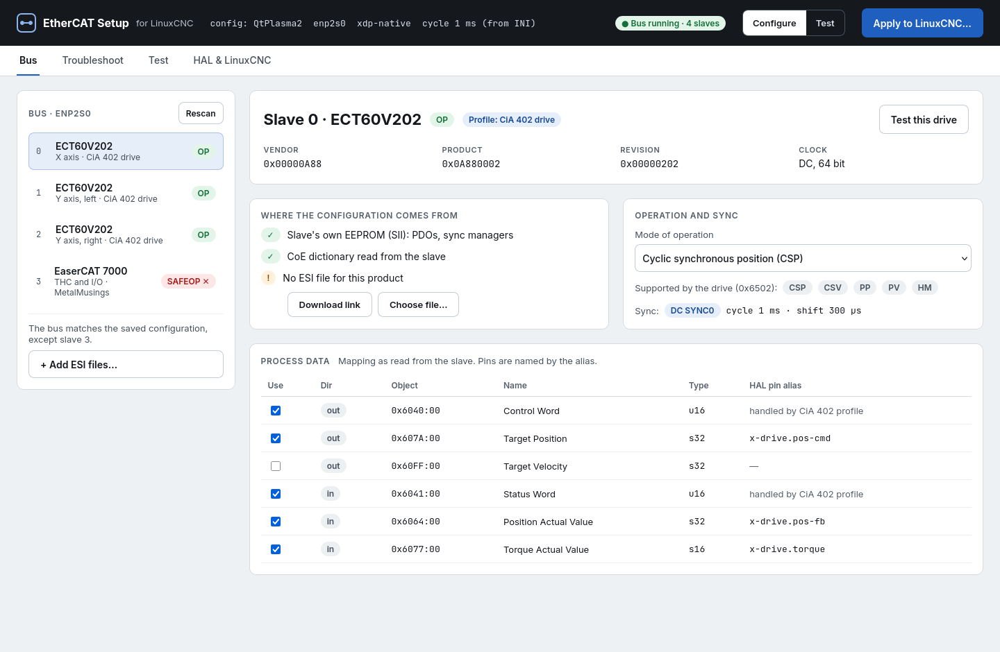
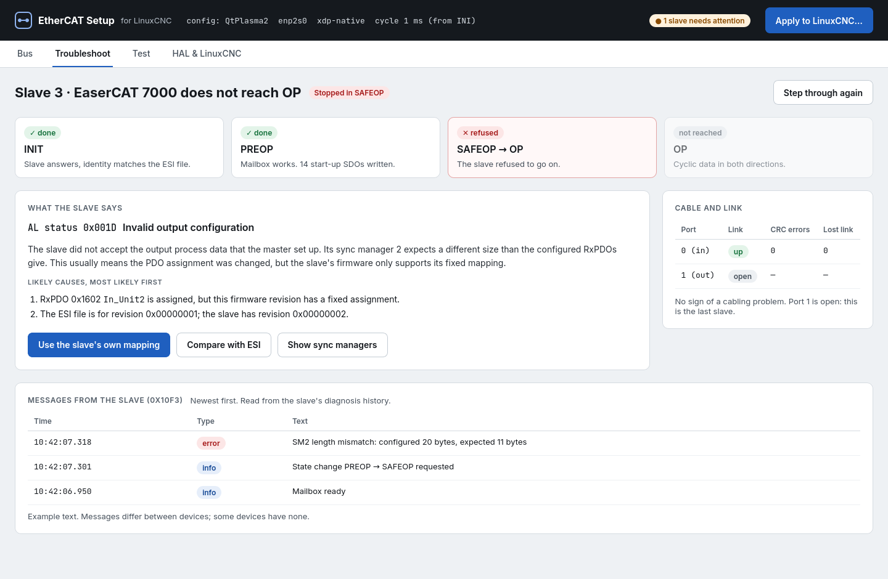
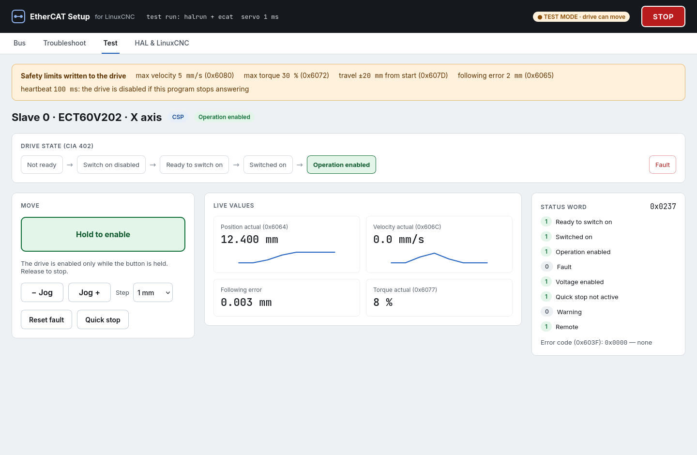
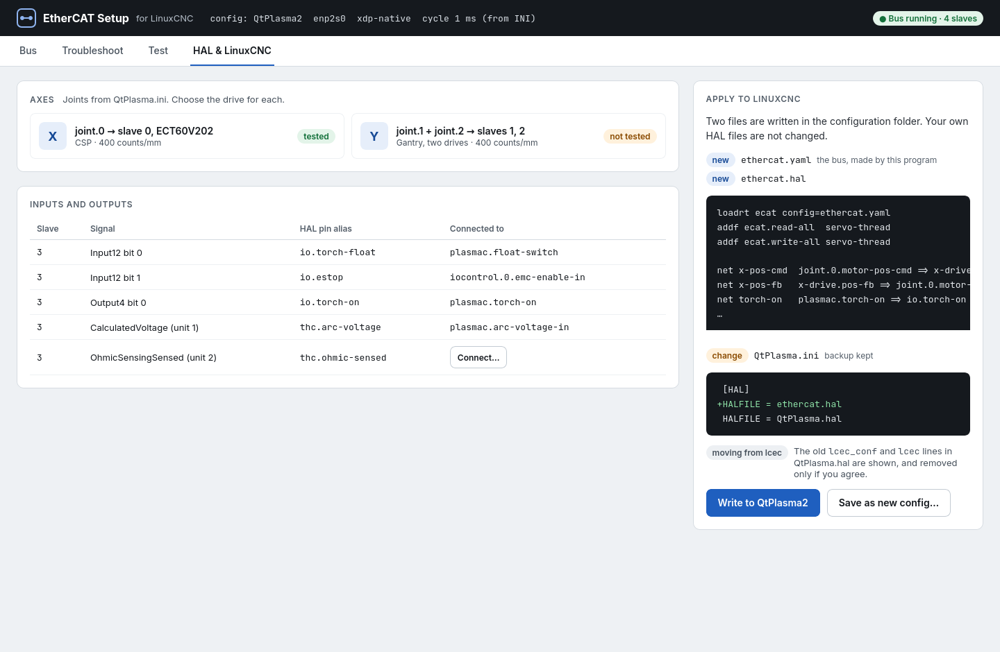

# EtherCAT Setup for LinuxCNC: design draft

Status: **draft for discussion**, 2026-11-08; status of the plan
updated 2026-11-09 (see [Plan](#plan)). Directions will change as parts
are tried on real machines.

## Summary

Today an EtherCAT bus for LinuxCNC is set up by writing an XML file
(`ethercat-conf.xml`) and HAL lines by hand. Many users find this hard to
get right, and when a slave does not work, finding out why takes
knowledge of EtherCAT that most users do not have.

This document proposes:

- **EtherCAT Setup**, an interactive program that shows the slaves on the
  bus, configures them from the slave's own data and its ESI file, helps
  bring up and troubleshoot a slave that does not work, tests it (I/O,
  SDOs, CiA 402 drives, sync modes), connects it to HAL, and writes the
  result into the LinuxCNC configuration;
- a **configuration file written by that program** instead of the
  hand-written XML file, read directly by `ecat`, a new HAL component;
- **device support from data** (ESI, slave data, device profiles)
  instead of one C driver per product.

It is built only for the userspace IgH EtherCAT master. `ecat` grows out
of `lcec_uspace`, linuxcnc-ethercat built against that master, and is
developed in steps, each of which is useful on its own.



## The problem

What a user has to know today:

| Information | Where | What makes it hard |
|---|---|---|
| Which slaves, position, type name | XML | lcec type names and positions must be known |
| Driver options (`modParam`) | XML | Driver documentation must be read |
| PDO mapping for generic slaves | XML | Indexes, subindexes, bit lengths, sync managers |
| Start-up SDOs | XML | Object dictionary and byte order |
| Distributed clocks (`assignActivate`, `sync0Cycle`, shift) | XML | Values from the ESI file |
| `appTimePeriod` | XML | Must match the servo period in the INI file |
| Connections to HAL | HAL file | Pin names must be looked up with `halcmd show` |

Almost all of this can be read from the slave (SII, CoE object
dictionary, 0x1C12/0x1C13, 0x6502), taken from the ESI file (PDO
alternatives, DC modes, init commands), or taken from the INI file (the
servo period). The difficulty is not the XML syntax but that the user
must know what to write.

Many users already use the `generic` device type instead of the
product-specific drivers, because most slaves only need process data and
start-up settings, not product-specific code. What makes `generic` hard is
writing the mapping by hand.

## Goals

- No hand-written bus configuration. The user picks and confirms; the
  program writes the files.
- Bring up a slave that "does not want to": show where it stops, what it
  reports, the likely cause, and what to do.
- Test a slave before it is used in a machine: read and write I/O, read and
  write SDOs, put a CiA 402 drive into operation and move it safely, try
  sync modes.
- Connect slaves to HAL from the program, with readable pin names.
- Move the result into a LinuxCNC configuration without the user editing
  files.
- Let existing lcec XML configurations be imported.

## Non-goals

- The kernel-mode master. Only the userspace master is supported.
- Machine configuration (axes, kinematics, limits, GUI). That remains the
  job of the LinuxCNC configuration and its tools. EtherCAT Setup only
  connects EtherCAT devices to the joints and signals that exist.
- Replacing HAL. The program writes ordinary HAL lines that the user can
  read.

## Overview

```
                 +-------------------------------------+
                 |        EtherCAT Setup (GUI)         |
                 |          Python + PyQt5             |
                 +-------------------------------------+
                    |                   |             |
     scan, SDOs,    |      test mode    |             |  writes
     diagnosis      |   (HAL pins via   |             |
     (IPC socket)   |   the hal module) |             v
                    v                   v       ethercat.yaml
          +-----------------+   +-------------------+  ethercat.hal
          | ec_master       |   | halrun            |  INI changes
          | (ethercat-      |   |  ecat             |        |
          |  uspace start)  |   |  config=...       |        v
          +-----------------+   +-------------------+   LinuxCNC:
                    \               /                   loadrt ecat
                     \             /                    config=ethercat.yaml
                      EtherCAT bus
```

The program uses two parts that already exist, depending on the task:

- **Scan, inspect, SDOs and diagnosis**: a free-running master
  (`ethercat-uspace start`), reached over its IPC socket with the
  `ethercat-uspace` tool's interface. The same works against the master
  inside a running LinuxCNC, for diagnosis while the machine runs.
- **Cyclic tests (I/O, CiA 402, DC)**: `halrun` with `ecat`, the
  generated configuration and a servo thread, without motion. The program
  reads and writes HAL pins through LinuxCNC's Python `hal` module, as
  qtvcp does. What is tested is the same code that runs the machine.

A master built into the program itself would be a third way to the bus,
with its own behaviour to maintain. It is only worth adding if something
turns out to be impossible through the two above.

## The configuration file

`ethercat.yaml` in the machine configuration's folder (format to be
settled; YAML is the working assumption). It is written by EtherCAT Setup
and is not meant to be edited by hand, but it stays a readable text file:
it can be kept under version control, compared, and posted to the forum
when asking for help, and LinuxCNC can start without EtherCAT Setup
installed.

It holds, per slave: position and identity (vendor, product, revision,
serial if the slave has one), the profile and options, the PDO selection,
start-up SDOs, the sync mode, pin aliases and scaling. The servo period is
not repeated; it comes from the INI file.

`ecat` reads the file itself:

```
loadrt ecat config=ethercat.yaml
```

This removes lcec's `loadusr -W lcec_conf ethercat-conf.xml`, and with it
the need for `lcec_conf` and the HAL module to agree on a shared-memory
layout. Existing XML files can be imported (see [Relation to lcec and its
XML files](#relation-to-lcec-and-its-xml-files)).

**Pin aliases**: `ecat` creates pins with names chosen in the
program, such as `x-drive.pos-fb`, instead of `lcec.0.0.actual-position`,
so that HAL files are readable.

## Device support from data

Today's drivers do three different things, which should be handled
differently:

| What a driver does | Examples | Proposal |
|---|---|---|
| Data: PDO mapping, start-up SDOs, DC mode | most Beckhoff drivers | Read from the ESI file and the slave; no code |
| Pins: name, type, direction, scaling | `din-0`, `aout-1-scale` | Made from the PDO entries: type from the ESI data type, name from the ESI or the user's alias |
| Behaviour: logic in every cycle | CiA 402 state machine, encoder overflow, latch, SoE | **Profiles** (below) |

**Profiles** follow standards, not products:

- **CiA 402 (ETG.6010)** for drives: one profile that reads 0x6502 and the
  mapping covers most drives.
- **Modular Device Profile (ETG.5001)**, which Beckhoff and many others
  follow: inputs in 0x6000, outputs in 0x7000, settings in 0x8000. Digital
  I/O, analog I/O and encoder profiles build on this layout.
- **Quirks as data**: a small table per vendor and product for devices that
  need something special (an SDO in PREOP, a known SII error).

lcec's product drivers are not carried over, not even as a fallback; see
[Decision: profiles with quirks, no product
drivers](#decision-profiles-with-quirks-no-product-drivers).

**Data sources**, in order: the slave itself (SII, CoE dictionary), which
says what it is; the ESI file, which says what is possible and what it
means; and the user's choices. Without an ESI file the slave's own data
often goes a long way; with one, names are better and the alternatives
are known.

**ESI files**: many vendors do not allow redistribution, so the program
uses files the user has downloaded (a folder, or one file per device),
with links to where to download them. ESI files vary in quality, one file
may cover several revisions, and modular devices (bus couplers with
slots) need to know which modules are fitted.

**Later**: user comments per device ("works in CSP, needs 0x2010 set"),
shown next to the device, and a shared list of download links.

## Bringing up and troubleshooting a slave

Much of what is needed exists in the master but is shown in a way only
experts understand. The program shows it in plain language:

- **State by state**: INIT → PREOP → SAFEOP → OP, one step at a time.
  Where it stops, the AL status code is explained with its likely causes
  and actions, for example 0x001D/0x001E (process data mapping), 0x0035
  (cycle time), 0x002C/0x0032 (DC sync).
- **The slave's own messages**: the diagnosis history 0x10F3 (ETG.1020),
  where many slaves say exactly what they do not accept.
- **CiA 402**: the status word and error code 0x603F in plain language,
  and what is missing to reach "Operation enabled".
- **Cable and link**: error counters per port (CRC errors, lost link),
  which point at bad cables and connectors.
- **Comparison**: the bus against the configuration, and the slave against
  the ESI file, so a wrong revision or position shows.



## Test mode and safety

Test mode runs `ecat` in `halrun` as described above, so I/O,
SDOs, CiA 402 drives and sync modes are tested with the same code as in
the machine. LinuxCNC must not run at the same time; diagnosis without
motion also works against a running LinuxCNC.

Moving a CiA 402 drive from a test program needs care:

- **No motion without a deliberate act**: the drive stays in "Switched
  on" until the user enables it, with a hold-to-enable button.
- **Heartbeat**: the GUI writes a heartbeat to a HAL pin; if it stops, for
  example because the GUI hangs, the HAL thread disables the drive.
  Safety must not depend on the GUI being alive.
- **Limits written to the drive**: low maximum velocity and torque
  (0x6080, 0x6072), software position limits (0x607D) and a tight
  following-error window (0x6065), set in the drive, not only in the
  program.
- **Careful motion**: jog in small steps or at low velocity, not free
  positioning.
- **Emergency stop**: if the machine's E-stop is wired through EtherCAT
  I/O, test mode can use it.

Built so far (CSP only, see [test-mode.md](../test-mode.md)): hold-to-enable
and jog buttons, the heartbeat through the drive's `watchdog` pin, limits
written to the drive where it has the objects, and velocity,
acceleration and travel limited in HAL by a `limit3`. The ECT60 has no
0x6080, 0x6072 or 0x6065 and ignores 0x607D in CSP, so on it only the
following error (its 0x2022) is set in the drive. The E-stop is not used
yet.



## CiA 402 drives and their modes

The `cia402` profile runs CSP and CSV so far. Machines also need profile
position (PP), profile velocity (PV) and the drive's own homing (HM).
What each mode is for in LinuxCNC decides how it is done:

| Mode | Used for | Who plans the motion |
|---|---|---|
| CSP (8) | a joint | LinuxCNC |
| CSV (9) | a joint with the position loop in LinuxCNC, or a spindle | LinuxCNC |
| PV (3) | a spindle, a conveyor, a pump | the drive (its ramps) |
| PP (1) | positioning that is not coordinated motion: tool changer, indexer, stop, loader; jogging in test mode | the drive (its trajectory) |
| HM (6) | homing a joint or a PP drive by the drive's own method | the drive |
| CST (10) | later | LinuxCNC |

**Principles**

- **A joint stays in a cyclic mode.** LinuxCNC must be the only one that
  plans a joint's motion. PP and PV are for drives that are not joints.
  The exception is homing, below.
- **The modes are in the file.** `cia402: {mode: csp, modes: [hm]}`:
  `mode` is the mode when the drive is enabled, `modes` the others it may
  switch to. The generator checks them against 0x6502 and the mapping;
  the component refuses any other mode.
- **One way to change mode.** The component changes mode in steps: stop
  (halt bit in PP and PV, wait for standstill), write 0x6060, wait for
  0x6061 to follow (a timeout is a fault), take the targets from the
  actual values, run in the new mode. Going back is the same. The drive
  does not jump, and a mode is never changed during a move.
- **The same safety in every mode.** Enable, the shut-down reasons and the
  latch until enable goes false are as for CSP. Added:
  - PP and PV move only after a deliberate act: a rising edge of the start
    pin, or a non-zero velocity command after enable.
  - When enable goes false, a moving drive is halted (control word
    bit 8) and then shut down.
  - Homing and positioning have timeouts.
  - A PP drive gets software limits (0x607D) and a maximum profile
    velocity (0x607F) written to it. The generator proposes them.

**What each mode needs**

| Mode | Process data | Settings (SDOs at start) | Control and status bits |
|---|---|---|---|
| PP | 0x607A target position; 0x6081 profile velocity (or a setting) | 0x6083/0x6084 acceleration/deceleration, 0x607D, 0x607F | cw 4 new set-point, 5 change immediately, 6 relative, 8 halt; sw 10 target reached, 12 set-point acknowledge |
| PV | 0x60FF target velocity; 0x606C actual velocity | 0x6083/0x6084 | cw 8 halt; sw 10 target reached (at speed), 12 speed zero |
| HM | none beyond control and status words | 0x6098 method, 0x6099:01/02 speeds, 0x609A acceleration, 0x607C home offset | cw 4 start; sw 10 target reached, 12 homing attained, 13 homing error |

0x6060 and 0x6061 are required when a drive has more than one mode. The
settings are ordinary `settings` in the file. EtherCAT Setup shows them
with their names, and the homing methods the drive supports (0x60E3)
when it has that object.

**Pins** (proposal; position and velocity in machine units through
`pos-scale` and `velo-scale`):

| Mode | Pins |
|---|---|
| PP | `pp-target`, `pp-velocity`, `pp-start` (rising edge; the set-point handshake is in the component), `pp-relative`, `pp-halt`, `pp-done` |
| PV | `velocity-cmd`, `at-speed`, `zero-speed` |
| HM | `home` (as in the cia402 component), `stat-homed`, `stat-homing`, `home-error` |
| all | `opmode-cmd` to choose among `modes` (0 = `mode`) where that is not given by the pins above; `opmode-display` shows the result |

A spindle in PV connects `spindle.N.speed-out-rps` to `velocity-cmd` and
`at-speed` to `spindle.N.at-speed`. A PP drive is controlled from HAL, for
example from an M-code, `motion.analog-out` or a tool-changer component.

**Homing a joint with the drive's method** can be done in two ways:

1. **Index-enable**, as the cia402 component does. The joint is set up to
   home on an index pulse with zero search velocity. When motion sets
   `index-enable`, the profile switches the drive to HM and starts it.
   When the drive reports homing attained, the profile switches back to
   CSP with the target at the actual position and clears `index-enable`.
   Motion then takes the position as home. This works with existing
   configurations. To check: motion moves the joint at the latch velocity
   while the drive homes, so the following error must not trip.
2. **A LinuxCNC homing module** (`[EMCMOT]HOMEMOD`, LinuxCNC 2.9 and
   later) that hands homing of chosen joints to the drive and waits for
   the profile's `stat-homed` or `home-error`. There is no fake index
   pulse, and `HOME_SEQUENCE` keeps working. It is more work, and it would
   ship with ecat.

The proposal is the first way first, and the second when the first shows
its limits. In both, the drive's actual position after homing is the
home offset, and the profile returns to CSP without a jump.

**Test mode** uses PP and PV to move a drive. The drive plans the ramp, so
EtherCAT Setup can do "move 1 mm at 5 mm/s" or jog slowly without a
trajectory planner in `halrun`, and can try homing methods with HM. It
uses the same pins as a machine.

**Order of work**:

1. HM with index-enable.
2. PV.
3. PP with its set-point handshake.
4. `opmode-cmd`.
5. The homing module.

In the component, each mode is an entry in a table: its number, the
objects it needs, how it is entered, what it writes every cycle and when
it is done. The mode change is then the same code for all modes.

## Integration with LinuxCNC

The program writes, after showing the change and keeping a backup:

```ini
[ETHERCAT]
CONFIG = ethercat.yaml

[HAL]
HALFILE = ethercat.hal      ; before the user's own HAL files
HALFILE = my-machine.hal
```

`ethercat.hal` holds `loadrt ecat config=...`, the `addf` lines and
the connections made in the program. The user's own HAL files are not
changed. When an existing `lcec` configuration is moved over, the old
`lcec_conf` and `lcec` lines in the user's HAL file are shown, and removed
only if the user agrees.

As built (step 5, [linuxcnc.md](../linuxcnc.md)): two files, since the
servo thread exists only once `motmod` is loaded in the user's first HAL
file. `ethercat-load.hal`, the first HALFILE, loads the component;
`ethercat.hal`, the last, adds its functions and connects the joints.
Lines in the user's HAL files that would clash are commented out, shown
first, with a `.bak` copy; their signal names are kept.

At start, `ecat` compares the bus with the file and stops with a
clear message if they differ, such as "slave 2 is an EL2008, the
configuration expects an EL1008; run EtherCAT Setup".



## Relation to lcec and its XML files

**Decided**: the new system is called `ecat`, also the name of its HAL
component, not `lcec_uspace`. It no longer reads lcec's XML files, so the
name should make clear that forum answers, examples and documentation
about lcec and its XML do not apply to it as they are. Its HAL pins are
named by the aliases chosen in the program anyway.

**Decided** (built as `--import`): the new component reads only its own file at run time.
Existing XML files are converted once, by an import in EtherCAT Setup,
which shows what could not be carried over. Generic slaves convert
directly (PDOs, SDOs, DC); slaves with product drivers and `modParam`
options need a translation per driver. The kernel-mode `lcec` and its XML
files are left as they are, for those who do not move.

| Way | Cost | For the user |
|---|---|---|
| Read both XML and the new file at run time | `lcec_conf` and two formats to keep, test and document | Notices nothing; the break is only put off |
| **Only the new file at run time; XML import in the program** | The import, and a translation per driver for `modParam` | Converts once and sees what was not carried over |
| Only the new file, no import | Least | Redoes everything by hand, against the goal of making it easier |

**Devices without a profile** (decided 2026-11-10, see [Decision:
profiles with quirks, no product
drivers](#decision-profiles-with-quirks-no-product-drivers)). The break
with XML mattered less than what happens to today's product drivers. The
two ways that were weighed:

- **Keep the C drivers as a fallback** in the new component. Every device
  that works with lcec today keeps working (EL7041 stepper, encoder
  terminals, AX5000 with SoE and so on). But their options must be
  expressible in the new file, so part of the XML structure moves over
  into the new format, and the old driver interface must be kept.
- **Support only devices covered by profiles**, at least at first:
  CiA 402 drives, MDP I/O, and slaves configured from their own data and
  ESI. The component and its file stay clean, but devices that need
  product-specific logic are not supported until a profile covers them,
  and the import must say so for those slaves.

A middle way was also possible: start with profiles only, and bring over
individual drivers, as profiles or fallback drivers, when users need
them. The choice was profiles only, with quirks as data.

## Decision: profiles with quirks, no product drivers

Decided 2026-11-10. The question was asked for all kinds of devices and
many users, not for the test machines (both of which the existing
profiles already cover).

**Decision.** Devices are supported through profiles that follow
standards, plus quirks kept as data. lcec's per-product C drivers are not
brought over, not even as a fallback. A device that needs logic in every
cycle that no profile covers is not supported until a profile does. The
XML import says so for each such slave. Users who need such a device keep
lcec.

**Why:**

- **Most drivers repeat a standard.** About ten of lcec's 57 drivers
  implement CiA 402 for one vendor each (`rtec`, `rtdrv`,
  `leadshine_stepper`, `deasda`, `dems300`, `omrg5`, `omr1s`, `ommx2`,
  `basic_cia402`, `class_cia402`). Most Beckhoff I/O drivers do what the
  Modular Device Profile layout and the slave's own data already say. One
  profile per standard covers devices whose product nobody has written
  code for.
- **A new device should not need C code and a release.** With product
  drivers, every new product waits for someone to write, test and
  release a driver. With profiles, a device that follows the standard
  works directly, and a quirk is a table entry that a user can propose.
- **Predictable.** The configuration file holds everything that is
  written to a slave: process data, settings and DC. Nothing is added by
  hidden code at start. What the program shows is what happens, and the
  file can be posted when asking for help.
- **`modParam` was the drivers' interface, and its content fits better
  elsewhere.** Going through the `modParam`s of the 17 drivers that have
  them gives three groups:

  | Group | Examples | Replacement |
  |---|---|---|
  | A setting under a readable name, sometimes with a unit or named values | `peakCurrent_amps`, `homeMode`, `input3Func`, `encoderResolution`, `maxCurrent`, `coilResistance`, `ch0Baudrate` | `settings` rows. Name, type and limits come from the dictionary. Description, unit and named values come from the ESI file. Where the ESI file lacks them, a quirk table supplies labels, units and value names. |
  | Which PDOs and pins exist | `enableCSV`, `ciaChannels`, `digitalInChannels`, `enableFB2`, `encoder`, `probe1Positive`, `opmode` | The process data chosen in the program, and the profile's options (`cia402.mode`, `modes`, `encoders`) |
  | Logic in every cycle | FSoE (`fsoeSlaveIdx`), SoE drives (AX5000) | None. Not supported. |

  Keeping the C drivers as a fallback would have meant bringing group 2
  and 3 options into the new file format and keeping the old driver
  interface, for little gain over group 1 settings.

**Cost, accepted:** SoE drives (`ax5100`, `ax5200`, `class_ax5`), safety
devices (`el6900`, `el1918_logic`, `el1904`, `el2904`, `ax5805`) and
special cases (`el6090` display, `el3403` power measurement, `stmds5k`,
`ph3lm2rm`) are not supported. Until a profile covers them, the stepper
and analog terminals work only as `generic` slaves, without the
convenience lcec's drivers give.

**Profiles:**

| Profile | Covers (lcec drivers) | State |
|---|---|---|
| `cia402` | the CiA 402 drivers above; EL72xx/EL7411 in CiA 402 mode | Done, one axis per slave |
| `mdp`, `generic` | digital I/O (`el1xxx`, `el2xxx`, `el2202`, `digitalcombo`, `easyio`, `epocat`, `ex260`, `ep9214`), status bits (`el95xx`, `el9410`), `passive` | Done |
| Encoder (MDP 511) | `el5101`, `el5151`, `el5152`, the encoder channels of `el7342`/`em7004` | Done |
| `cia402` with several axes per slave | two-axis drives (`ECT60x2`, `ECR60x2`), EL72xx with channel offset | Next. An extension of `cia402`. |
| Analog I/O (MDP) | `el3xxx`, `el31x2`, `el3255`, `el4xxx`, `el41x2` | Next. The value is scaled to a float pin from the range, status becomes a fault pin, and the 0x80n0 channel settings become named settings. |
| Stepper and DC motor terminals, velocity mode | `el7041`, `el70x1`, `el7342`, `el2521` | Later. Velocity command, enable, ready and warnings, and position from the encoder channel. |
| Absolute encoders (SSI, EnDat) | `el5002`, `el5032` | Check first whether `generic` plus settings is enough. |

The order is set by what users run; analog I/O and the EL7041 are
probably the most common among LinuxCNC users with Beckhoff terminals.

**Quirks** are a table per vendor, product and, where needed, revision.
EtherCAT Setup uses them when it proposes a configuration. An entry can
hold:

- settings a device needs at start;
- labels, units and value names for vendor objects;
- corrections of known SII or ESI errors;
- limits a device ignores. For example, the ECT60 ignores 0x607D in CSP,
  `LIMIT_QUIRKS` in `drivetest.py`.

Quirks act through what they put into `ethercat.yaml`, so the component
needs no quirk table. The configuration stays complete and predictable.

**Importing lcec XML** translates group 1 `modParam`s into settings rows,
and group 2 into process data and profile options, driver by driver. It
starts with the common drivers (`rtec`, `rtdrv`, `leadshine_stepper`,
`el7041`, `class_cia402`). Group 3 gets a note.

## Technology

- **Python and PyQt5**: present in every LinuxCNC installation, known in
  the community, and LinuxCNC's `hal` module is available.
- **EtherCAT access** through the userspace master's IPC socket and HAL.
  No new C bindings at first.
- **`ecat`**, the HAL component, starts from `lcec_uspace`'s code (moved
  with its git history) and gains reading of `ethercat.yaml`, pin aliases
  and profile-based device support.

## Decided questions

Questions that were open in this draft, with the answer and where it is
described.

- **Upstream** (2026-11-10): ecat breaks with linuxcnc-ethercat (lcec).
  It keeps no backward compatibility with lcec, and future upstream
  changes to lcec are not pulled in: the code taken from lcec is ecat's
  own and changes as ecat needs. lcec configurations reach ecat through
  the one-time XML import. The userspace IgH master
  ([MetalMusings/ethercat](https://github.com/MetalMusings/ethercat)) is
  not part of this break: it is developed actively as part of the
  project, and ecat is built on it.
- **Several masters** (2026-11-10): one master and one bus. A
  configuration has one `master`; the component's pins are `ecat.0.*`.
- **Identifying slaves** (2026-11-10): by position and type, and checked
  in test mode (jog X and see which motor moves). Some slaves report
  serial number 0 (the ECT60 drives on the test machine), so nothing
  better is known; swapped drives of the same type are not noticed
  automatically.
- **File format**: YAML, `ethercat.yaml`
  ([config-format.md](../config-format.md)).
- **Scaling**: in HAL, as today. `ethercat.hal` sets each joint's
  `pos-scale` from `linuxcnc.joints` ([linuxcnc.md](../linuxcnc.md)).
- **INI keys**: `[ETHERCAT]CONFIG`, and `HALFILE = ethercat-load.hal`
  first and `HALFILE = ethercat.hal` last ([linuxcnc.md](../linuxcnc.md)).
- **Joints and gantries**, for now: EtherCAT Setup connects joints to
  CiA 402 drives in CSP. Gantries, CSV drives, home and limit switches,
  and I/O such as an E-stop are connected in the user's HAL files
  ([linuxcnc.md](../linuxcnc.md)).
- **CiA 402 homing**: `index-enable` with the drive's own homing
  (`modes: [hm]`); no homing module. Tried on the plasma cutter's X axis
  ([cia402.md](../cia402.md)). How drives differ in PP mode (the
  set-point handshake, profile velocity as process data or a setting) is
  handled as quirks ([Decision: profiles with quirks, no product
  drivers](#decision-profiles-with-quirks-no-product-drivers)).
- **Devices without a profile**: profiles with quirks, no product
  drivers ([Decision: profiles with quirks, no product
  drivers](#decision-profiles-with-quirks-no-product-drivers)).

## Open questions

- **Modular devices**: how slots and modules are detected and chosen.
- **ESI files**: licensing, finding the right file and revision.

## Plan

Each step is useful on its own; the order may change as parts are tried.

1. **Prototype the core idea**: read ESI files, SII and the CoE dictionary
   (Python, no GUI) and propose PDO mapping, DC mode and pins for the
   slaves on a real bus. Compare with a hand-written XML configuration
   known to work.
2. **Data model and file**: `ethercat.yaml`, `ecat config=...`,
   pin aliases, import of XML files.
3. **Generator without GUI**: scan, match profiles, write the file (a
   successor to `lcec_configgen`).
4. **Test mode and troubleshooting**: the GUI on top of `halrun` and the
   master's IPC. The CiA 402 modes PP, PV and HM come before or with it,
   since test mode moves drives with them.
5. **HAL and LinuxCNC integration**: `ethercat.hal`, INI changes, the start
   check.
6. **Later**: ESI download links, user comments per device.

Where it stands (2026-11-09): steps 1-3 are done (`ecatsetup` on the
command line, `ethercat.yaml`, the `ecat` component, which runs the
plasma cutter). Of step 4, the window has the Bus, Troubleshoot, Test
and HAL & LinuxCNC pages; test mode covers I/O, SDOs and moving a CSP
drive, tried on three axes. Moving a drive in PP, PV or HM from the
window is not built; the profile has those modes. Of step 5, writing the
file, `ethercat-load.hal`, `ethercat.hal` (joints connected to CSP drives)
and the INI changes is built and tried on a copy of the plasma cutter's
configuration and run in LinuxCNC; connecting I/O pins from the program
and the start check are not built.

## Mockups

The screens in this document are mockups without function, made to show
the idea. Slave identities and PDOs are read from the test machine's bus;
messages, limits and values are examples.
