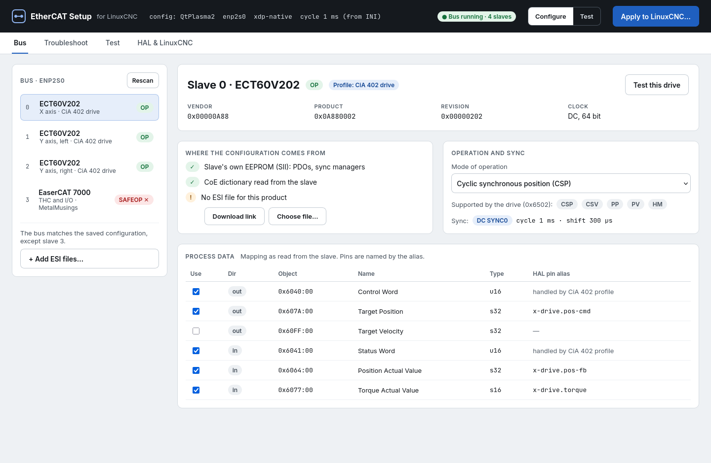
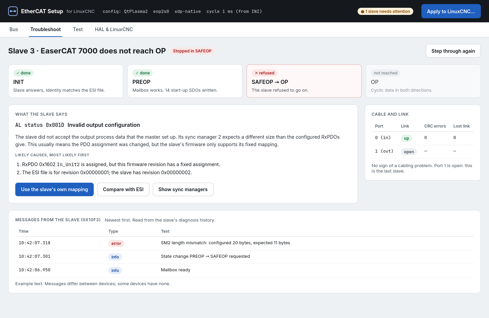
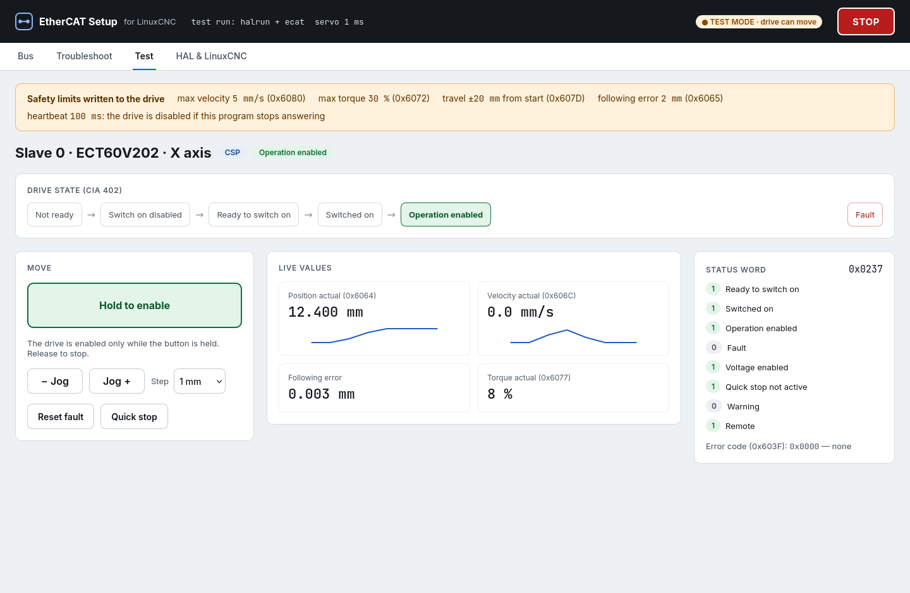
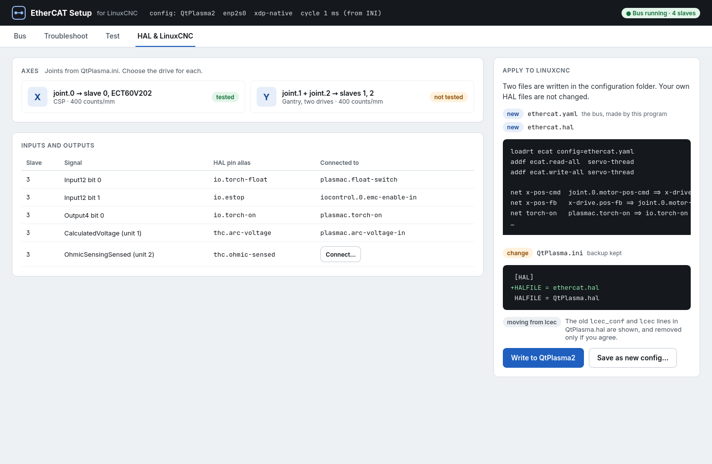

# Developing ecat

For whoever works on ecat itself: how to build and test it, the design
draft, what the prototype found on a real bus, and the plan for tests at
a machine.

## Build and test

```
scripts/run-tests                          # Python tests, modules in parallel
scripts/run-tests gui wiring               # only some modules
python3 -m unittest discover -s tests      # Python tests, one process
make -C component                          # ecat.so
make -C component check                    # C unit tests
scripts/check-component-2.9                # the same against LinuxCNC 2.9 (in a copy)
scripts/build-deb.sh -w -o <dir>           # package from the working tree
```

- The component needs LinuxCNC 2.10 (`linuxcnc-uspace-dev`, or a run-in-place
  build: `. <linuxcnc>/scripts/rip-environment` in the shell first, so that
  `halcompile` is on the PATH), `libyaml-dev` (and `libmodbus-dev` for the
  C tests: the serial channels' Modbus RTU test), and the master
  package's headers in `/opt/linuxcnc-ethercat-uspace/include`. Set
  `USPACE_ETHERCAT=` to use another master install. To install it from
  the checkout: `make -C component install`.
- `make check` runs the cia402 profile's and the encoder function's read
  and write functions cycle by cycle against a fake of HAL and the master
  (`component/tests/fake.c`), without a bus, and reads configuration
  files into the records the component is set up from, checking the
  records and the errors.
- The window's tests run offscreen against a fake bus and are skipped
  without PyQt5.
- `scripts/run-tests` runs each test module in a process of its own, as many
  at a time as there are CPUs (`-j`), and lists every module with its time
  and test count: about 30 s on an N100, against 45 s in one process. A
  module that runs no tests counts as failed (two modules had tests that
  never ran: one in pytest style, one with a block that cut its class).
- The *HAL & LinuxCNC* page is built only while it is shown (its pin table
  is the slowest part of the window to fill): a window test that reads it
  shows it first (`WindowBase.hal(w)`).
- `scripts/docs-screenshots [NAME ...]` takes the window's screenshots in
  `docs/images` again, offscreen against the same fake bus (no event log,
  English messages, only the quirk files that come with the program; the
  HAL pages with a three-joint machine "mill" in a temporary folder;
  `gui-response` from two recordings of the simulated drive on the bus in
  `tests/data/response-simdrive-*.samples`, which `tests/test_response.py`
  also analyses). Take
  them again when the window changes, look at them, and keep an unchanged
  picture out of the commit (`gui-hal-apply` shows the temporary folder's
  name).
- **Fake slaves from a capture** ([A capture of the
  bus](ecatsetup.md#a-capture-of-the-bus)). In Python, `capture.Replay`
  answers the ethercat tool's calls from a capture
  (`tests/test_capture.py`). For C, `ecatsetup --capture-c CAPTURE --c-name
  NAME > component/tests/captured_NAME.h` writes each slave's identity, its
  process data entries as assigned on the bus (from `pdos`, outputs first,
  gaps left out) as `fake_entry_t` lists, and a `fake_capture_slave_t`
  table. If the capture has frames of a bus in SAFEOP or OP, it adds the
  values of every entry for each cycle (at most 1000; 32 bits kept),
  read from the returned LRW/LRD/LWR datagrams through the slave's FMMU and
  sync manager registers (`--c-cycles N` keeps fewer). `fake_capture_slave()` makes the slave, and
  `fake_capture_inputs()` puts a cycle's inputs into the process data.
  `fake_capture_output()` gives what the master sent, to compare with what a
  profile writes. `component/tests/test_captured.c` runs the cia402
  profile on the ECT60's own layout from `captured_plasma.h`, which comes
  from `tests/data/capture-ect60-easercat.tar.gz` (PREOP: no cycles), and
  on the cycles of `captured_plasma_op.h` (`tests/data/capture-plasma-op.tar.gz`:
  the plasma cutter in OP under ecat in halrun, drives not enabled, the
  frames cut to 200; 20 cycles): fed the inputs the drives sent, the profile
  writes the control word, mode and target position that were on the bus.
  `tests/test_capturec.py` checks that both headers are current.
- **The archive for a run-in-place LinuxCNC** (`scripts/build-rip-archive`, run
  after `. <linuxcnc>/scripts/rip-environment`; `-w` for the working tree):
  `ecat-rip-<version>-<distro>.tar.gz` with `ecat.so` (libyaml linked in,
  `make YAML_STATIC=1`), EtherCAT Setup, `install` (`packaging/install-rip`)
  and `ecat-abi.sha256`: the checksums of the LinuxCNC headers `ecat.so`
  includes (from the compiler's `.d` files), with `BUILD-INFO` naming the
  LinuxCNC commit. `install` runs `sha256sum -c` over the user's
  `<tree>/include` and refuses on any difference: ecat.so is tied to the HAL
  API it was built with, and 2.10 is a pre-release whose API changed as late as
  October 2026. The CI builds the archive at the pinned LinuxCNC commit
  (`LINUXCNC_COMMIT` in `deb.yml`); moving that commit moves what the release
  supports. A user on another commit builds from source (`. rip-environment`,
  `make -C component install`, EtherCAT Setup from the checkout with
  `linuxcnc: <tree>` in `~/.config/ecatsetup/settings.yaml`). The tests of the
  installer are `tests/test_install_rip.py`.
- EtherCAT Setup works with the LinuxCNC named in `settings.yaml` (`linuxcnc:`),
  in `$ECATSETUP_LINUXCNC`, or the one the shell is in (`$EMC2_HOME`), else the
  installed one (`ecatsetup/lcnc_env.py`): it reads that tree's
  `scripts/rip-environment` for `halrun`, `halcmd` and `tclsh` and takes the
  HAL library (`hallib`) from it. The window shows which one in its status bar.
  `lcnc_env.series()` is that LinuxCNC's series ((2, 9) or (2, 10); the tree's
  `VERSION`, else `linuxcnc_var LINUXCNCVERSION`; unknown is (2, 10));
  `$ECATSETUP_LINUXCNC_SERIES` overrides it, and every test module sets it to
  2.10 unless a test says otherwise (`tests/test_series.py`).
- `scripts/build-deb.sh` runs both test suites and builds the package for
  Debian 12 and 13 (`.github/workflows/deb.yml` does so for releases).

## Design draft

Status: **draft for discussion**, 2026-11-08; status of the plan
updated 2026-11-09 (see [Plan](#plan)). Directions will change as parts
are tried on real machines.

### Summary

Today an EtherCAT bus for LinuxCNC is set up by writing an XML file
(`ethercat-conf.xml`) and HAL lines by hand. Many users find this hard to
get right, and when a slave does not work, finding out why takes
knowledge of EtherCAT that most users do not have.

This draft proposes:

- **EtherCAT Setup**, an interactive program that shows the slaves on the
  bus, configures them from the slave's own data and its ESI file, helps
  bring up and troubleshoot a slave that does not work, tests it (I/O,
  SDOs, CiA 402 drives, sync modes), connects it to HAL, and writes the
  result into the LinuxCNC configuration;
- a **configuration file written by that program** instead of the
  hand-written XML file, read directly by `ecat`, a new HAL component;
- **device support from data** (ESI, slave data, device profiles)
  instead of one C driver per product.

It is built only for the userspace IgH EtherCAT master. `ecat` grows out
of `lcec_uspace`, linuxcnc-ethercat built against that master, and is
developed in steps, each of which is useful on its own.



### The problem

What a user has to know today:

| Information | Where | What makes it hard |
|---|---|---|
| Which slaves, position, type name | XML | lcec type names and positions must be known |
| Driver options (`modParam`) | XML | Driver documentation must be read |
| PDO mapping for generic slaves | XML | Indexes, subindexes, bit lengths, sync managers |
| Start-up SDOs | XML | Object dictionary and byte order |
| Distributed clocks (`assignActivate`, `sync0Cycle`, shift) | XML | Values from the ESI file |
| `appTimePeriod` | XML | Must match the servo period in the INI file |
| Connections to HAL | HAL file | Pin names must be looked up with `halcmd show` |

Almost all of this can be read from the slave (SII, CoE object
dictionary, 0x1C12/0x1C13, 0x6502), taken from the ESI file (PDO
alternatives, DC modes, init commands), or taken from the INI file (the
servo period). The difficulty is not the XML syntax but that the user
must know what to write.

Many users already use the `generic` device type instead of the
product-specific drivers, because most slaves only need process data and
start-up settings, not product-specific code. What makes `generic` hard is
writing the mapping by hand.

### Goals

- No hand-written bus configuration. The user picks and confirms; the
  program writes the files.
- Bring up a slave that "does not want to": show where it stops, what it
  reports, the likely cause, and what to do.
- Test a slave before it is used in a machine: read and write I/O, read and
  write SDOs, put a CiA 402 drive into operation and move it safely, try
  sync modes.
- Connect slaves to HAL from the program, with readable pin names.
- Move the result into a LinuxCNC configuration without the user editing
  files.
- Let existing lcec XML configurations be imported.

### Non-goals

- The kernel-mode master. Only the userspace master is supported.
- Machine configuration (axes, kinematics, limits, GUI). That remains the
  job of the LinuxCNC configuration and its tools. EtherCAT Setup only
  connects EtherCAT devices to the joints and signals that exist.
- Replacing HAL. The program writes ordinary HAL lines that the user can
  read.

### Overview

```
                 +-------------------------------------+
                 |        EtherCAT Setup (GUI)         |
                 |          Python + PyQt5             |
                 +-------------------------------------+
                    |                   |             |
     scan, SDOs,    |      test mode    |             |  writes
     diagnosis      |   (HAL pins via   |             |
     (IPC socket)   |   the hal module) |             v
                    v                   v       ethercat.yaml
          +-----------------+   +-------------------+  ethercat.hal
          | ec_master       |   | halrun            |  INI changes
          | (ethercat-      |   |  ecat             |        |
          |  uspace start)  |   |  config=...       |        v
          +-----------------+   +-------------------+   LinuxCNC:
                    \               /                   loadrt ecat
                     \             /                    config=ethercat.yaml
                      EtherCAT bus
```

The program uses two parts that already exist, depending on the task:

- **Scan, inspect, SDOs and diagnosis**: a free-running master
  (`ethercat-uspace start`), reached over its IPC socket with the
  `ethercat-uspace` tool's interface. The same works against the master
  inside a running LinuxCNC, for diagnosis while the machine runs.
- **Cyclic tests (I/O, CiA 402, DC)**: `halrun` with `ecat`, the
  generated configuration and a servo thread, without motion. The program
  reads and writes HAL pins through LinuxCNC's Python `hal` module, as
  qtvcp does. What is tested is the same code that runs the machine.

A master built into the program itself would be a third way to the bus,
with its own behaviour to maintain. It is only worth adding if something
turns out to be impossible through the two above.

### The configuration file

`ethercat.yaml` in the machine configuration's folder (format to be
settled; YAML is the working assumption). It is written by EtherCAT Setup
and is not meant to be edited by hand, but it stays a readable text file:
it can be kept under version control, compared, and posted to the forum
when asking for help, and LinuxCNC can start without EtherCAT Setup
installed.

It holds, per slave: position and identity (vendor, product, revision,
serial if the slave has one), the profile and options, the PDO selection,
start-up SDOs, the sync mode, pin aliases and scaling. The servo period is
not repeated; it comes from the INI file.

`ecat` reads the file itself:

```
loadrt ecat config=ethercat.yaml
```

This removes lcec's `loadusr -W lcec_conf ethercat-conf.xml`, and with it
the need for `lcec_conf` and the HAL module to agree on a shared-memory
layout. Existing XML files can be imported (see [Relation to lcec and its
XML files](#relation-to-lcec-and-its-xml-files)).

**Pin aliases**: `ecat` creates pins with names chosen in the
program, such as `x-drive.pos-fb`, instead of `lcec.0.0.actual-position`,
so that HAL files are readable.

### Device support from data

Today's drivers do three different things, which should be handled
differently:

| What a driver does | Examples | Proposal |
|---|---|---|
| Data: PDO mapping, start-up SDOs, DC mode | most Beckhoff drivers | Read from the ESI file and the slave; no code |
| Pins: name, type, direction, scaling | `din-0`, `aout-1-scale` | Made from the PDO entries: type from the ESI data type, name from the ESI or the user's alias |
| Behaviour: logic in every cycle | CiA 402 state machine, encoder overflow, latch, SoE | **Profiles** (below) |

**Profiles** follow standards, not products:

- **CiA 402 (ETG.6010)** for drives: one profile that reads 0x6502 and the
  mapping covers most drives.
- **Modular Device Profile (ETG.5001)**, which Beckhoff and many others
  follow: inputs in 0x6000, outputs in 0x7000, settings in 0x8000. Digital
  I/O, analog I/O and encoder profiles build on this layout.
- **Quirks as data**: a small table per vendor and product for devices that
  need something special (an SDO in PREOP, a known SII error).

lcec's product drivers are not carried over, not even as a fallback; see
[Decision: profiles with quirks, no product
drivers](#decision-profiles-with-quirks-no-product-drivers).

**Data sources**, in order: the slave itself (SII, CoE dictionary), which
says what it is; the ESI file, which says what is possible and what it
means; and the user's choices. Without an ESI file the slave's own data
often goes a long way; with one, names are better and the alternatives
are known.

**ESI files**: many vendors do not allow redistribution, so the program
uses files the user has downloaded (a folder, or one file per device),
with links to where to download them. ESI files vary in quality, one file
may cover several revisions, and modular devices (bus couplers with
slots) need to know which modules are fitted.

**Later**: user comments per device ("works in CSP, needs 0x2010 set"),
shown next to the device, and a shared list of download links.

### Bringing up and troubleshooting a slave

Much of what is needed exists in the master but is shown in a way only
experts understand. The program shows it in plain language:

- **State by state**: INIT → PREOP → SAFEOP → OP, one step at a time.
  Where it stops, the AL status code is explained with its likely causes
  and actions, for example 0x001D/0x001E (process data mapping), 0x0035
  (cycle time), 0x002C/0x0032 (DC sync).
- **The slave's own messages**: the diagnosis history 0x10F3 (ETG.1020),
  where many slaves say exactly what they do not accept.
- **CiA 402**: the status word and error code 0x603F in plain language,
  and what is missing to reach "Operation enabled".
- **Cable and link**: error counters per port (CRC errors, lost link),
  which point at bad cables and connectors.
- **Comparison**: the bus against the configuration, and the slave against
  the ESI file, so a wrong revision or position shows.



### Test mode and safety

Test mode runs `ecat` in `halrun` as described above, so I/O,
SDOs, CiA 402 drives and sync modes are tested with the same code as in
the machine. LinuxCNC must not run at the same time; diagnosis without
motion also works against a running LinuxCNC.

Moving a CiA 402 drive from a test program needs care:

- **No motion without a deliberate act**: the drive stays in "Switched
  on" until the user enables it, with a hold-to-enable button.
- **Heartbeat**: the GUI writes a heartbeat to a HAL pin; if it stops, for
  example because the GUI hangs, the HAL thread disables the drive.
  Safety must not depend on the GUI being alive.
- **Limits written to the drive**: low maximum velocity and torque
  (0x6080, 0x6072), software position limits (0x607D) and a tight
  following-error window (0x6065), set in the drive, not only in the
  program.
- **Careful motion**: jog in small steps or at low velocity, not free
  positioning.
- **Emergency stop**: if the machine's E-stop is wired through EtherCAT
  I/O, test mode can use it.

Built so far (CSP only, see [the workbench](ecatsetup.md#the-workbench)): hold-to-enable
and jog buttons, the heartbeat through the drive's `watchdog` pin, limits
written to the drive where it has the objects, and velocity,
acceleration and travel limited in HAL by a `limit3`. The ECT60 has no
0x6080, 0x6072 or 0x6065 and ignores 0x607D in CSP, so on it only the
following error (its 0x2022) is set in the drive. The E-stop is not used
yet.



### CiA 402 drives and their modes

The `cia402` profile runs CSP and CSV so far. Machines also need profile
position (PP), profile velocity (PV) and the drive's own homing (HM).
What each mode is for in LinuxCNC decides how it is done:

| Mode | Used for | Who plans the motion |
|---|---|---|
| CSP (8) | a joint | LinuxCNC |
| CSV (9) | a joint with the position loop in LinuxCNC, or a spindle | LinuxCNC |
| PV (3) | a spindle, a conveyor, a pump | the drive (its ramps) |
| PP (1) | positioning that is not coordinated motion: tool changer, indexer, stop, loader; jogging in test mode | the drive (its trajectory) |
| HM (6) | homing a joint or a PP drive by the drive's own method | the drive |
| CST (10) | later | LinuxCNC |

**Principles**

- **A joint stays in a cyclic mode.** LinuxCNC must be the only one that
  plans a joint's motion. PP and PV are for drives that are not joints.
  The exception is homing, below.
- **The modes are in the file.** `cia402: {mode: csp, modes: [hm]}`:
  `mode` is the mode when the drive is enabled, `modes` the others it may
  switch to. The generator checks them against 0x6502 and the mapping;
  the component refuses any other mode.
- **One way to change mode.** The component changes mode in steps: stop
  (halt bit in PP and PV, wait for standstill), write 0x6060, wait for
  0x6061 to follow (a timeout is a fault), take the targets from the
  actual values, run in the new mode. Going back is the same. The drive
  does not jump, and a mode is never changed during a move.
- **The same safety in every mode.** Enable, the shut-down reasons and the
  latch until enable goes false are as for CSP. Added:
  - PP and PV move only after a deliberate act: a rising edge of the start
    pin, or a non-zero velocity command after enable.
  - When enable goes false, a moving drive is halted (control word
    bit 8) and then shut down.
  - Homing and positioning have timeouts.
  - A PP drive gets software limits (0x607D) and a maximum profile
    velocity (0x607F) written to it. The generator proposes them.

**What each mode needs**

| Mode | Process data | Settings (SDOs at start) | Control and status bits |
|---|---|---|---|
| PP | 0x607A target position; 0x6081 profile velocity (or a setting) | 0x6083/0x6084 acceleration/deceleration, 0x607D, 0x607F | cw 4 new set-point, 5 change immediately (off by default: the ECT60 did not move with it), 6 relative, 8 halt; sw 10 target reached, 12 set-point acknowledge |
| PV | 0x60FF target velocity; 0x606C actual velocity | 0x6083/0x6084 | cw 8 halt; sw 10 target reached (at speed), 12 speed zero |
| HM | none beyond control and status words | 0x6098 method, 0x6099:01/02 speeds, 0x609A acceleration, 0x607C home offset | cw 4 start; sw 10 target reached, 12 homing attained, 13 homing error |

0x6060 and 0x6061 are required when a drive has more than one mode. The
settings are ordinary `settings` in the file. EtherCAT Setup shows them
with their names, and the homing methods the drive supports (0x60E3)
when it has that object.

**Pins** (proposal; position and velocity in machine units through
`pos-scale` and `velo-scale`):

| Mode | Pins |
|---|---|
| PP | `pp-target`, `pp-velocity`, `pp-start` (rising edge; the set-point handshake is in the component), `pp-relative`, `pp-halt`, `pp-done` |
| PV | `velocity-cmd`, `at-speed`, `zero-speed` |
| HM | `home` (as in the cia402 component), `stat-homed`, `stat-homing`, `home-error` |
| all | `opmode-cmd` to choose among `modes` (0 = `mode`) where that is not given by the pins above; `opmode-display` shows the result |

A spindle in PV connects `spindle.N.speed-out-rps` to `velocity-cmd` and
`at-speed` to `spindle.N.at-speed`. A PP drive is controlled from HAL, for
example from an M-code, `motion.analog-out` or a tool-changer component.

**Homing a joint with the drive's method** can be done in two ways:

1. **Index-enable**, as the cia402 component does. The joint is set up to
   home on an index pulse with zero search velocity. When motion sets
   `index-enable`, the profile switches the drive to HM and starts it.
   When the drive reports homing attained, the profile switches back to
   CSP with the target at the actual position and clears `index-enable`.
   Motion then takes the position as home. This works with existing
   configurations. To check: motion moves the joint at the latch velocity
   while the drive homes, so the following error must not trip.
2. **A LinuxCNC homing module** (`[EMCMOT]HOMEMOD`, LinuxCNC 2.9 and
   later) that hands homing of chosen joints to the drive and waits for
   the profile's `stat-homed` or `home-error`. There is no fake index
   pulse, and `HOME_SEQUENCE` keeps working. It is more work, and it would
   ship with ecat.

The proposal is the first way first, and the second when the first shows
its limits. In both, the drive's actual position after homing is the
home offset, and the profile returns to CSP without a jump.

**Test mode** uses PP and PV to move a drive. The drive plans the ramp, so
EtherCAT Setup can do "move 1 mm at 5 mm/s" or jog slowly without a
trajectory planner in `halrun`, and can try homing methods with HM. It
uses the same pins as a machine.

**Order of work**:

1. HM with index-enable.
2. PV.
3. PP with its set-point handshake.
4. `opmode-cmd`.
5. The homing module.

In the component, each mode is an entry in a table: its number, the
objects it needs, how it is entered, what it writes every cycle and when
it is done. The mode change is then the same code for all modes.

### Integration with LinuxCNC

The program writes, after showing the change and keeping a backup:

```ini
[ETHERCAT]
CONFIG = ethercat.yaml

[HAL]
HALFILE = ethercat.hal      ; before the user's own HAL files
HALFILE = my-machine.hal
```

`ethercat.hal` holds `loadrt ecat config=...`, the `addf` lines and
the connections made in the program. The user's own HAL files are not
changed. When an existing `lcec` configuration is moved over, the old
`lcec_conf` and `lcec` lines in the user's HAL file are shown, and removed
only if the user agrees.

As built (step 5, [writing into LinuxCNC](ecatsetup.md#writing-the-configuration-into-linuxcnc)): two files, since the
servo thread exists only once `motmod` is loaded in the user's first HAL
file. `ethercat-load.hal`, the first HALFILE, loads the component;
`ethercat.hal`, the last, adds its functions and connects the joints.
Lines in the user's HAL files that would clash are commented out, shown
first, with a `.bak` copy; their signal names are kept.

At start, `ecat` compares the bus with the file and stops with a
clear message if they differ, such as "slave 2 is an EL2008, the
configuration expects an EL1008; run EtherCAT Setup".



### Relation to lcec and its XML files

**Decided**: the new system is called `ecat`, also the name of its HAL
component, not `lcec_uspace`. It no longer reads lcec's XML files, so the
name should make clear that forum answers, examples and documentation
about lcec and its XML do not apply to it as they are. Its HAL pins are
named by the aliases chosen in the program anyway.

**Decided** (built as `--import`): the new component reads only its own file at run time.
Existing XML files are converted once, by an import in EtherCAT Setup,
which shows what could not be carried over. Generic slaves convert
directly (PDOs, SDOs, DC); slaves with product drivers and `modParam`
options need a translation per driver. The kernel-mode `lcec` and its XML
files are left as they are, for those who do not move.

| Way | Cost | For the user |
|---|---|---|
| Read both XML and the new file at run time | `lcec_conf` and two formats to keep, test and document | Notices nothing; the break is only put off |
| **Only the new file at run time; XML import in the program** | The import, and a translation per driver for `modParam` | Converts once and sees what was not carried over |
| Only the new file, no import | Least | Redoes everything by hand, against the goal of making it easier |

**Devices without a profile** (decided 2026-11-10, see [Decision:
profiles with quirks, no product
drivers](#decision-profiles-with-quirks-no-product-drivers)). The break
with XML mattered less than what happens to today's product drivers. The
two ways that were weighed:

- **Keep the C drivers as a fallback** in the new component. Every device
  that works with lcec today keeps working (EL7041 stepper, encoder
  terminals, AX5000 with SoE and so on). But their options must be
  expressible in the new file, so part of the XML structure moves over
  into the new format, and the old driver interface must be kept.
- **Support only devices covered by profiles**, at least at first:
  CiA 402 drives, MDP I/O, and slaves configured from their own data and
  ESI. The component and its file stay clean, but devices that need
  product-specific logic are not supported until a profile covers them,
  and the import must say so for those slaves.

A middle way was also possible: start with profiles only, and bring over
individual drivers, as profiles or fallback drivers, when users need
them. The choice was profiles only, with quirks as data.

### Decision: profiles with quirks, no product drivers

Decided 2026-11-10. The question was asked for all kinds of devices and
many users, not for the test machines (both of which the existing
profiles already cover).

**Decision.** Devices are supported through profiles that follow
standards, plus quirks kept as data. lcec's per-product C drivers are not
brought over, not even as a fallback. A device that needs logic in every
cycle that no profile covers is not supported until a profile does. The
XML import says so for each such slave. Users who need such a device keep
lcec.

**Why:**

- **Most drivers repeat a standard.** About ten of lcec's 57 drivers
  implement CiA 402 for one vendor each (`rtec`, `rtdrv`,
  `leadshine_stepper`, `deasda`, `dems300`, `omrg5`, `omr1s`, `ommx2`,
  `basic_cia402`, `class_cia402`). Most Beckhoff I/O drivers do what the
  Modular Device Profile layout and the slave's own data already say. One
  profile per standard covers devices whose product nobody has written
  code for.
- **A new device should not need C code and a release.** With product
  drivers, every new product waits for someone to write, test and
  release a driver. With profiles, a device that follows the standard
  works directly, and a quirk is a table entry that a user can propose.
- **Predictable.** The configuration file holds everything that is
  written to a slave: process data, settings and DC. Nothing is added by
  hidden code at start. What the program shows is what happens, and the
  file can be posted when asking for help.
- **`modParam` was the drivers' interface, and its content fits better
  elsewhere.** Going through the `modParam`s of the 17 drivers that have
  them gives three groups:

  | Group | Examples | Replacement |
  |---|---|---|
  | A setting under a readable name, sometimes with a unit or named values | `peakCurrent_amps`, `homeMode`, `input3Func`, `encoderResolution`, `maxCurrent`, `coilResistance`, `ch0Baudrate` | `settings` rows. Name, type and limits come from the dictionary. Description, unit and named values come from the ESI file. Where the ESI file lacks them, a quirk table supplies labels, units and value names. |
  | Which PDOs and pins exist | `enableCSV`, `ciaChannels`, `digitalInChannels`, `enableFB2`, `encoder`, `probe1Positive`, `opmode` | The process data chosen in the program, and the profile's options (`cia402.mode`, `modes`, `encoders`) |
  | Logic in every cycle | FSoE (`fsoeSlaveIdx`), SoE drives (AX5000) | None. Not supported. |

  Keeping the C drivers as a fallback would have meant bringing group 2
  and 3 options into the new file format and keeping the old driver
  interface, for little gain over group 1 settings.

**Cost, accepted:** SoE drives (`ax5100`, `ax5200`, `class_ax5`), safety
devices (`el6900`, `el1918_logic`, `el1904`, `el2904`, `ax5805`) and
special cases (`el6090` display, `el3403` power measurement, `stmds5k`,
`ph3lm2rm`) are not supported. Until a profile covers them, the stepper
and analog terminals work only as `generic` slaves, without the
convenience lcec's drivers give.

**Profiles:**

| Profile | Covers (lcec drivers) | State |
|---|---|---|
| `cia402` | the CiA 402 drivers above; EL72xx/EL7411 in CiA 402 mode | Done, one axis per slave |
| `mdp`, `generic` | digital I/O (`el1xxx`, `el2xxx`, `el2202`, `digitalcombo`, `easyio`, `epocat`, `ex260`, `ep9214`), status bits (`el95xx`, `el9410`), `passive` | Done |
| Encoder (MDP 511) | `el5101`, `el5151`, `el5152`, the encoder channels of `el7342`/`em7004` | Done |
| `cia402` with several axes per slave | two-axis drives (`ECT60x2`, `ECR60x2`), EL72xx with channel offset | Built (`cia402.axes`, objects 0x800 apart, pins per axis); not tried on such a drive. |
| Analog I/O (MDP) | `el3xxx`, `el31x2`, `el3255`, `el4xxx`, `el41x2` | Built as a proposal, not a profile ([analog terminals](ecatsetup.md#analog-inputs-and-outputs)): `generic` with the value as a float pin scaled from the range in the device's name, status bits as pins, the 0x8nn0 channel settings offered by name. Not tried on a terminal. |
| Stepper and DC motor terminals | `el7041`, `el70x1`, `el7342` | `generic` slaves; the EL7041's pin names, velocity scale, error reset (HAL lines) and lcec modParams are a quirk file ([stepper terminals](ecatsetup.md#stepper-and-dc-motor-terminals), [quirk files](ecatsetup.md#quirk-files)). Not tried on a terminal. `el2521` (pulse train) not yet. |
| Absolute encoders (SSI, EnDat) | `el5002`, `el5032` | Check first whether `generic` plus settings is enough. |

The order is set by what users run; analog I/O and the EL7041 are
probably the most common among LinuxCNC users with Beckhoff terminals.

**Quirks** are YAML files per vendor and product, which users can write
and share ([quirk files](ecatsetup.md#quirk-files), decided 2026-11-10: a small product
such as the EL7041 gets a quirk file, not code). EtherCAT Setup uses them
when it proposes, imports and writes a configuration. An entry can
hold:

- settings a device needs at start;
- labels, units and value names for vendor objects;
- corrections of known SII or ESI errors;
- limits a device ignores. For example, the ECT60 ignores 0x607D in CSP,
  `LIMIT_QUIRKS` in `drivetest.py`.

Quirks act through what they put into `ethercat.yaml`, so the component
needs no quirk table. The configuration stays complete and predictable.

**Importing lcec XML** translates group 1 `modParam`s into settings rows,
and group 2 into process data and profile options, driver by driver. It
starts with the common drivers (`rtec`, `rtdrv`, `leadshine_stepper`,
`el7041`, `class_cia402`). Group 3 gets a note.

### Technology

- **Python and PyQt5**: present in every LinuxCNC installation, known in
  the community, and LinuxCNC's `hal` module is available.
- **EtherCAT access** through the userspace master's IPC socket and HAL.
  No new C bindings at first.
- **`ecat`**, the HAL component, starts from `lcec_uspace`'s code (moved
  with its git history) and gains reading of `ethercat.yaml`, pin aliases
  and profile-based device support.

### Decided questions

Questions that were open in this draft, with the answer and where it is
described.

- **Upstream** (2026-11-10): ecat breaks with linuxcnc-ethercat (lcec).
  It keeps no backward compatibility with lcec, and future upstream
  changes to lcec are not pulled in: the code taken from lcec is ecat's
  own and changes as ecat needs. lcec configurations reach ecat through
  the one-time XML import. The userspace IgH master
  ([MetalMusings/ethercat](https://github.com/MetalMusings/ethercat)) is
  not part of this break: it is developed actively as part of the
  project, and ecat is built on it.
- **Several masters** (2026-11-10): one master and one bus. A
  configuration has one `master`; the component's pins are `ecat.0.*`.
- **Identifying slaves** (2026-11-10): by position and type, and checked
  in test mode (jog X and see which motor moves). Some slaves report
  serial number 0 (the ECT60 drives on the test machine), so nothing
  better is known; swapped drives of the same type are not noticed
  automatically.
- **File format**: YAML, `ethercat.yaml`
  ([file format](reference.md#the-configuration-file)).
- **Scaling**: in HAL, as today. `ethercat.hal` sets each joint's
  `pos-scale` from `linuxcnc.joints` ([writing into LinuxCNC](ecatsetup.md#writing-the-configuration-into-linuxcnc)).
- **INI keys**: `[ETHERCAT]CONFIG`, and `HALFILE = ethercat-load.hal`
  first and `HALFILE = ethercat.hal` last ([writing into LinuxCNC](ecatsetup.md#writing-the-configuration-into-linuxcnc)).
- **Joints and gantries**, for now: EtherCAT Setup connects joints to
  CiA 402 drives in CSP. Gantries, CSV drives, home and limit switches,
  and I/O such as an E-stop are connected in the user's HAL files
  ([writing into LinuxCNC](ecatsetup.md#writing-the-configuration-into-linuxcnc)).
- **CiA 402 homing**: `index-enable` with the drive's own homing
  (`modes: [hm]`); no homing module. Tried on the plasma cutter's X axis
  ([cia402](ecatsetup.md#cia-402-drives)). PP and PV were tried on the plasma
  cutter's three ECT60 drives on 2026-11-10 ([test mode](ecatsetup.md#pp-pv-and-homing-at-the-machine)):
  the ECT60 sometimes acknowledges a set-point without starting (the
  profile gives it again), and torque homing (method 36) ends only with an integral gain in
  the drive's speed loop (`0x2030:06`).
  How drives differ in PP mode (the set-point handshake, profile velocity
  as process data or a setting) is handled as quirks ([Decision: profiles with quirks, no product
  drivers](#decision-profiles-with-quirks-no-product-drivers)).
- **Devices without a profile**: profiles with quirks, no product
  drivers ([Decision: profiles with quirks, no product
  drivers](#decision-profiles-with-quirks-no-product-drivers)).

### Use cases

Agreed with the user on 2026-11-10. These are the main things people do
with EtherCAT Setup; the window should lead into each of them, and the
plan below is ordered by them.

#### a. A new machine, from a simulated configuration

A user tries LinuxCNC's simulator and picks a configuration. The
starting point is a folder in `~/linuxcnc/configs/` holding that
configuration: a copy from LinuxCNC, whose repository (and installation)
has all the simulated configurations under `configs/sim/`. The copy has
the configuration's own files, but lines such as `LIB:core_sim.hal`,
`LIB:sim_spindle_encoder.hal` and `LIB:simulated_home.hal` may still
point into LinuxCNC's `hallib`, where much of the simulation is.

- EtherCAT Setup starts from the copy's INI file and recognises the
  simulated parts: a joint's `motor-pos-cmd` looped back to
  `motor-pos-fb`, `sim_home_switch`, `sim_spindle`, simulated limit
  switches.
- A library file that must change is copied into the configuration
  folder first, with a note (today the program stops with an error).
  LinuxCNC's own files are never changed.
- Step by step: joints (the loop-back replaced by a drive), home and
  limit switches (the simulated ones replaced by inputs), spindle (a PV
  drive or an output), the scale (from the drive's counts per revolution
  and the screw's lead), then a test of each axis, writing, and the start.
- The INI file is checked against the bus: `SERVO_PERIOD` against DC,
  `MAX_VELOCITY` against the drive's maximum speed, `FERROR` values.
- Everything else in the copy stays as it was.

#### b. Changing a configuration that runs

New I/O, another scale, modules added or moved. Users often edit their
HAL files by hand, and those then drift from `ethercat.yaml`. That is
the main problem here; it cannot be prevented, so the program finds it.

- **One place per connection.** What the program connects is in
  `ethercat.hal`, which the user never has to edit; what the user
  connects is in their own files. The program reads both and shows,
  for each pin, where it is connected.
- **Hand edits of `ethercat.hal` are noticed** (a checksum in its
  header): the user can take the change into the program or move it to
  a file of their own, instead of it being overwritten.
- **A HAL check**, when writing, with `--check` and in the window: pins
  in HAL files that the configuration does not have (after a rename or a
  removed PDO), pins connected twice, signals nothing writes, inputs
  nothing drives. Optionally also at LinuxCNC's start (`loadusr -w` in
  `ethercat-load.hal`), for a clear message instead of halcmd's "pin not
  found"; it costs a second or two, so it is a choice.
- **A rename follows into the user's HAL files** too, if they want (with
  `.bak`); today only `ethercat.hal` follows. This is probably the most
  common cause of drift.
- **Taking over from the HAL files** (joints and I/O, built) also works
  after hand edits: edit freely, then let the program take over.
- **The bus changed**: the bus is matched to the file by type and order,
  showing slaves added, removed and moved. Moved slaves keep their names
  and pins, so HAL files keep working (today a slave inserted in the
  middle shifts every position after it).

**Modular devices**, best effort until users report back. A coupler with
terminals (EK1100) already works: each terminal is a slave of its own.
The hard case is one slave with modules in slots, whose process data
depends on the modules:

- read the modules the slave reports (`0xF050`) and take the process data
  the coupler has mapped, as it is; compare with the configured modules
  (`0xF030`) and say so clearly when they differ;
- with an ESI file, build the process data per slot from its modules and
  slots, and write `0xF030` as a setting;
- the start check compares the modules as it compares the slaves.

#### c. Bringing up a new slave

Getting it to work with the master: process data, DC and
synchronisation, settings.

- **ESI files**: for now the user provides the file, or there is none.
  The program remembers the folder, shows which device and revision a
  file matched, and warns when the revision differs. Without an ESI file
  it works from the SII and the CoE dictionary, as today, and says what
  is missing (names and units of settings, predefined PDO sets,
  sometimes DC modes) and that an ESI file gives them.
- **Where each proposal comes from** (ESI, SII, CoE, quirk file) is
  shown, so that it is clear what is known and what is guessed.
- **A sync card** in test mode: DC state, the shift chosen,
  `turnaround-cycles` (should be 2), the spread of `send-offset`, whether
  SYNC0 synced. All of it is pins already; it needs showing and
  explaining.
- **Save as quirk file**: the pin names, scales and settings chosen for
  a product become a quirk file, to share and to ship.

#### d. Using a slave by hand

Reading and setting I/O, moving to positions, trying homing: testing a
slave's functions on their own. Test mode does this (I/O, SDOs, CSP, PP,
PV, homing, with its safety layers).

- A small plot in the Move card: position, following error and velocity
  over the last seconds.
- PP, PV and homing to be tried on the plasma cutter.

#### e. Troubleshooting while LinuxCNC runs

Something unexpected happens in LinuxCNC that the user thinks may come
from a slave. The Troubleshoot page reads the master and the slaves over
IPC while LinuxCNC runs (AL states, error codes, port error counters),
but by the time the user looks, the fault has often passed.

- **A flight recorder in the component**: a ring buffer of time-stamped
  events (AL state changes, working counter drops, drive faults with
  `0x603F`, DC sync, late cycles, the stop guard stepping in), read
  afterwards by the window and `ecatsetup --diagnose`. Since version 2 of
  its file (2026-11-14) it also keeps the master's own messages: `ecat`
  gives `ecrt_lib_init()` a log callback (`lcec_uspace_log` in
  `lcec_main.c`) that copies each message up to level info into a second
  ring (`ecat_events_text()`, lock-free like the events, since the library
  calls it from the servo thread too) and prints it with `rtapi_print`.
  The pointer to the recorder is set when it opens and cleared after
  `ecrt_lib_cleanup()`, with a count of callbacks inside it, so that no
  callback writes into an unmapped file. Before, the library printed the
  messages on stderr only, where LinuxCNC's start script loses them (a
  temporary file removed at exit).
- **Save report**: one file with `ethercat.yaml`, the diagnosis, the
  event log, versions and the relevant INI lines, to attach to a forum
  post.
- **Watching while LinuxCNC runs**: the pins live, read only, the same
  view as test mode without changing anything.
- **A symptom guide** on the Troubleshoot page, from what has been
  learnt: following error at enable (scale sign, FERROR against the
  drive's lag; with lcec a drive that kept its position), a varying
  turn-around (`sync0-shift-ns`), working counter drops (cables, port
  error counters).

#### For all of them

A start page in the window with the five tasks (six since 2026-11-16:
tuning a servo drive, see "Tuning a drive"), leading to the pages and the
order for each. The pages exist; what is missing is the way in
for someone who does not know where to begin.

### Open questions

- **Modular devices**: how slots and modules are detected and chosen;
  best effort for now (see [use case b](#b-changing-a-configuration-that-runs)),
  waiting for users' reports.
- **ESI files**: licensing, finding the right file and revision. For now
  the user provides the file, or works without one.

### Plan

Each step is useful on its own; the order may change as parts are tried.

1. **Prototype the core idea**: read ESI files, SII and the CoE dictionary
   (Python, no GUI) and propose PDO mapping, DC mode and pins for the
   slaves on a real bus. Compare with a hand-written XML configuration
   known to work.
2. **Data model and file**: `ethercat.yaml`, `ecat config=...`,
   pin aliases, import of XML files.
3. **Generator without GUI**: scan, match profiles, write the file (a
   successor to `lcec_configgen`).
4. **Test mode and troubleshooting**: the GUI on top of `halrun` and the
   master's IPC. The CiA 402 modes PP, PV and HM come before or with it,
   since test mode moves drives with them.
5. **HAL and LinuxCNC integration**: `ethercat.hal`, INI changes, the start
   check.
6. **Later**: ESI download links, user comments per device; optional: a
   test plan generated for each configuration (a Test page card or
   `--test-plan`), the steps of "Trying the configuration in LinuxCNC"
   ([ecatsetup.md](ecatsetup.md)) with the file's own slave names, scales
   and pins, and only the parts the configuration has.
   Built 2026-11-13: a "Suggest following-error window" button on the Settings
   card for a CiA 402 drive (`integrate.following_error_suggestion`): the
   object from its quirk file (`limits: following-error`, such as the
   ECT60's `0x2022`) or `0x6065`, and twice the joint's `FERROR` in the
   joint's counts, written as an ordinary setting. Removed 2026-11-27 (the
   user: the drive's own window had not been used; LinuxCNC's FERROR and the
   workbench's own check watch the error): the Settings card asks instead
   for the maximum velocity a PP or PV drive needs (`config.velocity_limits_missing`).

Where it stands (2026-11-09): steps 1-3 are done (`ecatsetup` on the
command line, `ethercat.yaml`, the `ecat` component, which runs the
plasma cutter). Of step 4, the window has the Bus, Troubleshoot, Test
and HAL & LinuxCNC pages; test mode covers I/O, SDOs and moving a CSP
drive, tried on three axes. Moving a drive in PP, PV or HM from the
window is not built; the profile has those modes. Of step 5, writing the
file, `ethercat-load.hal`, `ethercat.hal` (joints connected to CSP drives)
and the INI changes is built and tried on a copy of the plasma cutter's
configuration and run in LinuxCNC; connecting I/O pins from the program
and the start check are not built.

Where it stands (2026-11-10): connecting I/O pins from the program and
the start check are built; test mode also moves drives in PP and PV and
homes them; quirk files, several axes per drive, analog and stepper
terminals as generic slaves. The next steps follow the use cases above,
in this order:

1. **Flight recorder and Save report** (e): helps users who ask for help
   the most, and is useful in a-d too. Built 2026-11-10
   ([event log](ecatsetup.md#event-log-and-report)).
2. **HAL check and drift** (b): the check, hand edits of `ethercat.hal`
   noticed, renames into the user's files, where each pin is connected.
   Built 2026-11-10 ([writing into LinuxCNC](ecatsetup.md#checking-the-hal-files)).
3. **The bus changed**, matched by type and order (b); modular devices
   best effort. Built 2026-11-10: *Update from bus* shows the changes and
   what depends on missing slaves first; connections of missing slaves
   are removed; modules recorded and compared ([modular devices](ecatsetup.md#modular-devices)).
4. **From a simulated configuration** (a): recognising and replacing the
   simulation, copying library files, the scale, the INI check. Built
   2026-11-10 ([writing into LinuxCNC](ecatsetup.md#from-a-simulated-configuration)).
5. **Bringing up a slave** (c): the sync card, where proposals come
   from, ESI file handling, Save as quirk file. Built 2026-11-10
   ([bringing up a slave](ecatsetup.md#bringing-up-a-new-slave)).
6. **Watching while LinuxCNC runs and the plot** (d, e). Built
   2026-11-10 ([test mode](ecatsetup.md#watching-linuxcnc)); the
   watching is tried against a fake HAL, not a running LinuxCNC.
7. **The start page**, once the parts exist. Built 2026-11-10: the *Start* tab
   (`ecatsetup/tasks.py`) lists the five tasks with their steps and a button
   for each; it opens first when nothing is loaded. A sixth, *Tuning a servo
   drive*, added 2026-11-16 (the Response card's way in).

### Mockups

The screens in this document are mockups without function, made to show
the idea. Slave identities and PDOs are read from the test machine's bus;
messages, limits and values are examples.

## Prototype: can slaves be configured from their own data?

Status: done, 2026-11-08. Step 1 of the plan in the
[design draft](#design-draft).

### The question

Can a slave's process data, distributed clocks and HAL pins be proposed
from what can be read (the slave's SII, its CoE dictionary, a few CoE
objects, and an ESI file if one matches), without a hand-written mapping?

### How it was tried

The prototype, `ecatsetup` (Python, no GUI), reads the bus through the
userspace master's `ethercat` tool. It only reads: the slave list, SII
contents, the CoE dictionary and single SDO uploads (0x1000 device type,
0x6502 supported drive modes). It proposes a configuration per slave and
compares it with an lcec XML file:

```
python3 -m ecatsetup --esi <ESI folder> --ini <machine>.ini --compare ethercat-conf.xml
```

It was run against a plasma cutter's bus while LinuxCNC was running on it
(the tool reached the master inside LinuxCNC), and compared with the
machine's hand-written `ethercat-conf.xml`, which is known to work:

| Pos | Slave | Profile found |
|---|---|---|
| 0–2 | ECT60V202 closed-loop stepper drives | CiA 402 (0x1000 = 0x00040192) |
| 3 | MetalMusings EaserCAT 7000, THC and I/O | Modular device, ETG.5001 (0x1000 = 5001) |

There was no matching ESI file for any of them: none for the ECT60, and
the EaserCAT 7000's firmware folder holds the ESI file of the EaserCAT
6000 (another product code). The proposals below come from the slaves'
own data alone.

### Results

**Process data: derived.**

- ECT60: the SII's default assignment is 0x1600 (control word, mode,
  target position) and 0x1A00 (status word, mode display, actual
  position, digital inputs). That is what CSP needs; the drive reports
  CSP in 0x6502. The hand-written file maps the same plus velocity and
  torque, and leaves out the digital inputs.
- EaserCAT 7000: the proposal has exactly the same entries as the
  hand-written file.

**Distributed clocks: derived.** The ECT60's SII describes a DC mode
"DC" with AssignActivate 0x0300 and SYNC0 = 1 × cycle, which is what the
hand-written file has. The EaserCAT 7000 has no DC mode, and the
hand-written file uses none.

**Profile: derived.** CoE 0x1000 identified both kinds of slave. For the
drives, the CiA 402 objects (control word, status word, mode) are left to
the drive profile, and the rest become pins with fixed names (`pos-cmd`,
`pos-fb`).

**Pins: derived, but naming needs the user.** Every entry gets a pin with
a type from the data type (`float` for REAL, `s32`, `u32`) and a name from
the entry, prefixed by the PDO's name when names repeat
(`out-unit1.calculated-voltage`). The hand-written names differ
(`calculatedVoltage-1`), as names will; aliases chosen in the program are
needed.

### What could not be derived

These are choices, not data. The program must ask for them:

- **Bit fields.** The hand-written file splits `Input12` (32 bit) into 12
  bit pins, `Output4` (8 bit) into 4, and uses bit 0 of three 8-bit flags.
  Nothing in the SII or CoE dictionary says that these are bit fields or
  how many bits are used. An ESI file may say so; otherwise the user
  chooses "split into bits" in the program.
- **Settings.** The hand-written file writes 4–5 vendor objects per drive
  (peak current, idle current, motor direction, closed loop, position
  loop gain) and 10 on the EaserCAT (ADC type, I2C address, filter, ohmic
  sensing times). They are machine-specific. The CoE dictionary gives them
  names, so the program can show "0x2000 Peak Current = 4000" instead of
  `<sdoDataRaw data="a0 0f"/>`, and offer the writable vendor objects (69
  on the ECT60) as a settings list.
- **Cyclic mode** (CSP or CSV) for drives that support several.

### Found on the way

- **The SII can be wrong.** The EaserCAT 7000's SII gives subindex 0 for
  every entry of its record objects (0x6001, 0x7001, ...); its CoE
  dictionary has the right ones (1–6). The prototype takes them from the
  CoE dictionary, matched by order, and says so. Sources must be
  cross-checked, not trusted one by one.
- **Data types differ between sources.** The ECT60's SII says USINT for
  0x6060 (modes of operation), its CoE dictionary SINT, as CiA 402 has
  it. The master's own `ethercat xml` output gives UINT32 for 0x607A,
  which is a DINT.
- **"#" is not a comment in XML.** The hand-written file has lines like
  `#<pdoEntry idx="60FF" .../>`, meant to be commented out. The XML
  parser still reads the element, and the running master maps 0x60FF,
  0x606C and 0x6077. Harmless here, but an example of why hand-written XML
  is hard to get right.
- **No serial numbers.** All four slaves report serial number 0, so they
  can only be told apart by position and identity. Two swapped drives of
  the same type would not be noticed by the configuration.
- **ESI files are hard to match** even for one's own device (the 7000
  folder holds the 6000's file). Matching must be by vendor, product code
  and revision, never by file name, and the program must work without
  one.

### Conclusion

For these slaves the core idea holds: process data, distributed clocks,
profile and pins can be proposed from the slaves' own data, without an
ESI file. What remains are real choices (settings, bit fields, cyclic
mode, pin names), which is what the program's screens are for.

The bus had only two kinds of slave, both with a CoE dictionary and a
correct default mapping. Still to try: slaves without CoE, slaves whose
default mapping does not fit, modular devices with slots, and ESI files
from vendors such as Beckhoff.

### Next

Step 2 of the plan: settle the data model and file (`ethercat.yaml`) from
these proposals, and let the component read it. The proposal objects in
`ecatsetup/propose.py` are a first draft of what the file holds per
slave.

## Fault tests at the machine

The event log and the report are tried so far on a bus that behaves. This
is the plan for provoking real faults and checking that the recorder
catches them, that the diagnosis and the symptom guide name them, and that
Watch shows them live. Results are at the end.

### Before

- LinuxCNC runs with `ecat` (the machine can stay switched off, no motion
  is needed for most rows). The kernel master is stopped.
- In a terminal: `scripts/ecat-events-follow`. It prints each event as the
  component records it.
- In the window: *Troubleshoot* page, *Watch LinuxCNC (read only)*.
- Note the time of each action; the log is to the millisecond.
- After each row: *Save report...*, and look at the diagnosis and at which
  symptom in the guide fits. Restart LinuxCNC between rows when a row says
  so (each start drops the older of the two logs, so save first).

### Rows

| # | Provoke | Expect in the log | Expect elsewhere |
|---|---|---|---|
| 1 | Pull the cable between two slaves, put it back | `slaves respond` fewer, `working counter incomplete`, `slave N OFFLINE`; then back: online, operational | Watch: slave state; diagnosis: lost-link counter on the port; symptom "a slave drops out" |
| 2 | Pull the cable at the master (the card) | `link DOWN`, working counter zero | Symptom for link down |
| 3 | Switch off the last slave's power | `slave N OFFLINE`, working counter incomplete | same as row 1 |
| 4 | Stop the servo thread (`halcmd stop`, or pause it) | `servo thread late`, then `stop guard` taking the slaves to PREOP, `done` | slaves in PREOP, outputs zero |
| 5 | Start the servo thread again (`halcmd start`) | `stop guard: the servo thread runs the bus again`, slaves back to OP | backlog items 4 and 5 (DC slaves stay in SAFEOP?) are watched here |
| 6 | Force a drive fault (drive over-travel input, or a wrong parameter that trips it) | `drive fault <text> (status word ...)`, then `the profile shut the drive down` | Watch: CiA 402 state Fault; symptom "a drive switches itself off" |
| 7 | Clear the fault (fault-reset) | `drive fault cleared` | |
| 8 | Hold the machine's enable and unplug the bus while the drive is enabled | `drive left Operation enabled` or no valid process data as `fault-reason` | the drive's own state afterwards |
| 9 | Run with a heavy load on the CPU (a build, `stress`) | `servo thread late` lines (at most one a second) | whether the report's diagnosis points at latency |

Rows 1-3, 6 and 7 are the ones a user can meet in practice; 4 and 5 test
the guard; 8 and 9 are stress.

### What to check in each row

1. The event appears within the cycle or the second it is recorded for
   (states are read once a second, the working counter every cycle).
2. The text says what to look at (cable, power, drive) without the reader
   knowing EtherCAT.
3. The diagnosis in the saved report agrees with the log.
4. The symptom guide has an entry that fits, and Watch shows the same live.
5. No event is missing or false (for example a working counter error at a
   normal start).

### Results (fault tests)

2026-11-10, plasma cutter, LinuxCNC (QtPlasmaC, 1 ms servo thread), 3 drives
and the EaserCAT, machine switched off. Rows 6-8 need a real drive fault or
a drive that is enabled and were not tried.

| # | Tried | What the log showed |
|---|---|---|
| 1 | Cable between slave 0 port 1 and slave 1 pulled and put back | Working counter incomplete, "1 slaves respond (was 4)", working counter zero. Back: 4 respond, all in OP 10 s later. |
| 2 | Cable at the master | Working counter zero, "0 slaves respond", all OFFLINE, and a second later `link DOWN`. Back: `link up`, all in SAFEOP, in OP 10 s later. |
| 3 | Slave 2 powered off and on | "2 slaves respond (was 4)", correct. Back: 4 respond, in OP 10 s later. |
| 4, 5 | `halcmd stop`, 6 s, `halcmd start` | `servo thread late`, `stop guard` to PREOP and done (60 ms), then `runs the bus again`, all in OP 1 s later. The DC slaves did not stay in SAFEOP. |
| 9 | Busy loops on every CPU for 25 s | No events. The servo thread's maximum time did not grow. |
| 10 | 2026-11-13, turner (two ECT60, an EL5101, EL1008, EL2008; `halrun`, nothing enabled): cable at the master pulled for 5 s and put back, master debug level 1 | Why the climb back takes 12 s. The slaves had dropped out of OP by themselves (EL5101: AL status 0x001B "Sync manager watchdog", the two ECT60: 0x001A "Synchronization error"; the master acknowledges them). The master then **re-scans the whole bus** ("Re-scanning now", every slave: SII, mailbox, PDO configuration over CoE): slave 0-3 in about 3 s, the first ECT60 4 s, the second 2.5 s (states polled every 0.5 s); then it configures all slaves again (forced to OP, FMMUs, sync managers, DC start time) and all are in OP 1.5 s later: 12 s from link up. No DC sync check timed out (no `DC sync check failed` event) and no 10 s state-change timeout: the earlier guess was wrong. A re-scan is what the IgH master does after any change of the link, even when the same slaves answer. Not pursued (decided 2026-11-13): a bus loss is rare and the drives are shut down in a millisecond; a change in the master fork (skip the re-scan, or only the CoE read of the PDO configuration, when the same slaves answer by identity) would shorten it, at the risk of missing a slave that was replaced. |
| 4, 5 | 2026-11-14, LinuxCNC 2.10 (QtPlasmaC, machine off, copy QtPlasma-ecat402-210-zero): `halcmd stop`, 6 s, `halcmd start` | `servo thread late` (2067 us), `stop guard` to PREOP and done in 67 ms, outputs zero; at start `runs the bus again`, the known `working counter zero` ERROR, all four slaves in OP 0.45 s later, DC phased, turn-around 2, the shift chosen at load (525 us) kept, PLL re-locked, `pos-zero` kept. The DC slaves did not stay in SAFEOP. Then enabled, homed and jogged: no message in LinuxCNC, no event. |
| 6-8 | 2026-11-13, at the machine | Tried with the user: a drive fault, the fault reset, and the bus pulled with the drive enabled. The log showed what the table expects in rows 6, 7 and 8 (the user's report; the individual events were not recorded here). |

In every row the drives stayed in "Ready to switch on" and LinuxCNC kept
running: the bus recovers by itself, without a restart.

#### Found, and what was done

- Fixed: the diagnosis said "No problems found" with `lost 1` at both ends
  of the pulled cable. It now adds a note that names the cable when two
  ports at the ends of one cable count the same number of lost links
  (`lost_link_notes`). It is a note, not a problem: the counters are not
  cleared and the master's counts since power-on stay.
- Fixed: `scripts/ecat-events-follow` printed "a new run started" in the
  middle of a run.
- Not fixed: when the topology changes, the master reports every slave
  as not online for a moment: rows 1 and 3 list slaves that were still on
  the bus (slave 0 and 1 in row 3) as OFFLINE, and again when the
  slave behind them returns. "N slaves respond" is right. Read the count of
  responding slaves first; the cause is in how the master reports the
  slave configurations, so the component needs a closer look.
- Not fixed: a `working counter zero` of a millisecond, logged as ERROR,
  comes while the bus climbs back to OP (after rows 1-3 and 5). It is
  harmless, but the log cannot tell it from a real one.
- Both since 2026-11-13 (03f04dc): the event log shows these offline
  reports and working counter drops as information, with the reason, when the
  events before them explain them (a master reading the bus again, slaves
  climbing back). Decided 2026-11-13 that this is enough: no change in the
  component.
- The port counters of the master side and of a slave that lost power
  start again from zero, so those show nothing: the event log is the
  record for them.

## DC clock variants

Measured 2026-11-14 on this machine (N100, igc, xdp-native; three ECT60 and
the EaserCAT 7000, no motion, nothing enabled) with `scripts/dc-jitter-measure`
in halrun, 120 s each (the first 20 s left out), base file the plasma
cutter's 2.10 `ethercat.yaml` without 0x2010. Results in ~/dc-variants.
`--ref-sync-cycles` and `--no-dc POS` were added to the script for this.
`pll-err` is the phase between the thread's start and SYNC0; in `slaves`
mode (`servo-thread-follows-ref-clock: false`) there is no PLL and its drift
shows how the slaves' clock wanders against the thread.

| Run | Variant | pll-err mean / stddev / range | first / last tenth | turn-around | Other |
|---|---|---|---|---|---|
| A | `true`, 500 us | -55 ns / 0.9 us / -23..+4 us | -64 / -70 ns | 2 (shift 262 us) | no PLL reset, no DC sync event |
| B | `false`, `ref-clock-sync-cycles` 1 | -113 ns / 1.1 us / -28..+4 us | -119 / -79 ns | not measured (fixed shift 300 us) | |
| C | `false`, 100 | +335 ns / 1.2 us / -33..+4 us | +400 / +410 ns | not measured | |
| E | `false`, 1000 (as 2026-11-13) | -2.7 us / 8.1 us / -34..+12 us | -14.8 / -8.8 us | not measured | wanders |
| D | `true`, 1 ms, X without DC: Y is the reference clock | -56 ns / 1.5 us / -30..+6 us | -81 / -44 ns | 2 (shift 517 us) | |

Findings:

- `true` works at 500 us as at 1 ms, and with another reference slave (Y
  instead of X: both ECT60; the EaserCAT has no DC, so no other kind was
  tried).
- `false` depends on `ref-clock-sync-cycles`: with 1 or 100 the slaves'
  clock stays within about a microsecond of the thread; with 1000 it
  wanders by several microseconds in two minutes (on 2026-11-13, over ten
  minutes and under load, through the whole period, and the DC sync check
  failed). If `false` is used, sync the reference clock often (1 to 100
  cycles). `true` stays the recommendation.
- The minimum pll-err (about -30 us in every run) is the first cycles after
  phasing, inside the analysed time; the p99 is a few microseconds.


## Automatic SYNC0 shift while the machine moves

`sync0-shift-ns: auto` was tried with no motion only (turner, two cycles at
1 ms and 500 us). The question for a moving machine: does the servo thread's
timing change when motion, the drives and the GUI are busy, enough that the
component chooses a new shift or that the turn-around leaves two cycles?

**Setup.** A copy of the plasma cutter's 2.10 configuration,
`~/linuxcnc/configs/QtPlasma-ecat402-210-autoshift` (untracked, like the
original): `sync0-shift-ns: auto` instead of 300000, and a second sampler
channel `sampler.1` (cfg `sssbbu`, depth 40000) with `timedelta.0`, wired
as in `scripts/dc-jitter-measure` (send-offset, pll-err, timedelta,
all-op, dc-phased, pll-reset-count), added after `ecat.write-all`.

**Steps** (the user at the machine):

1. Kernel master stopped, userspace master up on enp2s0, `.
   ~/src/linuxcnc-2.10/scripts/rip-environment`.
2. Start LinuxCNC with the copy. In the log: `turn-around 2 cycles`, and
   `ecat.0.turnaround-cycles` 2 once all slaves are in OP.
3. Baseline at rest: `scripts/dc-jitter-measure --attach --seconds 60 --out
   ~/autoshift-rest`.
4. While moving: start `scripts/dc-jitter-measure --attach --seconds 180
   --out ~/autoshift-move`, then home, jog X, Y and Z at full speed, and run a
   program without the arc (lines and arcs at 1000 and 3000 mm/min).
5. Optionally the same with load: add `--load` (stress-ng for the run).

**Passes when:** `turnaround-cycles` stays 2 and `shift-time` does not change
(no "new shift" event), no `servo thread late`, no DC sync check event,
no following error; `send-offset` stays within the window that the margins
leave (its spread compared with the rest run), and no PLL reset.

**Results** (2026-11-14, this machine: N100, igc, xdp-native, 1 ms, three
ECT60 + EaserCAT 7000, LinuxCNC 2.10 run-in-place, the copy above with the
0x2010 settings removed; `auto-shift-margin` and `auto-shift-input-margin`
50 us). Load in row 3: stress-ng started by hand with the script's `--load`
arguments (`--load` did nothing with `--attach` then; it does now).

| Run | shift-time | turn-around | PLL resets | events | send-offset mean / p99.9 / max | pll-err stddev / max | td max |
|---|---|---|---|---|---|---|---|
| rest, 60 s | 524366, unchanged | 2 | 0 | 0 | 9.4 / 45.8 / 90.9 us | 1.6 / 7.2 us | 78 us |
| moving, 180 s | 524366, unchanged | 2 | 0 | 0 | 11.3 / 67.1 / 145.6 us | 1.8 / 9.1 us | 137 us |
| moving + stress-ng, 180 s | 524366, unchanged | 2 | 0 | 0 | 29.7 / 107.1 / 192.0 us | 4.0 / 17.6 us | 155 us |

Passed: the shift was chosen once at start and kept, the turn-around stayed
two cycles, no late servo thread, no DC sync check event, no PLL reset. The
latest frame (192 us into the period, under load) is far from SYNC0 at
524 us. One halsampler overrun line in each moving run (sampling only).
Data in ~/autoshift-rest, ~/autoshift-move, ~/autoshift-move-load.
The user saw the GUI's preview stutter a little during the runs (noted only;
not investigated, nothing in the measurement points to the bus). 500 us not
tried while moving.


## Zero at start in LinuxCNC

Tried 2026-11-14 on the plasma cutter (LinuxCNC 2.10, QtPlasmaC, homing by
switches in LinuxCNC) with a copy of the 2.10 configuration,
`~/linuxcnc/configs/QtPlasma-ecat402-210-zero`: `cia402.zero-at-start: true`
on X and Y (where the original wrote 0x2010), Z without it. The drives kept
their power through every restart.

1. Before, homed: X counts 14227 at joint 142.25, Y 17401 at 261.005.
2. LinuxCNC restarted with the copy: `pos-zero` = the drive's counts (X 14229,
   Y 17397), `pos-fb` and the joints 0; Z kept its counts (-1.555 mm).
3. Enabled and homed (QtPlasmaC does not jog before homing): no following
   error, no event. `pos-zero` unchanged by switch homing. The homed
   coordinates agree with step 1: X moved 784 counts (7.84 mm) and the joint
   7.82 mm, Y 1292 counts (19.38 mm) and the joint 19.38 mm.
4. LinuxCNC restarted again: `pos-zero` taken anew (X 15009, Y 18690), `pos-fb`
   0.

Passed. Not tried: homing by the drive (`modes: [hm]`) with zero-at-start,
which sets `pos-zero` back to 0; a drive that loses power between runs.


## Changing modes (opmode-cmd) at the machine

Tried 2026-11-14 on the plasma cutter's X (ECT60, 100 counts/mm), `ecat`
in halrun with a copy of the configuration's `ethercat.yaml` where X has
`cia402: {mode: pv, modes: [csp]}`, pins set with `halcmd`, the user at
the machine:

1. Not enabled: `opmode-cmd` 8 and 0: `opmode` and `opmode-display` 8, then
   3, at once; nothing moved.
2. Enabled in PV at 2 mm/s.
3. `opmode-cmd` 8 while moving, `pos-cmd` far away. **Found:** the drive
   stopped, changed to CSP and then crept on at 1.5 to 3 mm/s (204.5 to
   212.9 mm, disabled by hand), no fault: while waiting for `pos-cmd` the
   profile wrote the actual position as the target every cycle, and a
   target that moves with the drive keeps it moving (the drive feeds the
   target's velocity forward, or had not quite stopped). Fixed: the held
   target is taken once, when the drive is in "Operation enabled" and in
   CSP without following `pos-cmd`, and taken anew after homing and mode
   changes; with the drive off it follows the actual position as before.
   C test `test_mode_change_into_csp_holds_a_drive_that_moves` (a drive
   model with feedforward; mutation-checked, as is the reset after
   homing). Again with the fix: stopped and held (target 21702, actual
   21705), no creep.
4. `pos-cmd` brought to the drive and moved 3 mm and back in 0.02 mm steps:
   followed, no fault.
5. `opmode-cmd` 0: back to PV, ramped to `velocity-cmd` (2 mm/s), stopped
   at 0.
6. `opmode-cmd` 1 (PP, not in the file): shut down at once, `fault-reason`
   7, recorded in the event log; stayed down with `opmode-cmd` 0 until
   `enable` dropped.

Also found: the ECT60 has no `0x607F` (max profile velocity: "object does
not exist"), which `cia402.mode: pp` requires as a setting
(`ecat_config.c`, `config.py`); the window refused PP for X. Changed the
same day: `0x607D:01` and `:02` are required, `0x607F` only warned about
when the drive's dictionary has it and the settings do not set it
(`session.pp_problems`, in the window's setting problems and `--check`
with the bus). How the PP test of 2026-11-10 got past the old rule is not
known (its configuration is gone).

PP again from the window after the change (2026-11-14, drive test on X,
the new ecat.so, settings `0x607D:01/:02` = -2000000/2000000 on X and Y,
no `0x607F`): steps of 1 and 5 mm in both directions moved as expected
(the user's report), the last move ended 3 counts from its target, no
event after the slaves reached OP.


## Window checks on a real screen and bus

2026-11-14, the user at the screen, the plasma cutter's bus:

- Settings picker on X: the drive's objects with their present values.
- Process data of the EaserCAT 7000: the *Bit pins* column a fitting width.
- I/O test started, stopped and the master started again: no empty window.
- An INI file inside LinuxCNC's source tree: Write warned and asked again;
  answered no, nothing written.
- Apply on a copy of 2.10's QtPlasmaC sim (`sim_no_stepgen.tcl`): turned into
  `sim_no_stepgen.hal`, the INI pointed to it, the .tcl untouched. The
  question before writing listed only file names; it now lists each file with
  what is done to it, and the plan's notes.
- A signal name (`sim:joint0.homesw`) typed in *Connected to* of an
  EaserCAT input: connected, the simulated writer dropped.
- Master interface changed to another card, bus read again: the restart
  question came (answered no).
- `ecatsetup --report` with no master: offered to start it, then wrote the
  report.

Found while doing them and changed the same day: once an INI file was chosen,
the HAL & LinuxCNC page had no way to choose another or read it again (only
Bus > Master); the Joints card now always shows it with a button, and
*File > Machine INI file...*. And the servo period can be typed on the Master
page when there is no INI file (trying slaves without a machine
configuration).


## The master's messages in the window

Tried 2026-11-14 on the plasma cutter's bus: during the window's I/O test an
SDO read of an object the ECT60 does not have (`ethercat upload -p0 0x607F 0`)
made the master log three ERROR lines for slave 0-0 (upload aborted, abort
code 0x06020000, request failed). After the test, the *Slave status* page (now *Live*) of
X (slave 0) showed the three lines with their time in *Messages from the
master*; Y (slave 1) showed none. The ordinary start-up lines ("Using slave 0
as DC reference clock") are the master's own, not a slave's, and are not
shown there.


## Cutting with the arc on LinuxCNC 2.10

2026-11-14, the plasma cutter with `~/linuxcnc/configs/QtPlasma-ecat402-210-zero`
(QtPlasmaC; `sync0-shift-ns: auto`, `zero-at-start` on X and Y instead of
0x2010) and the ecat.so built that day (with the CSP hold fix): homed, then
a test piece cut with the arc by the user: "everything worked". Event log:
only the start (all in OP, SYNC0 shift 529 us, turn-around 2); after the
cut no PLL reset, no DC sync check event, no drive fault.


## PV as a spindle in LinuxCNC

Tried 2026-11-14 on the plasma cutter's X (ECT60) as `spindle.0` in
LinuxCNC 2.10 (AXIS), with the user at the machine. Configuration
`~/linuxcnc/configs/sim-pv-spindle` (untracked): 2.10's `sim/axis/axis_mm.ini`
with `sim_spindle_encoder.hal` replaced by ecat (`ethercat-load.hal` first,
`ethercat.hal` last), X `cia402: {mode: pv}`, Y and Z not connected (stay
disabled), `velo-scale` 100 (S60 = 1 mm/s), `[SPINDLE_0]` at most 300 rpm.
`spindle.0.on` -> `enable`, `speed-out-rps` -> `velocity-cmd`, `velocity-fb`
-> `speed-in`, `at-speed` -> `spindle.0.at-speed`, `drv-fault` ->
`amp-fault-in`.

1. M3 S60: forward at 1.03 mm/s (from `pos-fb`), `at-speed` true.
2. M4 S60, then S120 while running: backwards, faster; M5 stops.
3. A program (`M4 S60`, a feed move, `G4 P5`, `S120`, a feed move, `G4 P3`,
   `M5`): 1.00 mm/s and 2.0 mm/s backwards, off at M5, no event.
4. E-stop (F1, LinuxCNC's own) while running at 1 mm/s: `spindle.0.on` false,
   the drive in "Ready to switch on" within one 47 ms sample, 0.02 mm after
   the last moving sample, no event.

Passed. Two findings:

- The ECT60's velocity actual value (`0x606C`, `velocity-fb`) is of no use as
  a speed: it jumps between about -5 and +5 mm/s, often 0, while the drive
  runs evenly at 1 mm/s. For `spindle.0.speed-in` with this drive, derive the
  speed from `pos-fb` (`ddt` and a `lowpass`).
- The wait for `at-speed` could not be seen: the ECT60 reaches 1 mm/s in
  about 1 ms (`0x6083` 100000 counts/s^2), so `at-speed` came within the
  sample after `enable`. It was false until then. A slow ramp (`0x6083`)
  would show the wait.


## Serial channels (EL6001, EL6002, EL6021, EL6022)

Being built (2026-11-15). Decided with the user: Modbus RTU to a VFD through
mb2hal is a must, other serial use too; the channel shows up as a serial
port (a pty with a stable name), so mb2hal and other programs need no
changes; the baud rate follows the program (`tcsetattr`), parity and data
bits come from `ethercat.yaml` (a pty does not pass them on: the Linux pty
driver forces CS8 without parity; the terminal makes the parity on the wire
itself); CUSE, which would pass them, is kept as a later swap. IgH's tty
module is for the kernel master only.

Sources, since we have no terminal: the ESI file (process data, CoE 0x8000
"COM Settings" with its baud rate and data frame values), IgH's
`examples/tty/serial.c`, what others found on hardware (lcec commits
04d397d, 1f50d45: after an init the terminal starts its toggles at 0, a
request bit left at 1 stops sending; settings written while running are
lost when the slave is power cycled), and Beckhoff's manual "EL600x,
EL602x" 6.2.0 (read 2026-11-15, the user downloaded it). The manual
confirmed the handshake (its examples: TR/TA and RA/RR toggles, IR until
IA, then both off) and that new settings need an init request, and
corrected three things, now in the code: the terminal's 128-byte send
buffer takes every window and loses what does not fit (the channel now
sends no more than fits, reckoned from the baud rate: without it 3 tests
lose data); SW.3 is the *receive* buffer full (0x8000:1A, 864); 7N2 (value
8), 12000 and 14400 baud (values 14, 15) exist. Built after it:
`send-continuous` (0x8000:04: the buffer, up to 128 bytes, goes out at a
rising edge of CW.3, the terminal sets SW.2 when done, cleared with CW.3;
the channel fills the buffer while the program's bytes come, then sends;
a time-out of twice the sending time plus 0.1 s if SW.2 never comes).
Not used: explicit baud rate 0x8000:1B (EL6001 from firmware 11: any rate
1000-115200), the reception pause of "transfer rate optimization"
(0x8000:05, on by default: received bytes are passed on after a pause of
about 16 bit times, so a Modbus answer comes in whole windows).

Built so far:

- `component/devices/ecat_serial_core.c`: the handshake (transmit
  request/accepted, receive request/accepted, init), two lock-free byte
  queues to and from the host side, settings while running (0x8000:11 and
  :15 through SDO requests, written once the queued bytes have left the
  terminal, then an init), error counters. No HAL, no master calls.
- `component/tests/sim_el60xx.c`: a simulated terminal channel
  (edge-triggered transmit request, buffers of 128 and 864 bytes, the wire
  at the baud rate, turn-around 1-3 cycles, settings used from the next
  init) and `tests/test_serial.c` (13 tests, mutation-checked).

- The function in the component (`devices/ecat_serial.c`): `serial:` in
  the file (`ecat_config.c` and `ecatsetup/config.py` check the same
  rules), the two PDOs owned by the channel, the file's baud rate and frame
  written at start, SDO requests for changes while running, pins
  (`halpins.SERIAL`); tests in test_serial.c (on a fake EL6021 slave) and
  test_config.c, test_prototype.py.

- The ports (`devices/ecat_serial_bridge.c`): a pty per channel, the
  file's port path a symbolic link to it (made as root, never replacing
  anything but an old link to a pty), a thread that moves the bytes and
  turns the program's baud rate and stop bits into new settings before it
  passes on what the program wrote after them. `tests/test_serial_bridge.c`
  runs a program on the port against the channel and the simulated
  terminal in real time, and libmodbus (as mb2hal uses it) against a
  simulated Modbus RTU slave on the terminal's wire: requests and answers
  over several windows, the rate from the program (mutation-checked).

- EtherCAT Setup proposes a channel for each pair of serial PDOs (an output
  PDO starting with "Ctrl" and "Data Out 0", an input PDO with "Status" and
  "Data In 0", of the same size): tried on Beckhoff's ESI file for the
  EL6001, EL6002, EL6021 and EL6022 (all pass the check; the two-channel
  terminals get two). The Process data card says "handled by serial
  channel ...".

- The HAL check warns when an mb2hal transaction on a channel's port has
  other data bits or parity than the channel's frame, or a baud rate the
  terminals do not have (`halcheck.mb2hal_check`, mutation-checked).

- mb2hal itself: `scripts/serial-mb2hal-test [BAUD [FRAME [continuous]]]`
  (needs the 2.10 environment) runs `component/tests/serial_sim_port` (a
  port with the simulated terminal and a simulated Modbus RTU slave,
  `tests/sim_modbus.c`, behind it; the file's baud rate differs from the
  slave's, so mb2hal's rate must reach the terminal) and mb2hal in halrun,
  reading registers 0-4 and writing 5-9 for 3 s. 2026-11-15: 19200 8E1,
  115200 8E1 with send-continuous, 9600 8N1: all read and written, no
  errors in mb2hal, the slave understood every byte (108-171 requests).
  When mb2hal stops, libmodbus puts the port back as it found it (the
  file's rate), and the channel follows.

- The window's *Serial ports* card (slave page): port, baud, frame,
  send continuous, half duplex (as a setting), the mb2hal lines;
  `tests/test_gui.py` test_serial_card (mutation-checked).

Still to do: a capture from a real terminal (in particular of
send-continuous: when exactly SW.2 drops).

### Tried on a slave of our own (2026-11-16)

We have no terminal, so an EaserCAT 3000 (STM32F407 + AX58100, SOES) was
given a serial channel that behaves towards the master as an EL6021's
(work copy `~/src/easercat-3000-eoe` on the plasma PC, `src/serial_chan.cpp`):
the same process data (control byte, length, 22 data bytes; status byte,
length, 22 data bytes; the entries named as the terminal's), 0x8000:11 baud,
:15 data frame and :04 send continuous taken at an init request, a 128 byte
send buffer that loses what does not fit, an 864 byte receive buffer. Its
UART goes to a USB serial adapter on the PC, so the bytes cross a real
wire. The firmware was written from the same manual as the simulator, by
the same hand: **this does not show that the manual was read right**, only
that everything around it works on a real bus. No error bits (parity,
framing), no half duplex.

The card as slave 4 on the plasma bus (three ECT60, EaserCAT 7000), 1 ms,
`sync0-shift-ns: auto`, ecat in halrun, master
1.3+git20261115.79e91fc1; nothing in ecat had to be changed:

- EtherCAT Setup proposed the channel from the card's ESI file (`serial:
  [{name: port, output-pdo: '0x160B', input-pdo: '0x1A08', port:
  /dev/ttyECAT4, ...}]`), `/dev/ttyECAT4` was made by the component.
- Bytes both ways (all 256 values, then 2048 bytes; the far end's parity
  check on), the baud rate set on the port by the program each time and
  written to the card by the channel: 2400, 4800, 9600, 19200, 38400, 57600
  and 115200 at 8N1, all complete, at the line's rate up to 57600 (240 ...
  5700 bytes/s) and about 7500 bytes/s at 115200 (a window of 22 bytes per
  handshake, three cycles). 8E1, 8O1, 8N2 and 7E1 (the frame from the
  file) at 19200, 8E1 at 115200 too: complete.
- mb2hal reading registers 0-4 and writing 5-9 of a Modbus RTU slave
  (libmodbus) on the USB adapter: 9600 to 115200 at 8N1, 19200 and 115200
  at 8E1, 19200 at 8O1 and 8N2: 175-380 requests in 6 to 10 s each, no error in
  mb2hal or in the slave.
- `send-continuous: true`, 8E1 at 19200, 57600 and 115200: bytes and
  mb2hal complete, `burst-timeouts` 0 (throughput to the wire 1300, 2560
  and 3400 bytes/s: a buffer at a time).
- The card reset (its processor, by the debug probe) during mb2hal at
  19200 8E1: working counter incomplete for 124 ms, the channel in
  `state` 1 (settings written again) and back in 3 within a second, the
  card at 19200 8E1 again, mb2hal went on (896 requests in 30 s, no error
  counted).
- With EoE traffic on the same slave (1472-byte pings every 50 ms, 100 kB
  downloads): mb2hal 601 requests in 20 s without an error, 2048 bytes
  both ways complete.

Found on the way, none of it in ecat:

- The card's processor ran from its internal oscillator, 4 % slow, so its
  UART sent 4.5 % slower than the baud rate. The channel gives the terminal
  bytes at the baud rate and no more than the 128 it holds, so a "terminal"
  that sends slower fills up: 18 bytes of 2048 were lost at 2400 and 4800
  (the card counts them; ecat's `tx-bytes` said all were taken). With the
  clock from the card's crystal: none lost. A real terminal's rate comes
  from a crystal; the pacing has no margin for one that is off by percents.
- SOES stops answering its mailbox when the master asks it to describe a
  subindex that is missing in the middle of an object (0x8000 with only
  :04, :06, :11, :15): the card has every subindex up to :15.
- EtherCAT Setup takes a slave's PDOs from its ESI file or its SII, not
  from 0x1C12/0x1C13: a slave whose SII is older than its firmware needs
  its ESI file.

Not tried: LinuxCNC (halrun only), the window's *Serial ports* card on the
bus, a real terminal.

## The servo period (2026-11-16)

How short can LinuxCNC's servo period be on the plasma cutter's bus (three ECT60 drives, the
EaserCAT 7000, an N100 with an igc card on `xdp-native`, PREEMPT_RT, the servo thread on an
isolated core; `sync0-shift-ns: auto`, `servo-thread-follows-ref-clock: true`)? A first guess,
not a limit found: the bus and the component were measured, not LinuxCNC's own load beyond
the 250 us run.

- **250 us in LinuxCNC** (QtPlasmaC, the machine on, the user homing and jogging, `stress-ng`
  with 4 cpu workers, a vm and 2 io workers for 10 minutes): the servo thread 9-13 us on
  average and 67.6 us at most, PLL error within 8 us, SYNC0 shift 145 us, turn-around 2
  cycles, the largest following error 2.85 mm in the jogs. **One** cycle with working counter 0
  at the start of the load (8 s after `stress-ng` started: "datagram SKIPPED 2 times"); the
  drives were shut down, as they are on any lost cycle, and stayed so until the user enabled
  them. Nothing more in the next 9.5 minutes. The cause is not known (the user moved the mouse
  about then); a lost cycle is more likely the shorter the period.
- **ecat in halrun** (no motion, the drives not enabled, 40 s per run, with `stress-ng` unless
  said): the servo thread takes only 4-5 us on average here and 17-39 us at most.
  - 250, 200 and 175 us: clean from the start (the only event is the first cycles before the
    slaves are in OP).
  - 150 and 125 us, with and without load: about 150 cycles (1.4 s, 230 without load) with
    working counter 0 around 3.1 s after the bus was activated, when the automatic SYNC0
    shift takes effect, then clean for the rest of the run. A fixed `sync0-shift-ns` (0.56
    times the period, what auto chooses) did not remove it, so it is not the automatic choice
    itself.
  - 100 and 80 us: working counter lost again and again (360 and 800 skipped cycles in 40 s)
    and the bus not in OP at the end: not usable.
- **0.20 installed, 250 us in halrun** (2026-11-16, `irq-cpu: 3`, no motion, `stress-ng --cpu 4 --vm 1
  --io 1`): 600 s, thread time 5 us on average and 40.5 us at most, all slaves in OP, no lost cycle
  (the one working-counter event is the start-up's); the same as the 10 minutes in LinuxCNC above.
- **The network card's interrupts** (found the same day, 200 us in LinuxCNC): the interrupts of
  `enp2s0` were on CPUs 0-2, the servo thread on the isolated CPU 3, and ecat passed no CPU to
  the master (`irq_cpu` -1). With the QtPlasmaC GUI and a program running (the mouse moved),
  one cycle was lost at 250 us and one at 200 us (working counter 0 for one cycle, "datagram
  SKIPPED 1 time"); in halrun without a GUI, 270 s at 200 us under `stress-ng` lost none, and
  the thread's latency was within +-33 us under the same load (`latency-histogram`, 280 s).
  `master: irq-cpu: 3` (new; and `cpu` for the master's threads) pins the card's five interrupts
  to the servo thread's CPU when the master starts (this needs root: ecat takes the fsuid for
  the call). With it: 3 minutes at 200 us in LinuxCNC with a program running and the mouse used,
  no lost cycle. One run, so not proof: before it, the loss came about once in 100 s to 10
  minutes.
- **150 us in LinuxCNC with the interrupts pinned** (`irq-cpu: 3`, the machine on, the user
  homing, jogging and cutting, `stress-ng` as above for 10 minutes): no lost cycle after the
  start-up burst; the servo thread 8-11 us on average and 84.5 us at most (of 150), PLL error
  within 7.4 us, the largest following error 4.1 mm in the jogs, SYNC0 shift 91 us, turn-around
  2 cycles. The start-up burst is still there (about 170 events in 1.4 s, 3 s after the bus
  was activated, when the automatic SYNC0 shift takes effect; the machine is in E-stop then, so
  nothing is shut down that was running): it is not the interrupts. Wait for it before enabling.
- **125 us in LinuxCNC with the interrupts pinned** (same test as 150 us, 10 minutes): no lost
  cycle after the start-up burst (143 events in the first 5 s), the servo thread 9-12 us on
  average and 68 us at most (of 125), PLL error within 8.9 us, the largest following error 6.6
  mm in the user's jogs and cuts, all slaves in OP throughout. But 6.4 minutes into the run the
  automatic SYNC0 shift chose again, without any other event: "SYNC0 shift 92 us, turn-around
  3 cycles" (it had been 77 us and 2 cycles), and it stayed so to the end. The cia402 profile
  counts on two cycles from output to status (`STATUS_CYCLES`), and nothing went wrong in the
  minutes that followed, but at this period the window for two cycles is narrow: the frame
  (about 160 bytes through four slaves) and the PLL's jitter use a good part of 125 us.
- **125 us again, with the auto-shift margins a sixth of the period** (20.8 us instead of 50 us;
  `lcec_autoshift_default_margin()`, unit test `test_autoshift_margins_follow_a_short_period`,
  from 300 us up unchanged): the same 10 minutes under load, the machine on, jogs and a cut.
  SYNC0 shift 80 us at the start, turn-around 2 cycles to the end (the shift was not chosen
  again), no lost cycle after the start-up burst, the servo thread 63 us at most, PLL error
  within 8 us, the largest following error 6.5 mm. The run before had gone to three cycles after
  6.4 minutes with the old margins; one run each, so this does not prove that the margins were
  the whole cause.
- **100 us in LinuxCNC** (2026-11-16, the user): the first ECT60 refused SAFEOP, AL status 0x0036
  "DC Sync0 Cycle Time", so the bus never reached OP and LinuxCNC showed "amplifier fault" on
  all joints. The drive does not accept a SYNC0 cycle of 100 us (125 us and up were accepted).
  This is the hard limit on this bus and explains why 100 and 80 us never became stable in
  `halrun` either. The drive's own object `0x1C32:05` (minimum cycle time) reads the bytes
  `00 00 48 E8`, which is not a value that fits (the drive seems to mis-order it), so the limit
  cannot be read from the drive: a SYNC0 cycle shorter than the drives take is found by trying.
- **In practice:** 1 ms is what the machine runs, 250 us is tried (and worked), 200 us is the
  shortest where the bus is clean from the start, 150 and 125 us work after a start-up burst
  that matters only if the drives are enabled then, and 100 us and below does not work on this
  bus. What sets the limit: the ECT60 drives refuse a SYNC0 cycle of 100 us (above); not the
  servo thread's own time (4-13 us on average). With LinuxCNC's motion code and QtPlasmaC in the
  same thread, 67 us at most, a period below about 150 us would leave little margin
  in any case.

### Device data: making and keeping it (2026-11-16)

What EtherCAT Setup knows about a device beyond its ESI file, SII and dictionary is in
two kinds of file: quirk files (pins, settings, limits, homing, HAL lines:
`ecatsetup/devices`, written by hand or from a configured slave with *Save as quirk
file...*) and the measured SYNC0 results (`ecatsetup/measured/sync0.yaml`, written by
*Remember this period* on the Test page, now the Live tab). A user's quirk file for a device replaces the
one that came with the program, so a file with one new fact would drop the others; that
is why the measured results are a store of their own.

Built: a result carries the slave's revision (`record`; the shipped ECT60 results say
0x00000202), the slave page and the check list say when a result is for another revision
(`measured.other_revisions`), and `ecatsetup --device-data` (`measured.report`) lists both
kinds, yours and shipped, with what looks stale or wrong: unreadable files, results over
a year old or without a date, a user result that contradicts a shipped one, a user quirk
file that hides a shipped one, results without a revision. Tested in tests/test_measured.py
(mutation-checked).

Not built: a guided way to write a quirk file from scratch (today: *Save as quirk file...*
and by hand), one place for both kinds, sharing results between users (a pull request on
the shipped files is the way now), checking by running that a shipped result still holds
(needs the device). The guided writing and the sharing are now an assignment:
[Shared device data](#shared-device-data-assignment-2026-11-26).

## Tuning a drive (2026-11-16)

Why: following errors of 3-6 mm on the plasma cutter's ECT60 jogs
("The servo period" above), and a LinuxCNC forum question about the same on
StepperOnline A6 servos (4.6 mm in CSP; A6-EC manual: velocity feedforward
off, C01.13 = 0, and a position gain of 40 rad/s from the factory). In CSP the
position loop is in the drive: LinuxCNC's following error is the transport
delay (about two cycles, no setting removes it) plus the drive's own lag
(velocity / position gain without feedforward), plus a part that follows the
acceleration. The plan, agreed with the user:

1. **Measure** without changing the drive (part 1, built): the *Response* card
   (`ecatsetup/response.py`, docs/ecatsetup.md "Measuring a drive's
   response").
2. **Change the drive's gains** (part 2, not built): the originals read and kept
   first; a quirk key `tuning:` with the vendor's gain objects, their units
   where known (raw values else), which are changed only at standstill, and
   groups chosen by a mode object (ECT60: `0x2011` 1 -> `0x2023`, 2 (FOC) ->
   `0x2026`, 0 is open loop with nothing to tune; A6: `Cgg.xx` = `0x20gg:(xx+1)`,
   a guide of inertia, speed loop, Kp, velocity and torque feedforward);
   before/after on the same move; the result kept as settings in
   `ethercat.yaml` (written at every start), storing in the drive (ECT60
   `0x1010:01` = 1; the A6 has no `0x1010` in its ESI and seems to write SDOs
   to its EEPROM itself: alarm ALF1.3 "too frequent writing") a separate step.
3. **Feedforward from LinuxCNC** through `0x60B1` / `0x60B2` (built
   2026-11-16, design A: the profile works them out from `pos-cmd`; docs/
   ecatsetup.md "Feedforward in CSP"; C tests in component/tests/test_cia402.c
   and test_config.c, mutation-checked; config.check, halpins, the Response
   card prints `cia402.feedforward.torque` from a torque measurement). Not
   tried on a drive: the ECT60 has neither object; the A6 has `0x60B1` in its
   flexible 0x1600 and `0x60B2` in the fixed 0x1705 (C01.13/C01.16 = 5). Tried
   on a bus with a simulated drive (below, "Feedforward tried on a simulated
   drive").

### Part 1: how the measurement works

- The test's HAL file has a `sampler` channel per CSP drive (`loadrt sampler
  depth=16384,... cfg=ffb[s][s]`), `addf` after the jog's limit3 and before
  `ecat.write-all`, its pins on the jog's existing signals (`ecatjogN-cmd`,
  `-fb`, `-enabled`) and on `0x60F4` / `0x6077` pins where the drive has them
  in its inputs; `enable` 0 until a measurement. Tried in a bus-less halrun:
  the lines load, `halsampler -c 0 -t` reads the columns, and ends on SIGTERM
  with everything written.
- `Measurement` is a state machine stepped by the window's 25 ms timer
  (enabling, settle 0.3 s, moving / dwell per target, draining the FIFO,
  done): the targets are the drive test's start and start + distance (cut to
  the travel); the limit3's `maxv` / `maxa` are the measurement's while it
  runs and the drive test's afterwards. A drive that leaves "Operation
  enabled", a released button or a stopped test ends it early; the samples
  are kept and analysed.
- `analyse()`: velocity and acceleration from the command (central
  differences); the lag *T* from the mean error at constant speed both ways
  (the least-squares fit of *T v + K a + c* gives *K* and the rest, and *T*
  when there is no constant speed both ways); with `0x60F4` the transport
  delay is the *k* for which LinuxCNC's error less the drive's is best
  `cmd[n] - cmd[n-k]`, and the drive's lag is its own error per velocity;
  without it the delay is the turn-around (`ecat.0.turnaround-cycles`, 2 if
  unknown). Stops from where the command holds a target exactly.
- Tested against a simulated drive (tests/test_response.py: k cycles of delay,
  a first-order loop with gain and feedforward, a second-order one that
  overshoots): transport 2 and 3 cycles found, drive lag 1/Kp within 1.5 ms
  for Kp 40 when the move is long enough (a 10 mm move at 50 mm/s gives 23.4
  instead of 25 ms, and the card says the move was short). Mutation-checked.

### Tried on the plasma cutter (2026-11-16, with the user)

Copy `~/linuxcnc/configs/QtPlasma-ecat402-210-tune` (1 ms; `0x60F4` added to X's
inputs from the card; `0x6077` mapped as the 16 bits the drive has, it was 32 in the
older copies). X and Y, ECT60 in servo mode 1 (Kp 4000, Kvff 30):

| | `0x2009` | lag | at constant speed | drive's target behind `pos-cmd` | drive's own error (`0x60F4`) |
|---|---|---|---|---|---|
| X, 20 mm/s | 25600 us | 17.3 ms | 0.37 mm | 17 cycles | 0.04 mm |
| X, 20 mm/s | 6400 us | 7.7 ms | 0.19 mm | 7 cycles | 0.04 mm |
| X, 20 mm/s | 2000 us | 5.5 ms | 0.14 mm | 5 cycles | 0.04 mm |
| X, 100 mm/s | 2000 us | 4.6 ms | 0.48 mm | 4 cycles | 0.07 mm |
| Y, 100 mm/s | 25600 us | 16.4 ms | 1.65 mm | (no `0x60F4`) | |
| Y, 100 mm/s | 2000 us | 4.7 ms | 0.49 mm | | |

The drives' position loop was never the problem (0.04-0.07 mm): their command filter
`0x2009` "Filter Time" (a sliding average, factory 6400 us) stood at its maximum,
25600 us, in all three drives' EEPROM, and delays by about half its time. The
first analysis called the whole delay "transport"; it now compares the drive's own
target (`pos-fb` + `0x60F4`) with `pos-cmd` and the bus's turn-around, and says
what the parts point at (`response.diagnose()`). `0x2009` = 2000 is a setting of X,
Y, Z in the user's `QtPlasma` configuration (not in the drives' EEPROM, the user's
choice); the user heard no difference. The ECT60's `0x6077` reads a constant
(-1998 on X, 0 on Y and Z): its quirk file now leaves it out of the measurement.
Y's `0x2023:02` (Ki) reads 0 (factory 100); X shows a constant +0.03 mm both ways:
not tried yet.

Then built (the user's points 6, 8, 10): trying a setting from the list
(`tuning.try_value`: the drive disabled, within a known range, the drive's own
value in `tuning-trials.json` before the write, read back after it), *Keep as
setting* (`tuning.keep`: a setting of the slave; nothing in EEPROM) and *Undo*;
every recording carries the values being tried (`meta.trials`), and
`response.compare()` puts "since the last measurement: what changed, and how the
numbers moved" first. Put back at test stop, window close, and offered after a
crash. Tested against fakes (tests/test_tuning.py, tests/test_response.py,
mutation-checked); not yet tried at the machine.

How it was found, which the window now does (`tuning.py`): the drive's own error
small but the lag large, so the delay is before its loop; its target 15 cycles
later than the bus explains; the drive's dictionary has `0x2009 "Filter Time"` at
the end of its range. *Look for settings in the drive* lists such settings (quirk
file `tuning:` first, then by name), what the diagnosis points at first; one
change and a measurement before and after decides.

### The Response card's feedforward row (2026-11-16)

On the user's request after the guide was written (until then feedforward
was tried with `halcmd setp` and kept by editing the file): *Feedforward
from LinuxCNC* on the Response card, shown for a drive with `0x60B1` or
`0x60B2` as `use: profile` (`response.feedforward_objects`, every axis).
Fields velocity / torque per acceleration / limit, read from the test's
HAL (`feedforward_now`, `halcmd show param <drive>.ff-`); *Try in the test*
(`feedforward_setp`, the test's `setp_many`), *Off*, *Keep in the
configuration* (`keep_feedforward`: only keys the drive has objects for, the
default limit not written, the key removed when both are 0). A measurement
with `0x6077` fills in the torque per acceleration while the test runs
without torque feedforward. Tests: TestFeedforward and
TestResponseCard.test_feedforward_from_linuxcnc (mutation-checked);
`feedforward_now` / `feedforward_setp` tried against the simulated drive in
halrun. The window's buttons were not pressed on a real screen.

### Feedforward tried on a simulated drive (2026-11-16)

No drive here has `0x60B1` / `0x60B2`, so the EaserCAT 3000 (slave 4 on the
plasma bus) got a firmware that acts as a CiA 402 drive in CSP: a model of a
servo drive's cascade (position loop Kp 40 /s, velocity loop Kv 200 /s,
torque from the acceleration, the offsets used only when its settings
0x2100:04/:05 say so, as real drives), run once per SYNC0. Work copy
`~/src/easercat-3000-eoe` (Firmware commit 0dae00c, README.md "The simulated
CiA 402 drive", test scripts in `test-scripts/drive/`). ecat was the dev build
of fb74dc0 in halrun, 1 ms, DC with `sync0-shift-ns: auto` (shift 520 us,
two cycles), slaves 0-3 `unused`; `pos-cmd` a sine of 10000 counts at 2 Hz
(125660 counts/s, 1.58e6 counts/s2 at the peaks), `pos-scale` and
`velo-scale` 1:

| Feedforward | `pos-cmd` - `pos-fb` | drive's 0x60F4 | lag (best shift) |
|---|---|---|---|
| none | 3173 counts | 2930 | 26 cycles |
| velocity 1.0 | 260 | 195 | 1 cycle |
| velocity 1.0, torque 5e-5 %/(count/s2) | 124 | 128 | 1 cycle, rest 4 counts |

- The same with `cia402.feedforward` in the file as with `setp` (the
  parameters take the file's values at load).
- An offline copy of the model fed the recorded `pos-cmd` and the profile's
  feedforward (`offline.py`) gives the card's 0x60F4 within 1-6 counts, so the
  values, their units (0x60B2 per mille) and their timing (the same frame as
  the target) reach the drive as designed.
- What is left (128 counts) is the model's: it steps its target once per
  cycle. A drive that interpolates between targets (most do, at their own
  faster loop) would be left with about 17 counts on the same data.
- The `velocity-ff` / `torque-ff` pins show what is written.

With the Response card (the same calls as the window: the I/O test, the
drive test, the measurement stepped every 25 ms with the heartbeat, without
the window; `test-scripts/drive/response-test.py SCALE`), 40 mm at 100
mm/s, 1000 mm/s², pos-scale 1000 counts/mm, then the card's feedforward line
set with `setp`:

| | lag | error at constant speed | peak error | torque per acceleration |
|---|---|---|---|---|
| without feedforward | 25.65 ms | 2.565 mm | 2.600 mm | 0.04979 %/(mm/s²) (model 0.05) |
| velocity 1.0, torque 0.04979 | 1.00 ms | 0.100 mm | 0.101 mm | |

At 100 counts/mm: torque per acceleration 0.004977 (model 0.005), the same
lag. Three faults found and fixed on the way (all in EtherCAT Setup):

- The drive test set `velo-scale` only in PP and PV, so in CSP 0x60B1 got
  machine units/s: 1000 times too little, and feedforward did nothing.
  The drive test sets it in CSP now, and *Apply* writes `setp
  <drive>.velo-scale` with the `pos-scale` for a drive with
  `feedforward.velocity` (before, a LinuxCNC configuration had the same
  fault unless the user set it by hand).
- Torque per acceleration was fitted against the command's acceleration:
  a quarter low on a drive that lags 25 ms (0.0368 here). It is fitted
  against `pos-fb`'s now, both smoothed alike so that a count's step is at
  most 1 % of the acceleration (with a fixed 7 ms it was still 5 % low at
  100 counts/mm).
- Without a dictionary read from the bus the drive test asked the drive for
  an object as `uint8`; the tool refuses another size, so 0x6065 and
  0x6072 counted as missing and no limits were written. It tries each size
  now. (The window passes the dictionary it read, so this was hit only
  where a CoE slave's dictionary had not been read.)
- The comparison said "no setting changed in the drive" between the two;
  a recording keeps the feedforward parameters now (`meta.feedforward`)
  and the comparison names their change.

At the edges (`test-scripts/drive/kick.sh`, `kick.py`; `drive-ff.yaml`,
feedforward velocity 1.0 and torque 5e-5 from the file, a sine of 10000
counts at 2 Hz on `pos-cmd` all the time, a sampler on `velocity-ff`,
`torque-ff`, `stat-op-enabled`, `drv-fault` and 0x6077):

- not following (not enabled, or in a fault): `velocity-ff` and
  `torque-ff` exactly 0 in all 3168 samples;
- never more than the command's own: `velocity-ff` at most 125660 counts/s
  (the sine's peak), `torque-ff` at most 79.0 % (5e-5 × its peak
  acceleration);
- enabled mid-sine (three times: first, after a fault reset, after an
  enable dropped mid-move): 0 in the first cycle, then the command's
  velocity at once (65322 against the command's 65994 counts/s); torque 0,
  then 5e-5 × the acceleration (-67.71 % against -67.19 %): no spike;
- a following-error fault (0x6065 = 50 counts written mid-move: 0x8611)
  and an enable dropped mid-move: 0 in the same cycle.
- The drive itself hits its torque limit (0x6077 -3000) at an enable
  mid-sine: that is the position step (`pos-cmd` ran on while it stood),
  not the feedforward; in LinuxCNC `pos-cmd` follows `pos-fb` while a joint
  is disabled, so it starts from standstill.
- Not tried: a mode change (`opmode-cmd`) and homing: the card has no
  0x60FF and its model runs CSP only (unit-tested in test_cia402.c).

The model then stepped to each target, and with velocity feedforward ran a
cycle ahead of it: the card showed the drive's loop lag as -1.00 ms and the
lag as 1.00 ms, less than the bus's 2.00. It now runs 8 substeps per cycle
with the target interpolated between cycles, as drives do (Firmware
"Drive model: 8 substeps"); with full feedforward its 0x60F4 is 17 counts
(was 128), an offline copy matches within 1 count, and the Response card at
1000 counts/mm gives: lag 26.53 -> 1.87 ms with the card's line (the bus's
2 cycles), the drive's loop -0.13 ms, torque per acceleration 0.04988
(model 0.05).

In LinuxCNC 2.10 (2026-11-16; `~/linuxcnc/configs/sim-ff-drive`, untracked:
a copy of 2.10's `sim/axis/axis_mm.ini` with the simulated drive as joint 0
by *Apply*, scale 1000, `cia402.feedforward: {velocity: 1.0, torque: 0.05,
torque-max: 100}` (the Response card's value) and the drive's "use the
offsets" (0x2100:04/:05) as `settings`; X at 100 mm/s and 1000 mm/s²,
FERROR 5, MIN_FERROR 1, homing at once; LinuxCNC under Xvfb, driven by the
`linuxcnc` Python module; scripts in `test-scripts/drive/lcnc`):

- *Apply* wrote `setp drv.velo-scale 1000.0` beside the `pos-scale`;
- with the feedforward from the file (the settings written at start, 0 ->
  1): `joint.0.f-error` at most 0.087 mm through four 40 mm moves back and
  forth (`G1 X40 F6000`), no error;
- with `ff-velocity-gain` and `ff-torque-per-accel` set to 0: the error
  grew to 2.59 mm in the first move and LinuxCNC stopped with "joint 0
  following error" (the limit is scaled with the velocity, so the
  deceleration of a lagging drive trips it);
- `ferror_highmark` showed 9 and 39 mm: at LinuxCNC's start the drive's
  remembered position comes into `pos-fb` while the machine is off. Homing
  (`motor-pos-cmd` still, f-error 0) and machine on (the same) were
  recorded: nothing moves.

Found on the way, in the card's firmware (not in ecat): the EaserCAT 3000's
firmware polled SOES from `loop()` (`use_interrupt = 0`) and never ran on
SYNC0, also with DC on; the SYNC0 interrupt read the ESC over SPI (into a
transfer of the main loop); its "no SYNC0 for 5 ms" fallback compared an
unsigned age and polled ~500 extra times a second; the step generators took
most of the cycle. All fixed in the work copy (step generators off there);
the drive model ran on 1000 of 1000 SYNC0s afterwards, with no cycle
without new outputs.

Found in the master: with slave 0 `unused`, the master still took it as
the DC reference clock (the first DC-capable slave) and, as upstream IgH
does (ceec75bf, 2009, no reason given), requested OP of the reference clock
whatever its configuration (`ec_master_request_op`); the unconfigured ECT60
refused SAFEOP (AL 0x001E) and stayed PREOP + ERROR, with two ERROR lines in
the event log. DC worked (the clock runs in PREOP). Fixed the same day:
"The DC reference clock" below.

### The DC reference clock (2026-11-16)

What the references say:

- ETG.1020 Protocol Enhancements (V1.2.0, 21.1): "The first device that
  should be synchronized is used as the reference clock for that segment."
  Its System Time is distributed to the others by a read-multiple-write,
  which writes only to the slaves after it: the clock must come first.
- ETG.2000 (ESI, V1.0.6, table 47): `Dc@PotentialReferenceClock`; every
  device that supports a DC mode can be the reference clock.
- Beckhoff (TwinCAT): the first DC-capable slave by default; couplers
  (EK1100, CU1128) may be and are even advised as reference clocks; manual
  selection only "in exceptional circumstances". The pages do not cover a
  slave the application does not use.
- IgH: the first slave with DC support unless the application calls
  `ecrt_master_select_reference_clock()`; the reference clock is always
  requested to OP (ceec75bf).

Decided with the user: follow ETG.1020. The component selects the used
slave with `dc:` (assign-activate not 0x0000) that comes first on the bus
(`ecat_ref_clock_choice()` in ecat_startcheck.c, `config.ref_clock()` in
Python; tests in component/tests/test_startcheck.c and tests/test_dcinfo.py,
mutation-checked). `--check` prints it and warns when it has no DC system
time. Changes the clock only where the first DC-capable slave has no `dc:`
or is unused: on turner (`dc:` only on the two ECT60 at 4 and 5) the clock
becomes the ECT60 at 4 instead of the first DC-capable slave before it (the
EK1100 or a terminal, if their chips have a DC clock).

The master needed a fix too (fork 52eabcf4, on uspace-tool-ipc-fixes, not
pushed, no release): the selection only set `dc_ref_config`, and the clock
was found again only after the next bus scan; the component selects after
creating its slave configurations, which is after the scan, so the first
attempt changed nothing ("Using slave 0" again). Now the selection finds the
clock and the transmission delays at once when the slaves are scanned and
the master is not active; activation writes the offsets and delays again
(`config_changed`). tests/test_sim_dc_ref_select.c (fails without the fix:
slave 0 in OP and given the time). Fork `make check`: 31 pass, 1 skip.

Tried on the plasma bus (package 1.4+git20261116.52eabcf4 installed here,
dev ecat.so in rtlib): with slaves 0-3 `unused` and the EaserCAT 3000 as a
simulated drive with `dc:`: "Using slave 4 as DC reference clock", slaves
0-3 PREOP without error, no ERROR lines, SYNC0 shift 514 us, two cycles,
pll-err -4 ns, the drive model's results as before. With every slave used
(`bus5-serial.yaml`, X with `dc:` at 0): slave 0 as before. Not tried on
turner (its clock would move to the ECT60 at position 4).

## EoE

Use case (the user, 2026-11-15): web pages for a drive's settings through
the bus; 0.5 MB/s is fast enough. The test slave will be an EaserCAT board
(SOES) with EoE and lwIP.

### Done: the ecat side (2026-11-15)

`eoe:` per slave in `ethercat.yaml` ([reference](reference.md#eoe)):
`ecat_config.c` writes an `LCEC_CONF_EOE_T` record, `lcec_main.c` calls
`ecrt_slave_config_eoe_*` beside `ecrt_slave_config_dc`. These calls need no
IPC: the master's library runs inside `ecat.so`, so they only fill the slave
configuration's request (the master sends it in the slave's configuration
state machine; a failure there is an error line, not a stop). Checked by
`config.check`/`--check` (the same rules as C), `eoe_warnings` (same address
twice, gateway outside the subnet), the SII's EoE bit
(`sii.has_eoe`, `Proposal.has_eoe`: a note in the proposal, a warning for an
`eoe:` block on a slave without it). Unit tests in
`component/tests/test_config.c` (`test_eoe`) and `tests/test_prototype.py`
(`test_eoe_*`), mutation-checked. No HAL pins.

### Done: the master side (2026-11-15, fork f681704f, not released)

Without `ecrt_master_callbacks()` (ecat's case in LinuxCNC), the fork's EoE
thread now only runs the EoE state machines and its datagrams ride in ecat's
cyclic frames: `ecrt_master_send()` takes them from the master's external
queue (trylock, within the send interval's frame budget, else next cycle),
`ecrt_master_receive()` brings the replies. The EoE thread never sends a
frame and never holds up the servo thread. The handover is lock-free by the
datagram's atomic state (QUEUED/SENT belong to the I/O side, which dequeues
before the state store that hands a datagram back); EoE handlers cleared by a
rescan in OP take their datagrams back first. Found and fixed on the way:
EoE fragments were sized by the slave's send mailbox instead of its receive
mailbox. Design and handover table: the fork's
`docs/design/userspace-master.md`, "EoE After Activation". Test:
`tests/test_sim_eoe_cyclic.c` (multi-fragment frames, no frame outside the
cycle, process data complete, link loss with EoE in flight), mutation-checked.
Needs a master release (uspace-v1.4) to reach the package. ecat itself
needed no change.

### Done: one mailbox, several protocols

Found 2026-11-15, fixed the same day in the fork (c7585ee9, not pushed, not
released). The master read a slave's mailbox for whichever protocol asked
first and gave up on a mail of another protocol. The EoE handler polls the
mailbox all the time (in userspace the TAP device counts as open from its
creation), so it dropped CoE responses ("Other mailbox protocol response for
eoe0s0"), and the CoE state machine failed on an Ethernet frame ("Received
mailbox protocol 0x02 as response"). Measured in the simulator, a slave with
EoE and CoE, the same with and without `ecrt_master_callbacks()` (so not
from the cyclic change; upstream's way of running EoE has it too):

| | no EoE | EoE, before | EoE, after |
|---|---|---|---|
| ten SDOs in the configuration: OP? | yes, 0.37 s | **no**, "SDO configuration failed" | yes, 0.40 s |
| 50 SDO uploads in OP, frames echoed meanwhile | (50 of 50 without frames) | 44 of 50 (callbacks: 0 of 50) | 50 of 50 |

Now a reader that fetches another reader's mail puts it aside for it, and
only one reader at a time is told to fetch (`master/mailbox.c`; design: the
fork's `docs/design/userspace-master.md`, "One Mailbox, Several Readers").
Tests: `tests/test_mbox_share.c` (the rules, without a bus, 12 mutations
caught) and `tests/test_sim_mbox_share.c`. The simulated slave had to learn
two things a real one does: responses queue behind the send mailbox, and an
empty mailbox does not answer. Only slaves whose SII lists EoE are read
this way, and `ecrt_master_send()` looks for EoE datagrams only when the EoE
thread runs in the cyclic frames: a bus without EoE slaves is read as by
master 1.3, with no added work in the servo cycle. Not tried on a real slave. Left: at release,
an EoE fetch in flight can be lost (one "Failed to receive mbox fetch
datagram" warning).

### Tried on a slave (2026-11-15)

The test slave is an EaserCAT 3000 (STM32F407 with an AX58100, the SOES
slave stack) with EoE added to a copy of its firmware: SOES's EoE and lwIP,
which answers ping, echoes UDP on port 7 and serves one web page. It sat on
the plasma cutter's bus as slave 4, after three ECT60 drives and an
EaserCAT 7000; no drive was enabled. The PC is the N100 with the igc card,
`xdp-native`, 1 ms servo period, the servo thread following the reference
clock. The slave's mailboxes are 512 bytes.

With the free master: the address set with `ethercat ip`, ping with every
size up to a full frame (1472 bytes of data, four fragments each way), the
web page.

With ecat in halrun (`eoe:` and one start-up SDO on the same slave):

| | |
|---|---|
| All five slaves in OP | 2.2 s after `loadrt`, as without EoE |
| ping, 56 bytes | 30 of 30, 13 ms on average |
| ping, 1472 bytes | 30 of 30, 51 ms on average |
| The web page, 20 times | 20 of 20, 47 ms each |
| ping 1000 bytes at 10 a second, and 40 SDO reads on four slaves meanwhile | no loss, no failed read |
| ping 1000 bytes at 100 a second (more than gets through), 1500 frames | all answered, at 66 a second: about 0.5 Mbit/s each way |
| 60 SDO reads on the EoE slave with EoE saturated | none failed, 35 ms each |
| Afterwards | ping and SDO reads as before, the bus in OP all the time |
| 200 pings of 1472 bytes from the moment the bus is in OP | all answered, the master's log empty |

The table is from the master with every fix below. The first run lost two
of thirty large pings and the read of the slave's SDO dictionary in the
first seconds, and with EoE saturated a third of the SDO reads on that
slave got no answer; the last three fixes in the list are what that was.

`scripts/dc-jitter-measure --mode follows --seconds 60`, without EoE traffic
and with ping at the rate EoE carries (ns):

| | quiet: mean | p99.9 | max | EoE: mean | p99.9 | max |
|---|---|---|---|---|---|---|
| send-offset | 5394 | 25106 | 43097 | 5495 | 23855 | 43556 |
| pll-err (stddev 1512 / 1694) | -70 | 4449 | 5948 | -92 | 4809 | 11463 |
| td - period | -4 | 6021 | 16924 | -4 | 4419 | 19323 |

No PLL reset, turn-around 2 cycles in both. EoE in the cyclic frames costs
the servo thread nothing that can be seen here.

A bus without an EoE slave (the same five slaves before the EoE bit was
written to the test slave's EEPROM) ran on the same master: OP after 2.2 s,
1000 of 1000 SDO reads in OP.

What the test found, all fixed in the master fork:

- `ethercat ip` gave the slave no address: the tool and the master
  disagreed on the request's layout by one field (fd422344).
- A slave that did not take the set IP request was asked for ever, and the
  master's tool interface hung with it (fd422344).
- A frame the slave did not take was never freed; after about a hundred the
  interface was dead (bb2480ee).
- SOES reads no mail while its own mail waits to be read. The master sent
  the next fragment a hundred times without reading that mail and then
  dropped the frame; under load every frame took 100 ms (2e7eb18b).
- One place per reader for mails put aside was not enough: a fragment was
  replaced by the next before it was read. Now eight in a row (c914c876).
- The requests of the SDO dictionary and of upload segments gave up at
  once when the slave had not emptied its mailbox yet (134647e2).
- Two mailbox writes to the slave in one frame (an SDO request and an EoE
  fragment): the chip takes both and the second replaces the first, so the
  request is never answered. A frame capture showed it (two FPWR to 0x1000
  in one frame, both with working counter 1). The master now keeps the
  second for the next frame (31ad2ef2). This one is not about SOES: it
  holds for any slave with EoE and SDO traffic at once.

And two limits in the board's own ESC access code (not SOES's): a read of
more than 128 bytes did nothing, and lengths were 8 bits wide. Small CoE
mails never met them; an Ethernet frame in a 512 byte mailbox does.

### Done: the host's address (`host-ip`)

Built 2026-11-15. The TAP device is made anew at every scan and handover, so
the address has to be set by whoever makes it: the master fork got
`ecrt_slave_config_eoe_host_address()` (79e91fc1, not released; test
`tests/test_sim_eoe_host.c`), which keeps the address in the slave's
configuration and sets it on the device when the slave is configured and at
the end of every scan. `ecat` passes `eoe.host-ip` and the slave's mask to
it (`EC_HAVE_EOE_HOST_ADDRESS`; an older master gives an error line), with
the same rules in `ecat_config.c` and `config.eoe_errors()`; the window
also warns about a subnet the PC already has (`config.host_networks()`,
from `ip -j -4 addr`). Routing and bridging are documented, not configured,
and the idle master sets nothing ([reference](reference.md#eoe)).

Tried on the EaserCAT 3000 in halrun, no `ip` command by hand: the device
down and without an address under the idle master; all five slaves in OP
2.4 s after halrun started, the device then up with 192.168.77.1/24 and the
subnet's route; 100 of 100 pings of 1472 bytes from that moment, the web
page in 43 ms. Not tried on hardware: a rescan in OP (the simulator test
covers it).

### Done: the window's card

Built 2026-11-15: *Network (EoE)* on the slave page (`gui.py` `show_eoe`),
shown for a slave whose SII lists EoE or that has an `eoe:` block. Switching
it on starts from `config.eoe_suggestion()`: the first `192.168.N.0/24` (N
from 10) that no other slave's `eoe:` and none of the PC's networks is in.
The card shows this slave's errors and warnings of the check
(`config.eoe_errors()`, `eoe_warnings()`) and the device's name
(`config.eoe_device()`). `tests/test_gui.py` test_eoe_card
(mutation-checked). An unquoted MAC address that YAML reads as a number
(`12:00:00:00:10:21`) now gets a message that says so.

### Tried in LinuxCNC (2026-11-16)

With the user at the plasma cutter: LinuxCNC 2.10 (QtPlasmaC) on a copy of the
configuration with the EaserCAT 3000 as slave 4 and `eoe: {ip:
192.168.77.2/24, host-ip: 192.168.77.1, ...}`, 1 ms, `sync0-shift-ns: auto`.
All five slaves in OP 3.0 s after LinuxCNC was started, the device up with
the host's address without a command by hand; with the machine off 100 of
100 pings of 1472 bytes, the web page in 73 ms, 30 of 30 SDO reads on the
EoE slave and 30 of 30 on a drive.

Then EoE traffic all the time (a 1472-byte ping every 50 ms and 200 kB
downloads from the card's page, one after the other) for six minutes while
the user switched the machine on, homed and jogged: 7458 of 7458 pings
answered (median 108 ms, longest 157 ms, with the downloads in the way), 51
of 51 downloads complete (27 kB/s beside the pings), the card's `txdrop` and
`rxnobuf` 0, all slaves in OP throughout, nothing in the event log after the
start (SYNC0 shift 539 us, turn-around 2 cycles), no following error from
LinuxCNC; the user saw nothing unusual. The *Network (EoE)* card was tried
by the user on the screen at the same time, beside the running LinuxCNC.

Not measured: the following error against a run without EoE (sampled about
every 7 s only; the largest sample was 3.9 mm on Y in a jog, limit 10).

### Not built

- The EoE firmware as part of the card's own code: it lives in a work copy
  (`~/src/easercat-3000-eoe` on the plasma PC), not in MyOwnEtherCATDevice.
- Not tried: a device that was not made here, and two EoE slaves on one bus.

## Start time: the XDP program stays on the card

Measured 2026-11-15 on this machine (N100, igc, `xdp-native`, three ECT60
and the EaserCAT 7000, `ecat` in halrun, no motion). Before, from the event
log: `ecat` loaded to OP 4.4 s, of which 3.0 s was the link going down and
up: attaching an XDP program restarts the card (`igc`, `igb`). A test with
a raw BPF program on both machines showed: attach and detach restart the
link (igc 2.1 s, igb 1.6 s); replacing a program restarts igc but not igb;
binding and closing AF_XDP sockets while a program stays on the card does
not touch the link.

So the master fork (3ee80d27, `transport/transport_xdp.c`) attaches its own
program once and leaves it on the card; the next master only binds its
socket, and checks the link at once instead of after 1 s. After it, with
master package 1.3+git20261115.3ee80d27 installed:

| | here before | here after | turner before | turner after |
|---|---|---|---|---|
| free master start (here: to the end of the bus scan; turner: the tool's `start` until it reports the slaves) | 3.45 s | 0.37 s | 2.93 s | 0.82 s |
| halrun start to OP (free master running before, so with the handover) | 4.4 s from `ecat` loaded | 1.47 s | 3.82 s | 1.58-1.60 s |
| free master again after halrun (the window's restart question) | ~3.5 s | 0.42 s | 2.92 s | 0.82 s |

Turner: i3-7100, igb, six slaves, a copy of its own `ethercat.yaml`, halrun
without motion, before = master 1.3, after = 1.3+git20261115.3ee80d27 (the
first start after the install attaches the program: 2.92 s once).

The raw transport works with the program on the card. `sudo ip link set
dev <if> xdp off` removes it (a reboot does too). The restart question
after an I/O test stays for now (decided with the user); a service that
keeps the free master running was discussed and put off.

## LinuxCNC 2.10

Investigated 2026-11-11 against LinuxCNC master 64fab5d412 (2026-11-10,
2.10.0~pre; tag v2.10.0-pre2 is from 2026-09-28). ecat 0.11 builds and runs on 2.9 only; on 2.10 it does not compile.

Status (2026-11-12, branch `linuxcnc-2.10`, not released): LinuxCNC 2.10 is
built run-in-place in `~/src/linuxcnc-2.10` (worktree of `~/src/linuxcnc`,
commit b0e7b191b9, 2.10.0~pre2-436; `. scripts/rip-environment`, `sudo make
setuid` done). The component (points 1-7) and EtherCAT Setup (8-9) are ported
and unit-tested (C and Python); the new keys `extend` and `raw`, the 64-bit
integer pins for LINT/ULINT and the hal-type names are in
[What the slaves give in LinuxCNC](ecatsetup.md#what-the-slaves-give-in-linuxcnc). Not done: 10 and 11 (need halrun against the
bus), steps 3-6 of the order of work below.

### Decision (2026-11-17): one code base for 2.9 and 2.10

The 2.10-only decision below was replaced on 2026-11-17, because users on
2.9 need ecat. Decided with the user:

- **One code base, `main`, built for both series.** The code stays written
  against 2.10's HAL API. One header, `component/ecat_hal.h`, is the only
  place with `#if HAL_API_VERSION`: on 2.9 it gives 2.10's types
  (`hal_bool_t`, `hal_sint_t`, ...), getters, setters, `hal_pin_new_*()`,
  `hal_param_new_*()` and `hal_extend_counter()` on 2.9's pointers, and the
  old `rtapi_task_new()`. This is the alternative described under the old
  decision ("the way to go if a backport to 2.9 is ever needed"). Every
  feature is in both builds; no backporting onto `0.11.x`.
- **Target 2.9:** LinuxCNC 2.9.4 or newer on Debian 13 (Debian's own
  package is 2.9.4; linuxcnc.org has 2.9.5 to 2.9.10) and Debian 12
  (linuxcnc.org's packages). First said 2.9.7; 2.9.4 chosen the same day, as
  the HAL API is the same in the whole series and 2.9.4 was the one tried.
  This computer stays on 2.9.4 (no upgrade, the user's choice); it runs real
  work on 2.10 run-in-place with ecat only.
- **Packages:** 2.9 as a deb (`Depends: linuxcnc-uspace (>= 1:2.9.4),
  linuxcnc-uspace (<< 1:2.10~)`, a version marked for the series, e.g.
  `0.22+git...+lcnc2.9~debian13`); 2.10 as the run-in-place archive until 2.10 is
  released, then as a deb as well.
- **How long:** 2.9 is supported until some time after 2.10's release
  (to be set then), after that bug fixes only, then not at all.
- `0.11.x` is closed when the first 2.9 build from `main` is released.

Where the two series behave differently (decided on 2.9's terms, as
ecat 0.11 did):

- Integer pins have 32 bits on 2.9. Commands are already held within the
  PDO entry's range, so entries up to 32 bits behave the same.
- LINT/ULINT entries and the encoder's 64-bit count are `float` pins on
  2.9 (exact up to 2^53); `--check` refuses `hal-type: sint`/`uint` on a
  LINT/ULINT entry for 2.9 and proposes `real`. Counters that wrap at
  32 bits wrap as pins, as in lcec and 0.11.
- HAL names (pins and parameters, `<slave>.<pin>`) take at most 47
  characters on 2.9 and 55 on 2.10 (`HAL_NAME_LEN`); the component refuses
  to load a longer one ("length 48 too long for name"). `--check` names
  each such pin for the series (`config.check_name_lengths`; found in
  LinuxCNC 2.9 with 0.22 on the plasma cutter's EaserCAT 7000, whose
  `in-unit1.low-pass-filter-threshold-voltage` makes 48).
- The same `ethercat.yaml` works on both (the old type names are read
  already), names of at most 47 characters given.
- EtherCAT Setup finds the series at run time (`lcnc_env`, else halcmd's
  output): type names in `halpins`/`halcheck`/`testmode`, INI keys
  (`HOME_SEARCH_DIST`/`HOME_LATCH_DIST` only on 2.10), component names
  (`conv_s32_float` vs `conv_sint_real`), `KNOWN_PINS` (lube pins exist on
  2.9, `spindle.N.orient-fault` is `s32` there), and `pindocs` (2.10's
  texts, marked as such on 2.9 unless 2.9's are added). From lcec matters
  most on 2.9: most lcec configurations are 2.9 ones.

Tests: the C tests run twice, against a fake 2.10 HAL and against a fake
2.9 HAL through `ecat_hal.h` (the layer is what is tested; mutation-check
it); the Python tests with both series. At the machine: halrun on the
plasma bus here with 2.9.4 (no motion), and on turner's bus (2.9.4 from
Debian beside its 2.10 run-in-place, which must keep working: turner's own
Turner configuration runs on that). The window and Apply on copies of
configurations, on either. CI: the 2.10 package and archive and the 2.9
package, each for Debian 12 and 13.

Order of work: (1) `ecat_hal.h` and the 2.9 fake, C tests twice;
(2) build against 2.9 here, halrun on the bus; (3) EtherCAT Setup by
series; (4) build-deb.sh and CI for 2.9; (5) docs (README, getting-started:
which package for which series), release; close `0.11.x`.

Done (2026-11-17):

- (1) `component/ecat_hal.h` (2.10's types, getters/setters, `hal_pin_new_*`,
  `hal_param_new_*` with a `hal_malloc`ed slot, `hal_extend_counter` as 2.10's
  code, `rtapi_task_new` and `hal_export_funct` with 2.9's `uses_fp`). Built
  against 2.9's headers without a warning; the rest of the component is
  unchanged except two rules in `ecat_config.c` (2.9: LINT/ULINT only as
  `real`; `extend` only for 8- and 16-bit entries). `scripts/check-component-2.9`
  builds and runs the C tests in a copy against `/usr/bin/halcompile`; the test
  pins' storage follows the series (`tests/fake.h`), tests of 64-bit pins are
  `#if ECAT_HAL_64` with 2.9 counterparts; `tests/test_hal29.c` tests the
  layer against faked 2.9 functions. 12 mutations of the layer and the rules,
  all caught.
- (2) on 2.9.4 (installed here): halrun with the 2.9 build on
  the plasma bus (QtPlasma-ecat402-210-unused's file, 1 ms, no motion), the
  build put in place of the package's `ecat.so` for the run and the
  package's put back: all slaves of the file in OP, DC phased, SYNC0 shift
  515 us, turn-around 2 cycles, the params at their defaults (pll-step 1000,
  margins 50 us), the drives in "switch on disabled" without fault, stop
  clean. 2.9's halrun needs a shell without the run-in-place environment
  (`LD_LIBRARY_PATH` else gives 2.10's liblinuxcnchal: `undefined symbol:
  hal_port_alloc`), and its `loadrt` needs the module named `ecat.so` in
  `/usr/lib/linuxcnc/modules` (halcmd waits for a component of the module's
  name).
- (3) EtherCAT Setup by series (`lcnc_env.series()`/`wide_pins()`): `config.check`
  has the component's two 2.9 rules with the same words; `propose` gives
  LINT/ULINT a `real` pin and `extend` only to 16-bit counters on 2.9;
  `testmode.parse_pins` reads 2.9's halcmd types (bit, s32, u32, float) as
  2.10's and a hex value as decimal, so the rest keeps 2.10's names. Nothing
  else was 2.10-only: HAL lines written by Apply and the tests (`limit3`,
  `mux2`, `not`, `sampler`, `timedelta`, `net a <=> b`) are 2.9's as well, and
  the pin help (`pindocs`) links to linuxcnc.org's current documentation.
  `tests/test_series.py`, 10 mutations caught.
- (4) `scripts/build-deb.sh` finds the series (a run-in-place tree's `VERSION`, else
  `linuxcnc-uspace-dev`'s version): a 2.9 package has `+lcnc2.9` before the Debian
  release in its version and `Depends: linuxcnc-uspace (>= 1:2.9.4),
  linuxcnc-uspace (<< 1:2.10~)` (`LINUXCNC29_MIN`); built here from the working
  tree against 2.9.4 (in a shell without the run-in-place environment) and against
  2.10, all tests passing in both. CI: job `deb29` builds against the oldest 2.9
  the package takes, 2.9.4: on Debian 13 Debian's own `linuxcnc-uspace-dev`
  1:2.9.4-2 (with its point updates, 2.9.4-2+deb13u1 since November 2026), on
  Debian 12 linuxcnc.org's 1:2.9.4 (Debian 12's own is a 2.9 pre-release).
  linuxcnc.org signs bookworm with the old "EMC Archive Signing Key"
  (EEDD...4FEF, 2008, DSA) and trixie with the "LinuxCNC Archive Signing Key"
  (0CE3...2927, 2025); the job checks each by its full fingerprint. The first
  run on GitHub (2026-11-17) failed on both points (one key for both, Debian's
  version pinned exactly); fixed for ecat 0.22.
- Tried with the package (2026-11-17): the 2.9 package built from the working
  tree installed here over 0.11 (0.11's release package kept in
  `~/ecat-0.11-backup` as the way back); from a shell without the run-in-place
  environment and settings without `linuxcnc:`: `ecatsetup --check` with the
  bus ("installed LinuxCNC 2.9.4"), and the I/O test (`testmode.TestRun`,
  halrun 2.9) on the plasma bus: all OP, turn-around 2, every one of the 219
  pins and params `halpins` predicts there with its type, nothing more but
  HAL's function times; stop clean.
- (5) README and getting-started name the three ways (2.9 package, 2.10
  run-in-place archive, 2.10 package). Release, and closing `0.11.x`, wait for
  the user's word (after the real-time check).

### Old decision (2026-11-11, replaced): ecat moves to 2.10 only

Decided with the user 2026-11-11:

- ecat is written for 2.10's HAL API only: `hal_get_*()`/`hal_set_*()`,
  `hal_pin_new_*()`, the types `bool`, `real`, `sint`, `uint`. No
  `#ifdef HAL_API_VERSION`, no layer that gives 2.9 the getters and
  setters.
- ecat-v0.11 is the last release for 2.9. A branch `0.11.x` takes bug
  fixes for 2.9 if they are needed. Whether a feature is backported from
  the 2.10 line to 2.9 while 2.9 is still in use is decided when the need
  comes up, not now.
- This machine (the plasma cutter) moves to 2.10; turner stays on 2.9 for
  now, as the reference for 0.11, and follows later.

Why:

- 2.9 is the old series; development is on 2.10, which is to be released
  soon, and then come 2.11 and later. A clean 2.10 code base is the better
  starting point for those than 2.10 built on fixes for 2.9.
- Supporting both costs the same in either direction (whichever is the
  "clean" one, the other needs a layer): two builds, two test runs, two
  packages, and pins that are 32 bits on one and 64 bits on the other, so
  the same code behaves differently (wrapping counters, clamping, LINT
  pins). That cost buys support for a series nobody develops further.
- The only 2.9 installations we run are our own machines.

Alternative considered: 2.10 as the main code with a header
(`hal29.h`) that implements 2.10's getters, setters and `hal_pin_new_*()`
on 2.9's pointers (the names are free in 2.9's `hal.h`; `hal_port_t`
clashes; params would need a `hal_malloc`ed slot). Workable, but rejected
for the reasons above. It is the way to go if a backport to 2.9 is ever
needed (chosen 2026-11-17, above).

What still holds for 2.9 users: `ethercat.yaml` files keep working (the
old `hal-type` spellings are read), and the master package
(MetalMusings/ethercat) is the same for both series.

### What changed in LinuxCNC

- **The HAL API was broken on purpose** (ff27543c25, "hal: Break the HAL
  API - Move to 64-bit exclusively"). `include/hal.h` defines
  `HAL_API_VERSION 1`.
  - Types are `HAL_BOOL`, `HAL_REAL`, `HAL_SINT`, `HAL_UINT`, `HAL_PORT`.
    All integers are 64-bit. `HAL_BIT`/`HAL_FLOAT`/`HAL_S64`/`HAL_U64`
    remain as deprecated aliases; `HAL_S32`/`HAL_U32` are "no longer
    supported" (same value as `HAL_SINT`/`HAL_UINT`, with a warning).
  - Pins and params are opaque pointers (`hal_bool_t`, `hal_sint_t`,
    `hal_uint_t`, `hal_real_t`, `hal_port_t`). `hal_bit_t`, `hal_float_t`,
    `hal_s32_t`, `hal_u32_t` are gone. Values are read and written only
    with `hal_get_bool()`/`hal_set_bool()`, `hal_get_real()`,
    `hal_get_sint()`, `hal_get_uint()`, and the 32-bit helpers
    `hal_get_si32()` (truncating), `hal_get_si32_clamped()`,
    `hal_set_si32()`, `hal_get_ui32*()`, `hal_set_ui32()`. They are
    relaxed atomic loads and stores: no cost on x86.
  - Pins are made with `hal_pin_new_bool/sint/uint/real/si32/ui32/port(
    comp_id, dir, &ref, default, fmt, ...)`. The generic `hal_pin_new()`
    and `hal_param_new()` and all `hal_pin_*_newf()` are gone. Params are
    references too (`hal_param_new_*()`), no longer plain values.
  - `hal_pin_dir_t`/`hal_param_dir_t` are deprecated for `hal_pdir_t`.
  - `hal_extend_counter(old, newlow, nbits)` is in `hal.h`.
  - `src/hal/utils/halcompupdate.py` migrates `.comp` files, and
    `halfileupdate.py` HAL files (components whose names spell a type, such
    as `conv_s32_float` -> `conv_sint_real`).
- **RTAPI**: `rtapi_task_new()` lost its last argument (`uses_fp`) and
  `RTAPI_USES_FP` is gone. The other RTAPI calls ecat uses are unchanged
  (`rtapi_task_start/pause/delete`, `rtapi_task_pll_*`, `rtapi_prio_*`,
  `rtapi_mutex_*`, `rtapi_shmem_getptr(id, ptr)`, `rtapi_get_time`). The
  headers moved to `include/` in the source tree (the installed layout is
  to be checked). uspace refuses a component without `rtapi_app_exit`
  (ecat has one), and rtapi_app picks the highest CPU when no CPU is
  isolated (455b63cdcb).
- **halcmd**: `show pin` prints the types `bool`, `real`, `sint`, `uint`.
  `bit`, `float`, `s32`, `u32`, `s64`, `u64` are still accepted as input.
  The column layout ("Owner Type Dir Value Name") is the same. `unloadrt`
  is refused while a function of the component is in a running thread
  (32a602d1a3).
- **Module build**: `Makefile.modinc` compiles with `-O2 -Wall -Wextra`
  and links with `-Wl,-Bsymbolic $(EXTRA_LDFLAGS)`. Expect new warnings.
- **Homing** (ee80cc1330, 7c7e46ef3e): new `[JOINT_n]HOME_SEARCH_DIST` and
  `HOME_LATCH_DIST` (default 0, the old unbounded behaviour), and every leg
  of a synchronized home sequence runs together. Homing by the drive
  (`index-enable`, method 35) is likely unaffected, but must be tried.
- **Python `hal` module**: `hal.HAL_BIT` etc. still work with a
  FutureWarning; new names are `hal.Type.BOOL/REAL/SINT/UINT`. ecatsetup
  uses halcmd, not `hal`.

The master fork (MetalMusings/ethercat) does not include or link anything
from LinuxCNC and needs no change.

### What ecat needs

C component (`component/`, about 200 pin reads and writes, most in
`devices/ecat_cia402.c`, then `lcec_main.c`, `devices/ecat_encoder.c`,
`devices/lcec_generic.c`; the unused lcec class `lcec_class_cia402*` was removed):

1. Every `*d->pin = x` and `x = *d->pin` becomes `hal_set_*()`/
   `hal_get_*()`; struct members become `hal_bool_t` etc.
2. `lcec_pins.c`: `lcec_pin_newfv()` (now `hal_pin_new()` with a type and
   a `void **`) dispatches on the type to `hal_pin_new_bool/sint/uint/
   real()`, default 0 (which replaces the zeroing that follows).
   `lcec_pindesc_t` lists keep working with a pointer-sized ref.
3. Params (`lcec_ethercat.c:519` `hal_param_new()`; in `lcec.h`
   `pll_step`, `pll_max_err`, `dc_phase_max_err`, `send_offset_max`, the
   auto-shift margins) become refs, read with getters in the realtime
   code too.
4. `lcec_main.c:693`: `rtapi_task_new()` without `RTAPI_USES_FP`.
5. `HAL_BIT/FLOAT/S32/U32` -> `HAL_BOOL/REAL/SINT/UINT` (about 200 uses,
   incl. `ecat_config.c`'s `LCEC_CONF_*` records); `hal_pin_dir_t` ->
   `hal_pdir_t`.
6. `component/tests/fake.c`/`fake.h`: a fake of 2.10's API.
7. Behaviour, decided on 2.10's terms:
   - Integer pins are 64-bit. A value written to a narrower PDO entry is
     clamped to the entry's range by ecat, explicitly (commands); raw bit
     patterns (`digital-outputs`) are masked. Mutation-check both.
   - Counters that wrap at 32 bits (`propose.py`'s `WRAPPING`) are
     extended to 64 bits in the component (`hal_extend_counter`), as the
     encoder function already does with its own code.
   - LINT/ULINT entries become `sint`/`uint` pins (not float any more,
     `lcec_generic_int64.h`); the encoder's 64-bit count and the cia402
     positions can be integer pins without loss.
   - Pin names that spell a type: none found.

EtherCAT Setup (`ecatsetup/`):

8. Use the 2.10 names internally: `halpins.py`'s tables, `testmode.py`
   (`pin.type == "bit"`/`"float"` at lines 281 and 387 would treat `bool`
   pins as numbers), `halcheck.py`, `integrate.py`'s table of LinuxCNC pins
   (lines 435-460).
9. `ethercat.yaml`'s `hal-type`: `bool/real/sint/uint` are written; the old
   `bit/float/s32/u32` are still read (files must keep working);
   LINT/ULINT get integer pins. `config.py` (`HAL_TYPES`, the LINT rule at
   line 362), `propose.py` (`HAL_TYPES`) and `ecat_config.c` (lines
   393-404) in step.
10. `testmode.py` stops with `stop` then `exit`, so the `unloadrt` rule is
    met; check halrun's own `unload all` at exit.
11. `integrate.py` writes `limit3`, `mux2`, `not` (names unchanged). Check
    its INI keys against 2.10; `HOME_SEARCH_DIST`/`HOME_LATCH_DIST` may be
    worth proposing for a drive that homes.

Packaging and docs:

12. DONE: `scripts/build-deb.sh`: `Depends: linuxcnc-uspace (>= 1:2.10~)`,
    version 0.12 (the break). (Up to 0.16 also `LINUXCNC_LIBDIR=/usr/lib`
    for the run path to liblinuxcnchal; since then `ecat.so` is not linked to
    that library at all: HAL and RTAPI come from hal_lib.so and rtapi_app, as
    for LinuxCNC's own modules. The rip archive's ecat.so had the CI tree's
    run path and worked only where LinuxCNC 2.9 was installed too.)
13. `.github/workflows/deb.yml`: there are no 2.10 packages for Debian 12 or
    13 (buildbot.linuxcnc.org is gone), so the job builds LinuxCNC from
    source at the pinned commit without GUIs and manual pages (cached) and
    runs `build-deb.sh` with its `rip-environment`. Not yet run on GitHub:
    try it with "Run workflow" before tagging.
14. DONE: README, getting-started.md and the release text: 2.10 or newer;
    2.9 users take 0.11. Nobody can `apt install linuxcnc-uspace` 2.10 yet:
    the package's `Depends` cannot be met until 2.10 is released, or built
    as packages from source (`dpkg-buildpackage`).

### Moving this machine

- It runs the plasma cutter, and the installed ecat 0.11 does not load on
  2.10. So 2.10 is first built run-in-place in `~/src/linuxcnc`, on a
  pinned commit, beside the installed 2.9. ecat is ported and tried in
  halrun against the bus (no motion) with that build. Only then is the
  installation switched.
- 2.10 is a pre-release and its HAL API changed as late as October 2026:
  move the pinned commit on purpose only. Way back: 2.9.4 comes from
  Debian trixie (`apt install linuxcnc-uspace=1:2.9.4-2`).
- Configurations: run `halfileupdate.py` on copies (a migrated
  configuration does not run on 2.9). `skewkins.comp` (all QtPlasma*
  configs) has an `s32` pin: `halcompupdate.py`, then compile again.
  `sum2` in `custom_postgui.hal` keeps its name; QtPlasmaC comes with
  LinuxCNC. `python3-qtpyvcp`/`monokrom` are built for 2.9 and may break;
  QtPlasma-ecat402 does not use them.

### Order of work

1. LinuxCNC 2.10 run-in-place on a pinned commit.
2. Port the component (1-7) and EtherCAT Setup (8-11); `make check` and
   the Python tests green, with halcmd output in the 2.10 spelling.
3. halrun against the bus without motion, with the run-in-place build.
4. 2.10 packages installed here; copies of the plasma configurations
   migrated; tried at the machine with the user.
5. Branch `0.11.x` from ecat-v0.11; packaging and docs (12-14); release.
6. turner to 2.10 when the above is stable.

## Devices we do not have

Plan (2026-11-14); the capture (way 1) is built, the rest is not. New functions (EL6021 serial, EoE)
and devices that should work but do not need a device on a bus to develop
and try against. There are four ways to get one, in this order: the first
that suffices is used.

### A simulated StepperOnline A6 (2026-11-17)

The EaserCAT 3000 test card can act as an A6 servo drive: its identity,
sync managers, PDOs and CiA 402 dictionary come from the A6's ESI file
(V0.04), with the drive model of the feedforward tests behind them. As the
A6: DC only (SAFEOP without SYNC0 refused with AL 0x0027), no SDO
information, CSP only, fault Er74.0 (0x603F 0x6320) when SYNC0 is not a
multiple of 250 us. Not the A6's own parameters (C01.13 and the rest) yet.
How it is made and flashed: the work copy's README, "The A6 personality"
(~/src/easercat-3000-eoe, Firmware tag a6-sim-1).

What it found, on its first run:

- EtherCAT Setup proposed no cia402 profile: the A6's ESI has the profile
  number as `Profile/ChannelInfo/ProfileNo` (esi.py read only
  `Profile/ProfileNo`; ETG.2000 allows both), and without SDO information
  the slave's dictionary is empty, so 0x1000 was not read. Now 0x1000 is
  read from every CoE slave, and the ESI's dictionary decides what else is
  read (0x6502, 0x1C32/0x1C33, 0x607F) when the slave lists none.
- The cia402 profile enabled the drive in no mode: the default PDOs
  0x1701/0x1B01 have neither 0x6060 nor 0x6061, the profile wrote the mode
  only into the process data and checked 0x6061 only when mapped, and the
  drive came up with 0x6060 = 0. Now the mode is written by SDO at load and
  read back when 0x6060 is not mapped, and the master writes it again at
  each configuration (docs/ecatsetup.md, CiA 402 drives). The A6's ESI asks for the
  same with an InitCmd (0x6060 = 8 at PS), which ecat does not read.
- The ESI file's dictionary has other entries for 0x1702 and 0x1B04 than
  its PDO definitions of the same index (0x60B8 twice in 0x1702, no 0x60F4 in
  0x1B04). What a real A6 answers is not known; a master that compares the
  slave's mapping with its own would try to write those fixed PDOs.

Results (halrun, 1 ms): OP with DC, turn-around 2, no warnings in the event
log; following error +-3040 counts on a 10000-count 2 Hz sine without
feedforward, 184 with velocity feedforward through 0x1600 with 0x60B1 (the
mapping an A6 owner needs: no fixed A6 PDO has 0x60B1); free run refused
with 0x0027 "Freerun not supported" in the event log; at 1.1 ms Er74.0, the
drive cannot be enabled.

### Waiting for equipment (list, 2026-11-16)

Built and tested as far as possible here, but the last try needs a device or
wiring we do not have. Each moves off the list when a user with the device
sends a capture or report (way 1 below), or the device comes here.

| What | Built and tried so far | Needs |
|---|---|---|
| Feedforward from LinuxCNC (`cia402.feedforward`, 0x60B1 / 0x60B2) on a real drive | unit tests; a simulated drive on the bus (an EaserCAT 3000 acting as a CiA 402 drive), the Response card, LinuxCNC 2.10 | a servo drive with velocity and torque offset in its PDOs, and a setting to use them (StepperOnline A6: C01.13 / C01.16 = 5; Leadshine, Delta and others) |
| The Response card's *Look for settings* / *Try it* on another drive than the ECT60 | the ECT60 (filter, Kp, Ki) at the machine; dictionary search unit-tested | any other CiA 402 drive, ideally a real servo (A6: the quirk file's `tuning:` is not filled in) |
| `cia402.axes`: several axes in one slave | unit tests, objects 0x800 apart | a two-axis drive (ECT60x2, ECR60x2) or an EL72xx with channels |
| Serial channels (`serial:`, EL6021 / EL6022) on a Beckhoff terminal | the EL6021 protocol emulated by the EaserCAT 3000 over a real wire, 2400-115200 baud, mb2hal | an EL6021 or EL6022 (and, for RS-485, a Modbus device on it) |
| Home and limit switch inputs set from the homing card (quirk `homing: inputs`) on the A6-EC and the GeRui EC1 | the ECT60 (IN5, normally open) at the plasma cutter; A6 and EC1 data from their manuals, unit-tested | an A6-EC and an EC1 drive with a switch on an input |
| EoE on a bought device, and two EoE slaves on one bus | one EaserCAT 3000 with our own SOES/lwIP firmware, in LinuxCNC | a device with a web page over EoE (a drive, an IO-Link master, a gateway), and a second EoE slave |
| Analog terminals (EL3xxx, EL4xxx) | the proposal (scaling from the range in the name, status bits) | an analog input and an output terminal |
| Stepper and DC motor terminals (EL7041, EL70x1, EL7342) | a quirk file for the EL7041; `generic` slaves | an EL7041 (or EL70x1 / EL7342) with a motor |
| Modular devices (modules in slots, 0xF030 / 0xF050) | a coupler with terminals works (each a slave); slots not built | a slave with modules in slots |
| Absolute encoders (EL5002, EL5032) | nothing yet (check whether `generic` plus settings is enough) | an SSI or EnDat terminal with an encoder |
| Homing by the drive with a switch (ECT60 torque homing 36/37 did not move; a repeatable method needs a switch) | method 35 at the machine; the homing card unit-tested | a home switch wired to the drive's input |

### 1. A capture from the user

The user runs `ecatsetup --capture` and sends the file
([A capture of the bus](ecatsetup.md#a-capture-of-the-bus)). Built: every
call of the ethercat tool is recorded with its answer, and
`capture.Replay` answers them again (`--from-capture`, and the tests:
`tests/data/capture-ect60-easercat.tar.gz`, the plasma cutter's bus without
its ESI file). C fakes from a capture are built too (`--capture-c`, see
[Build and test](#build-and-test)), and *Save capture...* in the window.
Tried 2026-11-14: a capture of the plasma cutter in OP (ecat in halrun,
`raw` transport, no enable): 1000 cycles per slave decoded; target position
equal to the actual position, control word Shutdown, CSP. It
holds what is needed to make a fake of the device for the tests: the SII,
the CoE dictionary with present values, the PDO assignment, the ESI used,
the report (configuration, diagnosis, event log with the master's
messages) and a few seconds of the frames on the wire in SAFEOP and in OP
(pcap, readable in Wireshark). From it the C tests' `fake.c` and the
Python tests' fake bus (today from `tests/data/easercat7000.sii` and
`-sdos.txt`) get a device of that kind, so that most of the code and its
tests are written without the device. The device itself is still needed
for the final try. The capture holds bus data only: no user names, home
folders or other files.

#### When a capture comes in

1. **Look at it**: `ecatsetup --capture-info FILE.tar.gz` lists the slaves,
   their states, whether there are frames, and the notes on what is
   missing.
2. **Read the report**: `tar xzf FILE.tar.gz report.md`. It has the
   versions, the user's `ethercat.yaml` with its check, the diagnosis and
   the event log with the master's messages. The fault often shows there
   already.
3. **See it as the user does**: `ecatsetup --from-capture FILE.tar.gz -p N`
   (the proposal for the slave), with `--diagnose`, or `--check theirs.yaml`
   for their file; `--gui` opens the window on it (no writes, no test
   mode).
4. **If settings or a quirk file are enough**: correct them in the window,
   save a quirk file and send it, or their corrected `ethercat.yaml`, back.
   No code.
5. **If code is needed**:
   - Python (proposal, check, window): put the capture, without the
     vendor's ESI file, in `tests/data/` and write tests with
     `capture.Replay(...).install()`, as `TestRecordedBus` in
     `tests/test_capture.py` does;
   - C (a profile): `ecatsetup --capture-c FILE --c-name NAME --c-cycles 20
     > component/tests/captured_NAME.h`, tests in `test_captured.c` with
     `fake_capture_slave()`, `fake_capture_inputs()` and
     `fake_capture_output()`, and the header added to
     `test_checked_in_headers_are_current` in `tests/test_capturec.py`;
   - mutation-check the new tests, as always.
6. **Frames missing, or only from PREOP**: ask for a new capture taken
   while the I/O test runs, so that the bus is in OP.
7. **The try**: the user runs the new version and sends a new capture or
   report. Remote access (way 3) only if that is not enough.
8. **Privacy**: the capture holds the user's `ethercat.yaml` and INI lines.
   Do not commit their configuration, and take the vendor's ESI file out
   before anything goes into the repository.

### 2. The device is sent here

The user sends the device (and what it talks to, such as a serial device
behind an EL6021) and gets it back. Tried on turner or on this machine as
any other device. For a single terminal or a small module this is the
cheapest and the first choice; buying one is another (an EL6021, an
EoE-capable slave such as an EL6601/EL6614 are not expensive used).

### 3. Remote access to a test computer at the user's

For what cannot be sent: large or expensive drives, a combination of
devices that misbehaves only together, a device in use.

The user's part (a user who wants a missing function supports it with
this):

- a computer for the test only, not a LinuxCNC computer in use;
- the device on a bench with its power supply (24 V), a coupler if it is
  a terminal (EK1100), cables, and what it talks to;
- someone at it during the session, for wiring and for anything that
  moves.

The computer (a mini-PC or an old desktop):

| | Required | Recommended |
|---|---|---|
| CPU | x86-64, boots from USB (UEFI with Secure Boot works: Debian's signed shim and RT kernel) | Intel N100 or better; an old desktop of the last ten years does |
| Memory | 4 GB | 8 GB |
| Network | two ports: one for EtherCAT, one for the internet (or Wi-Fi for the internet) | Intel for EtherCAT (i210/i211 igb, i225/i226 igc, e1000e): tried with the master. Many N100 mini-PCs have two i226. In an old desktop: an Intel PCIe card (i210, a few hundred SEK). Other chips may work: the stick's check says |
| USB stick | 16 GB, USB 3 | 32 GB |
| Latency | measured by the stick at start and saved; I/O tests at 1 ms tolerate a lot | |

The stick: a live image of Debian 13 with the RT kernel, LinuxCNC 2.10
run-in-place at the pinned commit, the userspace master, ecat and EtherCAT
Setup of the release, tcpdump, stress-ng, latency-histogram, and a help
script. Built in CI (live-build or mkosi) and released beside ecat. It
never mounts the computer's disks (a promise to write in the
instructions, and the image is built without automounting). A partition
`ECATLOG` on the stick keeps captures, logs and the session's recording
across restarts; the user can read it.

The help script, started by the user from the desktop:

1. checks the network cards: which one has a slave behind it (the master
   is started on it), which one reaches the internet;
2. runs a short latency measurement and `ecatsetup --capture`, saved in
   `ECATLOG`;
3. starts the session: an outgoing SSH connection to the jump server with
   a reverse tunnel (`ssh -R`), so nothing is opened in the user's router
   or firewall; shows a session code and a Stop button;
4. records the session in a terminal log (`script`) in `ECATLOG`;
5. Stop, or pulling the internet cable, ends it.

The jump server (run by the maintainer, needed seldom): a small VPS with
OpenSSH only. Per session a key of its own, valid for that session only,
and the tunnel reaches only the stick's SSH port, not the user's network.
From here it is then `ssh <session>` as with turner; the window by
`ssh -X` or Xpra when needed, most work on the command line (`--propose`,
`--diagnose`, halrun, the I/O test).

Rules for a session:

- Nothing moves without the user at the device with a working emergency
  stop, as at our own machines. Hold-to-enable from afar is not
  hold-to-enable: the stick's drive test is off unless the user turns it
  on locally.
- The user is asked to connect the internet port to a guest network, as
  the stick reaches the network it is on.
- Agreed beforehand what is to be tried, and afterwards what was found;
  the capture and the log stay with the user too.

### 4. Not chosen

- A container or a program on the user's own LinuxCNC computer: needs
  raw access to the network card and RT, and touches a system in use.
- Tailscale or similar: works, but a third service to trust and an
  account for the user; a reverse SSH tunnel needs nothing but OpenSSH.
  Kept as the fallback if the jump server becomes a burden.

### Order of work

1. `ecatsetup --capture` and a fake device built from a capture (useful at
   once, also for ordinary bug reports).
2. When a user needs it: the live image, the help script, the jump
   server; tried first on turner or a borrowed computer as if it were a
   stranger's.

## Real-time check: where jitter comes from (design, 2026-11-17)

Agreed with the user (2026-11-17), not built. A page in the window and a
command line that measure a LinuxCNC computer's timing, say where a delay
comes from, and suggest and try changes one at a time, with the evidence
beside each. **It is for a user with a computer we know nothing about and
cannot reach**: everything we did by hand on turner and here has to be in the
program, as data that can be read and checked, so that the user can go from
measuring to a better computer with the window alone.

### Why

The usual LinuxCNC advice is a list (isolcpus, no hyperthreading, C-states,
BIOS settings) and one number from `latency-test` held against a rule of
thumb. Two weaknesses, both seen on our own computers:

- **Cause and effect are not tied together.** On turner, steps 1-3 of the
  real-time tuning (2026-11-14) added six kernel parameters at once
  (`isolcpus=managed_irq,domain,1 nohz_full=1 rcu_nocbs=1
  intel_idle.max_cstate=1 processor.max_cstate=1 pcie_aspm=off`): the servo
  latency under load went from -28.6/+26.8 us to -14.4/+17.6 us, idle from
  -5.4/+7.5 to -3.8/+4.3 us (`~/rt-tune` on turner). Which of the six did
  it is not known.
- **The wrong measure.** What matters is not a latency on its own but
  whether it fits the period: for EtherCAT the frame must be on the wire
  before SYNC0 with a margin and the answer back within two cycles; for a
  Mesa Ethernet card the read must come back within the servo period. 67 us
  at most is nothing at 1 ms and most of the room at 125 us ("The servo
  period").

Both real findings came from measuring, not from a guide: turner's ~300 us
spikes were ACPI GPEs and i915 display power states (`acpi_mask_gpe=0x6F
i915.enable_dc=0`), and the lost cycles here were the network card's
interrupts on CPUs 0-2 while the servo thread ran on the isolated CPU 3
(`master: irq-cpu`).

### The period's budget, in layers

| Layer | Measure | Sources that can be shown with data |
|---|---|---|
| The thread wakes late | wake-up latency per cycle (`ecat_rtprobe`; first `timedelta`), `rtla timerlat` | interrupts on the real-time CPU (`/proc/interrupts`, per-CPU column), softirqs (`/proc/softirqs`), SMIs (MSR 0x34, root), ACPI GPEs (`/sys/firmware/acpi/interrupts/gpe*`), C-state exits (cpuidle `usage` per state and its stated `latency`), frequency changes (`scaling_cur_freq`), thermal throttling (`thermal_throttle/*_count`) |
| The thread runs long | HAL function `time` / `tmax` | which function (ecat, motion, hm2, plasmac, ...) |
| The I/O | EtherCAT: `send-offset` spread, working counter 0 (event log); Mesa Ethernet: the hm2 read's time, its packet errors; parallel port: the base thread's latency | the card's IRQ placement, interrupt coalescing (`ethtool -c`), Energy Efficient Ethernet (`ethtool --show-eee`), PCIe ASPM (`lspci -vv` LnkCtl) |
| DC and PLL (EtherCAT) | `pll-err`, SYNC0 shift, turn-around | the Synchronisation card's rows (built) |
| The drive (EtherCAT) | status cycles, AL codes | measured SYNC0 results (built) |

The result is a budget: wake-up latency + thread time + I/O time + margins
against the period, "X us left; Y of it goes to Z". It answers first whether
there is a problem at this period at all, and at the end whether the work is
done ("60 % margin at 1 ms: no more changes needed").

### Two modes

- **Look** needs no sudo and changes nothing: inventory, measurement,
  analysis, budget. What needs root (the SMI counter, `rtla`) is shown as
  "not measured without sudo", never left out silently.
- **Improve** runs with sudo after the user says yes (as the master start,
  `masterstart.py`: `sudo -n` from the window, a terminal prompt on the
  command line). Every change is clear and can be taken back by hand.

### What is measured, and how

- **Inventory** (seconds, no load). Facts, each with where it was read:
  kernel, `/proc/cmdline`, PREEMPT_RT or not, CPU model, cores and SMT
  siblings, isolated CPUs (`isolated`, `nohz_full`, `rcu_nocbs`), the governor
  and turbo/boost, cpuidle states with their stated exit latencies and which
  are disabled, every IRQ with its CPUs and its driver, `irqbalance` running
  or not, network cards (driver, link, EEE, coalescing, ASPM, whether the
  I/O card's NIC also carries other traffic), graphics driver, the BIOS
  vendor and version (`/sys/class/dmi/id`), virtual machine or not, on
  battery or not, the INI's thread periods and the CPU rtapi_app runs on.
  A fact gets a verdict only when a measurement shows that it matters.
- **Three ways to measure**:
  - *Threads only*: `halrun` with the INI's threads at their periods and
    `timedelta` in each; no I/O loaded. Safe anywhere, but not the real load.
  - *With the bus*: ecat in the test's HAL (as the I/O test), for EtherCAT.
  - *Alongside a running LinuxCNC* (attach, as `dc-jitter-measure --attach`):
    the user runs the machine as usual; the check adds `ecat_rtprobe` to its
    HAL (`loadrt`/`addf` into the running threads, removed at the end; first
    a sampler and `timedelta`, see "The probe" below), reads the HAL functions' times (`hm2_7i76e.0.read.tmax`,
    `ecat.read-all.tmax`, ...) and the I/O driver's error counters. It loads
    nothing that talks to the user's hardware, so it works for any I/O card.
    This is the realistic one, and the one for zx45.
- **Load**: at rest, under `stress-ng` (if installed, else offered), and "use
  the computer as usual" (the GUI and the mouse gave our lost cycles).
- **Counters beside it**: a poller on a non-real-time CPU reads the counters
  of the table every 10 ms with a monotonic time stamp; as root also `rtla
  timerlat` on the real-time CPU with its automatic analysis above a
  threshold; its report is kept with the run.
- **Per spike**: every cycle over a threshold gets what changed in its time
  window ("11 of 12 spikes over 40 us came with an SMI count increase"). A
  correlation is a reason to suspect; the A/B measurement of a change is
  the proof.

### Numbers that are honest

- The baseline is measured twice; the difference is the noise, and a change
  counts as better only by more than that.
- Counts over thresholds per hour and high percentiles (99.99 %) beside the
  maximum.
- "No spike" with a bound: none in 15 minutes means fewer than about 12 per
  hour (95 %, Poisson). The page says how long a run is needed for the claim
  the user wants.
- Every run keeps the inventory it ran under; two runs are compared with the
  difference in conditions shown.

### The rule catalogue

Everything the check knows is in data files beside the program
(`ecatsetup/rtrules/*.yaml`, as the quirk files; a user's own in
`~/.config/ecatsetup/rtrules/`), not in code paths and not in our heads.
A rule has:

- **when**: the evidence that makes it apply (an inventory fact, a counter
  that moves with the spikes, a measure over a limit), as a small
  expression the code evaluates;
- **cause**: what is probably going on, in plain words, and why;
- **action**: what to do, as commands the Improve mode can run (run-time,
  or permanent: a kernel parameter, a systemd unit, a setting of the I/O
  driver), what it does, the risk, and what it costs (power, heat, a
  restart);
- **expected effect** and **how it is checked** (which measure must change);
- **undo**: the exact commands, and for a kernel parameter how to get back
  if the computer does not start (`e` in the GRUB menu, remove it);
- **source**: where the knowledge comes from (kernel documentation,
  LinuxCNC's, a datasheet, a forum thread with a measurement), and **seen
  here**: on which of our computers it was measured, or "from the
  documentation, not seen here".

When no rule explains a finding, the check says so with the finding ("IRQ 37
'xyz' lands on the real-time CPU 40 times a second; no rule knows this
source; the general action is to move it") and offers the general action;
it never guesses.

**Generality** (the user: cases that do not occur here must be in it too).
The catalogue covers what is known to matter on LinuxCNC computers in
general, each rule with its source and marked whether we have seen it:

- the kernel: not PREEMPT_RT (the first and largest step); a virtual
  machine; no isolated CPU; isolcpus without `managed_irq`; `irqbalance`
  moving interrupts back onto the isolated CPU; `nohz_full`/`rcu_nocbs`;
  timer migration; `vm.stat_interval`, transparent huge pages, memory
  compaction;
- the CPU: SMT sibling of the real-time CPU busy; deep C-states (intel_idle,
  `processor.max_cstate`, AMD's `amd_pstate`/C-states, `idle=poll` as the
  last resort); frequency scaling and turbo/boost; thermal throttling;
  laptops on battery; SMIs (BIOS: USB legacy, power management, TPM;
  nothing to do in Linux but show it);
- devices: interrupts of USB (xhci), graphics (i915 display power states,
  nouveau/nvidia), sound (`snd_hda_intel` power save), WiFi/Bluetooth, disks
  (`ahci`, NVMe APST) on the real-time CPU; ACPI GPE storms
  (`acpi_mask_gpe`); PCIe ASPM;
- network cards for the I/O: coalescing (LinuxCNC's documentation for Mesa
  Ethernet: `rx-usecs 0`), EEE, ASPM, the card's interrupts on the wrong CPU,
  the I/O card's NIC shared with the LAN, drivers known to be poor for it
  (Realtek `r8169` with hm2_eth), NetworkManager touching the card;
- LinuxCNC: a period too short for the budget; a HAL function that runs long
  (which one); the base thread of a parallel-port machine.

Since most of this cannot be tried here, every rule has a **test of its own
on recorded data**: a fake `/proc` and `/sys` tree and a sample stream in
which its evidence is present, and one in which it is not (as `gui.irq_row`'s
tests). A user's run can be saved as a file (inventory, samples, counters)
and replayed with `--from-run`, as `--capture` does for a bus: a run that
came out wrong on a computer we never saw becomes a test.

### The guided workflow

The window leads, so that a user who knows nothing of kernels can follow:

1. **Inventory** and what the I/O is (EtherCAT, Mesa Ethernet, parallel port,
   other), from the INI.
2. **Baseline**, measured twice, in the way the user picks (attach is
   offered first when LinuxCNC runs); the budget.
3. **Analysis**: the findings, each with the rules that explain it, ranked
   by expected gain against risk and cost. Run-time changes come before ones
   that need a restart; BIOS advice comes last and is advice only.
4. **One change** (Improve mode): what it does, the command, the undo; run.
5. **Measure again**, the same way; the comparison first: better, no
   change, worse (noise taken into account). Keep, or undo.
6. Back to 3, until the budget says **done**, or nothing is left that the
   check can do (then it says what is left and why).

A restart in the middle is part of the flow: the state is kept, and after
the restart the window offers "measure again to confirm" for the change
that needed it. The user can stop anywhere; the change log and the undo
commands stay.

### Changes, and taking them back

Every change is an entry in `~/.local/state/ecatsetup/rt-changes.yaml`: what,
the value before and after, run-time or permanent, the exact undo command,
and the runs before and after that are the reason it was kept. A changed
file gets a copy (`<file>.before-ecatsetup-<date>`) and its lines are marked
`# ecatsetup: added ...` (as `integrate.py` does), so that they are seen
without the tool. Taking back is by hand (the user's choice); the page also
writes an undo script with every command in reverse order, to be read and
run by the user. Nothing is changed in the BIOS.

### Results and the report

Per computer (CPU, board and BIOS version, network cards and drivers,
kernel): the inventory, the runs, what was tried and what it gave, in
`~/.local/state/ecatsetup/rt-runs/`, and a report to save (as Save report):
what the user saw, did and got, including what the check could not explain.
The report is how a test on a computer we cannot reach is judged
afterwards. Over time such results are evidence for what helps on which
hardware (the same question as device data, memory `todo-device-data-upkeep`).

### Test protocol

- **Training cases, known answers** (here and on turner; the user lets
  them be changed freely, 2026-11-17): take `irq-cpu` away here, and see that
  the check finds the network card's interrupts on the wrong CPU and proposes
  the right move; take `acpi_mask_gpe` away on turner (it gave ~300 us
  spikes), and see that it finds the GPE storm; redo turner's steps 1-3 one
  at a time (leave-one-out from the working set: two baselines and six runs
  of ~20 minutes, a restart between, each on the user's word). Both are put
  back afterwards.
- **The test case: zx45** (the user's third LinuxCNC computer: Mesa
  Ethernet, LinuxCNC 2.9, its machine can be run for real). The user installs
  ecat's 2.9 package there and follows the window. I do not log in to zx45
  and read nothing from it. The user may ask me during the test; I answer
  from what the window shows them, and every question is written down as a
  place where the check fell short. At the end the user sends the report.
  It is a one-time test: after it zx45 is known, and another blind test
  needs another computer. So it comes after the training cases pass.

### Window and command line

A start page task "Check the computer's timing" and a page with: inventory,
Measure (way, load, length with its bound), the budget, the findings and the
rules that explain them, Try / Keep / Undo in Improve mode, the change log
with undo commands, Save report. Command line: `ecatsetup --rt-check` (Look,
prints the same), `--rt-check --improve` (asks before every change),
`--from-run FILE`. Modules without Qt (session pattern): `rtcheck.py`
(inventory, measurement, analysis), `rtrules.py` (the catalogue), with roots
for `/proc` and `/sys` that tests point at fake trees. It runs on 2.9 and
2.10 (halrun is in both; `ecat_rtprobe` is built for both).

### Order of work

1. Inventory, Look measurement (threads only and attach), the budget, the
   statistics; tests on fake trees. **Built 2026-11-17** (see "Step 1:
   built" below).
2. The poller and per-spike analysis; `rtla` and the SMI counter as root.
   **Built 2026-11-17** (see "Steps 2 and 3: built").
3. The rule catalogue with its tests, general cases included. **Built
   2026-11-17**.
4. The guided page; Improve mode at run time: change log, undo commands and
   script; Save report and `--from-run`. **Built 2026-11-17** (see "Step 4:
   built").
5. Permanent changes (GRUB, systemd), the flow across a restart. **Changed
   2026-11-17 (the user): EtherCAT Setup makes no lasting change; it writes
   a list for the user to follow** (see "Step 5: built" below).
6. Training cases here and on turner; then the user's test on zx45.

### Step 1: built (2026-11-17)

`ecatsetup/rtcheck.py` and `ecatsetup --rt-check` / `--from-run`
(docs/ecatsetup.md "Command line"); tests/test_rtcheck.py on fake `/proc` and
`/sys` trees and a fake halcmd/halsampler (mutation-checked).

- **Inventory**: `Roots` (proc, sys, and how a program such as `ethtool` is
  run) so that tests point it at a fake tree; `Inventory` holds facts to
  show, each with its source, and the data for the analysis (interrupt rows
  with their affinity, idle states per CPU, network cards with their IRQs).
  `ethtool -c` and `--show-eee` work without root (it is in /usr/sbin, not
  on a user's PATH: looked for there too).
- **Measurement**: a timedelta first in each thread (`addf ... 1`) and one
  sampler channel per thread; `halsampler` per channel read as it comes into
  `CycleStats` (1 us histogram, worst 20, counts over 10-500 us), so a 25 us
  base thread over a long run costs little memory. Threads only:
  `halrun -I` with `threads_hal()`; the thread and function `tmax` are set to
  0 before recording (it is our own HAL). Attach: the same lines through
  halcmd, taken out at the end (delf before unloadrt), the user's `tmax` not
  touched (noted "since LinuxCNC started").
- **Tried here** (N100, 2.10 run-in-place and the installed 2.9.4): threads
  only at 50 us + 1 ms, both series; attach beside a halrun with its own
  threads and functions, which was left as it was. 10 s at rest: 99.99 %
  within 10-16 us, largest 13-21 us on both threads, real-time threads on
  CPU 3 (the isolated one). Not tried beside LinuxCNC itself (needs the
  user) or on turner.

Found while building it:

- 2.10 gives a thread's and a function's `time`/`tmax` as `real` pins in
  seconds; 2.9 as `s32` (`time` a pin, `tmax` a parameter) in ns (uspace).
- `addf <f> <thread> 1` puts a function first in a running thread; `delf`
  and `unloadrt` of what was added work while the threads run, on 2.9 and
  2.10 (the open point below is answered).
- HAL loads a component once, and `sampler` and halcompile's `timedelta`
  have no second instance; `unloadrt timedelta` removes every instance. So
  attach refuses a HAL that has either loaded already, and says to measure
  the threads only. A comp of our own (the open point on time stamps) would
  remove this limit.
- timedelta gives the time between two starts, not how late a start is: two
  late cycles in a row look like an on-time one. The budget says "the start
  moved by at most ... from one cycle to the next" and that the absolute
  wake-up latency is not measured yet (step 2: `rtla timerlat`, or our own
  comp against the thread's nominal start).

### Steps 2 and 3: built (2026-11-17)

**Each cycle's time and lateness, without root.** `rtapi_get_time()` in uspace
is `CLOCK_MONOTONIC` (uspace_posix.cc), the clock of Python's
`time.monotonic_ns()`. The sum of timedelta's deltas is each sample's time
since the first one; the first one's time is fixed by enabling the sampler
channel (`sampler.N.enable`, false until halsampler reads) from a halcmd that
stays running (`halcmd -kf`: a setp + getp takes ~20 us; starting halcmd takes
~3 ms), to within that and one period. The same sum gives the lateness: the
thread wakes on a grid (`nextstart += period + pll_correction`), so
sum(delta - period) is the lateness plus a constant; against its smallest value
in the 50 ms before (the least late cycle) it is the lateness. A PLL moving
the period by ppm adds well under 1 us over 50 ms; a delay longer than 50 ms is
under-counted. The budget now uses this lateness, not the cycle-to-cycle move.
Lost samples (halsampler "overrun") end the time line for that run.

**The poller** (`ecatsetup/rtpoll.py`, standalone so that it runs as
`sudo python3 -I`): every 10 ms on the other CPUs it writes the changes of
the real-time CPUs' interrupts and softirqs, idle state entries, frequency,
thermal throttling, ACPI GPE/SCI counts and, as root, the SMI count (MSR 0x34
through the `msr` module, loaded if missing). `PollData` reads its file;
`correlate()` takes the spikes (later than 10 us and than 99.9 % of the
cycles; bursts within 2 ms as one) and counts, per counter, the spikes whose
time window (the anchor's uncertainty, and the poll after the spike) holds a
growth, against how often it grows in any window by chance. A counter in at
least half the spikes (and 3), twice as often as by chance, is a suspect.
Counters that grow in every poll (the local timer, a busy network card) can
never be told apart this way at 10 ms: for them the rate on the real-time CPU
is the evidence, which the rules use.

**rtla** (Debian package `rtla`, 6.12 here; installed 2026-11-17): as root,
`rtla timerlat top -q -c <rt cpus> -H <others> -d <s> -T 50` beside the run;
its per-CPU maxima, and when a wake-up exceeds 50 us it stops and its own
analysis of that spike (IRQ latency, blocking thread, interference) is kept
with the run. Its timer thread runs on the real-time CPU (noted in the run).

**The catalogue** (`ecatsetup/rtrules/*.yaml`, `ecatsetup/rtrules.py`): 37
rules in five files (kernel, cpu, devices, network, linuxcnc), each with
`when` (a safe expression over the evidence: no names but its own, no
attributes but keys, a few functions), the cause, the action (kind runtime /
permanent / bios / advice / measure, commands, `kernel-param` for step 5,
risk, cost), the effect, the check, the undo (commands for run-time changes,
text for kernel parameters, including the GRUB `e` way back), the source and
"seen here". `each:` tries a rule on every interrupt, card or function;
`fallback:` gives the general "move this interrupt off the real-time CPU" only
where no specific rule matched. A suspect counter no rule explains becomes an
"unexplained" finding. `rtrules.evidence(inventory, run)` builds the names; the
findings are ranked (gain, then run-time before restart; BIOS and advice last).

EtherCAT is the exception to "interrupts off the real-time CPU": the userspace
master reads the frame back in the servo thread, so its card's interrupts
belong on that CPU (`master: irq-cpu`); the rule `ethercat-nic-irq-cpu` says so
and the general rule leaves that card alone.

**Tests**: tests/test_rtrules.py applies every rule's own `tests: present /
absent` to "a good computer" built as a real run is (fake tree, measured run),
on which no rule applies; checks that every name and item field a rule uses
exists in real evidence and that every template is filled; end to end: a GPE
storm, the irq-cpu training case, a Mesa card found by its address, a run read
back from JSON giving the same findings. tests/test_rtcheck.py: lateness, the
time line, the poller on a fake tree, correlation (SMIs with the spikes, SMIs
20-30 ms later not counted), rtla's output (recorded here). Mutation-checked.

**Tried here** (2026-11-17, threads only at 1 ms, 30 s under stress-ng, as
root): late at most 56 us (rtla: 30 us thread latency), no SMI; the findings:
governor powersave, i915.enable_dc, turbo, sound power saving,
vm.stat_interval, timer_migration, and "spikes came with rescheduling
interrupts (15 of 23, by chance 20 %), no rule knows it". The network card's
queue interrupts (enp2s0-TxRx-0/1) ran on CPU 3 at 234/s each with only the
idle master running: right for EtherCAT (irq-cpu), and the general rule
leaves them alone.

Packaging: build-deb.sh now installs `ecatsetup/rtrules/*.yaml`, and
`ecatsetup/measured/*.yaml`, which it had missed since 0.20 (the window's
measured SYNC0 results were empty in the deb; the rip archive copies the whole
folder and had them).

### Step 4: built (2026-11-17)

`ecatsetup/rtflow.py` (no Qt): `Flow` (the steps, which runs are the baseline
and the reference, the change being tried; kept in
~/.local/state/ecatsetup/rt-flow.json so that it survives the window),
`ChangeLog` (rt-changes.yaml, readable without the tool) with
`try_change` / `undo_change` / `record_by_hand`, `write_undo_script`
(rt-undo.sh, newest first), `compare_runs` against the noise of the two
baseline runs, and `report()`. Commands run as `sudo -n sh -c`; when sudo
needs a password the window shows `sudo sh -c '...'` lines for a terminal and
the user says when they ran them (the window never asks for a password). A
command that fails undoes the ones before it; nothing is logged then.
Only run-time changes are made; kernel parameters wait for step 5.

The window's *Timing* tab (`gui.TimingPage`, `FindingView`) and a start page
task; the measurement runs in the page's own worker, so the rest of the
window stays usable, and *Stop* (or closing the window) ends it cleanly
(`cancel` in `rtcheck._measure`). `ecatsetup --rt-check --improve
[--rt-report FILE]` does the same on a terminal. Runs are saved under
unique names (two in one second overwrote each other before).

"Done" is advice, not a stop: with half the period left and nothing of high
gain, the check says no more changes are needed, and still offers the rest.

Tests: tests/test_rtflow.py (the steps through baseline, a change kept and
one undone, the noise deciding, the log, the undo script's order, a failing
command, a password), tests/test_gui.py TestTimingPage (the page offscreen:
steps, Look/Improve, Try, Keep, Undo from the table, the password dialog, the
report), tests/test_rtrules.py TestRecordedRun on a real run of this computer
(tests/data/rt/run-n100-stress-root.json). Screenshot docs/images/gui-timing.png
(scripts/docs-screenshots gui-timing, from that run).

Tried here: `--improve` with turbo off (15 s runs under stress-ng): no
change beyond the noise (99.99 % 45 -> 46 us), undone, no_turbo back to 0;
the log and the undo script as expected. Not tried: the window on a real
screen (the user), beside a running LinuxCNC.

### Step 5: built (2026-11-17): the list to do yourself

The user chose, instead of the window editing GRUB and systemd: a list of
the lasting changes, shown, copied or saved, which the user makes outside
EtherCAT Setup. `ecatsetup/rttodo.py` (no Qt): `items(flow)` = the changes
kept (from rt-changes.yaml; they last until the restart) and the findings not
in force (those being tried are named, not listed); `text()` groups them so
that each group is one edit:

- kernel parameters: the present `GRUB_CMDLINE_LINUX_DEFAULT` read from
  /etc/default/grub and the new line with the parameters put in
  (`merge_params`: one of the same name replaced, e.g. `isolcpus=3` by
  `isolcpus=managed_irq,domain,3`), the backup, update-grub, the way back and
  what to do if the computer does not start; without that file, the
  parameters to add to the boot loader by hand;
- a rule's `action.keep` (new; checked when the rules load: only on a
  run-time change, exactly one of `sysctl`, `modprobe`, `once` (with
  `once-undo`), `file` (path, text, then), `boot`, plus a `note`): sysctl
  lines into one file, module options into one file, `once` commands,
  files; a run-time change whose lasting form is a kernel parameter has it
  in `kernel-param` (`pcie_aspm.policy=performance`,
  `transparent_hugepage=madvise`, `acpi_mask_gpe`), and one with neither is
  `boot`: its commands as `ExecStart=/bin/sh -c ...` lines (systemd's `%`
  escaped) of a oneshot `ecatsetup-rt.service`, the whole unit written out
  (the test runs `systemd-analyze verify` on it);
- other commands of permanent findings (apt install), then the BIOS and advice.

The change log keeps each change's `keep` (an older entry without it: its
commands at each start). The Timing tab's *To do yourself: the lasting
changes...* (`TodoDialog`: Save..., Copy) and `ecatsetup --rt-todo [FILE]`.
Tests: tests/test_rttodo.py (groups, GRUB line, the unit, every form, every
run-time rule has a lasting form, keep validation, the log), TestTimingPage
(the dialog and Save); mutation-checked. Not built: the flow across a
restart (the next measurement after a restart is an ordinary one).

### Step 6: training cases (2026-11-17)

**Here** (N100, the plasma bus, ecat in halrun, no drive enabled; 60 s
beside it under stress-ng): with the card's interrupts on CPUs 0-2 as after a
start with irqaffinity=0-2 and no `irq-cpu`, the check found "EtherCAT's
network card interrupts are not handled on the real-time CPU" with `irq-cpu:
3` as the fix; with `irq-cpu: 3`, not. Found on the way: the EtherCAT
master's own FIFO thread (`irq_work`) made its CPU a "real-time CPU" (now
only the HAL threads, `rtapi_app:T#<n>`), and the finding came once per queue
interrupt (now merged). Interrupt placement lasts until a restart: the case
needs the interrupts put where a fresh start has them.

**turner** (i3-7100, 2 CPUs, 1 ms + 100 us base thread, threads only under
stress-ng, as root, 3 min each; the user allowed the restarts). Its working
set taken away one at a time, a restart each, then put back (/proc/cmdline
compared with the original: the same; the free master started again):

| Taken away | Late max / 99.99 % (us) | What the check said |
|---|---|---|
| nothing (the full set) | 16.4 / 13 | EEE on enp1s0 (true: the EtherCAT card has it on); ASPM (false, below) |
| rt-cpu-performance (governor, turbo) | 21.5 / 16 | governor powersave: right; turbo not (late under 30 us) |
| acpi_mask_gpe=0x6F | 17.7 / 14 | nothing: the GPE storm did not come (gpe66 fired 5 times); the ~300 us spikes of 2026-11-14 came with LinuxCNC and its GUI, not in a threads-only run |
| i915.enable_dc=0 | 16.6 / 14 | nothing (the rule waits for more than 50 us) |
| irqaffinity=0 | 18.5 / 15 | no irqaffinity, and the disk's (ahci) interrupt on the real-time CPU: right |
| isolcpus | 13.9 / 10 | no isolated CPU: right |
| nohz_full | 15.7 / 11 | the tick on the real-time CPU (no nohz_full): right |
| rcu_nocbs | 18.5 / 14 | nothing: right, nohz_full offloads RCU anyway (the rule now says so; it was quiet for the wrong reason: no RCU softirq on PREEMPT_RT) |
| intel_idle/processor.max_cstate=1 | 16.4 / 14 | nothing, though C8 (200 us) was enabled: LinuxCNC (rtapi_app) holds /dev/cpu_dma_latency at 0 while it runs, so the deep states were not used |
| pcie_aspm=off | 18.4 / 14 | ASPM: right this time, but it was reported in every case: the policy file says "default" also with pcie_aspm=off (no link had ASPM). Fixed: not with pcie_aspm=off |

On this computer, under load with the threads alone, no single parameter
moved the numbers beyond the noise (14-22 us): the set's value showed with
LinuxCNC and its GUI running (2026-11-14). The GPE case needs a measurement
beside LinuxCNC on turner. Scripts: the session's scratchpad (train-here,
train-turner).

**The GPE case beside LinuxCNC (2026-11-26, turner, ecat 0.26, master 1.7).**
LinuxCNC with the Turner configuration and gmoccapy on turner's screen (the
machine left off, nobody at it), `--rt-check --rt-way attach --rt-seconds 120
--rt-twice`, the GPE counts before and after; first with the kernel line as it
is, then without `acpi_mask_gpe=0x6F` (after a restart), then the line put back
(restart; `/proc/cmdline` identical to before). Results in turner's
`~/gpe-test/`.

| Kernel line | GPEs in 4 min | Late at most (run 1 / run 2) | GPE finding |
|---|---|---|---|
| with `acpi_mask_gpe=0x6F` | none (gpe66: 5, at boot) | 19.6 / 22.1 us | none |
| without it | none (gpe6F: 0; gpe66: 5, at boot) | 52.6 / 19.0 us | none |

The storm did not come back: gpe6F, the one the mask is for, never fired. So
the rule `acpi-gpe-storm` is still untried on a real storm; it stayed quiet as it
should. What set off the storm on 2026-11-14 (an event of the board's
embedded controller, the touch screen, the BIOS then) is not known. The first
run without the mask had its 99.99 % at 51 us but "none over 20 us" in the
spike count and only +-14 us from cycle to cycle: a steady offset, not
spikes, most likely the thread's phase still moving after the start (SYNC0
shift); not looked into.

### Step 7: the blind test on zx45 (2026-11-17)

The user installed ecat's 2.9 package (Debian 13, LinuxCNC 2.9.4, a working-tree
build of main, not a release) and the master package on zx45 (i3-6100, Mesa
Ethernet, `isolcpus=1,2,3`, siblings 0+2 and 1+3, threads on CPU 3) and went
through the Timing tab alone. "Works well". Shortcomings found, each fixed:

- *With load (stress-ng)* ran at rest because stress-ng was not installed,
  and only a note in the result said so. Now the page says so under *Load*
  and *Measure* does not start; the package recommends stress-ng.
- Nothing was said about `isolcpus=1,2,3`: no rule looked for too much
  isolation. Rule `isolated-cpu-unused` (gain low, permanent): an isolated CPU
  that neither runs a real-time thread nor shares its core with one gives the
  timing nothing and takes a CPU from the rest; the kernel parameter keeps the
  real-time CPUs and their siblings with the flags as they were
  (`isolcpus=1,3` on zx45). Only after a run (the threads' CPU known).
- No rule for the Mesa card's interrupt: `ethercat-nic-irq-cpu` covered
  EtherCAT only. hm2_eth sleeps in ppoll() in the servo thread until the
  board answers, so the same placement applies: rule `mesa-nic-irq-cpu`
  (runtime, `echo <rt> > /proc/irq/N/smp_affinity_list`, managed queues left
  out). Not tried on a Mesa card. `irq-on-rt-cpu` and
  `isolcpus-without-managed-irq` now leave every I/O card's interrupt alone,
  not EtherCAT's only.
- The user asked about rx-usecs (zx45: 0, EEE enabled). `mesa-nic-coalescing`
  and `io-nic-eee` read the card with ethtool; without ethtool both were quiet
  and nothing said why. Now the inventory has an ethtool line, rule
  `ethtool-missing` (advice) names the I/O card, and the package recommends
  ethtool.

### The probe: `ecat_rtprobe` (2026-11-17)

Beside the user's LinuxCNC the check failed at once: the plasma cutter's
QtPlasma.hal loads `sampler` for its own use, and HAL loads a component once
(`sampler` and halcompile's `timedelta` have no second instance). A
configuration with a sampler is common (debugging), so steps 1-2's
timedelta + sampler + halsampler is replaced, in both ways, by a small HAL
module of our own, `component/ecat_rtprobe.c` (`ecat_rtprobe.so`, shipped
beside `ecat.so` in the deb and the run-in-place archive, built for 2.9 and
2.10 through `ecat_hal.h`):

- `loadrt ecat_rtprobe names=ecatsetup-rt-<thread>,...` exports one
  function per name, no pins; `addf <name> <thread> 1` puts it first. Each
  run writes `rtapi_get_time()` into a ring in `/dev/shm/ecat-rtprobe`
  (`ecat_rtprobe_core.h` has the layout: header, 128-byte instances with
  name, period and count, 65536 slots per thread; the slot first, then the
  count with release order). No system call or lock in the function. The
  file is made at load (a new inode, so a reader of an old one keeps its
  mapping) and removed at unload.
- `rtcheck.ProbeReader` maps it read-only; `Recorder` reads every 50 ms
  (the ring holds 1.6 s of a 25 us thread, 65 s of 1 ms), skips the runs
  before the measurement starts, counts as lost what the ring overwrote,
  and gives `CycleStats` the delta and the run's own time: the anchor is
  exact (it was +- 20 us + one period from enabling the sampler) and the
  time line goes on after lost runs (it ended there before). No halsampler
  and no `halcmd -kf` any more.
- Attach refuses only when `ecat_rtprobe` is loaded already (a check running,
  or one cut short: the message says how to take it out); a LinuxCNC without
  the module says that it comes with ecat 0.23 or later.

**No `rtla` beside LinuxCNC.** The user's first measurement beside LinuxCNC
(60 s, as root) ended with LinuxCNC's "Unexpected realtime delay" (uspace
prints it once, when a thread's work ends after its next start: here more
than ~420 us late at 500 us). With a second copy of the probe (another
module name) watching the servo thread through a whole root measurement:
loading and unloading `ecat_rtprobe` three times gave nothing over 14.5 us;
`rtla timerlat`'s start gave 39 us and its end 57 us (its end came after our
recording had stopped, so the run did not show it). rtla switches the
kernel's tracing on and off and puts its own FIFO thread on the real-time
CPU. So `start_rtla` does nothing in attach (a note says why); the SMI count
stays. With the threads only it still runs.

Tests: component/tests/test_rtprobe.c (layout offsets, the ring wrapping,
names, a second load), tests/test_rtcheck.py TestProbe (the file, runs to
cycles, lost runs, runs before the start skipped) and TestAttach with a fake
halcmd whose `loadrt` starts a writer of the same file (beside a sampler of
the configuration's own; the module missing); mutation-checked. Tried here
beside the user's running LinuxCNC 2.10 (QtPlasma, 500 us, its own sampler
loaded): 10 s, 20027 cycles, late at most 13.5 us, everything taken out again
(no module, no file, the servo thread's functions as before).

### Open

- MSR access needs root and the `msr` module (loaded by the check when
  missing); AMD has no SMI counter.
- (Answered 2026-11-17 by `ecat_rtprobe`: each run's own `rtapi_get_time()`,
  on the poller's clock.)
- What `hm2_eth` exposes in 2.9 vs 2.10 for the read's time and packet errors.
- (Answered 2026-11-17: `addf`, `delf` and `unloadrt` work in running
  threads on 2.9 and 2.10; delf first.)

## Own PDO mapping (assignment 2026-11-19)

One ladder for every profile: device -> profile (from CoE 0x1000 or the ESI's
ProfileNo, preselected, always changeable; generic is always offered) -> the
profile's choices (cia402: `mode` and `modes`) -> the process data that needs
(requirement) -> a verdict -> the ways to meet it. The user chooses the
profile; it is never switched automatically.

Ways: *own* (the slave's mapping as it is, `configure-pdos: false`), *ready*
(a predefined set, the default assignment or fixed PDOs, as the ESI gives
them; the master writes a PDO's entries only when they differ, so these are
never written) and *build* (an own mapping in the open PDOs).

### Step 0: requirement, verdict, ways (built 2026-11-21)

- `ecatsetup/pdoreq/cia402.yaml`: the requirement as data (per mode, what
  several modes add: 0x6060 and 0x6061, what is good to have: 0x603F, 0x6061;
  axis n at +0x800). The user's `~/.config/ecatsetup/pdoreq/` (or
  `$ECATSETUP_PDOREQ`, for tests) replaces a file of the same name. The
  package installs `pdoreq/` beside `rtrules/`.
- `ecatsetup/pdoreq.py`: `cia402(mode, modes, axes)` gives the requirement,
  `judge(req, esi_dev, supported, mode_bits)` the verdict, `cia402_verdicts()`
  the verdict for the chosen mode set and for every mode on its own (the small
  table at the mode choice). Verdicts: `ready` (ways: predefined sets, the
  default assignment, fixed PDOs picked per direction without two that exclude
  each other, fewest missing good-to-have first), `build` (an open PDO exists,
  PdoConfig is on, every object is mappable in the right direction by the ESI
  dictionary's PdoMapping R/T, the entries fit the PDO's maximum),
  `impossible` (with the reasons, in object numbers and names; also when
  0x6502 lacks the mode) and `unknown` (no ESI file, or an ESI without a
  dictionary).
- `esi.EsiDevice` now also holds `pdo_config`, `pdo_assign`, `sdo_info`,
  `mapping` (object -> R/T/RT), `max_entries` (PDO -> most entries: the
  MaxValue of subindex 0, decimal unless it starts with `#x`, as every
  HexDecValue of ETG.2000; the A6's 0x1600 takes 10: 336 bits = 16 + 10 x 32) and
  `drive_modes` (0x6502's default). The ESI cache version is 2.
- Checked on StepperOnline's A6 ESI: csp ready with 0x1701 + 0x1B01 (the
  default; 0x6061 lacking: the profile writes 0x6060 by SDO), csp + hm ready
  only with 0x1702 or 0x1703 and 0x1B02-0x1B04, csv/pv ready only with 0x1B04,
  and an own mapping in 0x1600/0x1A00 for each.
- Not in step 0: the encoder (MDP 511) and serial requirement files, the
  ChannelInfo sub-profile reading, the window and `--check`, and the slave's
  own mapping (a way that needs the bus). Order of work after this: 1 the
  proposal with way C and a status line, 2 `--check` against the ESI, 3 editing
  in the window.

### Step 1: the proposal fits the PDOs to the mode set (built 2026-11-21)

- `pdoreq.fit_cia402()` gives the PDOs of a CiA 402 drive: the default
  assignment when it holds what the mode set needs (as before), else the best
  ready way (a predefined set or fixed PDOs, fewest missing good-to-have
  first), else an own mapping in the open PDO of each direction that lacks
  something (the entries the PDO has by default that are needed stay, then
  what is missing in the order of the requirement, then what is only good to
  have; the PDO's maximum cuts from the end, never what is needed). A direction
  that is already covered is not touched. An assignment the user asked for
  (`pdo_set`) is never replaced, and without an ESI file nothing is fitted.
- `propose(..., extra_modes=)` takes the slave's other modes (`cia402.modes`);
  `session.read_slave` and `propose_again` pass them on, so *Propose again*
  after adding `hm` finds a mapping that has 0x6060/0x6061.
- `Proposal.pdo_way` ("", "ready", "build"), `Proposal.pdo_source` says which
  and why, and `Proposal.status` holds the lines under the PDOs
  (`pdoreq.cia402_status`): error "cannot run as CiA 402 in CSP: 0x6040
  Controlword missing" (with what to add), info for 0x6060/0x6061 not mapped
  with a single mode (the mode is set by SDO at start / not read back), ok
  "enough for CiA 402 in CSP". Errors are also notes, so the window already
  shows them; the window's own status line and the Add buttons are step 3.
- Run for this step: `scripts/run-tests prototype capture pdoreq` (the full
  suite is left for the release). The old note "the default PDOs lack ...; the
  mapping must be changed" is replaced by the error line's text.

### Step 2: the file against the ESI (built 2026-11-21)

- `pdoreq.check_slave(slave, esi_dev, exact)` compares a slave's `process-data`
  with its ESI description and gives `[(level, text)]`. Level `error` (`warning`
  when the ESI file is for another revision of the device): a fixed PDO whose
  entries differ from the ESI's, two PDOs that exclude each other, a PDO under
  the wrong direction, more entries than the open PDO takes, an object that the
  dictionary lets be mapped only the other way (R/T), a changed PDO on a device
  whose PdoConfig is off, another assignment than the default where PdoAssign is
  off. `warning`: a PDO the ESI does not list. `note`: 0x6060/0x6061 not mapped
  with a single mode (the profile sets the mode by SDO at start / does not read
  it back), and a CiA 402 drive run as generic whose PDOs would do for CiA 402
  in CSP (the profile's protections do not apply). A slave with
  `configure-pdos: false` and a slave without an ESI file are not checked.
  What a mode set lacks is still `config.check`'s error (no ESI needed).
- `Session.pdo_problems()`: the same for every slave of the file, with
  "slave N (name):"; `ecatsetup --check FILE --esi DIR` prints them (Error:,
  Warning:, Note:), and the window's Check shows them with the other messages
  (errors count and block "No errors in the file").
- Tests: `scripts/run-tests pdoreq prototype guidance capture gui` (the full
  suite is left for the release); every rule has a test and was mutation-checked.

### Step 3: editing in the window (built 2026-11-21)

- `ecatsetup/pdoedit.py` (no Qt): `add_object` (the direction from the ESI's
  PdoMapping flag R/T, or asked for when RT; into the first open PDO of the
  direction, the device's open PDO is added when the file has none; refused for
  a fixed PDO, past the PDO's entry limit, or when the size of the object is not
  known from the dictionary, an ESI PDO or the CiA 402 table), `remove_entry`
  (an emptied PDO goes too), `addable_pdos` / `add_pdo` (a PDO of the ESI file
  with its entries, not one that excludes or is excluded by a PDO in use, not
  when PdoAssign is off), `candidates` (what *Add object...* lists), `add_missing`
  (what the status line's error names; what could not be added is returned as
  texts). The profile's own objects get `use: profile`, known drive objects
  their fixed pin names, others a kebab-case pin from the name, kept unique.
  Every refusal is an `EditError` with the reason and, for fixed PDOs, the way out.
- The Process data card: three lines under the table (errors, warnings, notes;
  `show_pd_status`: `pdoreq.cia402_status` for the mode set plus
  `Session.pdo_problems(position)` for the ESI) and the buttons *Add object...*,
  *Remove entry*, *Add PDO...* and *Add what is missing* (shown only when the
  status line names something). An edit calls `MainWindow.changed()`, so it is
  checked and marked unsaved like any other.
- Not done: writing a mapping that the device refuses is not detected until
  the master tries it (an A6 accepting a written 0x1600 is still unproven);
  the screenshots (`scripts/docs-screenshots`) were not retaken, the slave
  page has new buttons.
- Run for this step: `scripts/run-tests pdoreq pdoedit prototype gui capture`.

### MDP: incremental encoder channels (built 2026-11-21)

- `ecatsetup/pdoreq/mdp-encoder.yaml`: what a channel at status index S
  (`0x6000 + 0x10 n`, outputs at S + 0x1000) needs per use: *position* S:11;
  *index* adds S:01, S:12 and S+0x1000:01; *external latch* adds S:02, S:12 and
  S+0x1000:02. ecat never sets the counter, so "set counter" is not needed.
  `pdoreq.mdp_encoder(base, uses)` gives the requirement, and `judge()` the
  verdict and the ways (the device's predefined sets) as for a drive.
- `esi.EsiDevice.channels` / `sub_profiles`: the ChannelInfo `(ProfileNo,
  AddInfo)` list. In Beckhoff's files the EL5101 lists 5001/510 and 5001/511,
  the EL7041 511, 703 and 704. The list gives which sub-profiles the *device*
  has, not which channel is which: a channel's index is found from the mapped
  entries. (The EL5151 and EL5152 revisions in `~/esi` list none: they are
  recognised by latch C as before.)
- `propose.encoder_channels(entries, sub_profile_511)`: with 511 in the
  device's ESI a channel needs only its counter value at S:11 (before: also
  latch C at S:01, so a channel mapped for position alone was not found).
- `propose()`: for a device with sub-profile 511 whose default assignment has
  no encoder channel (the EL5101's legacy layout), the first predefined set
  that has one is taken (`pdo_way: ready`, a note says why). An assignment the
  user asked for is never replaced.
- `pdoreq.encoder_status()`, shown as notes by `check_slave` (the window's
  lines under the PDOs, `--check --esi`): for each encoder of the slave the
  uses the mapping does not give, with the pins that are then missing
  (`index-enable`; `latch-enable-pos`, `latch-pos`), the objects not mapped,
  and the device's predefined set that has them.
- Not done: serial channels (EL6001/EL6021, MDP 600) have no requirement file
  or verdict yet (the serial function recognises its PDO pairs as before); the
  *use* is not a choice in the window, the PDO assignment box (the ESI's sets)
  is how a user gets index or latch, and the notes say which set that is; no
  new key in the file (the component's file format is unchanged).
- Tests: `scripts/run-tests mdp pdoreq pdoedit prototype capture capturec
  guidance gui halcheck`; `tests/test_mdp.py` uses a synthetic ESI with the
  EL5101's layout; each rule was mutation-checked.

### MDP: serial channels (built 2026-11-21)

- `ecatsetup/pdoreq/mdp-serial.yaml`: sub-profile 600 and the serial
  function's limit, 22 data bytes per cycle (the 50-word and 98-byte sets of the
  EL6001/EL6021 have PDOs it does not take, and give plain pins).
- `pdoreq.serial_sets(esi_dev)`: the predefined sets that give a serial channel with
  their data bytes, the largest first, "Standard" before "Legacy".
- `propose()`: for a device with sub-profile 600 (and 511, as before) whose default
  assignment has no channel of the kind, the set that has one is taken, the serial
  one with the most data bytes (`propose._set_with_channel`; a user's own choice is kept).
  Beckhoff's EL6021 and EL6002 already default to a 22-byte set; the change matters
  for a default that is a 50-word or 98-byte set, or none.
- `pdoreq.serial_status()`, notes in `check_slave`: no serial port in a device that
  has the profile (an assignment of 98 bytes was chosen), or fewer data bytes per cycle
  than the device's best set (the 3- and 5-byte legacy sets: 2 and 4), with the set's name.
- Not done: no requirement for the other MDP kinds (analog, digital, stepper: they are
  plain pins and need no function); a window choice of the serial use.
- Tests: `tests/test_mdp.py` (synthetic EL6021), every rule mutation-checked; run
  `scripts/run-tests mdp pdoreq pdoedit prototype capture capturec guidance` (gui not run:
  nothing in it changed; it ran on the encoder step's propose).

### Fixes after the review (2026-11-21)

- `max_entries` read MaxValue as hexadecimal (the A6's 0x1600 got 16 instead
  of 10); now decimal unless `#x` (ESI cache version 4).
- `check_slave` reported two PDOs that exclude each other only when the lower
  one named the other; now either side counts.
- `cia402_status` with no or an unknown mode (a hand-edited file) crashed the
  window's check; it now says nothing (`config.check` names the mode).
- Encoder notes only for a use the device has a way to give (no "no external
  latch" on a terminal without one).
- `pdoedit` refuses every edit when `configure-pdos` is false (nothing would
  reach the slave); an edit without an ESI file says that whether the device
  takes it is not known.
- The window lists the ESI file's objections as "ESI file: ..." apart from the
  file's errors: they do not stop a save, and a grey line says so.
- `pdoreq.load` reads each file once (again when it changes).

### The choice steps in the window (built 2026-11-21, the user's decisions)

The user's decisions: a better PDO assignment is a *recommendation*, applied
only when the user chooses it; the profile is chosen in the window; the order
is slave, profile, the profile's choices, then the PDOs they need.

- `propose(..., way=None, profile=None)`: without `way` nothing is switched
  any more; `Proposal.recommendation` (`{"way", "pdo-set", "why"}`) and a note
  name the better way (cia402: `fit_cia402`'s best; MDP: the set with an
  encoder or serial channel). `way="recommended"` or a way's title applies it
  (`fit_cia402(choose=)`); `profile` ("cia402", "mdp", "generic") overrides
  the recognised one (`Proposal.recognised` keeps what was recognised).
- `Session.apply_pdos(position, way, pdo_set)`: reads the slave and replaces
  only the PDO part of its entry (process data, encoders, serial,
  configure-pdos; `session._take_pdos` keeps the pin names and pin settings of
  objects that stay). `Session.change_profile(position, profile)`: the same
  for another profile, and the cia402 block set (mode kept, csp by default)
  or removed.
- `pdoreq.ways_for(slave, esi_dev)`: the ways for the slave as the file has it
  (empty when it already has what is needed), each with `why`; cia402 from
  `judge`, MDP from the sets that give a channel, an encoder use or more
  serial data bytes. `Way.set_name` names a predefined set's way (applied as
  `pdo_set`).
- Window: a *Profile* box at the top of the Operation card (the recognised
  profile, the file's, generic; a change asks first; Cancel puts the box
  back), *PDOs per mode* in the CiA 402 form (`cia402_verdicts`, per mode,
  reasons in the tooltip), *Ways to get this* under the Process data table
  (at most three ready ways and the build way, the first marked
  *Recommended*, each with *Use this*; needs the bus, since the slave is
  read).
- Not done: way A (the slave's own mapping, `configure-pdos: false`) is not
  offered: whether the slave's present mapping has the objects is not read.
  A use per encoder channel is not a stored choice (no key in the file): the
  ways name the set that gives it.
- Found while building: `refresh(keep_page=True)` does not redraw the slave
  page, so a box that a cancelled question should put back stays as chosen
  unless the page resets it itself (done for the profile box; the PDO
  assignment box's "Cancel puts the box back" relies on the same refresh and
  was not looked into).
- Tests: `scripts/run-tests pdoreq pdoedit mdp prototype capture capturec
  guidance gui halcheck` (345); mutation-checked.

### Way A: the slave's own mapping (built 2026-11-22)

`configure-pdos: false` as a way to choose, not only a box to untick.

- Read: `tool.pdos(pos)` / `tool.parse_pdos()`: `ethercat pdos -p N`, the
  assignment and mapping the master read at its scan (no SDO traffic: 11 ms
  against 0.3-0.4 s for reading 0x1C12/0x1C13 and 0x16xx/0x1Axx by SDO). Read
  in `read_slave` for every slave, kept as `Proposal.reads["own"]`;
  `Session.own_mapping`. On the A6 simulation it showed what the last test had
  written into the slave's RAM, which is why the window says so.
- `pdoreq.own_pdos` (EsiPdos, entries named and typed from the ESI file's
  PDOs, else the dictionary, else by size), `own_row` (ok / lacks, and
  whether it is the ESI default), `own_differs` (the file against it, per
  sync manager, a gap's subindex not counted). `propose(own=)`,
  `Proposal.pdo_way` "own", `config.slave_from_proposal` writes
  `configure-pdos: false` for it. `Session.use_own_pdos`; `Session.check`
  gives a *Bus:* problem when a `configure-pdos: false` file differs.
- Window: *the slave's own* first in both PDO boxes; the boxes stay with
  `configure-pdos: false`; from the slave's own to a device PDO the other
  direction takes its default.
- Component: the start check compares the file's PDOs with the slave's own
  (`ecat_startcheck_own_pdos`, unit-tested; `lcec_start_check_own_pdos` reads
  the master with `ecrt_master_get_sync_manager` / `_pdo` / `_pdo_entry`,
  weak). Those were in the master's symbol list but had no code in the
  userspace build: added in the fork (3900e761,
  tests/test_sim_master_pdos.c), so the comparison needs a master release
  after 1.5. With 1.5 a warning says it is not compared (tried: ecat loads,
  OP).
- Tried on the bus (A6 simulation): `use_own_pdos` took 0x1600/0x1A00 as the
  slave had them, the check clean; a file with 0x1701 instead gives the Bus:
  line; ecat in halrun reached OP on the slave's own mapping. Not tried: the
  component's comparison on the bus (needs the fork's master installed).

### Choosing the PDOs by hand (built 2026-11-22, the user's wish)

From the user's try on the A6 simulation: with homing ticked the window
complained that 0x6060/0x6061 were missing, but the assignment could not be
chosen again. The A6 has no predefined sets, only fixed PDOs (0x1701-0x1705,
0x1B01-0x1B04) and open ones (0x1600, 0x1A00). The *PDO assignment* box
offered only "the slave's own". The user: the normal way is the open PDOs,
filled with what is needed; every PDO should be visible, with what does not
suit marked.

- `pdoreq.judge` orders its ways: the vendor's own combinations (a predefined
  set, the default assignment) first, then the build way, then fixed PDOs
  (`_rank`). `fit_cia402` takes the build way before fixed PDOs. The A6 with
  CSP + HM is now recommended 0x1600/0x1A00 filled (0x6060 and 0x6061
  added), not 0x1702/0x1B02.
- `pdoreq.assignment_rows(slave, esi_dev)`: one `PdoRow` per PDO of the
  ESI file (direction, fixed, default, in the file, excludes, level, text).
  `pdoreq.assigned(esi_dev, indexes, slave)`: those PDOs with their sync
  manager. An open one is filled (`_filled`, shared with `fit_cia402`) with
  what the profile needs and the other chosen PDOs of its direction lack.
- `propose(..., assignment=[indexes])` takes them as they are
  (`pdo_way` "chosen"), with no fitting and no recommendation.
  `Session.assign_pdos(position, indexes)` reads the slave and takes only the
  PDO part. An open PDO the file already has keeps its entries.
- Window: *Output PDO* / *Input PDO* boxes in the Process data card (the
  user found a table too large: boxes as for the mode). Choosing one takes it
  at once. The predefined-set box is hidden for a device without sets.
- Speed (the user: a change took several seconds, the first scan long):
  `read_slave` waited the whole 20 s of `tool.sdos_settled` for a slave
  without SDO information (the A6: SII CoE details 0x0D, bit 1 clear), whose
  listing stays empty. `session.sdo_info(sii)` skips the wait for such a
  slave. Plasma bus with the A6 simulation: scan 22 s -> 2.4 s. The proposal
  keeps what was read (`Proposal.reads`, not a field), so `assign_pdos`
  proposes again without the bus (5 ms). `measured._read` parsed its YAML
  files for every slave at every check; now cached by mtime and size. A
  change in the window: 0.55 -> 0.25 s, the rest is Qt drawing.
- Found by the user next: ticking Homing (or another mode) left the boxes as
  they were; `general_edited` now redoes `show_pd_status` (lines, ways, PDO
  boxes, *Add what the device needs*). `Session.missing_init_cmds` decides
  the mode row (`0x6060:00`, from: profile) from the file as it is now (one
  mode, 0x6060 not mapped, no setting or row), not from the proposal of
  when the slave was read.
- Then (the user: the two rows under *Start position* had become
  redundant): *Supported (0x6502)* and *PDOs per mode* are gone; the mode box
  and the *Can also switch to* / Homing boxes carry the marks
  (`SlavePage.mode_judgement` / `show_mode_choices`: greyed out when the drive
  does not report the mode, unless the file has it; *the PDOs cannot give it*,
  *own PDO mapping*; the reason in the tooltip). *Propose again* became *Start
  over from the bus...*, beside *Used by LinuxCNC* and configure-pdos.
- Then the InitCmds card is shown whenever the ESI file has a command or the
  file a row (the user: "where did InitCmds go?"; it was hidden while the file
  had no rows): `Session.init_cmd_view` gives every row with a state
  (in-file, off, needed, offered, not-needed, skipped) and why; ticking a row
  that is not in the file adds it. The card is redone with the PDO status.
- Tests: test_pdoreq (rows, chosen PDOs, the new order on the A6, the
  session without the bus, `sdo_info`), test_gui `test_every_pdo_can_be_chosen`,
  `test_several_pdos_of_a_direction_are_kept_as_they_are`; mutation-checked.

### ESI InitCmds and the drive's mode as a setting (built 2026-11-21, the user's decisions)

The user: whether 0x6060/0x6061 are needed is a technical requirement of the
slave, and the vendor's own statement of what must be written is its ESI
file's InitCmds; support them, and do the mode the same way. A new proposal
takes the fixed InitCmds directly (marked by their notes, removable); *Update*
only recommends; the templates (0x1C32:02 with the servo period) wait until a
device needs them.

- What a drive technically needs: one mode used all the time: the mode set
  once before running (a setting), or every cycle (0x6060 mapped), or at least
  seen (0x6061 mapped: the profile enables only in the mode shown). Modes
  changed while running: 0x6060 and 0x6061 in the process data. A drive with
  one mode only (0x6502): the same as one mode used all the time (it may start
  in mode 0; until 2026-11-22 the proposal skipped the row for it, which the
  check then refused).
- The component's hidden SDO write of the mode (c4b2b15) is gone
  (`devices/ecat_cia402.c`). `ecat_config.c` and `config.check` check the same:
  with one mode, a setting 0x6060:00 must equal `cia402.mode`'s number, and
  "the drive's mode is neither set nor seen" when there is no setting and
  neither 0x6060 nor 0x6061 is mapped (silent with `modes`, which has its own
  error). `config.MODE_NUMBERS`, `config.mode_setting`, `config.sync_mode_setting`
  (the window keeps the setting in step when the mode is changed).
- `ecatsetup/initcmds.py` + `pdoreq/initcmds.yaml`: InitCmds sorted into
  settings (0x2000-0x8FFF; typed from the dictionary, or by length; the raw bytes
  as `data` when the dictionary's type has another size), skipped (0x1xxx:
  communication objects the tool fills in, such as 0x1C32:02; 0xFxxx: revision,
  module lists, diagnosis messages; a state change other than IP/PS; complete
  access, which ecat's settings do not do yet: a note), and objects a profile
  owns (cia402: 0x6060, whose value the mode decides). `esi.EsiDevice.init_cmds`
  has a fifth field, complete access (ESI cache version 5).
- In `~/esi` (4731 devices): InitCmds at IP (2369) and PS (420) only; 1929 in
  0x1xxx and 775 in 0xFxxx (skipped), 78 in 0x8xxx (Beckhoff channel settings,
  some with complete access), 7 in 0x6xxx, all 0x6060 (Rtelligent ECT42/60/86
  with 8, AX2000 with -2, a vendor mode).
- `propose()`: `Proposal.init_settings` (the InitCmd settings, and 0x6060:00 =
  the mode for each axis whose 0x6060 is not mapped, unless the drive has one
  mode or `modes` are set); `config.slave_from_proposal` writes them; the
  status lines count the mode setting.
- `Session.missing_init_settings(position)` / `add_init_settings`: what the
  proposal from the bus would write that the file's entry lacks (the mode only
  where the file's PDOs lack 0x6060, with the file's mode); `update_from_bus`
  names them in a note and adds nothing. Window: *Add what the device needs*
  in the Settings card (shown when something is missing); the Process data
  status line "neither set nor seen" has *Add what is missing*, which adds the
  mode setting (`pdoedit.add_missing` with "setting").
- Tests: `tests/test_initcmds.py`; C `test_cia402_mode_setting`; affected
  modules only (`scripts/run-tests initcmds pdoreq pdoedit mdp prototype capture
  capturec guidance gui halcheck`, `make -C component check`,
  `scripts/check-component-2.9`).
- Users of 0.23.1 whose A6 runs on its default PDOs (the mode was written by
  the profile): the component now refuses the file until the setting is there
  (the window's *Add what the device needs* or the error's text). Say so in the
  release notes.
- The test file `~/src/easercat-3000-eoe/test-scripts/a6/a6.yaml` (outside the
  repository) needs the setting 0x6060:00 = 8 for slave 4.

## Unused parts of the ESI file (2026-11-21, the user's order: SYNC1, state timeouts, Slots/Modules, mailbox timeouts)

Survey of `~/esi` (4731 device descriptions) against what `esi.py` reads: SYNC1 in
~6300 DC modes, `Info/StateMachine/Timeout` in ~1220 devices, `Slots`/`Modules` in
~1212, `Mailbox/Timeout` in ~4750; also not used, later or never: `Backup`/`Setting`
flags and `Unit` of the dictionary, `DiagMessages`, `Electrical/EBusCurrent`,
oversampling (`OSFac`), FoE, SoE, SM sizes and FMMUs (the master takes the SII's).

### SYNC1 (built 2026-11-21)

- ETG.2000 table 51: `CycleTimeSync1` > 0 is a fixed cycle in ns; 0 means its
  `Factor`: positive, times the SYNC0 cycle; negative, times the bus cycle. The
  register the master writes (ESC 0x09A4, "CycleTime1") is CycleTimeSync1 -
  CycleTimeSync0 + ShiftTimeSync1; IgH writes the value it is given as it is.
- The file: `dc.sync1-cycles` (SYNC1 every n SYNC0 cycles) and
  `dc.sync1-shift-ns`. `ecat_config.c` puts n in the DC record; `lcec_main.c`
  makes the register value once the SYNC0 cycle is known
  (`ecat_sync1_cycle(n, sync0, shift)` = (n - 1) x SYNC0 + shift).
- `esi.EsiDcMode` has `sync1_ns`, `sync1_factor`, `shift1` (cache version 6);
  the SII's Sync1 cycle factor and shift are read too (taken when positive);
  `dcinfo.Mode.sync1_cycles/sync1_shift` (`dcinfo.sync1_cycles` turns a negative
  factor into SYNC0 cycles when it divides). Beckhoff's files give a SYNC1 factor
  (1) on every mode, also those without SYNC1 (the EL5101's 0x0320): the proposal
  and the window write SYNC1 only where AssignActivate has 0x0400.
- `config.dc_warnings`: a slave with 0x0400 and no `sync1-cycles`; `config.check`:
  whole numbers, shift needs cycles. Window: a SYNC1 row under Sync, shown for a
  mode with SYNC1 or a file that has a cycle.
- Correction: turner's EL5101 refusing a typed 0x0700 (AL 0x0030) is not this:
  its ESI file has no SYNC1 mode at all. 1454 modes in Beckhoff's files have
  0x0700/0x0730. Not tried on a slave that uses SYNC1 (we have none).

### State change timeouts (built 2026-11-21)

- `Info/StateMachine/Timeout` (PreopTimeout, SafeopOpTimeout,
  BackToInitTimeout, BackToSafeopTimeout) in ~1220 devices; longer than the
  master's defaults (master/fsm_change.c: 3000, 10000, 5000, 200 ms): 738, 765,
  959 and 779 values, up to 60 s.
- The file: `state-timeouts-ms: {preop, safeop-op, back-to-init, back-to-safeop}`
  (1 to 600000 ms). `ecat_config.c` makes a `lcecConfTypeStateTimeouts` record;
  `lcec_main.c` (`ecat_state_timeouts`, before the SDOs) calls
  `ecrt_slave_config_state_timeout()` for each transition the master times
  (the same grouping as fsm_change.c's defaults), with
  `EC_HAVE_STATE_TIMEOUT` (a warning without it). That table is not unit
  tested (lcec_main.c is not in the C tests); the record is (test_config.c).
- `esi.EsiDevice.state_timeouts` (cache version 7); `config.longer_timeouts`,
  `config.STATE_TIMEOUTS`; a new proposal takes the longer ones; Update and
  *Add what the device needs* recommend them for an existing file
  (`Session.missing_state_timeouts`).
- Not tried on a slave that needs them.

### Slots and Modules (built 2026-11-21)

- In `~/esi` only Beckhoff's files have Slots (1212: AF1, AX1, AX8000, MB/MS/MO,
  ELM72xx with one TwinSAFE slot, VUI/VIx); couplers of other vendors that
  LinuxCNC users have (WAGO 750-354, Weidmüller UR20) are not there, and we have
  no modular device: none of this is tried on a slave.
- `esi.EsiModule`, `EsiSlot`, `EsiSlots` (`EsiDevice.slots`, with the file's
  `Descriptions/Modules` shared by its devices; cache version 8): PDOs, entries
  and InitCmds with their DependOnSlot / DependOnSlotGroup flags (by position, so
  that they survive the cache), slot types with Min/MaxInstances, allowed idents,
  default, SlotGroup and their own increments; the device's increments and
  `DownloadModuleIdentList`.
- `ecatsetup/slots.py`: `assign` (detected modules to slot types, in order, Min/Max
  instances), `layout` (moved PDO, entry and InitCmd indexes; the same module twice
  gets its PDO names with the slot number; empty PDOs left out; 0xF030 as settings
  when the device wants it; problems: a slot whose minimum is not met, a module that
  fits no slot or is not in the file, two slots with the same PDO index).
- Slot numbers count from 0 (ETG.2000 does not say; 0 keeps the first slot's
  indexes as the file gives them, which AX8000's descriptions expect). To be
  checked with a real device (ETG.5001 would say).
- `session.read_slave` reads 0xF050/0xF030 before the proposal (also without SDO
  information when the ESI has Slots); `propose(modules=)` adds the modules' PDOs
  to the device's own, their InitCmds (through `initcmds.from_esi`) and 0xF030.
  `config.slave_from_proposal` keeps an object written twice in a row (0xF030:00).
- Tests: `tests/test_slots.py` (a synthetic coupler with DI/DO modules),
  mutation-checked.

### SDO response timeouts (built 2026-11-21)

- `Info/Mailbox/Timeout/ResponseTimeout` in ~3500 devices: 3380 longer than the
  master's 1000 ms (2000 ms in 3137, 5000 in 142, up to 20 s). RequestTimeout is
  100 ms nearly everywhere and is not used.
- Master fork 1d5a16fa (uspace-tool-ipc-fixes, not pushed, no release):
  `ecrt_slave_config_sdo_timeout(sc, ms)` and `EC_HAVE_SDO_TIMEOUT`; the slave
  configuration's timeout applies to its configured SDOs (also those configured
  before), its SDO requests and `ecrt_master_sdo_download/upload` to its position;
  0 restores the default (`EC_SDO_REQUEST_RESPONSE_TIMEOUT`, now in
  sdo_request.h). tests/test_sim_sdo_timeout.c (a slave that takes no mail fails
  after its own time: 300, 1600 ms, and the default); the fork's SDO and mailbox
  tests pass. Not built for the kernel modules locally (the fork's CI does).
- ecat: `sdo-timeout-ms` per slave, in the same record as the state timeouts
  (`LCEC_CONF_STATE_TIMEOUTS_T.sdo_response`); `lcec_main.c` calls the new
  function where the master has it, else warns. The installed master (1.5) has
  not: the component built here uses the warning branch. A master release
  (uspace-v1.6) and ecat's MASTER_MIN are needed for it to work in a package.
- `esi.EsiDevice.sdo_timeout` (cache version 9); a new proposal takes it where it
  is longer than 1000 ms; Update and *Add what the device needs* recommend it.
- EtherCAT Setup's own SDO reads through the `ethercat-uspace` tool still use the
  master's 1000 ms (the tool has no timeout option).

### ESI InitCmds kept apart: init-cmds (built 2026-11-21, the user's decisions)

Replaces "InitCmds as settings" above (never released). The user: InitCmds are the
vendor's, settings the user's; a block of its own with a Use box per row (`disabled:
true`, kept so that Update does not bring it back); templates: the cycle time now,
the rest when a device needs it; SO: refused until a device needs it.

- The file: `init-cmds: [{at: IP|PS, object, value+type | data | from: profile |
  from: cycle-time, complete, disabled}]`, written before `settings`.
- `ecat_config.c` `init_cmds()` (and `sdo_bytes`, shared with `settings()`):
  SDO records before the settings'; `complete` as `LCEC_CONF_SDO_COMPLETE_SUBIDX`
  (from 0) or `LCEC_CONF_SDO_COMPLETE_FROM1` (from 1; `lcec_main.c` calls
  `ecrt_slave_config_complete_sdo_from`, master fork a71407f0, else an error is
  logged); `from: profile` gives the mode's number and counts as the mode being
  set; `from: cycle-time` is a `lcecConfTypeSdoCycleTime` record, written by
  `lcec_main.c` with the servo period where DC is configured (the period is known
  there), so after the settings in the master's list; other transitions refused.
- Master fork a71407f0: complete access from subindex 1 (the request's subindex
  goes into the CoE header; the master wrote every complete access from 0, which
  would have put an InitCmd's first byte into subindex 0); the simulator keeps a
  complete download at its first subindex (tests/test_sim_complete_sdo.c). The
  same commit adds `ecrt_slave_config_sdo_timeout` to master/uspace/libethercat.map,
  which 1d5a16fa had left out (it could not have been linked against).
- `initcmds.from_esi` gives rows (pdoreq/initcmds.yaml: `templates` 0x1C32:02 and
  0x1C33:02 = cycle-time; 0x6060 of cia402 = from: profile; skipped as before);
  `Proposal.init_cmds` (and the modules' InitCmds, 0xF030 at IP); `config.mode_setting`
  reads settings and init-cmds; `config.init_cmd_errors`; `Session.missing_init_cmds`
  / `add_device_needs`. Window: the card "Written at start by the device's description
  (InitCmds)" with Use boxes.
- Tests: C `test_init_cmds`; Python `tests/test_initcmds.py`, test_slots, the window's
  card; mutation-checked.

## The Help tab (2026-11-22)

The user's assignment (2026-11-20): users do not edit `ethercat.yaml`, so the user
documents do not teach it, and the documents are reachable from the window.

- **The split.** `docs/component.md` is gone. Its file format, every profile's part of
  the file, loading the component by hand, the full command line and the quirk file
  format (development stage) are in `docs/reference.md`; the profiles' behaviour and
  pins, the servo period and the start check are in ecatsetup.md "What the slaves
  give in LinuxCNC", in the window's terms (fields and cards, not keys).
- **`ecatsetup/helpdocs.py`** (no Qt): the three documents split at their headings
  with GitHub's anchors (a heading inside a code block is text), a section's text
  with or without its subsections (a file's title shows its own text and its
  chapters), the links between documents, a search (every word in the section's
  own text, title hits first), and `TOPICS`: which section a tab, a slave's kind or
  a card (by its title) points to. `tests/test_helpdocs.py` checks that every topic
  and every link between the documents exists.
- **`ecatsetup/helpview.py`**: `HelpView`, a widget of its own (it can move into a
  dock or a window later): Back button, *Contents* toggle, *Where you are* line,
  search field; a `QTextBrowser` with Qt's `setMarkdown` (Qt 5.15 on Debian 12 and
  13: no new dependency, no network). Qt makes no heading anchors, hence the split.
  Images are scaled to the text's width from their own size.
- **In the window** (`gui.MainWindow`): the seventh tab; F1 opens the topic of the
  page (`help_context`: on the Bus page the chosen slave's kind) and remembers the
  page for *Back*; F1 again or Esc returns; a `Card` whose title is a topic gets a
  `?` button. The text changes only on request; clicking the tab shows the last
  section, and *Where you are* is a suggestion to click.
- **Installed** with the program: the deb puts the documents in
  `ecatsetup/docs` (`/usr/share/doc/linuxcnc-ecat/docs` links there), the rip
  archive has them beside `ecatsetup/`, a checkout reads `docs/`; `$ECATSETUP_DOCS`
  overrides.
- Not yet: links from the text into the window ("Open the Response card"); `?`
  buttons on cards whose title is not a topic.

## Homing through cia402_homecomp (test, 2026-11-25)

A reviewer from linuxcnc-ethercat pointed to
[cia402_homecomp](https://github.com/linuxcnc-ethercat/cia402_homecomp), a
LinuxCNC homing module (`[EMCMOT]HOMEMOD`) that hands a joint's homing to
the drive, instead of ecat's `index-enable` handshake. It is not released
(no tags, not in their apt repository) and must be built for the exact
LinuxCNC that runs, since it includes LinuxCNC's `homing.c`. ecat offers it
beside `index-enable`, only when LinuxCNC already has the module
(docs/ecatsetup.md "Homing with cia402_homecomp (test)"); EtherCAT Setup
never builds it. For the test it was built here from their commit b13bf72
against the pinned 2.10 tree, without their build script (which also
builds lcec's `cia402.so`): `lcec_hal_compat.h` from linuxcnc-ethercat and
a `homing_config.h` naming 2.10's `homing.c`. The module is unchanged.

The profile's side of the contract (homecomp reads `stat-op-enabled`,
`opmode-display`, `stat-homing`, `stat-homed`, a homing error and a fault,
and drives `home`):

- `home-hold`: `home` is a level request; dropping it stops the homing
  (bit 4 low) and the drive goes back to its mode, as motion's clearing of
  `index-enable` does;
- `stat-homed` only when the drive follows again (back in its mode,
  enabled again where needed), since homecomp starts LinuxCNC's final move
  on it;
- with `home-hold` a homing error, `home-timeout-ms` or `home-max-travel`
  only stops the homing and sets `home-error` (the user's decision);
  through `index-enable` the drive is still shut down, since motion learns
  of a failure only by the fault.

Tried in LinuxCNC 2.10 on the plasma cutter's X (ECT60), with the user,
copy ~/linuxcnc/configs/QtPlasma-homecomp:

- Method 21 (home switch on IN5): the switch was not seen at first, since
  the drive's RAM had IN4 as the home switch from an earlier test
  (0x2007:04 = 3, 0x2007:05 = 0; written back to the factory values).
  Machine off during the homing: the drive went back to CSP without a
  fault and LinuxCNC's position followed the drive's. Then: switch found
  (47 mm to it, 6 mm back), LinuxCNC held its command while the drive
  homed, the final move went to `HOME` 5, following error 0.01 mm,
  motor offset 0 (`HOME_OFFSET` is the point where the drive homed).
- Method 36 (torque against the X- end stop) with *Enable the drive again
  after homing*: no humming at the stop any more (the problem of
  2026-11-24), but X then stood 27 and 47 counts (0.27, 0.47 mm) from its
  target, both signs, with the drive's own 0x60F4 at 1 or 2 counts: the
  ECT60 counted from its own point. The offset stayed through jogging;
  machine off and on removed it only by LinuxCNC taking the drive's
  position over. Going down to "Ready to switch on" instead of "Switched
  on", with 100 ms there, did not help (47 counts). Holding the drive
  200 ms after it is enabled again, before homing is done and the final
  move starts (`home-again-ms`), did: three homings, target and position
  397/397, 398/398, 396/396 counts. The ECT60 needs a while after
  "Operation enabled" before it follows; a move in that time is lost.
  The end stop is springy; the home point repeated within 0.02 mm.
- The same method 36 through `index-enable` (copy QtPlasma-torquehome,
  no homecomp) with the 200 ms hold: two homings, target and position
  300/300 both times, following error 0, no fault.

What homecomp could do for any drive layer (proposals for its authors):
wait until the drive is back in its cyclic mode and enabled before the
final move; a documented pin contract; a build without the
linuxcnc-ethercat source; a guard against a different `motmod` than the
one it was built for; packages per LinuxCNC version, including Debian's
2.9.4. Drive-specific steps such as enabling the ECT60 again belong in the
drive layer (homecomp's README: the drive component alone owns the
control word).

### Remarks on homecomp's way of homing (read 2026-11-25, b13bf72)

Read from its code and LinuxCNC 2.10's `homing.c`; points 1-3 come from the
test above, 4 and 5 are not tried. For our own decisions, not posted.

1. **The home point is taken where the motor stands, not where the drive
   set its zero.** At the drive's "homed" homecomp sets
   `motor_offset = actual - backlash - HOME_OFFSET` from the position of
   that moment. The drive's reference point (CiA 402: the position becomes
   0x607C there) is not used, so the result depends on where the motor came
   to rest after it. Against the springy end stop (method 36) this gave
   397 counts through homecomp and 300 through `index-enable`, with the
   same `HOME_OFFSET` -3: about 1 mm. Small with a switch or an index,
   worse repeatability than needed with torque homing. `index-enable` in
   ecat uses the drive's own coordinate (drive position 0 = `HOME_OFFSET`).
2. **No guard while the drive moves on its own.** Motion holds the command
   and `cia-pos-fb-out` follows it (README: following-error protection is
   removed), soft limits do not apply: only the drive's own limits and
   `cia-timeout-ms` (default 30 s; 120 s was needed here) stop a drive that
   misses its switch. A travel limit on the real feedback belongs in
   homecomp; ecat's `home-max-travel` gives it only with ecat's profile.
3. **The final move starts on the drive's "homed".** It should wait until
   the drive is back in its cyclic mode, enabled, and following (position
   at rest, command and feedback agree): "finished homing" is not "follows
   again" (the ECT60's 27/47 counts above). ecat now reports `stat-homed`
   only then, but homecomp should not rely on every drive layer doing so.
4. **A joint stays homed when the drive loses its position** (drive power
   lost, fault). The same holds for `index-enable`; a homing module is the
   natural place for a "position lost" pin from the drive that unhomes the
   joint.
5. **Coupled joints (negative `HOME_SEQUENCE`, gantry) are synchronised
   only in the final move.** For a joint with `request-custom-homing` the
   base search and latch states are skipped; the joint stays in
   `HOME_START` until the drive reports homed, then goes to
   `HOME_FINAL_MOVE_START`, where `homing.c`'s `sync_ready()` makes the
   sides start and end the final move together. Aborts are coupled: a
   failing side aborts its sequence peers at once (`cia-peer-abort`).
   LinuxCNC 2.10's own homing runs every leg of a coupled pair together
   (back off, search, slow down when the first side trips, latch), so the
   sides are never driven apart by more than their switches' misalignment.
   Two drives homing on their own search at their own speeds and stop on
   their own: the gantry is twisted by the difference until both are done,
   with no following-error check during it. Homecomp's tests cover a mixed
   pair (one drive-homed, one standard joint) in a negative sequence, in
   simulation; two drive-homed joints in one negative sequence are not
   tested. This cannot be fixed inside homecomp while the drive owns the
   motion; for a rigid gantry, homing through LinuxCNC (`index-enable` or
   LinuxCNC's switches) keeps the sides together.

## Shared device data (assignment 2026-11-26)

Given by the user, not started. The aim: users write quirk files for the devices
they use and make them available to others; the maintainer cannot write them all
and does not review them beforehand.

### Why

A new drive works without a quirk file for most things (CiA 402's own objects,
0x60E3, the ESI file). What a quirk file adds is what someone *learnt* about the
device, nearly always in the window: an object that is a command, which input is
which switch, settings a homing method needs, the drive not following after
homing, a setting that improved the response, a value that means nothing. Today a
user can only keep the pins, scales and settings (*Save as quirk file...*); the
rest is YAML by hand, against the decision that users do not edit YAML (2026-11-20).

### Decisions (the user, 2026-11-26)

- **No review before use; the user reviews at use.** A file sent in is checked
  automatically and taken in; whoever uses it reviews each fact as they choose it,
  one by one (the user's wording, 2026-11-26). Users then comment, vote and report.
  The maintainer only removes a file on a report.
- **Where:** a data repository of its own, `MetalMusings/ecat-devices`, on GitHub.
  Sending in needs a GitHub account; reading and using do not.
- **Licence:** contributions are CC0. Manuals are cited (name, version, section),
  never copied.
- **HAL lines** are allowed in shared files only in a form that can be checked
  automatically: `load` only components from a list of plain logic (such as
  `edge`, `and2`, `or2`, `not`, `oneshot`, `debounce`, `timedelay`, `mux2`,
  `conv_*`, `scale`; never `loadusr`), lines only `setp` and `net`, and these only
  between the slave's own pins (`{pin:...}`, `{signal:...}`) and the file's own
  instances (`{name}-...`), never a machine signal. Today's `hal: lines` are free
  text (`quirks.py`): a shared file could run a program or take over the E-stop.
  `beckhoff-el7041.yaml` passes as it is.
- **Fetching:** only when the user asks (a button); kept in `~/.cache/ecatsetup`;
  each ecat release carries a snapshot, so nothing needs the network.
- **Layers, chosen one by one:** shipped, shared, own. A shared fact is shown
  new against existing, one at a time, and the user chooses; the aim may be to try
  another setting (a setting goes to *Try it / Undo*). Nothing is used silently.
- **Share strips the machine's choices** (pin names, scales, offsets) and keeps the
  device facts and their sources.
- **Reports:** standard choices plus free text ("tried it: worked / did not", with
  firmware and revision); the author can come back to update or add. A report
  counts for more than a vote.
- **Measured SYNC0 results** are shared too, as suggestions only (they depend much
  on the machine).
- **Order:** first a prototype of the whole chain, in any order, for the user to
  test the concept; then built properly; then users invited to test; then another
  review of code and methods; then the real release; then ongoing improvements on a
  stable base.

### What must be right by the real release

Once other users' files exist and older windows read the repository, these are
hard to change: the file format with a version number (readers skip unknown fields
instead of refusing), the repository's layout and file names, the index file's
format, a report's structure. Free to change later: the window, stricter checks
(as long as accepted files still pass), the report's questions, new fields. The
prototype may be rough in the window but should try the hard-to-change parts.

### The prototype

1. **Writing:** "Remember for this device type" for three facts, each kept with
   its source: an object is a command (SDO card), which input is which switch
   (Switches card), and a setting (from *Keep as setting* on the Response card or
   the Settings card).
2. **Share:** strips the file and opens the browser at a new GitHub Discussion,
   prefilled, with the file as text in the post (a link cannot attach a file;
   quirk files are small).
3. **Check:** a GitHub Action runs the same check as the window (ecatsetup's own
   module, not a copy), stores the file as `devices/<vendor>-<product>/<n>.yaml`
   and answers in the thread. Every file sent in is kept apart; none overwrites
   another.
4. **Report:** the window writes a comment with the standard choices, free text and
   a small machine-readable block. GitHub lets the author edit a comment or add
   another.
5. **Index:** the Action rebuilds an index file each night from the threads as they
   are (votes, reports), so the window reads plain files only: no GitHub API, no
   token.
6. **Fetch and choose:** a button; each fact new against existing, one by one; a
   setting can be tried and undone.

The Action cannot check values against ESI files (the repository has none, and they
may not be put there): it checks the format and the file against itself. Values are
checked against the ESI file and the drive's own dictionary in the window, when the
file is used.

The prototype uses a public test repository, `MetalMusings/ecat-devices-test`,
marked as a test and removed when the real one is made. Creating it is done only on
the user's word.

### The prototype: built (2026-11-26)

- `ecatsetup/devicedata.py` (no Qt): facts and their paths (`facts`, `get`, `put`,
  `merge`), the user's own file fact by fact with sources (`remember`), sharing
  (`strip`, `check`, `check_hal`, `share`, `from_post`, `repo_path`), reports
  (`report`, `read_report`), fetching (`fetch`: the repository's tar.gz from
  codeload.github.com, only `index.json` and `devices/<v>-<p>/<n>.yaml` taken, no
  links, size limits; `shared_for` checks each file again) and choosing (`compare`,
  `take`). `quirks.load` lays a user's file over the shipped one by `merge`; quirk
  files have `format` and `sources`, and a newer format's unknown keys are skipped.
  *Save as quirk file* merges into the user's file instead of replacing it.
- `ecatsetup/devicedataview.py`: *Remember for the device type...* (Settings card),
  *Remember it as a command...* (SDO card's Run command, for an object not known as
  one), *Name input bit ...* (Switches card, after a test that reached one physical
  input), each asking where the fact comes from; the *Device data...* dialog (slave
  page): facts in use with From and Source, Share yours, Forget, Fetch, the files
  with votes and reports, the differing facts one at a time with Use it / Skip /
  Back, Try it / Undo for a setting (`tuning.try_value`: drive disabled, its own
  value kept and put back at Undo or when the workbench stops), Report (copied, the
  thread opened: GitHub takes no prefilled comment).
- `devices-repo/` (README, CC0 LICENSE, `.github/workflows/intake.yml`,
  `tools/intake.py`, `tools/index.py`) and `scripts/devices-repo-build DIR`, which
  adds a copy of `ecatsetup` as `checker/` (the real repository will fetch ecat at
  a tag instead). The Action runs on a Discussion (intake, then the index), on a
  comment and nightly (the index); it checks out `main` as it is, since runs queue
  and the event's own commit may be older (found at the first try: a push rejected).
- The test repository
  [MetalMusings/ecat-devices-test](https://github.com/MetalMusings/ecat-devices-test)
  (public, made 2026-11-26 on the user's word, Discussions on, category *General*).
  Tried there: a test device posted as Discussion #1 was taken in with a reply in
  the thread; a report as a comment came into `index.json`; #2 with a `loadusr`
  line was refused with the reason; the window's `fetch` and `shared_for` read it
  back. The checks were mutation-checked (pins, loadusr, a machine signal, the
  archive's members, the second check, layering, an empty query, a newer format).
- Not in the prototype: a form for how inputs get their function and polarity
  (`homing.inputs`, needs the manual), values against the ESI file's ranges when a
  fact is used (the dictionary's presence is checked for Try it), `tried:` from
  *Keep as setting* on the Response card, measured SYNC0 results, a help topic for
  the dialog.

### No quirk editor; the fact kinds and the device's page (2026-11-26)

Decided by the user: there is no quirk editor, and no "edit as text". Each kind of
fact is owned by the card that uses it, which is its editor (in window terms, where
it can be tried); a kind without such a card gets the card first. HAL lines and lcec
translations come with the program or from shared files only. The Device data page
shows, compares, takes, forgets and shares; it edits only sources and short notes.

`devicedata.KINDS` is the one table of fact kinds: path (with `*` for a key), section,
label, owning card, shared or not, what the value is. `facts`, `kind`, `label`,
`check` (a kind that is never shared, `pins`, is refused even empty) and the page
read it; tests check that every key of the format has kinds and every shipped fact a
kind, section and known card. It is the part that must stay stable by the real
release: it also sets how large a fact is (what a card sets at once).

The page (`devicedataview.page_html`, a QTextBrowser): the device and a line on its
ESI file, then the sections, each fact with value, source mark, a `card:` link
(`devicedataview.CARDS`: tab and card; `show_card` selects the slave, shows the tab
and scrolls the card into view) and `forget:` for the user's own; the measured SYNC0
periods under Timing; `devicedata.unknowns` (switchable, kept in settings.yaml as
`device-data-unknowns`): for a CiA 402 drive no commands, no input names or no tuning
objects known, for a DC slave no measured period, each with the card to learn it on.
A shared file can be shown the same way, each fact marked new, the same, or with the
value in use. Waits (the user): a list of every known device, also those not on the bus.

Later the same day (the user: a quirk file shared in a forum should be readable too):
*Open a file...* and *Paste...* in the dialog (`devicedata.from_text`: the YAML or the
first ```yaml block; `imported`: the same check, refused for another device), gone
through like a fetched file; the source is the file's name or "pasted text".

### Assignment: how each card makes its facts (2026-11-26, given, NOT started)

The user: go through how each card chooses what goes into the quirk file, such as
the link between `0x2010` and *zero-at-start*. Much of the shipped files was written
by hand from manuals and machine tests; the question now is how a user, alone, makes
the same file from the window. Each kind (`devicedata.KINDS`) needs a card that
produces it, with what the user is asked, what the window can find out by itself (the
dictionary, ESI, a test), and what only a manual can say.

First inventory (what exists on 2026-11-26):

| Kind | Owning card | Made from the window now? | To work out |
|---|---|---|---|
| `commands` | SDO | Yes: *Run command...* on an object not known as one | The rich form (value, type, confirm for Run command); suggest from the dictionary's names (guidance.command_reason) |
| `settings` | Settings | Yes: *Remember for the device type...* | Which settings are the device's (worth sharing) and which the machine's |
| `homing methods` | Homing | No | Drives without 0x60E3 (the ECT60): from the manual; test each method? |
| `homing describe` | Homing | No | Text per method: what it needs (switch, stop), which way |
| `homing extras` | Homing | No | Settings a method needs (ECT60 0x2030 for torque homing): kept after a homing that worked |
| `homing enable-again` | Homing / Move | No | The Move card's follow check after homing could find it and offer it |
| `homing input-bits` | Switches | Yes: *Name input bit...* after a switch test | Names from the connector or the manual |
| `homing inputs` | Switches | No | Function and polarity objects per input: a form, from the manual; test by switching |
| `limits` | Move | No | Where the drive keeps its following-error window, and that it ignores 0x607D in CSP (found by a test) |
| `tuning` | Response | No | *Look for settings* finds them by name; *Keep as setting* could keep `kind`, range, factory, `tried` |
| `measure ignore` | Response | No | A value that stays constant or means nothing: the analysis could offer it |
| `pins` | Process data | *Save as quirk file* (all at once) | Never shared; per pin? |
| `hal` | none | No (shipped or shared only, decided) | |
| `lcec` | From lcec | No | The user's example: lcec's sdoConfig `0x2010` -> `cia402.zero-at-start`, modParams -> settings. From lcec shows the old rows: a translation chosen there could be remembered. The decision "lcec only shipped or shared" may need another look, since From lcec is a card that uses it |

To decide with the user: the order, and per kind what the user is asked and how it is
checked before it is kept.

## Device facts: properties, advice, and bringing up a new drive (assignment 2026-11-27, given, NOT started)

From a discussion with the user (2026-11-27) on what a quirk file holds, where its
facts come from, and how a user alone with a new drive and the window makes them.
The assignment above ("how each card makes its facts") is part of this one: its
inventory table is the starting point for item 4 below.

### Principles (agreed in the discussion)

1. **`ethercat.yaml` stands alone; quirk data is advice.** The component never reads
   quirk files; they are used when a configuration is made and checked. The user may
   always do otherwise. Rules come only from the standard and the device's own
   description (ESI, SII, dictionary): the profile's rules and `config.check`.
2. **Property, advice, experience.**
   - A *property* holds for every unit of a device, perhaps for a firmware: "keeps its
     position counter while powered", "0x2010 zeroes the position (a command)", "IN5
     is 0x60FD bit 20", which settings matter for tuning, their range and factory value.
   - *Advice* is a property together with the machine's situation ("tick Start position
     unless the drive homes itself or has an absolute encoder"). The program derives
     it; the quirk file holds the property. The link property -> advice is general
     code, valid for every device.
   - *Experience* is a value that worked in one machine (0x2009 = 2000 on a plasma
     cutter in CSP at 500 us; the `tried` texts in `tuning`). It is marked with its
     context and never looks like a property.
   - Properties are what is worth sharing first. Two properties that disagree are a
     conflict (one is wrong, or firmware differs); two pieces of advice or experience
     that differ can both be right, each in its machine: show the context, not a
     conflict.
   - The property explains; the advice is shown where the choice is made, with the
     property as its reason, so that the user can choose otherwise knowingly. Advice
     the user declined does not come back silently.
3. **Sources have weight**: the drive itself (dictionary, 0x60E3, SII), the ESI file,
   the manual (name, version, section), a test on the bus, other users, an old lcec
   configuration. The quirk file only fills in where the others are silent or wrong,
   and its source says which it completes or corrects ("the drive has no 0x60E3;
   manual 2.4.6"), whether a list is *closed* (a manual: only these) or *open* (tests:
   these worked), and for which firmware or revision.
4. **The program owns the questions, the quirk file the answers.** Which gaps and
   which surprises can exist is general knowledge; the answers belong to a device. A
   question is asked when it becomes relevant (homing methods when homing is chosen,
   the start position at start, a command when the object is written), not all at once.
   A surprise found on one drive becomes a question for every drive.
5. **The goal sets the map.** First: to OP and moving. Then homing and switches. Then
   tuning, sync and timing.
6. **A failure with a code becomes a fact.** AL status codes and 0x603F point at a kind
   of fact (0x001D the mapping, 0x0030 the DC mode, 0x0036 the shortest SYNC0 period).
7. **Keep the device's gaps apart from the computer's and the machine's.** Late frames,
   STO and enable wiring, scale and direction are not facts about the device and do not
   go into a quirk file.
8. **Facts arise as a side effect** of what the user does anyway: a homing that worked
   with method 21 already is the fact "21 works".

How the kinds in the shipped files sort (first look): mostly properties `commands`,
`input-bits`, `limits`, `enable-again`, `homing methods`/`describe`, `inputs`, and in
`tuning` what an object does, its range and factory value; mostly experience
`settings` and `tuning: tried`; `homing extras` mixes a property (what 0x2030 is) with
experience (values that worked); `lcec` translations are hand-written advice that could
follow from a property ("0x2010 zeroes the position" -> `cia402.zero-at-start`).

Facts seen in the discussion that have no kind yet: "keeps its position" (today only
the yaml's `cia402.zero-at-start` and the ECT60's `lcec` row); the meaning of 0x603F
error codes (ECT60 0x8611); AL codes as device facts (only the SYNC0 period, via
*Remember this period*).

### The list (the user's order: 1 and 2 first, then 3, then 4 and 5 together)

1. **Put right what goes against "advice, not a rule".** Check first, then decide with
   the user:
   - `config.check` gives an *error* for a setting the quirk file calls a command
     (`config.py`, `quirks.command`), and the test mode does not write it: a rule
     today. Rule, or advice confirmed by the user?
   - *Propose again* (and a new proposal after a PDO set or profile change) may put a
     quirk value back over the user's own different choice.
   - A closed homing method list may hide the other methods on the homing card; they
     should stay reachable, marked "not in the list".
2. **The fact model.** Mark each kind in `devicedata.KINDS` as property, advice or
   experience; sources gain closed/open, completes/corrects, firmware/revision. Share
   and the comparison treat the sorts differently (conflict vs context).
3. **The bring-up card on the slave page** (the user's choice of place, 2026-11-27): a
   card at the top of the slave page for the goal "to OP and moving", rows *known /
   missing / shows only when tried*, each with how the gap is filled and a link to the
   card that fills it (slave page cards, Workbench cards, Diagnose). It is the existing
   Start page task *Bringing up a new slave* with the state of the slave at hand, and
   replaces and extends the "not known yet" rows of the Device data page.
   - Rows worked out from data (no test): ESI file (missing or another version than
     the SII), process data verdict (the PDO steps), the mode set or seen
     (0x6060/0x6061), DC mode, the shortest SYNC0 period (measured results), the
     following-error window (0x6065 or the drive's own, `limits`), open or closed loop
     where known.
   - Rows answered on the Workbench, the results coming back into the card:
     *Reaches OP* (or the AL code with "What this means"; a code that points at a
     device fact offers it); *Enables* (stuck in "Switch on disabled": probably
     hardware, STO or an enable input, said so and no device fact; a 0x603F fault:
     what the code means, from the manual, kept as a fact); *Follows* (jog; a
     following error at once leads to the start position question).
   - Start position: the program can compare the drive's position at OP over two starts
     of ecat with no motion and offer the property "keeps its position", with the
     *Start position* box as the advice.
   - Done when every row is known or its "?" accepted; the card then offers Share for
     the new facts and the next goal: homing and switches (table below), later tuning
     and sync.
   - What is kept: results of tries ("reached OP at 12:04") belong to the session and
     the machine and are not stored; the card is worked out again each time from data,
     facts and the session. Properties go to the user's own quirk file with source
     `tried` or `observed`; the yaml gets only what the user chooses on the cards.
   - The verdict is honest: more rows are "can be tried" than "ready", unlike the PDO
     steps, which judge from data alone.
4. **Facts made on the card that owns them** (with the inventory of "how each card
   makes its facts" above):
   - Homing card: the method list from the manual (ticked against the catalogue's
     texts, with the reference; closed list), and what the manufacturer-specific
     numbers do (36, 37, negatives: `describe`, part of the fact, not decoration). A
     method that homed is evidence for a listed one, or shows that a closed list lacks
     it. Where the drive answers 0x60E3, the user's list is a correction and says so.
   - *Start position*: the property "keeps its position" with the box as the advice.
   - Switches card: partly there (*Name input bit...*); function and polarity of the
     inputs.
5. **Failures become facts.** 0x603F codes as a new kind, filled in on Diagnose when a
   code shows (meaning from the manual, with the reference); AL codes such as 0x0036
   offered as facts, not only events.
6. **The program observes by itself** (later): the position at OP after a restart of
   ecat, a 0x6077 that never moves, whether the drive follows its target after homing;
   each offered as a fact with source `observed`.
7. **lcec translations derived from properties** (lowest priority): `0x2010` "zeroes
   the position" -> `cia402.zero-at-start` without a hand-written row.

Done 2026-11-27:

- Item 1 (62ef82c): a quirk file's command as a setting is a warning
  (`config.command_warnings`, `--check`, the Settings card), not an error, on the
  user's choice; the setting picker offers such objects grey and they can be added.
  A method missing only from a quirk file's homing list can be chosen, marked; one
  the drive's own 0x60E3 does not list cannot (the drive's description is a rule).
  *Propose again* asks first and says what is lost, so a quirk value that comes back
  there is not silent; the other ways (PDO boxes, profile, PDO way) keep the settings.
  Left as it is: From lcec leaves an lcec sdoConfig object that the quirk file calls a
  command out of its suggestions (item 7 looks at the translations again), and the
  workbench's *Write* sends a command to *Run command* (the same thing, once).
- Item 2: `devicedata.Kind.sort` (PROPERTY, ADVICE, EXPERIENCE, MACHINE; settings and
  homing extras are experience, hal and lcec advice, pins the machine's, the rest
  properties) and `Kind.listing` (homing methods, enable-again); sources may say
  `context`, `list` (closed/open), `relation` (completes/corrects), kind `observed`,
  checked by `devicedata.check`; `devicedata.differs`: same / new / conflict (two
  properties) / context (advice or experience). The Device data page marks the sort
  and the comparison, the one-by-one step says what a difference means, and the
  source dialog asks where an experience worked and whether a list is closed.

- Item 3: `ecatsetup/bringup.py` (no Qt) and the slave page's card *Bringing it up: to
  OP and moving* (`SlaveView.show_bringup`, first under the slave's header, CiA 402
  drives only). Rows: ESI file, process data (the configuration check's and the PDO
  check's errors for the slave), mode (0x6060 mapped / 0x6060:00 / 0x6061 seen), sync
  (DC; the servo period against `measured.results`: refused at or above it is ✗,
  shorter than every ok one is !), following-error window (quirk `limits`, else
  0x6065 in the dictionary), then from the workbench: reaches OP (not after
  `Seen.WAIT` 10 s: ✗, to Diagnose), enables (4 seen; a fault's 0x603F; held in
  "Switch on disabled" for `Seen.HELD` 3 s with enable on: hardware), follows (a move
  over 0.01 mm while enabled), start position (`drv-actual-position` at the end of one
  run and the start of the next: the same within 2 counts and not 0 is "kept", the
  advice is the *Start position* box; from 0 is "starts from 0 by itself").
  `bringup.Seen` per slave in `MainWindow.bringup_seen`, fed by
  `TestPage.saw_for_bringup` from the shown drive's pins (only the slave shown on
  the workbench is seen); not stored, the card is worked out again. Each row's button
  goes to its card (`devicedataview.CARDS` gained operation, source, workbench,
  diagnose). Later the same day: the goal *Homing and switches* (`bringup.homing_rows`,
  the card's Goal box, title now *Bringing it up*), fed by the Switches card's test
  (`Seen.switches`) and the Move card's homing and follow check (`Seen.homed`,
  `follows_after`); every drive is seen, not only the one shown
  (`TestPage.saw_every_drive`, all pins once a second). The Device data page keeps its
  own "not known yet" rows: they are about the device type, the card about this drive.
  Not tried on the bus.

- Items 4-7 (2026-11-27):
  - Quirk format: `commands` rich form `purpose` (`quirks.COMMAND_PURPOSES`,
    `command_purpose`), `position: {kept}` (`keeps_position`), `errors` per 0x603F code
    (`error_meaning`); fact kinds `position kept` and `errors *` (section Drive test),
    and the Device data page's "not known yet" rows for them. The ECT60 file has
    `position: {kept: true}`, `errors 0x8611` and 0x2010 with `purpose: zero-position`;
    its hand-written `lcec.sdo` row is gone.
  - Item 4: homing card *Remember the drive's methods...* (`devicedataview.MethodsDialog`,
    `remember_methods`: the catalogue's numbers ticked plus others typed, what 36/37 and
    other own numbers do as `homing describe`, list closed/open, relation completes or
    corrects (0x60E3)) and *Remember how its inputs are set up...* (`InputsDialog`,
    `remember_inputs`: an object per input, the codes, one polarity object with a bit per
    input, checked with `quirks._inputs`); the bring-up card's *Remember for the device
    type...* (`Row.remember`, `SlaveView.bringup_remember`) for "keeps its position"
    (source observed) and an error code's meaning (typed; `SourceDialog` note label by
    kind, `devicedataview.NOTE_LABELS`). Later: `LimitsDialog`/`remember_limits` on the
    Move card (`limits`), and the Response card's *Remember for tuning...*
    (`ResponseCard.remember_tuning`: kind, type, range, factory, unit and a typed note;
    `remember()` gives a mapping value its note).
  - Item 5: `diagnose.error_text(code, key)` gives the quirk file's meaning (Diagnose,
    the workbench's tiles, Live's line, the card); the event log's texts do not (no slave
    identity there). AL codes: the card's "Reaches OP" row points a DC slave that does
    not reach OP to *Remember this period* (the measured SYNC0 results, where AL 0x0036
    already becomes a device fact); other AL codes are not kept as facts (they are the
    file's or the computer's more often than the device's).
  - Item 6: `response.Result.constant` (0x6077 that stays the same through the move: the
    torque results are left out) and the Response card's *Remember: 0x6077 means nothing
    here...* (`measure ignore`, observed); the Move card's `offer_enable_again` when the
    follow check after homing fails and nothing says to enable again (`homing
    enable-again`, observed, an open list); the start position on the card (item 3).
  - Item 7: `quirks.lcec_replacement`: the file's own `lcec.sdo` first, else a
    `zero-position` command becomes `cia402.zero-at-start`, another command is
    "command": the import keeps it with a note, From lcec lists it grey
    (`SettingHint.command`) and *Add all* leaves it out.
  - None of it tried on the bus.

Corrected 2026-11-27 (with the user): a drive that keeps its position is not a
gap. LinuxCNC's motion sets `pos_cmd = pos_fb` while disabled (control.c,
EMCMOT_MOTION_DISABLED, the same in 2.9 and 2.10), and the cia402 profile holds
the drive's own position as its target until "Operation enabled". The following
error the user saw at power-on was with lcec (hal-cia402 sends `pos-cmd` to
0x607A while the drive enables; message not remembered, most likely the ECT60's
own 0x8611); never seen with ecat. The same pattern as a forum user's GeRui
EC1 on lcec (2026-11-22): its own 0x8403 "pulse increment per PWM cycle too
large", sometimes, at F2. In both what the drive gets as its target while it
enables is the open point, and that is where ecat holds the drive's position. So the card's *Start position* row is OK
either way (information, `position: kept` still remembered as a property),
From lcec offers *Start position* for an lcec `0x2010` only as an option (grey,
not in *Add all*: `fromlcec.for_add_all`), the import leaves the command out
without ticking it, and the symptom guide names the scale sign and FERROR against
the drive's lag. Confirmed at the machine the same day (LinuxCNC 2.10, ecat 0.26,
copy ~/linuxcnc/configs/QtPlasma-nozero = QtPlasma without zero-at-start and
without 0x2010): first start with the drives' kept counts (X 296, Y 6696, Z 823;
`pos-fb` 2.96 / 100.44 / 3.88 mm), switched on at once, homed, X jogged; second
start with X at 5771 counts (57.71 mm), switched on as soon as the window was up:
no error either time, no drive fault in the event log.

Machine test, with the user (not done yet). On the plasma cutter's bus, a copy of
QtPlasma; the user's own quirk file (~/.config/ecatsetup/devices/00000a88-0a880002.yaml)
moved aside first, so that the shipped ECT60 file is what is known, and a scratch folder
as ECATSETUP_DEVICES for the parts that make facts:

1. The card on X: *To OP and moving*, rows from data; start the workbench: Reaches OP,
   Enables (hold Enable), Follows (jog); Start position: the ECT60 file says it keeps it.
   With an empty ECATSETUP_DEVICES: two runs of the workbench, X jogged in the first:
   the row says it kept it and offers Remember.
2. Another drive not shown on the workbench (Y): its rows fill too (all pins, once a
   second).
3. A fault (FERROR small on the Move card, a fast jog): Enables shows 0x8611 in words
   (the ECT60 file); with an empty folder, Remember what it means.
4. *Homing and switches* on X (hm, method 21, IN5): inputs known from the ECT60 file,
   the Switches card's test of the home switch, Home (hold), the follow check.
5. The homing card's two Remember dialogs and the Move card's limits dialog, against the
   ECT60 manual (scratch folder), read back in Device data.
6. Response on X: 0x6077 constant on the ECT60 (it reads -1998 / 0): the button offers
   measure: ignore; Look for settings, choose 0x2009, Remember for tuning.
7. From lcec on a copy of the original lcec QtPlasma: 0x2010 is offered as Start
   position, grey, optional, not taken by Add all.

Done 2026-11-27 with the user, on a copy of QtPlasma without zero-at-start
(QtPlasma-nozero), the shipped ECT60 file stripped to its name and the 0x2010 command
(the drive "as new"), the dev component with `ferror-max`:

- 1-3 (and the bare window): rows from data, Reaches OP, Enables, Follows; a fault after
  enable shown on Follows; the workbench's own following-error stop (`ferror-max`,
  0.01 mm and a fast jog: fault-reason 13, kept as "Last stop" after the jog button).
- 4 without the inputs known: the Switches card found the home switch on IN5 (0x60FD
  bit 2 "Set up right", bit 20 the input, named IN5 with *Name this input...*: it
  crashed first, fixed ac5a871); method 21 homed X (stopped at the switch, backed off to
  its edge), the follow check green. "Which input is which" stayed amber although the
  switch worked (to be changed).
- Fixes from it: the drive's own window dropped from the window, PP/PV velocity limit
  as a setting (2236afa), the Settings row (d92156e), the card follows edits and a
  narrow page (43d771b), input fields with a border, the inputs dialog (7808254).
- Not done: 5 (the inputs and methods dialogs against the manual), 6 (Response), 7.

The goal "homing" as the discussion went through it (for the card's next goal):

| What is needed | Standard or manufacturer's | From |
|---|---|---|
| Which methods exist | standard 0x60E3, often missing | the drive, the manual, the quirk file |
| What 36, 37, negatives do | manufacturer's | the manual, the quirk file |
| Speeds, acceleration, offset (0x6099, 0x609A, 0x607C) | standard | the drive, ESI: mostly known |
| Which input is the home switch, how it gets its function | manufacturer's (ECT60 0x2007) | the manual, the quirk file |
| Its polarity | manufacturer's (ECT60 0x2008) | the manual, a test |
| The switch seen live, 0x60FD bits 0-2 | standard | the drive, once the function is set |
| Which 0x60FD bit is which input (16 up) | manufacturer's | the manual, or the Switches card finding the bit |
| Whether the method needs an index pulse, and the encoder has one | standard + the machine | the machine |
| Settings a method needs (ECT60 0x2030) | manufacturer's | the manual, a test |
| Whether the drive follows its target after homing | behaviour | a test only (Move card's follow check) |

A gap that stops (unknown input function: the home switch may not be wired to homing
at all) is told apart from one that only leaves doubt (unknown methods: all may be
tried). Switch rows belong to the Switches card also when the goal is limit switches
without homing.
