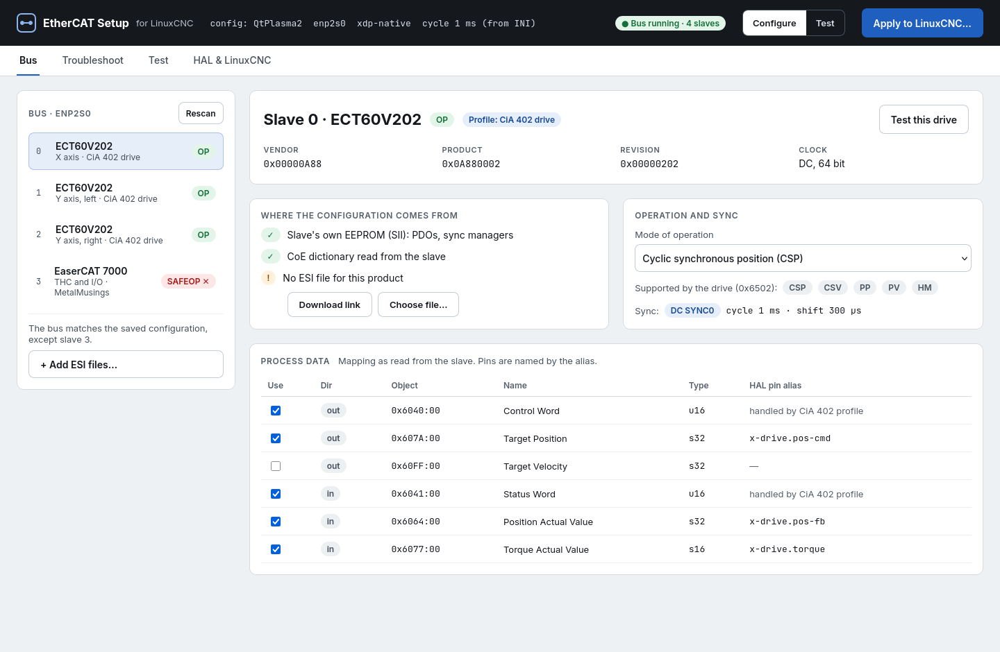
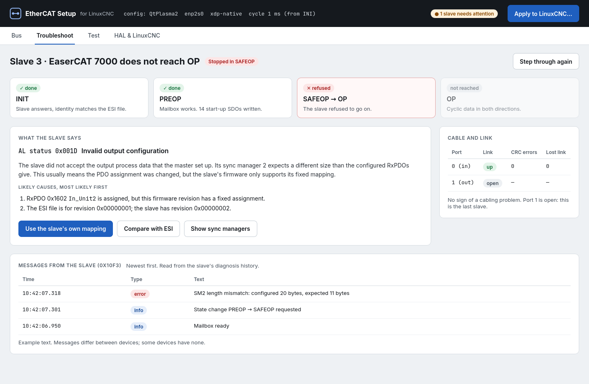
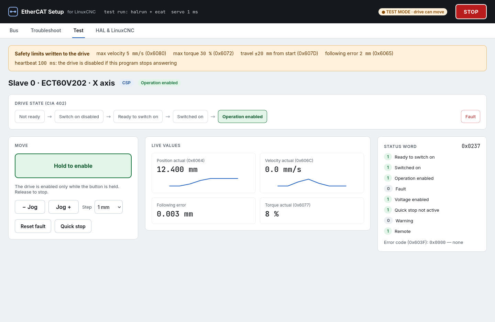
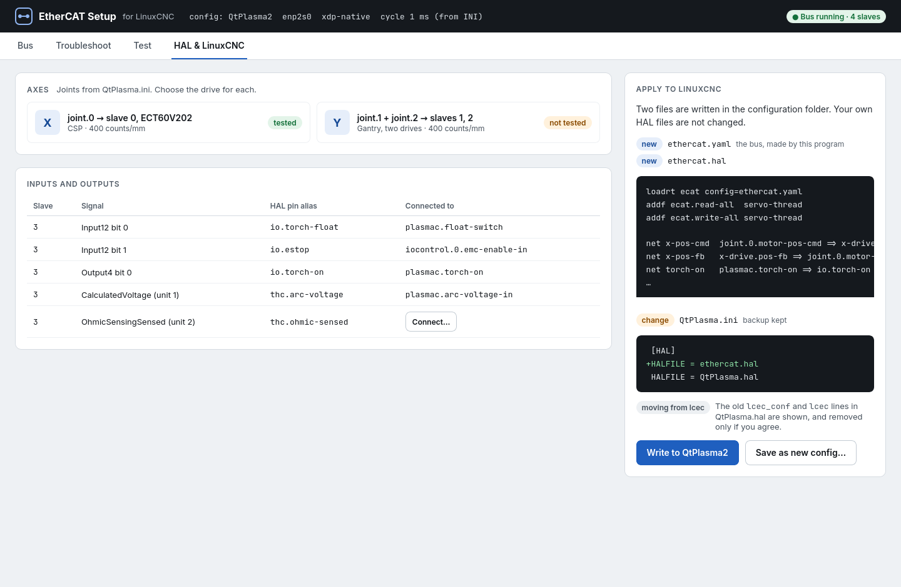

# Developing ecat

For whoever works on ecat itself: how to build and test it, the design
draft, what the prototype found on a real bus, and the plan for tests at
a machine.

## Build and test

```
python3 -m unittest discover -s tests      # Python tests
make -C component                          # ecat.so
make -C component check                    # C unit tests
scripts/build-deb.sh -w -o <dir>           # package from the working tree
```

- The component needs LinuxCNC 2.10 (`linuxcnc-uspace-dev`, or a run-in-place
  build: `. <linuxcnc>/scripts/rip-environment` in the shell first, so that
  `halcompile` is on the PATH), `libyaml-dev` and the master
  package's headers in `/opt/linuxcnc-ethercat-uspace/include`. Set
  `USPACE_ETHERCAT=` to use another master install. To install it from
  the checkout: `make -C component install`.
- `make check` runs the cia402 profile's and the encoder function's read
  and write functions cycle by cycle against a fake of HAL and the master
  (`component/tests/fake.c`), without a bus, and reads configuration
  files into the records the component is set up from, checking the
  records and the errors.
- The window's tests run offscreen against a fake bus and are skipped
  without PyQt5.
- **Fake slaves from a capture** ([A capture of the
  bus](ecatsetup.md#a-capture-of-the-bus)). In Python, `capture.Replay`
  answers the ethercat tool's calls from a capture
  (`tests/test_capture.py`). For C, `ecatsetup --capture-c CAPTURE --c-name
  NAME > component/tests/captured_NAME.h` writes each slave's identity, its
  process data entries as assigned on the bus (from `pdos`, outputs first,
  gaps left out) as `fake_entry_t` lists, and a `fake_capture_slave_t`
  table. If the capture has frames of a bus in SAFEOP or OP, it adds the
  values of every entry for each cycle (at most 1000; 32 bits kept),
  read from the returned LRW/LRD/LWR datagrams through the slave's FMMU and
  sync manager registers. `fake_capture_slave()` makes the slave, and
  `fake_capture_inputs()` puts a cycle's inputs into the process data.
  `fake_capture_output()` gives what the master sent, to compare with what a
  profile writes. `component/tests/test_captured.c` runs the cia402
  profile on the ECT60's own layout from `captured_plasma.h`, which comes
  from `tests/data/capture-ect60-easercat.tar.gz` (PREOP: no cycles).
  `tests/test_capturec.py` checks that the header is current.
- **The archive for a run-in-place LinuxCNC** (`scripts/build-rip-archive`, run
  after `. <linuxcnc>/scripts/rip-environment`; `-w` for the working tree):
  `ecat-rip-<version>-<distro>.tar.gz` with `ecat.so` (libyaml linked in,
  `make YAML_STATIC=1`), EtherCAT Setup, `install` (`packaging/install-rip`)
  and `ecat-abi.sha256`: the checksums of the LinuxCNC headers `ecat.so`
  includes (from the compiler's `.d` files), with `BUILD-INFO` naming the
  LinuxCNC commit. `install` runs `sha256sum -c` over the user's
  `<tree>/include` and refuses on any difference: ecat.so is tied to the HAL
  API it was built with, and 2.10 is a pre-release whose API changed as late as
  October 2026. The CI builds the archive at the pinned LinuxCNC commit
  (`LINUXCNC_COMMIT` in `deb.yml`); moving that commit moves what the release
  supports. A user on another commit builds from source (`. rip-environment`,
  `make -C component install`, EtherCAT Setup from the checkout with
  `linuxcnc: <tree>` in `~/.config/ecatsetup/settings.yaml`). The tests of the
  installer are `tests/test_install_rip.py`.
- EtherCAT Setup works with the LinuxCNC named in `settings.yaml` (`linuxcnc:`),
  in `$ECATSETUP_LINUXCNC`, or the one the shell is in (`$EMC2_HOME`), else the
  installed one (`ecatsetup/lcnc_env.py`): it reads that tree's
  `scripts/rip-environment` for `halrun`, `halcmd` and `tclsh` and takes the
  HAL library (`hallib`) from it. The window shows which one in its status bar.
- `scripts/build-deb.sh` runs both test suites and builds the package for
  Debian 12 and 13 (`.github/workflows/deb.yml` does so for releases).

## Design draft

Status: **draft for discussion**, 2026-11-08; status of the plan
updated 2026-11-09 (see [Plan](#plan)). Directions will change as parts
are tried on real machines.

### Summary

Today an EtherCAT bus for LinuxCNC is set up by writing an XML file
(`ethercat-conf.xml`) and HAL lines by hand. Many users find this hard to
get right, and when a slave does not work, finding out why takes
knowledge of EtherCAT that most users do not have.

This draft proposes:

- **EtherCAT Setup**, an interactive program that shows the slaves on the
  bus, configures them from the slave's own data and its ESI file, helps
  bring up and troubleshoot a slave that does not work, tests it (I/O,
  SDOs, CiA 402 drives, sync modes), connects it to HAL, and writes the
  result into the LinuxCNC configuration;
- a **configuration file written by that program** instead of the
  hand-written XML file, read directly by `ecat`, a new HAL component;
- **device support from data** (ESI, slave data, device profiles)
  instead of one C driver per product.

It is built only for the userspace IgH EtherCAT master. `ecat` grows out
of `lcec_uspace`, linuxcnc-ethercat built against that master, and is
developed in steps, each of which is useful on its own.



### The problem

What a user has to know today:

| Information | Where | What makes it hard |
|---|---|---|
| Which slaves, position, type name | XML | lcec type names and positions must be known |
| Driver options (`modParam`) | XML | Driver documentation must be read |
| PDO mapping for generic slaves | XML | Indexes, subindexes, bit lengths, sync managers |
| Start-up SDOs | XML | Object dictionary and byte order |
| Distributed clocks (`assignActivate`, `sync0Cycle`, shift) | XML | Values from the ESI file |
| `appTimePeriod` | XML | Must match the servo period in the INI file |
| Connections to HAL | HAL file | Pin names must be looked up with `halcmd show` |

Almost all of this can be read from the slave (SII, CoE object
dictionary, 0x1C12/0x1C13, 0x6502), taken from the ESI file (PDO
alternatives, DC modes, init commands), or taken from the INI file (the
servo period). The difficulty is not the XML syntax but that the user
must know what to write.

Many users already use the `generic` device type instead of the
product-specific drivers, because most slaves only need process data and
start-up settings, not product-specific code. What makes `generic` hard is
writing the mapping by hand.

### Goals

- No hand-written bus configuration. The user picks and confirms; the
  program writes the files.
- Bring up a slave that "does not want to": show where it stops, what it
  reports, the likely cause, and what to do.
- Test a slave before it is used in a machine: read and write I/O, read and
  write SDOs, put a CiA 402 drive into operation and move it safely, try
  sync modes.
- Connect slaves to HAL from the program, with readable pin names.
- Move the result into a LinuxCNC configuration without the user editing
  files.
- Let existing lcec XML configurations be imported.

### Non-goals

- The kernel-mode master. Only the userspace master is supported.
- Machine configuration (axes, kinematics, limits, GUI). That remains the
  job of the LinuxCNC configuration and its tools. EtherCAT Setup only
  connects EtherCAT devices to the joints and signals that exist.
- Replacing HAL. The program writes ordinary HAL lines that the user can
  read.

### Overview

```
                 +-------------------------------------+
                 |        EtherCAT Setup (GUI)         |
                 |          Python + PyQt5             |
                 +-------------------------------------+
                    |                   |             |
     scan, SDOs,    |      test mode    |             |  writes
     diagnosis      |   (HAL pins via   |             |
     (IPC socket)   |   the hal module) |             v
                    v                   v       ethercat.yaml
          +-----------------+   +-------------------+  ethercat.hal
          | ec_master       |   | halrun            |  INI changes
          | (ethercat-      |   |  ecat             |        |
          |  uspace start)  |   |  config=...       |        v
          +-----------------+   +-------------------+   LinuxCNC:
                    \               /                   loadrt ecat
                     \             /                    config=ethercat.yaml
                      EtherCAT bus
```

The program uses two parts that already exist, depending on the task:

- **Scan, inspect, SDOs and diagnosis**: a free-running master
  (`ethercat-uspace start`), reached over its IPC socket with the
  `ethercat-uspace` tool's interface. The same works against the master
  inside a running LinuxCNC, for diagnosis while the machine runs.
- **Cyclic tests (I/O, CiA 402, DC)**: `halrun` with `ecat`, the
  generated configuration and a servo thread, without motion. The program
  reads and writes HAL pins through LinuxCNC's Python `hal` module, as
  qtvcp does. What is tested is the same code that runs the machine.

A master built into the program itself would be a third way to the bus,
with its own behaviour to maintain. It is only worth adding if something
turns out to be impossible through the two above.

### The configuration file

`ethercat.yaml` in the machine configuration's folder (format to be
settled; YAML is the working assumption). It is written by EtherCAT Setup
and is not meant to be edited by hand, but it stays a readable text file:
it can be kept under version control, compared, and posted to the forum
when asking for help, and LinuxCNC can start without EtherCAT Setup
installed.

It holds, per slave: position and identity (vendor, product, revision,
serial if the slave has one), the profile and options, the PDO selection,
start-up SDOs, the sync mode, pin aliases and scaling. The servo period is
not repeated; it comes from the INI file.

`ecat` reads the file itself:

```
loadrt ecat config=ethercat.yaml
```

This removes lcec's `loadusr -W lcec_conf ethercat-conf.xml`, and with it
the need for `lcec_conf` and the HAL module to agree on a shared-memory
layout. Existing XML files can be imported (see [Relation to lcec and its
XML files](#relation-to-lcec-and-its-xml-files)).

**Pin aliases**: `ecat` creates pins with names chosen in the
program, such as `x-drive.pos-fb`, instead of `lcec.0.0.actual-position`,
so that HAL files are readable.

### Device support from data

Today's drivers do three different things, which should be handled
differently:

| What a driver does | Examples | Proposal |
|---|---|---|
| Data: PDO mapping, start-up SDOs, DC mode | most Beckhoff drivers | Read from the ESI file and the slave; no code |
| Pins: name, type, direction, scaling | `din-0`, `aout-1-scale` | Made from the PDO entries: type from the ESI data type, name from the ESI or the user's alias |
| Behaviour: logic in every cycle | CiA 402 state machine, encoder overflow, latch, SoE | **Profiles** (below) |

**Profiles** follow standards, not products:

- **CiA 402 (ETG.6010)** for drives: one profile that reads 0x6502 and the
  mapping covers most drives.
- **Modular Device Profile (ETG.5001)**, which Beckhoff and many others
  follow: inputs in 0x6000, outputs in 0x7000, settings in 0x8000. Digital
  I/O, analog I/O and encoder profiles build on this layout.
- **Quirks as data**: a small table per vendor and product for devices that
  need something special (an SDO in PREOP, a known SII error).

lcec's product drivers are not carried over, not even as a fallback; see
[Decision: profiles with quirks, no product
drivers](#decision-profiles-with-quirks-no-product-drivers).

**Data sources**, in order: the slave itself (SII, CoE dictionary), which
says what it is; the ESI file, which says what is possible and what it
means; and the user's choices. Without an ESI file the slave's own data
often goes a long way; with one, names are better and the alternatives
are known.

**ESI files**: many vendors do not allow redistribution, so the program
uses files the user has downloaded (a folder, or one file per device),
with links to where to download them. ESI files vary in quality, one file
may cover several revisions, and modular devices (bus couplers with
slots) need to know which modules are fitted.

**Later**: user comments per device ("works in CSP, needs 0x2010 set"),
shown next to the device, and a shared list of download links.

### Bringing up and troubleshooting a slave

Much of what is needed exists in the master but is shown in a way only
experts understand. The program shows it in plain language:

- **State by state**: INIT → PREOP → SAFEOP → OP, one step at a time.
  Where it stops, the AL status code is explained with its likely causes
  and actions, for example 0x001D/0x001E (process data mapping), 0x0035
  (cycle time), 0x002C/0x0032 (DC sync).
- **The slave's own messages**: the diagnosis history 0x10F3 (ETG.1020),
  where many slaves say exactly what they do not accept.
- **CiA 402**: the status word and error code 0x603F in plain language,
  and what is missing to reach "Operation enabled".
- **Cable and link**: error counters per port (CRC errors, lost link),
  which point at bad cables and connectors.
- **Comparison**: the bus against the configuration, and the slave against
  the ESI file, so a wrong revision or position shows.



### Test mode and safety

Test mode runs `ecat` in `halrun` as described above, so I/O,
SDOs, CiA 402 drives and sync modes are tested with the same code as in
the machine. LinuxCNC must not run at the same time; diagnosis without
motion also works against a running LinuxCNC.

Moving a CiA 402 drive from a test program needs care:

- **No motion without a deliberate act**: the drive stays in "Switched
  on" until the user enables it, with a hold-to-enable button.
- **Heartbeat**: the GUI writes a heartbeat to a HAL pin; if it stops, for
  example because the GUI hangs, the HAL thread disables the drive.
  Safety must not depend on the GUI being alive.
- **Limits written to the drive**: low maximum velocity and torque
  (0x6080, 0x6072), software position limits (0x607D) and a tight
  following-error window (0x6065), set in the drive, not only in the
  program.
- **Careful motion**: jog in small steps or at low velocity, not free
  positioning.
- **Emergency stop**: if the machine's E-stop is wired through EtherCAT
  I/O, test mode can use it.

Built so far (CSP only, see [test mode](ecatsetup.md#test-mode)): hold-to-enable
and jog buttons, the heartbeat through the drive's `watchdog` pin, limits
written to the drive where it has the objects, and velocity,
acceleration and travel limited in HAL by a `limit3`. The ECT60 has no
0x6080, 0x6072 or 0x6065 and ignores 0x607D in CSP, so on it only the
following error (its 0x2022) is set in the drive. The E-stop is not used
yet.



### CiA 402 drives and their modes

The `cia402` profile runs CSP and CSV so far. Machines also need profile
position (PP), profile velocity (PV) and the drive's own homing (HM).
What each mode is for in LinuxCNC decides how it is done:

| Mode | Used for | Who plans the motion |
|---|---|---|
| CSP (8) | a joint | LinuxCNC |
| CSV (9) | a joint with the position loop in LinuxCNC, or a spindle | LinuxCNC |
| PV (3) | a spindle, a conveyor, a pump | the drive (its ramps) |
| PP (1) | positioning that is not coordinated motion: tool changer, indexer, stop, loader; jogging in test mode | the drive (its trajectory) |
| HM (6) | homing a joint or a PP drive by the drive's own method | the drive |
| CST (10) | later | LinuxCNC |

**Principles**

- **A joint stays in a cyclic mode.** LinuxCNC must be the only one that
  plans a joint's motion. PP and PV are for drives that are not joints.
  The exception is homing, below.
- **The modes are in the file.** `cia402: {mode: csp, modes: [hm]}`:
  `mode` is the mode when the drive is enabled, `modes` the others it may
  switch to. The generator checks them against 0x6502 and the mapping;
  the component refuses any other mode.
- **One way to change mode.** The component changes mode in steps: stop
  (halt bit in PP and PV, wait for standstill), write 0x6060, wait for
  0x6061 to follow (a timeout is a fault), take the targets from the
  actual values, run in the new mode. Going back is the same. The drive
  does not jump, and a mode is never changed during a move.
- **The same safety in every mode.** Enable, the shut-down reasons and the
  latch until enable goes false are as for CSP. Added:
  - PP and PV move only after a deliberate act: a rising edge of the start
    pin, or a non-zero velocity command after enable.
  - When enable goes false, a moving drive is halted (control word
    bit 8) and then shut down.
  - Homing and positioning have timeouts.
  - A PP drive gets software limits (0x607D) and a maximum profile
    velocity (0x607F) written to it. The generator proposes them.

**What each mode needs**

| Mode | Process data | Settings (SDOs at start) | Control and status bits |
|---|---|---|---|
| PP | 0x607A target position; 0x6081 profile velocity (or a setting) | 0x6083/0x6084 acceleration/deceleration, 0x607D, 0x607F | cw 4 new set-point, 5 change immediately (off by default: the ECT60 did not move with it), 6 relative, 8 halt; sw 10 target reached, 12 set-point acknowledge |
| PV | 0x60FF target velocity; 0x606C actual velocity | 0x6083/0x6084 | cw 8 halt; sw 10 target reached (at speed), 12 speed zero |
| HM | none beyond control and status words | 0x6098 method, 0x6099:01/02 speeds, 0x609A acceleration, 0x607C home offset | cw 4 start; sw 10 target reached, 12 homing attained, 13 homing error |

0x6060 and 0x6061 are required when a drive has more than one mode. The
settings are ordinary `settings` in the file. EtherCAT Setup shows them
with their names, and the homing methods the drive supports (0x60E3)
when it has that object.

**Pins** (proposal; position and velocity in machine units through
`pos-scale` and `velo-scale`):

| Mode | Pins |
|---|---|
| PP | `pp-target`, `pp-velocity`, `pp-start` (rising edge; the set-point handshake is in the component), `pp-relative`, `pp-halt`, `pp-done` |
| PV | `velocity-cmd`, `at-speed`, `zero-speed` |
| HM | `home` (as in the cia402 component), `stat-homed`, `stat-homing`, `home-error` |
| all | `opmode-cmd` to choose among `modes` (0 = `mode`) where that is not given by the pins above; `opmode-display` shows the result |

A spindle in PV connects `spindle.N.speed-out-rps` to `velocity-cmd` and
`at-speed` to `spindle.N.at-speed`. A PP drive is controlled from HAL, for
example from an M-code, `motion.analog-out` or a tool-changer component.

**Homing a joint with the drive's method** can be done in two ways:

1. **Index-enable**, as the cia402 component does. The joint is set up to
   home on an index pulse with zero search velocity. When motion sets
   `index-enable`, the profile switches the drive to HM and starts it.
   When the drive reports homing attained, the profile switches back to
   CSP with the target at the actual position and clears `index-enable`.
   Motion then takes the position as home. This works with existing
   configurations. To check: motion moves the joint at the latch velocity
   while the drive homes, so the following error must not trip.
2. **A LinuxCNC homing module** (`[EMCMOT]HOMEMOD`, LinuxCNC 2.9 and
   later) that hands homing of chosen joints to the drive and waits for
   the profile's `stat-homed` or `home-error`. There is no fake index
   pulse, and `HOME_SEQUENCE` keeps working. It is more work, and it would
   ship with ecat.

The proposal is the first way first, and the second when the first shows
its limits. In both, the drive's actual position after homing is the
home offset, and the profile returns to CSP without a jump.

**Test mode** uses PP and PV to move a drive. The drive plans the ramp, so
EtherCAT Setup can do "move 1 mm at 5 mm/s" or jog slowly without a
trajectory planner in `halrun`, and can try homing methods with HM. It
uses the same pins as a machine.

**Order of work**:

1. HM with index-enable.
2. PV.
3. PP with its set-point handshake.
4. `opmode-cmd`.
5. The homing module.

In the component, each mode is an entry in a table: its number, the
objects it needs, how it is entered, what it writes every cycle and when
it is done. The mode change is then the same code for all modes.

### Integration with LinuxCNC

The program writes, after showing the change and keeping a backup:

```ini
[ETHERCAT]
CONFIG = ethercat.yaml

[HAL]
HALFILE = ethercat.hal      ; before the user's own HAL files
HALFILE = my-machine.hal
```

`ethercat.hal` holds `loadrt ecat config=...`, the `addf` lines and
the connections made in the program. The user's own HAL files are not
changed. When an existing `lcec` configuration is moved over, the old
`lcec_conf` and `lcec` lines in the user's HAL file are shown, and removed
only if the user agrees.

As built (step 5, [writing into LinuxCNC](ecatsetup.md#writing-the-configuration-into-linuxcnc)): two files, since the
servo thread exists only once `motmod` is loaded in the user's first HAL
file. `ethercat-load.hal`, the first HALFILE, loads the component;
`ethercat.hal`, the last, adds its functions and connects the joints.
Lines in the user's HAL files that would clash are commented out, shown
first, with a `.bak` copy; their signal names are kept.

At start, `ecat` compares the bus with the file and stops with a
clear message if they differ, such as "slave 2 is an EL2008, the
configuration expects an EL1008; run EtherCAT Setup".



### Relation to lcec and its XML files

**Decided**: the new system is called `ecat`, also the name of its HAL
component, not `lcec_uspace`. It no longer reads lcec's XML files, so the
name should make clear that forum answers, examples and documentation
about lcec and its XML do not apply to it as they are. Its HAL pins are
named by the aliases chosen in the program anyway.

**Decided** (built as `--import`): the new component reads only its own file at run time.
Existing XML files are converted once, by an import in EtherCAT Setup,
which shows what could not be carried over. Generic slaves convert
directly (PDOs, SDOs, DC); slaves with product drivers and `modParam`
options need a translation per driver. The kernel-mode `lcec` and its XML
files are left as they are, for those who do not move.

| Way | Cost | For the user |
|---|---|---|
| Read both XML and the new file at run time | `lcec_conf` and two formats to keep, test and document | Notices nothing; the break is only put off |
| **Only the new file at run time; XML import in the program** | The import, and a translation per driver for `modParam` | Converts once and sees what was not carried over |
| Only the new file, no import | Least | Redoes everything by hand, against the goal of making it easier |

**Devices without a profile** (decided 2026-11-10, see [Decision:
profiles with quirks, no product
drivers](#decision-profiles-with-quirks-no-product-drivers)). The break
with XML mattered less than what happens to today's product drivers. The
two ways that were weighed:

- **Keep the C drivers as a fallback** in the new component. Every device
  that works with lcec today keeps working (EL7041 stepper, encoder
  terminals, AX5000 with SoE and so on). But their options must be
  expressible in the new file, so part of the XML structure moves over
  into the new format, and the old driver interface must be kept.
- **Support only devices covered by profiles**, at least at first:
  CiA 402 drives, MDP I/O, and slaves configured from their own data and
  ESI. The component and its file stay clean, but devices that need
  product-specific logic are not supported until a profile covers them,
  and the import must say so for those slaves.

A middle way was also possible: start with profiles only, and bring over
individual drivers, as profiles or fallback drivers, when users need
them. The choice was profiles only, with quirks as data.

### Decision: profiles with quirks, no product drivers

Decided 2026-11-10. The question was asked for all kinds of devices and
many users, not for the test machines (both of which the existing
profiles already cover).

**Decision.** Devices are supported through profiles that follow
standards, plus quirks kept as data. lcec's per-product C drivers are not
brought over, not even as a fallback. A device that needs logic in every
cycle that no profile covers is not supported until a profile does. The
XML import says so for each such slave. Users who need such a device keep
lcec.

**Why:**

- **Most drivers repeat a standard.** About ten of lcec's 57 drivers
  implement CiA 402 for one vendor each (`rtec`, `rtdrv`,
  `leadshine_stepper`, `deasda`, `dems300`, `omrg5`, `omr1s`, `ommx2`,
  `basic_cia402`, `class_cia402`). Most Beckhoff I/O drivers do what the
  Modular Device Profile layout and the slave's own data already say. One
  profile per standard covers devices whose product nobody has written
  code for.
- **A new device should not need C code and a release.** With product
  drivers, every new product waits for someone to write, test and
  release a driver. With profiles, a device that follows the standard
  works directly, and a quirk is a table entry that a user can propose.
- **Predictable.** The configuration file holds everything that is
  written to a slave: process data, settings and DC. Nothing is added by
  hidden code at start. What the program shows is what happens, and the
  file can be posted when asking for help.
- **`modParam` was the drivers' interface, and its content fits better
  elsewhere.** Going through the `modParam`s of the 17 drivers that have
  them gives three groups:

  | Group | Examples | Replacement |
  |---|---|---|
  | A setting under a readable name, sometimes with a unit or named values | `peakCurrent_amps`, `homeMode`, `input3Func`, `encoderResolution`, `maxCurrent`, `coilResistance`, `ch0Baudrate` | `settings` rows. Name, type and limits come from the dictionary. Description, unit and named values come from the ESI file. Where the ESI file lacks them, a quirk table supplies labels, units and value names. |
  | Which PDOs and pins exist | `enableCSV`, `ciaChannels`, `digitalInChannels`, `enableFB2`, `encoder`, `probe1Positive`, `opmode` | The process data chosen in the program, and the profile's options (`cia402.mode`, `modes`, `encoders`) |
  | Logic in every cycle | FSoE (`fsoeSlaveIdx`), SoE drives (AX5000) | None. Not supported. |

  Keeping the C drivers as a fallback would have meant bringing group 2
  and 3 options into the new file format and keeping the old driver
  interface, for little gain over group 1 settings.

**Cost, accepted:** SoE drives (`ax5100`, `ax5200`, `class_ax5`), safety
devices (`el6900`, `el1918_logic`, `el1904`, `el2904`, `ax5805`) and
special cases (`el6090` display, `el3403` power measurement, `stmds5k`,
`ph3lm2rm`) are not supported. Until a profile covers them, the stepper
and analog terminals work only as `generic` slaves, without the
convenience lcec's drivers give.

**Profiles:**

| Profile | Covers (lcec drivers) | State |
|---|---|---|
| `cia402` | the CiA 402 drivers above; EL72xx/EL7411 in CiA 402 mode | Done, one axis per slave |
| `mdp`, `generic` | digital I/O (`el1xxx`, `el2xxx`, `el2202`, `digitalcombo`, `easyio`, `epocat`, `ex260`, `ep9214`), status bits (`el95xx`, `el9410`), `passive` | Done |
| Encoder (MDP 511) | `el5101`, `el5151`, `el5152`, the encoder channels of `el7342`/`em7004` | Done |
| `cia402` with several axes per slave | two-axis drives (`ECT60x2`, `ECR60x2`), EL72xx with channel offset | Built (`cia402.axes`, objects 0x800 apart, pins per axis); not tried on such a drive. |
| Analog I/O (MDP) | `el3xxx`, `el31x2`, `el3255`, `el4xxx`, `el41x2` | Built as a proposal, not a profile ([analog terminals](component.md#analog-inputs-and-outputs)): `generic` with the value as a float pin scaled from the range in the device's name, status bits as pins, the 0x8nn0 channel settings offered by name. Not tried on a terminal. |
| Stepper and DC motor terminals | `el7041`, `el70x1`, `el7342` | `generic` slaves; the EL7041's pin names, velocity scale, error reset (HAL lines) and lcec modParams are a quirk file ([stepper terminals](component.md#stepper-and-dc-motor-terminals), [quirk files](ecatsetup.md#quirk-files)). Not tried on a terminal. `el2521` (pulse train) not yet. |
| Absolute encoders (SSI, EnDat) | `el5002`, `el5032` | Check first whether `generic` plus settings is enough. |

The order is set by what users run; analog I/O and the EL7041 are
probably the most common among LinuxCNC users with Beckhoff terminals.

**Quirks** are YAML files per vendor and product, which users can write
and share ([quirk files](ecatsetup.md#quirk-files), decided 2026-11-10: a small product
such as the EL7041 gets a quirk file, not code). EtherCAT Setup uses them
when it proposes, imports and writes a configuration. An entry can
hold:

- settings a device needs at start;
- labels, units and value names for vendor objects;
- corrections of known SII or ESI errors;
- limits a device ignores. For example, the ECT60 ignores 0x607D in CSP,
  `LIMIT_QUIRKS` in `drivetest.py`.

Quirks act through what they put into `ethercat.yaml`, so the component
needs no quirk table. The configuration stays complete and predictable.

**Importing lcec XML** translates group 1 `modParam`s into settings rows,
and group 2 into process data and profile options, driver by driver. It
starts with the common drivers (`rtec`, `rtdrv`, `leadshine_stepper`,
`el7041`, `class_cia402`). Group 3 gets a note.

### Technology

- **Python and PyQt5**: present in every LinuxCNC installation, known in
  the community, and LinuxCNC's `hal` module is available.
- **EtherCAT access** through the userspace master's IPC socket and HAL.
  No new C bindings at first.
- **`ecat`**, the HAL component, starts from `lcec_uspace`'s code (moved
  with its git history) and gains reading of `ethercat.yaml`, pin aliases
  and profile-based device support.

### Decided questions

Questions that were open in this draft, with the answer and where it is
described.

- **Upstream** (2026-11-10): ecat breaks with linuxcnc-ethercat (lcec).
  It keeps no backward compatibility with lcec, and future upstream
  changes to lcec are not pulled in: the code taken from lcec is ecat's
  own and changes as ecat needs. lcec configurations reach ecat through
  the one-time XML import. The userspace IgH master
  ([MetalMusings/ethercat](https://github.com/MetalMusings/ethercat)) is
  not part of this break: it is developed actively as part of the
  project, and ecat is built on it.
- **Several masters** (2026-11-10): one master and one bus. A
  configuration has one `master`; the component's pins are `ecat.0.*`.
- **Identifying slaves** (2026-11-10): by position and type, and checked
  in test mode (jog X and see which motor moves). Some slaves report
  serial number 0 (the ECT60 drives on the test machine), so nothing
  better is known; swapped drives of the same type are not noticed
  automatically.
- **File format**: YAML, `ethercat.yaml`
  ([file format](component.md#the-configuration-file)).
- **Scaling**: in HAL, as today. `ethercat.hal` sets each joint's
  `pos-scale` from `linuxcnc.joints` ([writing into LinuxCNC](ecatsetup.md#writing-the-configuration-into-linuxcnc)).
- **INI keys**: `[ETHERCAT]CONFIG`, and `HALFILE = ethercat-load.hal`
  first and `HALFILE = ethercat.hal` last ([writing into LinuxCNC](ecatsetup.md#writing-the-configuration-into-linuxcnc)).
- **Joints and gantries**, for now: EtherCAT Setup connects joints to
  CiA 402 drives in CSP. Gantries, CSV drives, home and limit switches,
  and I/O such as an E-stop are connected in the user's HAL files
  ([writing into LinuxCNC](ecatsetup.md#writing-the-configuration-into-linuxcnc)).
- **CiA 402 homing**: `index-enable` with the drive's own homing
  (`modes: [hm]`); no homing module. Tried on the plasma cutter's X axis
  ([cia402](component.md#the-cia402-profile)). PP and PV were tried on the plasma
  cutter's three ECT60 drives on 2026-11-10 ([test mode](ecatsetup.md#pp-pv-and-homing-at-the-machine)):
  the ECT60 sometimes acknowledges a set-point without starting (the
  profile gives it again), and torque homing (method 36) ends only with an integral gain in
  the drive's speed loop (`0x2030:06`).
  How drives differ in PP mode (the set-point handshake, profile velocity
  as process data or a setting) is handled as quirks ([Decision: profiles with quirks, no product
  drivers](#decision-profiles-with-quirks-no-product-drivers)).
- **Devices without a profile**: profiles with quirks, no product
  drivers ([Decision: profiles with quirks, no product
  drivers](#decision-profiles-with-quirks-no-product-drivers)).

### Use cases

Agreed with the user on 2026-11-10. These are the main things people do
with EtherCAT Setup; the window should lead into each of them, and the
plan below is ordered by them.

#### a. A new machine, from a simulated configuration

A user tries LinuxCNC's simulator and picks a configuration. The
starting point is a folder in `~/linuxcnc/configs/` holding that
configuration: a copy from LinuxCNC, whose repository (and installation)
has all the simulated configurations under `configs/sim/`. The copy has
the configuration's own files, but lines such as `LIB:core_sim.hal`,
`LIB:sim_spindle_encoder.hal` and `LIB:simulated_home.hal` may still
point into LinuxCNC's `hallib`, where much of the simulation is.

- EtherCAT Setup starts from the copy's INI file and recognises the
  simulated parts: a joint's `motor-pos-cmd` looped back to
  `motor-pos-fb`, `sim_home_switch`, `sim_spindle`, simulated limit
  switches.
- A library file that must change is copied into the configuration
  folder first, with a note (today the program stops with an error).
  LinuxCNC's own files are never changed.
- Step by step: joints (the loop-back replaced by a drive), home and
  limit switches (the simulated ones replaced by inputs), spindle (a PV
  drive or an output), the scale (from the drive's counts per revolution
  and the screw's lead), then a test of each axis, writing, and the start.
- The INI file is checked against the bus: `SERVO_PERIOD` against DC,
  `MAX_VELOCITY` against the drive's maximum speed, `FERROR` values.
- Everything else in the copy stays as it was.

#### b. Changing a configuration that runs

New I/O, another scale, modules added or moved. Users often edit their
HAL files by hand, and those then drift from `ethercat.yaml`. That is
the main problem here; it cannot be prevented, so the program finds it.

- **One place per connection.** What the program connects is in
  `ethercat.hal`, which the user never has to edit; what the user
  connects is in their own files. The program reads both and shows,
  for each pin, where it is connected.
- **Hand edits of `ethercat.hal` are noticed** (a checksum in its
  header): the user can take the change into the program or move it to
  a file of their own, instead of it being overwritten.
- **A HAL check**, when writing, with `--check` and in the window: pins
  in HAL files that the configuration does not have (after a rename or a
  removed PDO), pins connected twice, signals nothing writes, inputs
  nothing drives. Optionally also at LinuxCNC's start (`loadusr -w` in
  `ethercat-load.hal`), for a clear message instead of halcmd's "pin not
  found"; it costs a second or two, so it is a choice.
- **A rename follows into the user's HAL files** too, if they want (with
  `.bak`); today only `ethercat.hal` follows. This is probably the most
  common cause of drift.
- **Taking over from the HAL files** (joints and I/O, built) also works
  after hand edits: edit freely, then let the program take over.
- **The bus changed**: the bus is matched to the file by type and order,
  showing slaves added, removed and moved. Moved slaves keep their names
  and pins, so HAL files keep working (today a slave inserted in the
  middle shifts every position after it).

**Modular devices**, best effort until users report back. A coupler with
terminals (EK1100) already works: each terminal is a slave of its own.
The hard case is one slave with modules in slots, whose process data
depends on the modules:

- read the modules the slave reports (`0xF050`) and take the process data
  the coupler has mapped, as it is; compare with the configured modules
  (`0xF030`) and say so clearly when they differ;
- with an ESI file, build the process data per slot from its modules and
  slots, and write `0xF030` as a setting;
- the start check compares the modules as it compares the slaves.

#### c. Bringing up a new slave

Getting it to work with the master: process data, DC and
synchronisation, settings.

- **ESI files**: for now the user provides the file, or there is none.
  The program remembers the folder, shows which device and revision a
  file matched, and warns when the revision differs. Without an ESI file
  it works from the SII and the CoE dictionary, as today, and says what
  is missing (names and units of settings, predefined PDO sets,
  sometimes DC modes) and that an ESI file gives them.
- **Where each proposal comes from** (ESI, SII, CoE, quirk file) is
  shown, so that it is clear what is known and what is guessed.
- **A sync card** in test mode: DC state, the shift chosen,
  `turnaround-cycles` (should be 2), the spread of `send-offset`, whether
  SYNC0 synced. All of it is pins already; it needs showing and
  explaining.
- **Save as quirk file**: the pin names, scales and settings chosen for
  a product become a quirk file, to share and to ship.

#### d. Using a slave by hand

Reading and setting I/O, moving to positions, trying homing: testing a
slave's functions on their own. Test mode does this (I/O, SDOs, CSP, PP,
PV, homing, with its safety layers).

- A small plot in the Move card: position, following error and velocity
  over the last seconds.
- PP, PV and homing to be tried on the plasma cutter.

#### e. Troubleshooting while LinuxCNC runs

Something unexpected happens in LinuxCNC that the user thinks may come
from a slave. The Troubleshoot page reads the master and the slaves over
IPC while LinuxCNC runs (AL states, error codes, port error counters),
but by the time the user looks, the fault has often passed.

- **A flight recorder in the component**: a ring buffer of time-stamped
  events (AL state changes, working counter drops, drive faults with
  `0x603F`, DC sync, late cycles, the stop guard stepping in), read
  afterwards by the window and `ecatsetup --diagnose`. Since version 2 of
  its file (2026-11-14) it also keeps the master's own messages: `ecat`
  gives `ecrt_lib_init()` a log callback (`lcec_uspace_log` in
  `lcec_main.c`) that copies each message up to level info into a second
  ring (`ecat_events_text()`, lock-free like the events, since the library
  calls it from the servo thread too) and prints it with `rtapi_print`.
  The pointer to the recorder is set when it opens and cleared after
  `ecrt_lib_cleanup()`, with a count of callbacks inside it, so that no
  callback writes into an unmapped file. Before, the library printed the
  messages on stderr only, where LinuxCNC's start script loses them (a
  temporary file removed at exit).
- **Save report**: one file with `ethercat.yaml`, the diagnosis, the
  event log, versions and the relevant INI lines, to attach to a forum
  post.
- **Watching while LinuxCNC runs**: the pins live, read only, the same
  view as test mode without changing anything.
- **A symptom guide** on the Troubleshoot page, from what has been
  learnt: following error at enable (`zero-at-start`), a varying
  turn-around (`sync0-shift-ns`), working counter drops (cables, port
  error counters).

#### For all of them

A start page in the window with the five tasks, leading to the pages
and the order for each. The pages exist; what is missing is the way in
for someone who does not know where to begin.

### Open questions

- **Modular devices**: how slots and modules are detected and chosen;
  best effort for now (see [use case b](#b-changing-a-configuration-that-runs)),
  waiting for users' reports.
- **ESI files**: licensing, finding the right file and revision. For now
  the user provides the file, or works without one.

### Plan

Each step is useful on its own; the order may change as parts are tried.

1. **Prototype the core idea**: read ESI files, SII and the CoE dictionary
   (Python, no GUI) and propose PDO mapping, DC mode and pins for the
   slaves on a real bus. Compare with a hand-written XML configuration
   known to work.
2. **Data model and file**: `ethercat.yaml`, `ecat config=...`,
   pin aliases, import of XML files.
3. **Generator without GUI**: scan, match profiles, write the file (a
   successor to `lcec_configgen`).
4. **Test mode and troubleshooting**: the GUI on top of `halrun` and the
   master's IPC. The CiA 402 modes PP, PV and HM come before or with it,
   since test mode moves drives with them.
5. **HAL and LinuxCNC integration**: `ethercat.hal`, INI changes, the start
   check.
6. **Later**: ESI download links, user comments per device; optional: a
   test plan generated for each configuration (a Test page card or
   `--test-plan`), the steps of "Trying the configuration in LinuxCNC"
   ([ecatsetup.md](ecatsetup.md)) with the file's own slave names, scales
   and pins, and only the parts the configuration has.
   Built 2026-11-13: a "Suggest following-error window" button on the Settings
   card for a CiA 402 drive (`integrate.following_error_suggestion`): the
   object from its quirk file (`limits: following-error`, such as the
   ECT60's `0x2022`) or `0x6065`, and twice the joint's `FERROR` in the
   joint's counts, written as an ordinary setting. Not built: showing the
   drive's present value beside it.

Where it stands (2026-11-09): steps 1-3 are done (`ecatsetup` on the
command line, `ethercat.yaml`, the `ecat` component, which runs the
plasma cutter). Of step 4, the window has the Bus, Troubleshoot, Test
and HAL & LinuxCNC pages; test mode covers I/O, SDOs and moving a CSP
drive, tried on three axes. Moving a drive in PP, PV or HM from the
window is not built; the profile has those modes. Of step 5, writing the
file, `ethercat-load.hal`, `ethercat.hal` (joints connected to CSP drives)
and the INI changes is built and tried on a copy of the plasma cutter's
configuration and run in LinuxCNC; connecting I/O pins from the program
and the start check are not built.

Where it stands (2026-11-10): connecting I/O pins from the program and
the start check are built; test mode also moves drives in PP and PV and
homes them; quirk files, several axes per drive, analog and stepper
terminals as generic slaves. The next steps follow the use cases above,
in this order:

1. **Flight recorder and Save report** (e): helps users who ask for help
   the most, and is useful in a-d too. Built 2026-11-10
   ([event log](ecatsetup.md#event-log-and-report)).
2. **HAL check and drift** (b): the check, hand edits of `ethercat.hal`
   noticed, renames into the user's files, where each pin is connected.
   Built 2026-11-10 ([writing into LinuxCNC](ecatsetup.md#checking-the-hal-files)).
3. **The bus changed**, matched by type and order (b); modular devices
   best effort. Built 2026-11-10: *Update from bus* shows the changes and
   what depends on missing slaves first; connections of missing slaves
   are removed; modules recorded and compared ([modular devices](component.md#modular-devices)).
4. **From a simulated configuration** (a): recognising and replacing the
   simulation, copying library files, the scale, the INI check. Built
   2026-11-10 ([writing into LinuxCNC](ecatsetup.md#from-a-simulated-configuration)).
5. **Bringing up a slave** (c): the sync card, where proposals come
   from, ESI file handling, Save as quirk file. Built 2026-11-10
   ([bringing up a slave](ecatsetup.md#bringing-up-a-new-slave)).
6. **Watching while LinuxCNC runs and the plot** (d, e). Built
   2026-11-10 ([test mode](ecatsetup.md#watching-linuxcnc)); the
   watching is tried against a fake HAL, not a running LinuxCNC.
7. **The start page**, once the parts exist. Built 2026-11-10: the *Start* tab
   (`ecatsetup/tasks.py`) lists the five tasks with their steps and a button
   for each; it opens first when nothing is loaded.

### Mockups

The screens in this document are mockups without function, made to show
the idea. Slave identities and PDOs are read from the test machine's bus;
messages, limits and values are examples.

## Prototype: can slaves be configured from their own data?

Status: done, 2026-11-08. Step 1 of the plan in the
[design draft](#design-draft).

### The question

Can a slave's process data, distributed clocks and HAL pins be proposed
from what can be read (the slave's SII, its CoE dictionary, a few CoE
objects, and an ESI file if one matches), without a hand-written mapping?

### How it was tried

The prototype, `ecatsetup` (Python, no GUI), reads the bus through the
userspace master's `ethercat` tool. It only reads: the slave list, SII
contents, the CoE dictionary and single SDO uploads (0x1000 device type,
0x6502 supported drive modes). It proposes a configuration per slave and
compares it with an lcec XML file:

```
python3 -m ecatsetup --esi <ESI folder> --ini <machine>.ini --compare ethercat-conf.xml
```

It was run against a plasma cutter's bus while LinuxCNC was running on it
(the tool reached the master inside LinuxCNC), and compared with the
machine's hand-written `ethercat-conf.xml`, which is known to work:

| Pos | Slave | Profile found |
|---|---|---|
| 0–2 | ECT60V202 closed-loop stepper drives | CiA 402 (0x1000 = 0x00040192) |
| 3 | MetalMusings EaserCAT 7000, THC and I/O | Modular device, ETG.5001 (0x1000 = 5001) |

There was no matching ESI file for any of them: none for the ECT60, and
the EaserCAT 7000's firmware folder holds the ESI file of the EaserCAT
6000 (another product code). The proposals below come from the slaves'
own data alone.

### Results

**Process data: derived.**

- ECT60: the SII's default assignment is 0x1600 (control word, mode,
  target position) and 0x1A00 (status word, mode display, actual
  position, digital inputs). That is what CSP needs; the drive reports
  CSP in 0x6502. The hand-written file maps the same plus velocity and
  torque, and leaves out the digital inputs.
- EaserCAT 7000: the proposal has exactly the same entries as the
  hand-written file.

**Distributed clocks: derived.** The ECT60's SII describes a DC mode
"DC" with AssignActivate 0x0300 and SYNC0 = 1 × cycle, which is what the
hand-written file has. The EaserCAT 7000 has no DC mode, and the
hand-written file uses none.

**Profile: derived.** CoE 0x1000 identified both kinds of slave. For the
drives, the CiA 402 objects (control word, status word, mode) are left to
the drive profile, and the rest become pins with fixed names (`pos-cmd`,
`pos-fb`).

**Pins: derived, but naming needs the user.** Every entry gets a pin with
a type from the data type (`float` for REAL, `s32`, `u32`) and a name from
the entry, prefixed by the PDO's name when names repeat
(`out-unit1.calculated-voltage`). The hand-written names differ
(`calculatedVoltage-1`), as names will; aliases chosen in the program are
needed.

### What could not be derived

These are choices, not data. The program must ask for them:

- **Bit fields.** The hand-written file splits `Input12` (32 bit) into 12
  bit pins, `Output4` (8 bit) into 4, and uses bit 0 of three 8-bit flags.
  Nothing in the SII or CoE dictionary says that these are bit fields or
  how many bits are used. An ESI file may say so; otherwise the user
  chooses "split into bits" in the program.
- **Settings.** The hand-written file writes 4–5 vendor objects per drive
  (peak current, idle current, motor direction, closed loop, position
  loop gain) and 10 on the EaserCAT (ADC type, I2C address, filter, ohmic
  sensing times). They are machine-specific. The CoE dictionary gives them
  names, so the program can show "0x2000 Peak Current = 4000" instead of
  `<sdoDataRaw data="a0 0f"/>`, and offer the writable vendor objects (69
  on the ECT60) as a settings list.
- **Cyclic mode** (CSP or CSV) for drives that support several.

### Found on the way

- **The SII can be wrong.** The EaserCAT 7000's SII gives subindex 0 for
  every entry of its record objects (0x6001, 0x7001, ...); its CoE
  dictionary has the right ones (1–6). The prototype takes them from the
  CoE dictionary, matched by order, and says so. Sources must be
  cross-checked, not trusted one by one.
- **Data types differ between sources.** The ECT60's SII says USINT for
  0x6060 (modes of operation), its CoE dictionary SINT, as CiA 402 has
  it. The master's own `ethercat xml` output gives UINT32 for 0x607A,
  which is a DINT.
- **"#" is not a comment in XML.** The hand-written file has lines like
  `#<pdoEntry idx="60FF" .../>`, meant to be commented out. The XML
  parser still reads the element, and the running master maps 0x60FF,
  0x606C and 0x6077. Harmless here, but an example of why hand-written XML
  is hard to get right.
- **No serial numbers.** All four slaves report serial number 0, so they
  can only be told apart by position and identity. Two swapped drives of
  the same type would not be noticed by the configuration.
- **ESI files are hard to match** even for one's own device (the 7000
  folder holds the 6000's file). Matching must be by vendor, product code
  and revision, never by file name, and the program must work without
  one.

### Conclusion

For these slaves the core idea holds: process data, distributed clocks,
profile and pins can be proposed from the slaves' own data, without an
ESI file. What remains are real choices (settings, bit fields, cyclic
mode, pin names), which is what the program's screens are for.

The bus had only two kinds of slave, both with a CoE dictionary and a
correct default mapping. Still to try: slaves without CoE, slaves whose
default mapping does not fit, modular devices with slots, and ESI files
from vendors such as Beckhoff.

### Next

Step 2 of the plan: settle the data model and file (`ethercat.yaml`) from
these proposals, and let the component read it. The proposal objects in
`ecatsetup/propose.py` are a first draft of what the file holds per
slave.

## Fault tests at the machine

The event log and the report are tried so far on a bus that behaves. This
is the plan for provoking real faults and checking that the recorder
catches them, that the diagnosis and the symptom guide name them, and that
Watch shows them live. Results are at the end.

### Before

- LinuxCNC runs with `ecat` (the machine can stay switched off, no motion
  is needed for most rows). The kernel master is stopped.
- In a terminal: `scripts/ecat-events-follow`. It prints each event as the
  component records it.
- In the window: *Troubleshoot* page, *Watch LinuxCNC (read only)*.
- Note the time of each action; the log is to the millisecond.
- After each row: *Save report...*, and look at the diagnosis and at which
  symptom in the guide fits. Restart LinuxCNC between rows when a row says
  so (each start drops the older of the two logs, so save first).

### Rows

| # | Provoke | Expect in the log | Expect elsewhere |
|---|---|---|---|
| 1 | Pull the cable between two slaves, put it back | `slaves respond` fewer, `working counter incomplete`, `slave N OFFLINE`; then back: online, operational | Watch: slave state; diagnosis: lost-link counter on the port; symptom "a slave drops out" |
| 2 | Pull the cable at the master (the card) | `link DOWN`, working counter zero | Symptom for link down |
| 3 | Switch off the last slave's power | `slave N OFFLINE`, working counter incomplete | same as row 1 |
| 4 | Stop the servo thread (`halcmd stop`, or pause it) | `servo thread late`, then `stop guard` taking the slaves to PREOP, `done` | slaves in PREOP, outputs zero |
| 5 | Start the servo thread again (`halcmd start`) | `stop guard: the servo thread runs the bus again`, slaves back to OP | backlog items 4 and 5 (DC slaves stay in SAFEOP?) are watched here |
| 6 | Force a drive fault (drive over-travel input, or a wrong parameter that trips it) | `drive fault <text> (status word ...)`, then `the profile shut the drive down` | Watch: CiA 402 state Fault; symptom "a drive switches itself off" |
| 7 | Clear the fault (fault-reset) | `drive fault cleared` | |
| 8 | Hold the machine's enable and unplug the bus while the drive is enabled | `drive left Operation enabled` or no valid process data as `fault-reason` | the drive's own state afterwards |
| 9 | Run with a heavy load on the CPU (a build, `stress`) | `servo thread late` lines (at most one a second) | whether the report's diagnosis points at latency |

Rows 1-3, 6 and 7 are the ones a user can meet in practice; 4 and 5 test
the guard; 8 and 9 are stress.

### What to check in each row

1. The event appears within the cycle or the second it is recorded for
   (states are read once a second, the working counter every cycle).
2. The text says what to look at (cable, power, drive) without the reader
   knowing EtherCAT.
3. The diagnosis in the saved report agrees with the log.
4. The symptom guide has an entry that fits, and Watch shows the same live.
5. No event is missing or false (for example a working counter error at a
   normal start).

### Results (fault tests)

2026-11-10, plasma cutter, LinuxCNC (QtPlasmaC, 1 ms servo thread), 3 drives
and the EaserCAT, machine switched off. Rows 6-8 need a real drive fault or
a drive that is enabled and were not tried.

| # | Tried | What the log showed |
|---|---|---|
| 1 | Cable between slave 0 port 1 and slave 1 pulled and put back | Working counter incomplete, "1 slaves respond (was 4)", working counter zero. Back: 4 respond, all in OP 10 s later. |
| 2 | Cable at the master | Working counter zero, "0 slaves respond", all OFFLINE, and a second later `link DOWN`. Back: `link up`, all in SAFEOP, in OP 10 s later. |
| 3 | Slave 2 powered off and on | "2 slaves respond (was 4)", correct. Back: 4 respond, in OP 10 s later. |
| 4, 5 | `halcmd stop`, 6 s, `halcmd start` | `servo thread late`, `stop guard` to PREOP and done (60 ms), then `runs the bus again`, all in OP 1 s later. The DC slaves did not stay in SAFEOP. |
| 9 | Busy loops on every CPU for 25 s | No events. The servo thread's maximum time did not grow. |
| 10 | 2026-11-13, turner (two ECT60, an EL5101, EL1008, EL2008; `halrun`, nothing enabled): cable at the master pulled for 5 s and put back, master debug level 1 | Why the climb back takes 12 s. The slaves had dropped out of OP by themselves (EL5101: AL status 0x001B "Sync manager watchdog", the two ECT60: 0x001A "Synchronization error"; the master acknowledges them). The master then **re-scans the whole bus** ("Re-scanning now", every slave: SII, mailbox, PDO configuration over CoE): slave 0-3 in about 3 s, the first ECT60 4 s, the second 2.5 s (states polled every 0.5 s); then it configures all slaves again (forced to OP, FMMUs, sync managers, DC start time) and all are in OP 1.5 s later: 12 s from link up. No DC sync check timed out (no `DC sync check failed` event) and no 10 s state-change timeout: the earlier guess was wrong. A re-scan is what the IgH master does after any change of the link, even when the same slaves answer. Not pursued (decided 2026-11-13): a bus loss is rare and the drives are shut down in a millisecond; a change in the master fork (skip the re-scan, or only the CoE read of the PDO configuration, when the same slaves answer by identity) would shorten it, at the risk of missing a slave that was replaced. |
| 6-8 | 2026-11-13, at the machine | Tried with the user: a drive fault, the fault reset, and the bus pulled with the drive enabled. The log showed what the table expects in rows 6, 7 and 8 (the user's report; the individual events were not recorded here). |

In every row the drives stayed in "Ready to switch on" and LinuxCNC kept
running: the bus recovers by itself, without a restart.

#### Found, and what was done

- Fixed: the diagnosis said "No problems found" with `lost 1` at both ends
  of the pulled cable. It now adds a note that names the cable when two
  ports at the ends of one cable count the same number of lost links
  (`lost_link_notes`). It is a note, not a problem: the counters are not
  cleared and the master's counts since power-on stay.
- Fixed: `scripts/ecat-events-follow` printed "a new run started" in the
  middle of a run.
- Not fixed: when the topology changes, the master reports every slave
  as not online for a moment: rows 1 and 3 list slaves that were still on
  the bus (slave 0 and 1 in row 3) as OFFLINE, and again when the
  slave behind them returns. "N slaves respond" is right. Read the count of
  responding slaves first; the cause is in how the master reports the
  slave configurations, so the component needs a closer look.
- Not fixed: a `working counter zero` of a millisecond, logged as ERROR,
  comes while the bus climbs back to OP (after rows 1-3 and 5). It is
  harmless, but the log cannot tell it from a real one.
- Both since 2026-11-13 (03f04dc): the event log shows these offline
  reports and working counter drops as information, with the reason, when the
  events before them explain them (a master reading the bus again, slaves
  climbing back). Decided 2026-11-13 that this is enough: no change in the
  component.
- The port counters of the master side and of a slave that lost power
  start again from zero, so those show nothing: the event log is the
  record for them.

## Automatic SYNC0 shift while the machine moves

`sync0-shift-ns: auto` was tried with no motion only (turner, two cycles at
1 ms and 500 us). The question for a moving machine: does the servo thread's
timing change when motion, the drives and the GUI are busy, enough that the
component chooses a new shift or that the turn-around leaves two cycles?

**Setup.** A copy of the plasma cutter's 2.10 configuration,
`~/linuxcnc/configs/QtPlasma-ecat402-210-autoshift` (untracked, like the
original): `sync0-shift-ns: auto` instead of 300000, and a second sampler
channel `sampler.1` (cfg `sssbbu`, depth 40000) with `timedelta.0`, wired
as in `scripts/dc-jitter-measure` (send-offset, pll-err, timedelta,
all-op, dc-phased, pll-reset-count), added after `ecat.write-all`.

**Steps** (the user at the machine):

1. Kernel master stopped, userspace master up on enp2s0, `.
   ~/src/linuxcnc-2.10/scripts/rip-environment`.
2. Start LinuxCNC with the copy. In the log: `turn-around 2 cycles`, and
   `ecat.0.turnaround-cycles` 2 once all slaves are in OP.
3. Baseline at rest: `scripts/dc-jitter-measure --attach --seconds 60 --out
   ~/autoshift-rest`.
4. While moving: start `scripts/dc-jitter-measure --attach --seconds 180
   --out ~/autoshift-move`, then home, jog X, Y and Z at full speed, and run a
   program without the arc (lines and arcs at 1000 and 3000 mm/min).
5. Optionally the same with load (`stress-ng`, as `--load` in the script).

**Passes when:** `turnaround-cycles` stays 2 and `shift-time` does not change
(no "new shift" event), no `servo thread late`, no DC sync check event,
no following error; `send-offset` stays within the window that the margins
leave (its spread compared with the rest run), and no PLL reset.


## LinuxCNC 2.10

Investigated 2026-11-11 against LinuxCNC master 64fab5d412 (2026-11-10,
2.10.0~pre; tag v2.10.0-pre2 is from 2026-09-28). ecat 0.11 builds and runs on 2.9 only; on 2.10 it does not compile.

Status (2026-11-12, branch `linuxcnc-2.10`, not released): LinuxCNC 2.10 is
built run-in-place in `~/src/linuxcnc-2.10` (worktree of `~/src/linuxcnc`,
commit b0e7b191b9, 2.10.0~pre2-436; `. scripts/rip-environment`, `sudo make
setuid` done). The component (points 1-7) and EtherCAT Setup (8-9) are ported
and unit-tested (C and Python); the new keys `extend` and `raw`, the 64-bit
integer pins for LINT/ULINT and the hal-type names are in
[component.md](component.md). Not done: 10 and 11 (need halrun against the
bus), steps 3-6 of the order of work below.

### Decision: ecat moves to 2.10 only

Decided with the user 2026-11-11:

- ecat is written for 2.10's HAL API only: `hal_get_*()`/`hal_set_*()`,
  `hal_pin_new_*()`, the types `bool`, `real`, `sint`, `uint`. No
  `#ifdef HAL_API_VERSION`, no layer that gives 2.9 the getters and
  setters.
- ecat-v0.11 is the last release for 2.9. A branch `0.11.x` takes bug
  fixes for 2.9 if they are needed. Whether a feature is backported from
  the 2.10 line to 2.9 while 2.9 is still in use is decided when the need
  comes up, not now.
- This machine (the plasma cutter) moves to 2.10; turner stays on 2.9 for
  now, as the reference for 0.11, and follows later.

Why:

- 2.9 is the old series; development is on 2.10, which is to be released
  soon, and then come 2.11 and later. A clean 2.10 code base is the better
  starting point for those than 2.10 built on fixes for 2.9.
- Supporting both costs the same in either direction (whichever is the
  "clean" one, the other needs a layer): two builds, two test runs, two
  packages, and pins that are 32 bits on one and 64 bits on the other, so
  the same code behaves differently (wrapping counters, clamping, LINT
  pins). That cost buys support for a series nobody develops further.
- The only 2.9 installations we run are our own machines.

Alternative considered: 2.10 as the main code with a header
(`hal29.h`) that implements 2.10's getters, setters and `hal_pin_new_*()`
on 2.9's pointers (the names are free in 2.9's `hal.h`; `hal_port_t`
clashes; params would need a `hal_malloc`ed slot). Workable, but rejected
for the reasons above. It is the way to go if a backport to 2.9 is ever
needed.

What still holds for 2.9 users: `ethercat.yaml` files keep working (the
old `hal-type` spellings are read), and the master package
(MetalMusings/ethercat) is the same for both series.

### What changed in LinuxCNC

- **The HAL API was broken on purpose** (ff27543c25, "hal: Break the HAL
  API - Move to 64-bit exclusively"). `include/hal.h` defines
  `HAL_API_VERSION 1`.
  - Types are `HAL_BOOL`, `HAL_REAL`, `HAL_SINT`, `HAL_UINT`, `HAL_PORT`.
    All integers are 64-bit. `HAL_BIT`/`HAL_FLOAT`/`HAL_S64`/`HAL_U64`
    remain as deprecated aliases; `HAL_S32`/`HAL_U32` are "no longer
    supported" (same value as `HAL_SINT`/`HAL_UINT`, with a warning).
  - Pins and params are opaque pointers (`hal_bool_t`, `hal_sint_t`,
    `hal_uint_t`, `hal_real_t`, `hal_port_t`). `hal_bit_t`, `hal_float_t`,
    `hal_s32_t`, `hal_u32_t` are gone. Values are read and written only
    with `hal_get_bool()`/`hal_set_bool()`, `hal_get_real()`,
    `hal_get_sint()`, `hal_get_uint()`, and the 32-bit helpers
    `hal_get_si32()` (truncating), `hal_get_si32_clamped()`,
    `hal_set_si32()`, `hal_get_ui32*()`, `hal_set_ui32()`. They are
    relaxed atomic loads and stores: no cost on x86.
  - Pins are made with `hal_pin_new_bool/sint/uint/real/si32/ui32/port(
    comp_id, dir, &ref, default, fmt, ...)`. The generic `hal_pin_new()`
    and `hal_param_new()` and all `hal_pin_*_newf()` are gone. Params are
    references too (`hal_param_new_*()`), no longer plain values.
  - `hal_pin_dir_t`/`hal_param_dir_t` are deprecated for `hal_pdir_t`.
  - `hal_extend_counter(old, newlow, nbits)` is in `hal.h`.
  - `src/hal/utils/halcompupdate.py` migrates `.comp` files, and
    `halfileupdate.py` HAL files (components whose names spell a type, such
    as `conv_s32_float` -> `conv_sint_real`).
- **RTAPI**: `rtapi_task_new()` lost its last argument (`uses_fp`) and
  `RTAPI_USES_FP` is gone. The other RTAPI calls ecat uses are unchanged
  (`rtapi_task_start/pause/delete`, `rtapi_task_pll_*`, `rtapi_prio_*`,
  `rtapi_mutex_*`, `rtapi_shmem_getptr(id, ptr)`, `rtapi_get_time`). The
  headers moved to `include/` in the source tree (the installed layout is
  to be checked). uspace refuses a component without `rtapi_app_exit`
  (ecat has one), and rtapi_app picks the highest CPU when no CPU is
  isolated (455b63cdcb).
- **halcmd**: `show pin` prints the types `bool`, `real`, `sint`, `uint`.
  `bit`, `float`, `s32`, `u32`, `s64`, `u64` are still accepted as input.
  The column layout ("Owner Type Dir Value Name") is the same. `unloadrt`
  is refused while a function of the component is in a running thread
  (32a602d1a3).
- **Module build**: `Makefile.modinc` compiles with `-O2 -Wall -Wextra`
  and links with `-Wl,-Bsymbolic $(EXTRA_LDFLAGS)`. Expect new warnings.
- **Homing** (ee80cc1330, 7c7e46ef3e): new `[JOINT_n]HOME_SEARCH_DIST` and
  `HOME_LATCH_DIST` (default 0, the old unbounded behaviour), and every leg
  of a synchronized home sequence runs together. Homing by the drive
  (`index-enable`, method 35) is likely unaffected, but must be tried.
- **Python `hal` module**: `hal.HAL_BIT` etc. still work with a
  FutureWarning; new names are `hal.Type.BOOL/REAL/SINT/UINT`. ecatsetup
  uses halcmd, not `hal`.

The master fork (MetalMusings/ethercat) does not include or link anything
from LinuxCNC and needs no change.

### What ecat needs

C component (`component/`, about 200 pin reads and writes, most in
`devices/ecat_cia402.c`, then `lcec_main.c`, `devices/ecat_encoder.c`,
`devices/lcec_generic.c`; the unused lcec class `lcec_class_cia402*` was removed):

1. Every `*d->pin = x` and `x = *d->pin` becomes `hal_set_*()`/
   `hal_get_*()`; struct members become `hal_bool_t` etc.
2. `lcec_pins.c`: `lcec_pin_newfv()` (now `hal_pin_new()` with a type and
   a `void **`) dispatches on the type to `hal_pin_new_bool/sint/uint/
   real()`, default 0 (which replaces the zeroing that follows).
   `lcec_pindesc_t` lists keep working with a pointer-sized ref.
3. Params (`lcec_ethercat.c:519` `hal_param_new()`; in `lcec.h`
   `pll_step`, `pll_max_err`, `dc_phase_max_err`, `send_offset_max`, the
   auto-shift margins) become refs, read with getters in the realtime
   code too.
4. `lcec_main.c:693`: `rtapi_task_new()` without `RTAPI_USES_FP`.
5. `HAL_BIT/FLOAT/S32/U32` -> `HAL_BOOL/REAL/SINT/UINT` (about 200 uses,
   incl. `ecat_config.c`'s `LCEC_CONF_*` records); `hal_pin_dir_t` ->
   `hal_pdir_t`.
6. `component/tests/fake.c`/`fake.h`: a fake of 2.10's API.
7. Behaviour, decided on 2.10's terms:
   - Integer pins are 64-bit. A value written to a narrower PDO entry is
     clamped to the entry's range by ecat, explicitly (commands); raw bit
     patterns (`digital-outputs`) are masked. Mutation-check both.
   - Counters that wrap at 32 bits (`propose.py`'s `WRAPPING`) are
     extended to 64 bits in the component (`hal_extend_counter`), as the
     encoder function already does with its own code.
   - LINT/ULINT entries become `sint`/`uint` pins (not float any more,
     `lcec_generic_int64.h`); the encoder's 64-bit count and the cia402
     positions can be integer pins without loss.
   - Pin names that spell a type: none found.

EtherCAT Setup (`ecatsetup/`):

8. Use the 2.10 names internally: `halpins.py`'s tables, `testmode.py`
   (`pin.type == "bit"`/`"float"` at lines 281 and 387 would treat `bool`
   pins as numbers), `halcheck.py`, `integrate.py`'s table of LinuxCNC pins
   (lines 435-460).
9. `ethercat.yaml`'s `hal-type`: `bool/real/sint/uint` are written; the old
   `bit/float/s32/u32` are still read (files must keep working);
   LINT/ULINT get integer pins. `config.py` (`HAL_TYPES`, the LINT rule at
   line 362), `propose.py` (`HAL_TYPES`) and `ecat_config.c` (lines
   393-404) in step.
10. `testmode.py` stops with `stop` then `exit`, so the `unloadrt` rule is
    met; check halrun's own `unload all` at exit.
11. `integrate.py` writes `limit3`, `mux2`, `not` (names unchanged). Check
    its INI keys against 2.10; `HOME_SEARCH_DIST`/`HOME_LATCH_DIST` may be
    worth proposing for a drive that homes.

Packaging and docs:

12. DONE: `scripts/build-deb.sh`: `Depends: linuxcnc-uspace (>= 1:2.10~)`,
    version 0.12 (the break), and `LINUXCNC_LIBDIR=/usr/lib` so that
    `ecat.so`'s run path is not the run-in-place tree's (tried here against
    the run-in-place build).
13. `.github/workflows/deb.yml`: there are no 2.10 packages for Debian 12 or
    13 (buildbot.linuxcnc.org is gone), so the job builds LinuxCNC from
    source at the pinned commit without GUIs and manual pages (cached) and
    runs `build-deb.sh` with its `rip-environment`. Not yet run on GitHub:
    try it with "Run workflow" before tagging.
14. DONE: README, getting-started.md and the release text: 2.10 or newer;
    2.9 users take 0.11. Nobody can `apt install linuxcnc-uspace` 2.10 yet:
    the package's `Depends` cannot be met until 2.10 is released, or built
    as packages from source (`dpkg-buildpackage`).

### Moving this machine

- It runs the plasma cutter, and the installed ecat 0.11 does not load on
  2.10. So 2.10 is first built run-in-place in `~/src/linuxcnc`, on a
  pinned commit, beside the installed 2.9. ecat is ported and tried in
  halrun against the bus (no motion) with that build. Only then is the
  installation switched.
- 2.10 is a pre-release and its HAL API changed as late as October 2026:
  move the pinned commit on purpose only. Way back: 2.9.4 comes from
  Debian trixie (`apt install linuxcnc-uspace=1:2.9.4-2`).
- Configurations: run `halfileupdate.py` on copies (a migrated
  configuration does not run on 2.9). `skewkins.comp` (all QtPlasma*
  configs) has an `s32` pin: `halcompupdate.py`, then compile again.
  `sum2` in `custom_postgui.hal` keeps its name; QtPlasmaC comes with
  LinuxCNC. `python3-qtpyvcp`/`monokrom` are built for 2.9 and may break;
  QtPlasma-ecat402 does not use them.

### Order of work

1. LinuxCNC 2.10 run-in-place on a pinned commit.
2. Port the component (1-7) and EtherCAT Setup (8-11); `make check` and
   the Python tests green, with halcmd output in the 2.10 spelling.
3. halrun against the bus without motion, with the run-in-place build.
4. 2.10 packages installed here; copies of the plasma configurations
   migrated; tried at the machine with the user.
5. Branch `0.11.x` from ecat-v0.11; packaging and docs (12-14); release.
6. turner to 2.10 when the above is stable.

## Devices we do not have

Plan (2026-11-14); the capture (way 1) is built, the rest is not. New functions (EL6021 serial, EoE)
and devices that should work but do not need a device on a bus to develop
and try against. There are four ways to get one, in this order: the first
that suffices is used.

### 1. A capture from the user

The user runs `ecatsetup --capture` and sends the file
([A capture of the bus](ecatsetup.md#a-capture-of-the-bus)). Built: every
call of the ethercat tool is recorded with its answer, and
`capture.Replay` answers them again (`--from-capture`, and the tests:
`tests/data/capture-ect60-easercat.tar.gz`, the plasma cutter's bus without
its ESI file). C fakes from a capture are built too (`--capture-c`, see
[Build and test](#build-and-test)). Not built: a button in the window.
Not tried: frames of a bus in OP turned into cycles (tested with made-up
frames only). It
holds what is needed to make a fake of the device for the tests: the SII,
the CoE dictionary with present values, the PDO assignment, the ESI used,
the report (configuration, diagnosis, event log with the master's
messages) and a few seconds of the frames on the wire in SAFEOP and in OP
(pcap, readable in Wireshark). From it the C tests' `fake.c` and the
Python tests' fake bus (today from `tests/data/easercat7000.sii` and
`-sdos.txt`) get a device of that kind, so that most of the code and its
tests are written without the device. The device itself is still needed
for the final try. The capture holds bus data only: no user names, home
folders or other files.

### 2. The device is sent here

The user sends the device (and what it talks to, such as a serial device
behind an EL6021) and gets it back. Tried on turner or on this machine as
any other device. For a single terminal or a small module this is the
cheapest and the first choice; buying one is another (an EL6021, an
EoE-capable slave such as an EL6601/EL6614 are not expensive used).

### 3. Remote access to a test computer at the user's

For what cannot be sent: large or expensive drives, a combination of
devices that misbehaves only together, a device in use.

The user's part (a user who wants a missing function supports it with
this):

- a computer for the test only, not a LinuxCNC computer in use;
- the device on a bench with its power supply (24 V), a coupler if it is
  a terminal (EK1100), cables, and what it talks to;
- someone at it during the session, for wiring and for anything that
  moves.

The computer (a mini-PC or an old desktop):

| | Required | Recommended |
|---|---|---|
| CPU | x86-64, boots from USB (UEFI with Secure Boot works: Debian's signed shim and RT kernel) | Intel N100 or better; an old desktop of the last ten years does |
| Memory | 4 GB | 8 GB |
| Network | two ports: one for EtherCAT, one for the internet (or Wi-Fi for the internet) | Intel for EtherCAT (i210/i211 igb, i225/i226 igc, e1000e): tried with the master. Many N100 mini-PCs have two i226. In an old desktop: an Intel PCIe card (i210, a few hundred SEK). Other chips may work: the stick's check says |
| USB stick | 16 GB, USB 3 | 32 GB |
| Latency | measured by the stick at start and saved; I/O tests at 1 ms tolerate a lot | |

The stick: a live image of Debian 13 with the RT kernel, LinuxCNC 2.10
run-in-place at the pinned commit, the userspace master, ecat and EtherCAT
Setup of the release, tcpdump, stress-ng, latency-histogram, and a help
script. Built in CI (live-build or mkosi) and released beside ecat. It
never mounts the computer's disks (a promise to write in the
instructions, and the image is built without automounting). A partition
`ECATLOG` on the stick keeps captures, logs and the session's recording
across restarts; the user can read it.

The help script, started by the user from the desktop:

1. checks the network cards: which one has a slave behind it (the master
   is started on it), which one reaches the internet;
2. runs a short latency measurement and `ecatsetup --capture`, saved in
   `ECATLOG`;
3. starts the session: an outgoing SSH connection to the jump server with
   a reverse tunnel (`ssh -R`), so nothing is opened in the user's router
   or firewall; shows a session code and a Stop button;
4. records the session in a terminal log (`script`) in `ECATLOG`;
5. Stop, or pulling the internet cable, ends it.

The jump server (run by the maintainer, needed seldom): a small VPS with
OpenSSH only. Per session a key of its own, valid for that session only,
and the tunnel reaches only the stick's SSH port, not the user's network.
From here it is then `ssh <session>` as with turner; the window by
`ssh -X` or Xpra when needed, most work on the command line (`--propose`,
`--diagnose`, halrun, the I/O test).

Rules for a session:

- Nothing moves without the user at the device with a working emergency
  stop, as at our own machines. Hold-to-enable from afar is not
  hold-to-enable: the stick's drive test is off unless the user turns it
  on locally.
- The user is asked to connect the internet port to a guest network, as
  the stick reaches the network it is on.
- Agreed beforehand what is to be tried, and afterwards what was found;
  the capture and the log stay with the user too.

### 4. Not chosen

- A container or a program on the user's own LinuxCNC computer: needs
  raw access to the network card and RT, and touches a system in use.
- Tailscale or similar: works, but a third service to trust and an
  account for the user; a reverse SSH tunnel needs nothing but OpenSSH.
  Kept as the fallback if the jump server becomes a burden.

### Order of work

1. `ecatsetup --capture` and a fake device built from a capture (useful at
   once, also for ordinary bug reports).
2. When a user needs it: the live image, the help script, the jump
   server; tried first on turner or a borrowed computer as if it were a
   stranger's.
