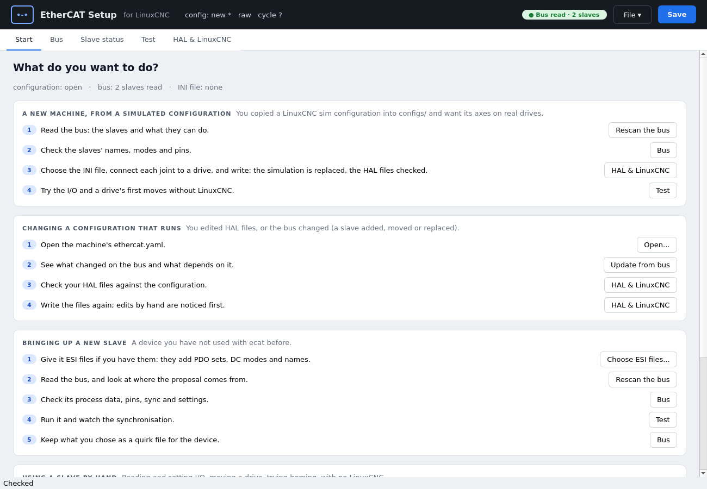
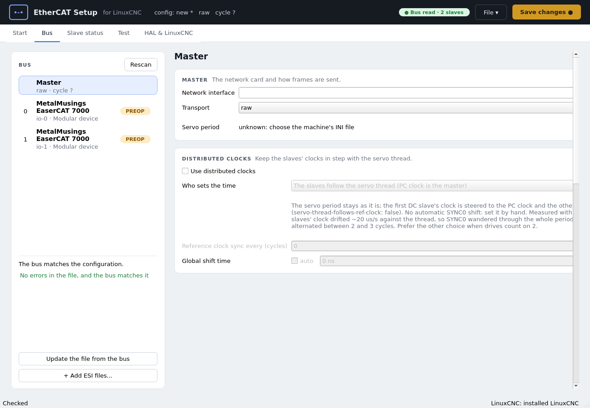
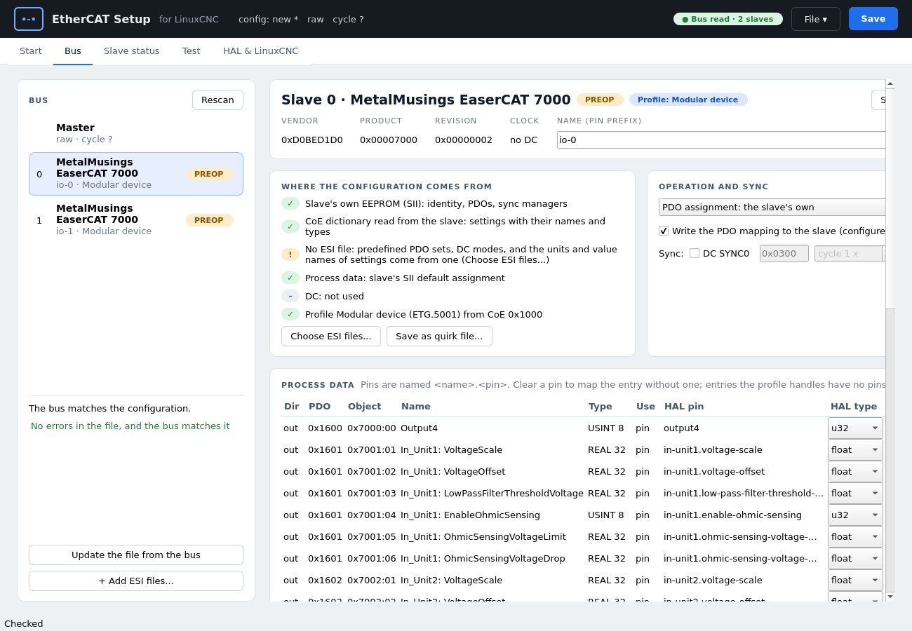
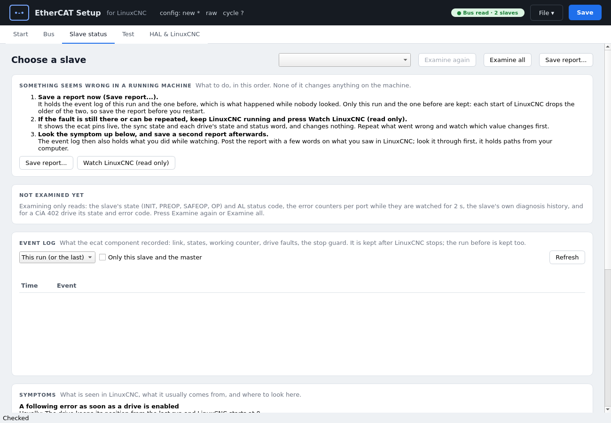
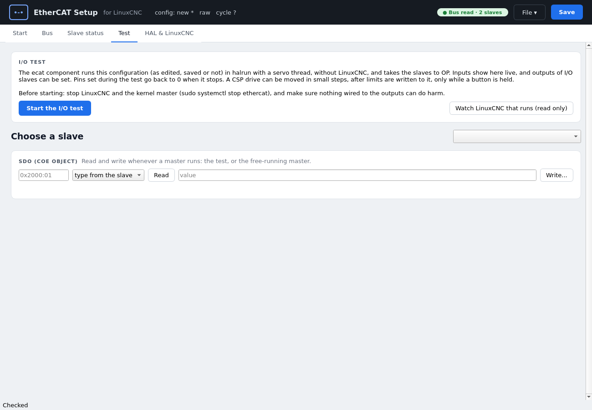
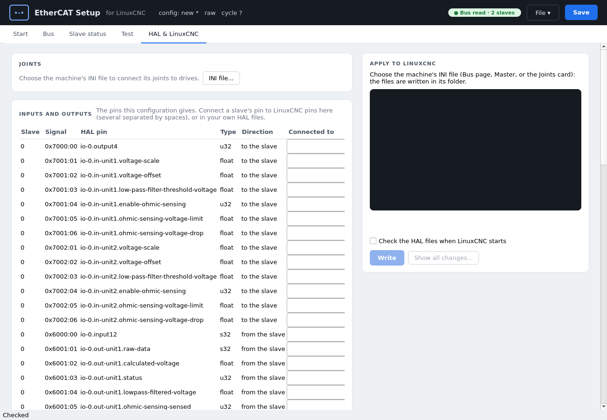
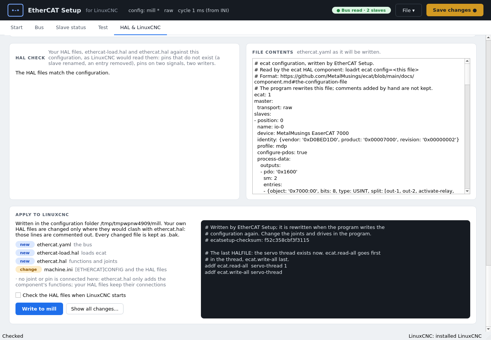

# EtherCAT Setup

EtherCAT Setup (`ecatsetup`) reads the slaves on the bus (SII, CoE
dictionary, ESI files), proposes their process data, distributed clocks
and HAL pins, lets you check and edit the result as an `ethercat.yaml`
([the file format](component.md#the-configuration-file)), tests it
without LinuxCNC, and writes it into a LinuxCNC configuration. It also
diagnoses slaves that do not reach OP and watches a running LinuxCNC.

```
ecatsetup --gui [ethercat.yaml] [--ini machine.ini] [--esi folder]
```

The window is the way to use it. Apart from the test mode it only reads
from the bus, and reading needs a running userspace master
([Getting started](getting-started.md)). Everything the window does with
a file can also be done from the [command line](#command-line), which is
what scripts use.

Contents:

- [The window](#the-window): a tour of the five tabs;
- [Bringing up a new slave](#bringing-up-a-new-slave): where a proposal
  comes from, ESI files, [a spindle encoder](#a-spindle-encoder-el5101),
  synchronisation;
- [Test mode](#test-mode): I/O, SDOs, moving a drive, homing;
- [Writing the configuration into LinuxCNC](#writing-the-configuration-into-linuxcnc);
- [Event log and report](#event-log-and-report): what to send when asking
  for help;
- [Quirk files](#quirk-files): keeping what you chose for a device;
- [Command line](#command-line).

## The window

`ecatsetup --gui` opens EtherCAT Setup's window (needs `python3-pyqt5`).
It is a shell around the same functions the command line uses
(`ecatsetup/session.py`): whatever the window does with a file, `--check`,
`--update`, `--diagnose` and `--apply` do too. The screenshots below were
taken from the window against a fake bus of two EaserCAT 7000 slaves, so
they show the layout, not a real machine.

```
ecatsetup --gui [ethercat.yaml] [--ini machine.ini] [--esi folder]
```

Without a file the window starts empty. Nothing is read from the bus until
you ask (*Rescan*), and nothing moves until you start a test and hold a
button. Reading the bus needs a running master: see
[Getting started](getting-started.md).

### The frame

The dark strip on top shows the open configuration (`new`, or the file
name; `*` means unsaved changes), the transport, the cycle time, and
whether the bus was read. To the right: the **File** menu and **Save**,
which is amber and reads *Save changes ●* while there is something not
written to the file, and grey and reads *Saved* when there is nothing.
Saving into a folder that does not exist asks whether to create it.
While a test or a watch runs, a red **STOP** button appears there too.

The **File** menu holds Open, Import lcec XML, Save, Save as, Rescan the
bus, Update from bus, Check, Add ESI files, Start the I/O test, Watch
LinuxCNC that runs (read only), and Stop the test or the watching.

Five tabs, in the order you normally use them: **Start**, **Bus**,
**Slave status**, **Test**, **HAL & LinuxCNC**.

### Start



A list of tasks, each with its steps in order and a button that takes you
to where the step is done (a tab, or an action such as *Rescan the bus*).
The line at the top tells what is open: configuration, bus, INI file. The
tasks:

- a new machine, from a simulated configuration;
- changing a configuration that runs;
- bringing up a new slave;
- using a slave by hand;
- troubleshooting while LinuxCNC runs.

### Bus



On the left, the bus: *Master* and each slave with its position, name,
pin prefix, profile and AL state. A line under the list says whether the
bus matches the configuration. *Rescan* reads the bus again;
*Update the file from the bus* brings the file in line with it (what
changed is listed first); *Add ESI files...* gives the program ESI files
to propose from.

The **Master** page (on the right) holds the network interface, the
transport, the servo period (taken from the INI file once you have chosen
one) and **Distributed clocks**: whether to use them, how often the
reference clock is synchronised, whether the servo thread follows it, and
the global shift time (`auto` lets the component find it; see
[file format](component.md#the-configuration-file)).



Choosing a slave shows:

- its identity, its **name** (the pin prefix) and its profile;
- **Problems**, when the proposal or the check found any;
- **Where the configuration comes from**: SII, CoE, ESI file, DC, profile.
  A green tick means the source was found, an amber mark that something
  would improve the proposal (usually an ESI file). *Choose ESI files...*
  and *Save as quirk file...* (what you chose, kept for the device, see
  [quirk files](#quirk-files)) are here;
- **Operation and sync**: the PDO assignment, `configure-pdos`, DC SYNC0
  and its shift, and for a drive the CiA 402 modes (below), *Propose again*
  and the homing card ([cia402](component.md#the-cia402-profile));
- **CiA 402 modes**, for a drive: *Mode of operation* is the mode the
  drive starts in and runs in. Under *Can also switch to* you tick the
  modes it may switch to while it runs, with the pin `opmode-cmd`: for
  instance CSP and PP, or CSV and PV, for a drive that is sometimes a
  joint and sometimes positions on its own. A line under the boxes shows
  the pin's numbers (0 is the mode above). The mode above cannot be
  ticked twice. *Homing by the drive's own method* is separate, since
  homing is not an `opmode-cmd` value; it shows the card **Homing by the
  drive**: the method (from the drive's `0x60E3`, or all of the standard's),
  speeds, acceleration, offset, and the INI lines LinuxCNC needs, with
  *Copy the INI lines*. The choice goes to Settings. Switching modes is
  built and unit-tested but not yet tried on a drive
  ([Changing modes](component.md#changing-modes));
- **Process data**: every PDO entry with its pin name and HAL type. Clear
  a pin name to map an entry without a pin; entries the profile handles
  are marked as such and get no pin. An entry of several bits, such as a
  drive's digital inputs (`0x60FD`), can get one `bit` pin per bit:
  choose *bit field* in the HAL type list. The pins are named
  `<pin>-0`, `<pin>-1`...; rename them, or leave a name empty to give a
  bit no pin, in the *Bit pins* column (double-click the empty *HAL pin*
  cell of the row to go there). Choosing a type again gives back one
  pin. The *Invert* column makes a bit pin the opposite of the bit (`yes`
  for a bit pin, the names of the bit pins for a bit field), for normally
  closed switches such as an E-stop: no `not` is needed in HAL;
- **Settings**: SDOs written at every start, in PREOP. *Add setting...*
  opens the slave's object dictionary: filter by object or name, objects
  writable in PREOP only (untick to see all), manufacturer objects
  (0x2000-0x5FFF) in bold, with type, size, access and, from the ESI file,
  range and default. Select one or more and *Add*: each gets its name and
  type and the value the slave has now (else the ESI default, else 0).
  PDO mapping objects and commands are not offered. You can also type an
  object; it completes from the dictionary. A row with a problem is
  coloured and explained under the table: not in the dictionary, not
  writable in PREOP, a value that does not fit the type or the ESI's
  range, another type than the dictionary's, or a command (a quirk file's
  command is an error and `--check` refuses it; one that only looks like a
  command, by its name, write-only access or 0x1010/0x1011, is a
  warning). *Read present values* fills the *Now* column from the slave.
  *Values in hex* shows the values and *Now* as `0x` hex, as wide as the
  type (the SDO card's *Hex* box is the same setting); you can type a value
  in either form, `255` or `0xFF`, and the file keeps the number;
  The dictionary is the slave's own with the ESI file's ranges added; with
  no slave read, the ESI file's alone. `ecatsetup --check FILE --esi DIR`
  prints the same problems from the ESI files;
- **Settings** (continued): *Remove setting* removes the selected rows;
- **Notes from the proposal**.

The buttons *Status* and *Test this slave* in the slave's header jump to
the other tabs with the slave chosen.

### Slave status



Diagnosis of the slaves on the bus: *Examine again* / *Examine all*. For
the chosen slave the page shows a series of steps (each ok, warning or
failed), what the slave says (AL state and status code), the cable and
link (port error counters), the slave's own message history (0x10F3), and
the **Event log**: what the `ecat` component recorded while LinuxCNC ran
([event log](#event-log-and-report)), optionally only for this slave and the master.

For a running machine the page opens with a short flow: *Save report...*
(a file to attach when you ask for help), then *Watch LinuxCNC (read only)*.
At the bottom, **Symptoms** lists what is seen in LinuxCNC, what it usually
comes from and what to do.

### Test



Works with no LinuxCNC. *Start the I/O test* runs `ecat` in `halrun` on
the bus; stop the kernel master first, or the two share the NIC
([Getting started](getting-started.md#getting-started)). For the chosen slave:

- **Synchronisation**: DC state and where SYNC0 falls;
- **Outputs** and **Inputs**, live, and **All pins**. Outputs are set
  here and go back to 0 when the test stops;
- **SDO**: read and write a CoE object while a master runs;
- for a drive: the **CiA 402 state chain**, live values, the status word,
  and **Move**, which can move the axis. It writes limits to the drive,
  needs *Hold to enable* held down (a heartbeat shuts the drive down if
  the window hangs), has jogs, runs, homing and *Reset fault*, and puts
  the drive's limits back with *Done*. Read [test mode](#test-mode)
  before using it, and have the user at the machine.

*Watch LinuxCNC that runs (read only)* shows the pins of a LinuxCNC that is
already running and changes nothing.

### HAL & LinuxCNC



Writing the configuration into a LinuxCNC machine ([writing into LinuxCNC](#writing-the-configuration-into-linuxcnc)).
One column, top to bottom in the order of the work:

- **Joints**: choose the INI file, then the drive for each joint.
  *Take over from the HAL files* reads what your HAL files already use;
- **Still to connect**: LinuxCNC's inputs and outputs to the machine
  (E-stop, home switches, probe, spindle, plasmac's torch and sensors ...)
  that the simulation still drives or reads, or that nothing does, with
  a choice of the slaves' pins of the right type for each (see
  [what is still simulated](#what-is-still-simulated)). Select a row to
  read what the LinuxCNC pin does (for example `plasmac.breakaway`), with
  links to the pin's section and to the whole page (QtPlasmaC, motion,
  halui ...) in LinuxCNC's documentation on linuxcnc.org. The text comes
  from LinuxCNC's documentation and is kept in `ecatsetup/pindocs.py`;
  nothing is fetched, the links open in your browser. Pins of your own
  components have no text. The *Invert* box of a row makes the connected
  slave pin the opposite of its bit (a bit pin or one bit of a bit field),
  for a normally closed switch such as an E-stop; it is the same setting as
  the *Invert* column of Process data, so every net the pin is in gets it;
- **Inputs and outputs**: the pins the configuration gives, and a column
  where you connect each to LinuxCNC pins. An encoder channel's pins
  (`pos`, `velocity`, `counts`, `index-enable` ...) are rows too. A pin both
  sides read and write (a handshake such as `index-enable`) is connected
  to such a pin (`spindle.0.index-enable`, `joint.N.index-enable`) and
  written with `<=>`; of a simulated spindle encoder on the same signal
  only the simulation's pins give way, never your own logic;
- **HAL check** and **File contents**, side by side: your HAL files
  against the configuration, and `ethercat.yaml` as it will be written;
- **Apply to LinuxCNC**, last: what will be written (`ethercat-load.hal`,
  `ethercat.hal`, the INI changes, the HAL lines that will be commented
  out with `#ecatsetup: `), *Show all changes...* and *Write* on the left,
  the selected file's new text on the right. Work on a copy of the
  configuration first. A checkbox runs the HAL check each time LinuxCNC
  starts. A configuration inside LinuxCNC's own files (the source tree of a
  run-in-place build, or the installed sample configurations) is flagged
  with a warning, and *Write* asks again before it writes there: copy the
  folder to `~/linuxcnc/configs` first. A run-in-place LinuxCNC runs a
  sample configuration where it is and does not offer to copy it; start it
  with `debug_pickconfig=1 linuxcnc` to be asked.



## Bringing up a new slave

Getting a slave to work with the master: its process data, its clock
and synchronisation, and its settings. EtherCAT Setup proposes all of
it from what it can read; this section is about seeing what the proposal
rests on, checking it on the bus, and keeping what you chose.

### Where the proposal comes from

The slave's page on the *Bus* page has a card *Where the configuration
comes from*, one line per source, marked ✓ (used), ✕ (missing or not
matching) or – (not used):

| Source | What it gives |
|---|---|
| The slave's EEPROM (SII) | Identity, PDOs, sync managers; always read. |
| The CoE dictionary | The names and types of settings, the drive's supported modes. Without it names come from the SII. |
| An ESI file | Predefined PDO sets (*Propose again* offers them), DC modes, units and value names of settings. The line says which file matched and whether it is for the slave's revision; a file for another revision is used, with a warning to check what it gave. |
| Process data, DC, profile | Which of the above each came from. |
| A quirk file | When one matches the device ([quirk files](#quirk-files)). |

### ESI files

For now you provide the ESI file: the vendor's XML, from its web site
or the device's CD. Without one EtherCAT Setup works from the SII and
the CoE dictionary, and says what is missing. *Choose ESI files...*
(or `--esi FOLDER` on the command line) reads every XML file in a
folder. A folder chosen in the window is remembered, in
`~/.config/ecatsetup/settings.yaml` (or `$ECATSETUP_SETTINGS`), and read
again at the next start; a folder that no longer exists is skipped.

### A spindle encoder (EL5101)

How to get a terminal with an incremental encoder input (an EL5101, or
another that follows ETG.5001 MDP 511) to be LinuxCNC's spindle encoder,
for threading and other spindle-synchronised moves. The encoder function
of the component does the work; the steps are to give EtherCAT Setup what
it needs to propose it, and to connect two pins. Status: the encoder
function has run an EL5101 (see [encoder channels](component.md#encoder-channels));
connecting the spindle pins from the window is built and unit-tested, and
has not been tried at a machine yet.

1. **Give it the ESI files.** *Add ESI files...* (Bus page, or the
   slave's *Choose ESI files...*) and choose the folder with Beckhoff's
   XML files (`Beckhoff EL5xxx.xml` for an EL5101); the folder is
   remembered. Without them the slave has only the process data it starts
   with, which for an EL5101 is the *legacy* layout (`0x7000:01`, `:02`,
   `0x6000:01` to `:03`: Ctrl, Value, Status, Value, Latch). The encoder
   function does not handle it, and the proposal says so in its notes.
2. **Read the bus again** (*Read the bus*, or *Propose again* on the
   slave). *Where the configuration comes from* shows ✓ for the ESI file.
   The proposal now uses the ESI file's default assignment, *Standard 16
   Bit (MDP 511)*, and finds the channel: the notes say *encoder enc:
   channel 0x6010 ...*, and the counter and latch entries are marked
   *profile* under Process data. For a 32-bit counter choose *Standard 32
   Bit (MDP 511)* under *PDO assignment*, then *Propose again*; the count
   is extended to 64 bits either way. The DC settings and the way the
   terminal reaches OP come from the ESI file too: if the slave does not
   reach OP, the test mode names what it did not accept.
3. **Set the scale.** The encoder's `pos` is in units of the scale, so
   that one turn of the spindle is 1.0. On *HAL & LinuxCNC*, the
   [*Parameters*](#parameters) card has `<slave>.enc.pos-scale`: type the
   counts per revolution (a quadrature encoder gives four counts per
   line: 4096 for a 1024-line encoder). It is written into `ethercat.hal`.
4. **Connect the two pins.** On *HAL & LinuxCNC*, *Still to connect* lists
   `spindle.0.revs` and `spindle.0.index-enable`, simulated while the
   configuration still has LinuxCNC's spindle simulation
   (`spindle_sim.hal`). Choose `<slave>.enc.pos` for `spindle.0.revs`
   (the spindle position in revolutions) and `<slave>.enc.index-enable`
   for `spindle.0.index-enable` (a handshake pin both sides drive, so
   it is connected with `<=>`). Writing replaces the simulated encoder on
   those signals; the rest of the simulation (the speed command) stays
   until you take it out.
5. **Check it by hand.** In the *Test* page (the free-running master and
   `halrun`, no LinuxCNC) turn the spindle by hand: `enc.pos` counts one
   per turn in the direction you expect (if it is backwards, make
   `pos-scale` negative), and `index-enable` clears at the index pulse,
   where `pos` returns to 0. Only then run the machine.

See [Inputs and outputs](#inputs-and-outputs) for the connection pins in
general, and [encoder channels](component.md#encoder-channels) for every
pin of the channel (`velocity`, `counts`, `reset`, the external latch).

### Synchronisation, in the test mode

While a test runs (*Test* page), the *Synchronisation* card shows, from
the master's pins (`ecat.0.*`):
- whether all slaves are in OP;
- distributed clocks: how many slaves use them, and whether the
  master's DC sync check failed for one (`dc-sync-failed`);
- which clock is the master (the Master page's "Who sets the time" says it
  in words: the slaves follow the servo thread, or the servo thread follows
  the reference clock); with `servo-thread-follows-ref-clock`, whether the servo thread is
  locked to the reference clock (`dc-phased`, `pll-err`);
- where SYNC0 is (`shift-time`) and the turn-around (`turnaround-cycles`):
  2 is what drive profiles count on; with `sync0-shift-ns: auto` it says
  so while it still measures (2 s after all OP), and warns at 3 or more;
- how much the moment the frame is sent varies (`send-offset`, the last
  50 samples): more than a quarter of the period points at the servo
  thread's latency.

A slave without DC has no SYNC0 to place; the card then says only
whether the slaves are in OP.

### Keeping what you chose

*Save as quirk file...* on the slave's page saves its pin names, scales
and settings as a quirk file of your own, for the device's vendor and
product. The next slave of the same device is proposed with them, on
this machine or, with the file shared, on another ([quirk files](#quirk-files)).

## Test mode

EtherCAT Setup's Test page runs the configuration being edited, saved or
not, in `halrun` with the `ecat` component and a servo thread, without
LinuxCNC. It is the same code that runs the machine.

Before starting it, stop LinuxCNC and the kernel master
(`sudo systemctl stop ethercat`). The free-running master
(`ethercat-uspace start`) hands the bus over to the test by itself and
does not come back when the test stops.

The test does not start when the master's network interface is missing,
does not exist on this computer, or is set to `xdp-native` on a driver
that cannot do it (such as `r8169`): the Master page says why. If the
component does not load, the test stops at once with the end of the
`halrun` log.

One test runs at a time, also with several EtherCAT Setup windows open:
editing in several windows is fine, but a second window that starts a
test is told which process runs one already. The lock
(`~/.local/state/ecatsetup/test.lock`) goes with the process, so a
crashed window does not keep it.

### I/O

Each slave's inputs show live; the outputs of I/O slaves can be set.
Pins set during the test go back to 0 before it stops. SDOs can be read
and written from the same page whenever a master runs; objects that are
commands rather than settings (such as `0x2010` on the ECT60), objects in
the process data, and a drive's CiA 402 objects are refused by *Write*.
*Run command...* runs a command object once: it asks first, showing what
the quirk file says it does, and is refused while a CiA 402 drive is in
"Operation enabled" (read from its statusword). Only objects known as
commands (a quirk file's `commands:`, or suspected from the dictionary)
can be run this way; the value is the quirk's, else the one typed.

When the test stops, every drive is disabled, the outputs go to zero, and
the slaves are taken to PREOP while process data still flows
(`ecat.take-down`; the component's stop guard would do it too), so that
they stop without an error.

### Moving a drive

A CiA 402 drive can be moved in small steps: in CSP and PP by jogging, in
PV by running it while a button is held, and a drive with `hm` in its
`modes` can home by its own method (see [PP, PV and homing](#pp-pv-and-homing)).
Safety comes in layers, so that no single one has to be perfect:

1. **Nothing moves without a deliberate act.** The drive is enabled only
   while a button is held, with the mouse or the space bar, one at a
   time: *Hold to enable* enables it without moving it; *Jog −* and
   *Jog +* enable it by themselves and move one step. Releasing the
   button disables the drive; so does the window losing focus.
2. **Heartbeat.** Every drive's `watchdog-ms` is set to 500 ms in the
   test's HAL file, and the window counts the `watchdog` pin up every
   100 ms. If the window hangs or dies, the servo thread shuts the drive
   down by itself (`fault-reason` 5).
3. **Limits in the drive.** *Write limits to the drive* reads the drive's
   own values and writes, where the drive has the objects:
   - software position limits `0x607D` at ± the travel around the
     position at that moment;
   - a tight following-error window: `0x6065`, or the vendor's object
     (on the Rtelligent ECT60, `0x2022` "Position trace error Limit");
   - the maximum torque `0x6072`.

   The drive's own values are kept in
   `~/.local/state/ecatsetup/drive-limits.json` before each limit is
   written, and written back by *Done* or when the test stops; if the
   program dies in between, it offers to write them back at its next
   start. While another window runs a test, the values in that file are
   its own: no other window offers to write them back.
4. **Limits in HAL.** The drive's `pos-cmd` comes from a `limit3` with the
   test's velocity, acceleration and travel, in the servo thread. Until
   the drive is in "Operation enabled", the `limit3` follows `pos-fb`, so
   enabling never makes a jump; a jog moves its target by one step, never
   past the travel.

Defaults: 5 mm/s, 50 mm/s², ± 20 mm, following error 2 mm, torque 30 %.
The scale (counts per mm) is taken from the configuration's HAL files
(`setp <drive>.pos-scale ...`) when they have it.

What the ECT60 has: `0x607D` and `0x2022`, no `0x6080`, `0x6072` or
`0x6065`. It ignores `0x607D` in CSP (tried: it moved 4.6 mm past a
limit of 1 mm, without an error or a status bit), so the test writes only
`0x2022` to it, and its travel, velocity and torque are limited in HAL.

#### PP, PV and homing

In PP and PV the drive plans the motion itself; there is no `limit3` in
front of it. The layers 1 to 3 are the same, and instead of layer 4:

- **PP** (*Jog −*, *Jog +*): each step is a move to the drive's present
  position ± the step, never past the travel around the start;
  `pp-velocity` is the test's maximum velocity, and the maximum profile
  velocity `0x607F` is written to the drive where it has it. The drive
  ramps with its own acceleration (`0x6083`, `0x6084`). The move starts
  once the drive is in "Operation enabled" (the profile ignores
  `pp-start` before that); releasing the button stops it. The profile
  velocity is `pp-velocity` if `0x6081` is in the process data, else
  `0x6081` is written to the drive with the other limits.
- **PV** (*Run −*, *Run +*): the drive runs at the test's maximum
  velocity while the button is held, and ramps down with its own
  deceleration when it is released. There is no travel limit in PV:
  keep the button short, or use PV for what turns (a spindle, a
  conveyor). `0x607F` is written where the drive has it.
- **Homing** (*Home (hold)*, for a drive with `modes: [..., hm]`): the
  drive homes by the method and speeds in its settings (`0x6098`,
  `0x6099`, `0x609A`); the card shows *in progress*, *homed* or *error*.
  Releasing the button stops the homing. Try the method first with the
  drive away from its end stops. When the drive reports the homing
  attained (`stat-homed`), the window disables the drive by itself, so
  the axis does not go on pressing against its stop, and the Home button
  turns green ("✓ Homed: position is 0") until the next homing; on an
  error it turns red.

The scale (counts per mm) is also used as `velo-scale`: the drive's
velocity units are taken as counts per second, the CiA 402 default. For
a drive with other velocity units, the mm/s shown are off by that
factor; check with a short run first.

Tried on the plasma cutter (2026-11-10, ECT60 drives): see
[PP, PV and homing at the machine](#pp-pv-and-homing-at-the-machine).

**Set the scale first.** The *Scale* field starts at 1 count per mm
unless the configuration's HAL files have the drive's `pos-scale`; with
1, a 1 mm step is 1 count and nothing seems to move. The window asks
before it writes limits with a scale of 1.

**Homing may move the axis.** The window reads the drive's homing method
(`0x6098`) when the limits are written, and says what it does. Only
method 35 (the current position) leaves the axis where it is; any other
drives it to a limit switch, an index pulse or a stop, and *Home (hold)*
is refused until *The homing may move the axis* is ticked. The ECT60s
were found on method 17 (negative limit switch): without a switch the
axis drives into its end stop.

#### The plot

While a drive can move, the *Move* card plots the last 10 seconds, one
strip each with its own scale: the position (from where the test
started), the following error (CSP: the command less the feedback) and
the velocity (PP and PV: the position and the velocity). It is drawn from
the pins, every 200 ms.

### Watching LinuxCNC

*Watch LinuxCNC that runs (read only)* on the *Test* page (or in the
File menu) shows the pins of the `ecat` component in a LinuxCNC that
runs, live, the same view as the test without anything that changes
something: no output can be set, no drive limits are written, no drive is
enabled, nothing is started or stopped, and *STOP* only ends the
watching. It reads through `halcmd`, as the same user as LinuxCNC. The
*Synchronisation* card works too, so a slave's sync and a drive's state
can be seen while the machine does its work. It stops by itself when
LinuxCNC ends.

The configuration open in the window is used to name the slaves; open
the one LinuxCNC runs (`[ETHERCAT]CONFIG` in its INI file). The
*Troubleshoot* page has a *Symptoms* guide: what is seen in LinuxCNC,
what it usually comes from, and where to look.

Tried against a running LinuxCNC (the plasma cutter's QtPlasmaC with
ecat, machine off, 2026-11-10): starting the watching takes 10 ms, a read
of the ecat pins about 3 ms; the *Synchronisation* card and a drive's
state, status word, live values and pins show and change live (the PLL
error moves between reads); every attempt to set a pin is refused and the
HAL had the same 1661 pins before and after. When LinuxCNC is closed the
watching ends by itself. Two findings, both fixed: the SDO card could
still be used while watching (it is now off), and a watching started
from the Start page showed no slave (the first one is shown now). LinuxCNC
must be started from a login session or with `setsid`; started from a
tool shell without a controlling terminal, its `rtapi_app` exited at once.

#### PP, PV and homing at the machine

Tried on the plasma cutter's three ECT60 drives on 2026-11-10, with the
user at the machine (100 counts/mm on X and Y; the test configuration
had the drives' `0x607D`, `0x607F` as settings):

- **PP** works on X, Y and Z, steps of 1 and 5 mm in both directions,
  after two findings, both in the profile ([cia402](component.md#the-cia402-profile)): the
  ECT60 acknowledges a set-point sometimes without starting (target
  reached stays set), so the profile gives it again; and with control
  word bit 5 ("change set immediately") set it acknowledged and did not
  move at all (`pp-immediate`, off by default). The step starts about
  50 ms after the drive is enabled, the time the drive needs to report
  target reached.
- **PV** works on X, Y and Z in both directions.
- **Homing, method 35** worked earlier (2026-11-09). **Torque homing**
  (method 36, `0x2030`) was tried again with the drive test: X moves
  towards X− at about half the commanded speed (the drive needs 40 % of
  its rated torque for the friction), stops softly at the end stop with
  the torque at 70 to 80 %, and the drive never sets "homing attained",
  with detect limits of 50 % and 60 %, because the drive's speed loop
  had no integral gain (`0x2030:06` = 0). With `0x2030:06` = 100 and a
  larger `0x2022` it ends: the drive sets "homing attained" and zeroes
  the position at the stop, twice in a row
  ([cia402](component.md#homing-by-the-drive)).
- Z hangs in a spring suspension and moves when its drive is disabled:
  with the drive off, the axis can drift.
- Everything the test wrote to the drives was read back and restored.

### First test at the machine

Done on the plasma cutter's three axes (ECT60 drives in CSP) on
2026-11-09, with the user at the machine, following the steps below; X
(100 counts/mm) first:

- limits written (0x607D at ±20 mm, 0x2022 at 2 mm = 200 counts) and put
  back afterwards (−1/−1, 4000);
- *Hold to enable*: "Operation enabled", no motion;
- jog 0.1 mm and 1 mm, both directions, as expected;
- heartbeat: with the window stopped (`kill -STOP`) while enabled, the
  servo thread shut the drive down 0.38-0.44 s later (`fault-reason` 5,
  the last heartbeat up to 0.1 s before), and kept it down while
  `enable` stayed set;
- the test stopped cleanly: the slaves in PREOP, `0x603F` 0 on all three
  drives;
- `0x607D` set to ±1 mm by hand, with the HAL travel at ±20 mm: the
  ECT60 followed the target to +4.6 mm without an error. It ignores
  `0x607D` in CSP; the test no longer writes it to an ECT60.
- Y (66.67 counts/mm) and Z (212.2 counts/mm, travel ±5 mm; Z holds
  when disabled) the same way: *Jog +* moves Y+ and Z+ (up), steps of
  0.1, 1 and 5 mm, no errors; all three drives' own values back
  afterwards, the slaves in PREOP, `0x603F` 0.
- When a drive is disabled, the stepper lets go of its holding torque
  and moves back 4-6 counts (0.06 mm on X); the next jog starts from
  there.

The steps:

1. E-stop within reach; the axis away from its ends.
2. Start the test, choose the drive (X first), check the scale, and
   *Write limits to the drive*. The banner lists what was written.
3. If the drive shows Fault, hold *Reset fault*.
4. Hold *Hold to enable* without jogging: the drive should reach
   "Operation enabled" and not move. Release: it goes back to "Switched
   on" or "Ready to switch on".
5. Step 0.1 mm, hold *Jog +* alone (it enables the drive by itself)
   until the step is done: the position should change by 0.1 mm. Then
   1 mm, both directions.
6. Check the heartbeat: while holding *Hold to enable*, stop the window
   (for example `kill -STOP` of its process from a terminal). The drive
   should be disabled within half a second (`fault-reason` 5). `kill -CONT`
   it again.
7. *Done* writes the drive's own limits back; check them with an SDO
   read of what the banner listed (`0x2022` on the ECT60).
8. The other axes the same way. Stopping the test takes the slaves to
   PREOP; `0x603F` should be 0 on every drive afterwards.


## Starting the master

Reading the bus needs a running master. When none answers (and LinuxCNC is
not running), EtherCAT Setup offers to start one:

- the window asks at start, after a test has ended (the free-running master
  does not come back by itself), and when you press *Start the master...* on
  the Bus card;
- the command line (`--propose`, `--diagnose`, `--update`) asks with
  `[y/N]`, but only on a terminal; in a script it prints the old hint.

The dialog shows the whole command, for example
`sudo /usr/bin/ethercat-uspace start -- -i enp2s0 -t xdp-native`, and nothing
runs until you answer Yes. The interface and transport come from the file's
`master:` section when it names an interface that exists here; otherwise the
master's own `ethercat-uspace.conf` decides. If the kernel master is loaded
(`/dev/EtherCAT0`), `sudo systemctl stop ethercat` is shown and run first;
it is never done without being shown. The box "Don't ask again this session"
stops the offers, the button still works.

The fork's own tool does the same. When you run `ethercat-uspace slaves`
(or any command that needs a master) in a terminal and no master answers,
it prints `sudo /opt/linuxcnc-ethercat-uspace/bin/ethercat start`, asks
`[y/N]`, starts the master on Yes and runs your command again (needs
linuxcnc-ethercat-uspace 1.2). It asks only with a terminal on both stdin
and stderr, never as root, never while LinuxCNC has the interface, and not
when `ETHERCAT_USPACE_NO_PROMPT=1` is set (ecatsetup sets it when it calls
the tool). With the kernel master loaded it shows
`sudo systemctl stop ethercat` first, as above.

The window never runs as root and never asks for a password: it runs
`sudo -n`. If sudo needs a password, the window tells you to run the command
in a terminal. The command line runs plain `sudo`, which asks by itself.
The code is in `ecatsetup/masterstart.py`.

## Writing the configuration into LinuxCNC

EtherCAT Setup writes an `ethercat.yaml` into a LinuxCNC configuration,
together with the HAL lines that load the `ecat` component and connect
the joints to their drives. In the window this is the *HAL & LinuxCNC*
page, *Write to <folder>*; on the command line:

```
ecatsetup --apply ethercat.yaml --ini <machine>.ini
```

`--apply` shows every change as a diff and asks before writing (`--yes`
writes without asking). Nothing is written while the configuration has
errors.

### What is written

In the folder of the INI file:

| File | |
|---|---|
| `ethercat.yaml` | The configuration (the name of the file being edited). |
| `ethercat-load.hal` | New. Loads the component: `loadrt ecat config=[ETHERCAT]CONFIG`. |
| `ethercat.hal` | New. Adds `ecat.read-all` first and `ecat.write-all` last to the servo thread, and connects the joints to the drives. |
| `<machine>.ini` (or the file it `#INCLUDE`s that holds `[HAL]`) | `[ETHERCAT]CONFIG = ethercat.yaml`; `HALFILE = ethercat-load.hal` before the other HAL files, `HALFILE = ethercat.hal` after them. |
| your HAL files | Only lines that would clash are commented out (below). |

Every file that existed is kept as `.bak` first. `ethercat-load.hal` and
`ethercat.hal` are rewritten each time; change the joints in the program,
not in these files.

An INI file that `#INCLUDE`s the rest, as QtPlasmaC's do, is read the way
LinuxCNC reads it: the included file in place of the line (only in the
main file, relative to its folder, `~` and `$VARIABLES` expanded), and
only the first section of each name. The HALFILE lines go into the file
that holds the first `[HAL]` section, so often the included `.inc` file,
and a new `[ETHERCAT]` goes just before it. Do not choose the
`<name>.ini.expanded` file: LinuxCNC writes it from the INI file at every
start, so it is out of date until then and loses what is written into it.
The program offers the INI file it comes from, and refuses to write into
it.

There are two files because the component must be loaded before your
HAL files, so that the slaves' pins exist for them, but its functions can
only be added once the servo thread exists, which `motmod` creates in
your first HAL file.

### Joints

A joint is connected to a CiA 402 drive in CSP. `ethercat.hal` then
holds, for joint 0 and a drive `x`:

```
setp x.pos-scale 100.0
net x-pos-cmd joint.0.motor-pos-cmd => x.pos-cmd
net x-pos-fb x.pos-fb => joint.0.motor-pos-fb
net x-enable joint.0.amp-enable-out => x.enable
net x-amp-fault x.drv-fault => joint.0.amp-fault-in
```

and `index-enable` both ways if the drive homes by itself (`modes:
[hm]`). The scale is counts per machine unit. The choice is kept in
`ethercat.yaml` (see [file format](component.md#linuxcnc)).

When your HAL files already connect a joint to a drive, the program
proposes the same connection with the same `pos-scale` (*Take over from
the HAL files*; `--apply` takes them over by itself).

Joints the program does not connect stay as your HAL files have them.
CSV drives and gantries with their own components are connected in your
HAL files for now.

### From a simulated configuration

A new machine often starts in LinuxCNC's simulator: pick one of its
configurations (`configs/sim/` in LinuxCNC), copy it into
`~/linuxcnc/configs/<machine>/`, try it, then open its INI file in
EtherCAT Setup and replace the simulation with the bus:

- **Joints.** The simulation loops each joint's `motor-pos-cmd` back to
  its `motor-pos-fb` (`core_sim.hal`). Connecting a joint to a drive
  takes the loop out: the command goes to the drive, and the feedback
  comes from the drive on a signal of its own. Other pins on the
  command's signal (the `ddt` blocks behind the velocity display) keep
  it.
- **Home and limit switches, E-stop.** Connect an input to
  `joint.N.home-sw-in`, `iocontrol.0.emc-enable-in` and so on
  (*Inputs and outputs*). The simulation's writer on that signal (a
  `sim_home_switch`, a `comp`, the E-stop loop-back
  `iocontrol.0.user-enable-out`) is taken off it. A simulated switch the
  simulation shared between joints (X and Z on one `or2`) is not given to
  the other joint: connect its own input.
- **Library files.** Most of the simulation is in LinuxCNC's `hallib`
  (`core_sim.hal`, `simulated_home.hal` ...). A file that must change is
  copied into the configuration folder and changed there; LinuxCNC finds
  the folder's first, and a `LIB:` line in the INI file is changed to the
  copy. LinuxCNC's own files are never changed.
- **`LIB:basic_sim.tcl`.** Most simulated configurations build their HAL
  in Tcl when LinuxCNC starts, and save it as `<ini name>_cmds.hal` in the
  folder. Start the copy once in the simulator, so that the file exists;
  writing then puts it in place of `LIB:basic_sim.tcl` (as that file's
  own header suggests), and changes it like any HAL file.
- **A configuration's own `.tcl` HAL files** (QtPlasmaC's
  `sim_no_stepgen.tcl`, `machine.tcl`) are read as the HAL they give: the
  file runs in `tclsh` as `haltcl` runs it, with the INI file's values
  (`$::KINS(JOINTS)`), but the HAL commands only note the line they would
  give, so nothing is loaded. Joints, pins, the take-over and the HAL
  check see their connections, with the Tcl file's line numbers. A query
  (`getp`, `show` ...) cannot be answered this way and is noted. A `.tcl`
  file is never changed. When it connects a pin `ethercat.hal` connects
  (the simulated joints and E-stop of `sim_no_stepgen.tcl`, once a joint
  or the E-stop is connected to a drive or an input), *Apply* turns it
  into a plain HAL file next to it, `sim_no_stepgen.hal`: the Tcl run once
  with the INI file's values (a loop over the joints becomes one set of
  lines per joint), with the clashing lines commented out with
  `#ecatsetup: `. The INI file then reads the `.hal` file; the `.tcl` file
  stays in the folder. Select the new file in the Apply card to see the
  complete HAL, and edit it as any HAL file: writing again keeps your
  changes. It is not done when the Tcl cannot be turned into HAL (a query
  such as `getp`, named in the message) or when the `.hal` file exists:
  then writing is refused and the message names the lines.
- <a id="what-is-still-simulated"></a>**Still to connect.** Each of
  LinuxCNC's pins to the machine is followed back through the HAL files
  (POSTGUI and `.tcl` ones too). A debounce (`dbounce`, `debounce`) is
  followed through, so the slave's pin takes the simulation's place in
  front of it (`db_arc-ok.in`, not `plasmac.arc-ok-in`); logic that
  changes the value (`not`, `or2` ...) is not, and the slave's pin is then
  connected to LinuxCNC's pin itself: an E-stop is never inverted by a
  guess. A source counts as simulated when its component is named so
  (`sim-torch`, `qtplasmac_sim`, `sim-joint.0...`) or comes from
  LinuxCNC's simulation files. Home switches are listed for joints that
  home to a switch (`HOME_SEARCH_VEL` not 0).
- **POSTGUI files.** A line there that connects a pin `ethercat.hal` now
  connects is commented out when that pin exists before the GUI (a
  slave's, or a component a HALFILE loads). The simulation's writer on it
  (the GUI's `qtplasmac_sim.arc_ok`) is left unconnected, with a note; the
  GUI's readers (an LED) get a line of their own that puts them back on
  the signal (`net sim:arc-ok => qtplasmac_sim.led  #ecatsetup: added`).
  A pin only the GUI has cannot be connected in `ethercat.hal`, which
  runs before the GUI: that is refused.
- **What is still simulated** is noted when writing: `simulated_home.hal`
  for switches not connected yet, `sim_spindle_encoder.hal` for the
  spindle. Take them out of the INI file once the real ones are
  connected.
- **The scale.** *Calculate...* beside a joint's counts per unit: the
  drive's counts per motor revolution, the screw's lead (units per
  revolution) and the gear between motor and screw.
- **The INI file is checked** against the drives: `SERVO_PERIOD` (the
  EtherCAT cycle), each connected joint's `FERROR` and `MIN_FERROR`, and
  its `MAX_VELOCITY` against the drive's maximum profile velocity
  (`0x607F`, read with the bus).

Tried on a copy of `configs/sim/axis/axis_mm.ini` with the plasma
cutter's configuration (three drives, one input for X's home switch):
the loops and the E-stop loop-back replaced, Z's shared simulated switch
left for its own input, `core_sim.hal` and `simulated_home.hal` copied
in, and the HAL check found nothing.

### Parameters

The *Parameters* card on the *HAL & LinuxCNC* page lists the parameters of
the slaves, their axes and encoder channels with their type, the
component's default and a *Value* you can type: `pos-scale` and
`velocity-window-ms` of an encoder channel, `enable-timeout-ms`,
`auto-fault-reset` and the PV and PP timeouts of a drive, and so on (the
[component's](component.md) tables say what each does). Empty keeps the
default. The value is kept in `linuxcnc.params` of `ethercat.yaml` and
written as a `setp` line in `ethercat.hal` under `# parameters`:

```
# parameters
setp Encoder.enc.pos-scale 4096.0
```

Not listed: the master's parameters (`ecat.0.*`), and a drive's
`pos-scale` that a joint sets (the *Joints* card). A parameter that your
own HAL files set too gets a note when the files are written:
`ethercat.hal` is read last and wins, so take it out of your file.

An encoder's `pos-scale` is its counts per revolution: four counts per
line for a quadrature encoder, so 1024 lines give 4096. A minus sign in
front of the value counts the other way.

### Inputs and outputs

A slave's pin can be connected to LinuxCNC pins in the program: the
*Inputs and outputs* card on the *HAL & LinuxCNC* page has a column
*Connected to*. Type one or more pins, separated by spaces, or choose one
of the offered LinuxCNC pins (only those of the pin's HAL type and the
other direction are offered: an input of the slave is offered
`motion.digital-in-00`, `joint.0.home-sw-in`, `iocontrol.0.emc-enable-in`
and so on). Pins of other components, such as `not.0.in` or
`plasmac.arc-voltage-in`, can be typed too; the component must be loaded
by a HALFILE, since `ethercat.hal` comes after them. `ethercat.hal` then
holds, for example:

```
# inputs and outputs
net home-x io.din-0 => joint.0.home-sw-in
net io-dout-1 motion.digital-out-00 => io.dout-1
```

The choice is kept in `ethercat.yaml` as `linuxcnc.nets`
([file format](component.md#linuxcnc)). The arrow is written when
one pin of the net is known to write it. The check refuses a net with two
pins known to write it, with pins of different HAL types, with a pin a
joint already takes, or without any slave pin.

On the command line:

```
ecatsetup --apply ethercat.yaml --ini <machine>.ini --net io.din-0=joint.0.home-sw-in
ecatsetup --apply ethercat.yaml --ini <machine>.ini --net io.din-0=      # removes it
```

**Taking over from the HAL files.** *Take over from the HAL files* (or
`--take-over-io`) moves the signals that carry a slave's pin into
`ethercat.hal`, with their names and with the pins your HAL files in the
configuration folder put on them. Lines in LinuxCNC's `hallib` and in
POSTGUI files that use the same signal keep working, since the signal
keeps its name. A signal with only the slave's pin in the folder (the
rest in `hallib`) is left where it is.

Unlike the joints, the I/O is not taken over by `--apply` by itself:
moving every connection is a larger change than most need.

**POSTGUI files.** They are read after `ethercat.hal`, when a GUI's pins
(PyVCP, QtVCP) exist. A pin connected here must not be connected in a
POSTGUI file; the program refuses to write then. Connect the signal there
instead (`net home-x => pyvcp.home-x-led`).

**Names.** Signals keep the name your HAL files gave them. A new
connection gets the slave's pin name with `-` for `.` (`io-din-0`); a name
already used in your HAL files for something else is refused.

### Names

A slave's pins are `<name>.<pin>`, with the name from `ethercat.yaml`
(letters, digits, `-`, `_`, `.`, unique). A configuration imported from
lcec keeps lcec's names, such as `lcec.0.X`, so that its HAL files work
unchanged; any other name works too, such as `x-drive` (`x-drive.pos-cmd`).

Rename a slave on the Bus page (*Name (pin prefix)*). A joint connected
to it, and its pins connected in the program, follow, and `ethercat.hal`
gets the new name at the next write.
Your own HAL files are not changed: lines there that use the old name,
such as an I/O slave's pins, must be changed by hand.

### Your HAL files

So that the two do not clash, these lines in the INI file's HAL files are
commented out with `#ecatsetup: ` in front:

- loading `lcec_conf`, `lcec`, `lcec_uspace` or `ecat`, and adding their
  functions;
- `net` lines with a pin that `ethercat.hal` connects (joints and
  inputs and outputs);
- `setp` of a connected drive's `pos-scale`.

The signal names of those lines are kept in `ethercat.hal`. Other lines
using the signals, such as `net x-enable => pyvcp.x-led` in a
POSTGUI file, keep working. Other pins of a commented `net` line are put
on the same signal in `ethercat.hal`.

Each write starts from your files as you wrote them: lines with
`#ecatsetup: ` are taken as uncommented. A joint taken back out of the
program therefore gets its lines back, and writing twice changes nothing.

Not written:

- when a joint reaches its drive through other components (a filter
  between `joint.N.motor-pos-cmd` and the drive's `pos-cmd`): connect it
  by hand;
- when a HAL file outside the configuration folder (from LinuxCNC's
  `hallib`) would have to change: copy it into the folder.

### Checking the HAL files

HAL files are edited by hand, and drift from `ethercat.yaml`: a slave
renamed in the program but not in a HAL file, a PDO entry removed, a pin
connected twice. The HAL check reads every HAL file of the INI file,
with `ethercat-load.hal` and `ethercat.hal`, as LinuxCNC would, and
reports:

| | |
|---|---|
| error | a pin of a slave, an axis or `ecat` that the configuration does not have, with the nearest one (`did you mean io.out-1?`), also under the slaves' old names (`lcec.0.E7000.out-1` after a rename) |
| error | a pin on two signals, a `setp` of a connected pin, a `setp` of an output of a slave: HAL refuses these |
| error | a signal with two writers |
| warning | a signal on a slave's input with other pins but nothing that writes it (a signal with only the slave's pin may be written by a GUI's Python code, as in QtPlasmaC, and is not reported) |
| warning | `ethercat-load.hal` or `ethercat.hal` changed by hand (below) |

It is on the *HAL & LinuxCNC* page (*HAL check*), and on the command
line: `ecatsetup --check-hal <machine>.ini`. With *Check the HAL files
when LinuxCNC starts* (`linuxcnc: {check-hal-at-start: true}`),
`ethercat-load.hal` runs `ecatsetup --check-hal` before it loads `ecat`:
LinuxCNC then stops with the check's lines instead of halcmd's "pin not
found". It takes about a second.

The tooltip of a pin on the *Inputs and outputs* card shows every line
where your HAL files use it.

**Hand edits of `ethercat.hal`.** The program writes a checksum into
`ethercat-load.hal` and `ethercat.hal`. When one was changed since, the
check says so, and writing asks first (`--apply` needs
`--overwrite-edited`): the change would be lost. Move it into a HAL file
of your own.

**The bus changed.** *Update from bus* (and `--update`) matches the bus
to the file by type and order: slaves moved by a slave put in or taken
out before them keep their names and pins, so the HAL files keep working.
The window shows the changes first, with what depends on slaves that are
missing: joints and connected pins (removed from the file), and lines in
your HAL files that use their pins (`--update --ini` prints those too);
then the HAL check lists what to fix. A modular device whose modules
changed is reported ([modular devices](component.md#modular-devices)).

**Renames.** Renaming a slave in the program offers to rename its pins in
your HAL files in the configuration folder too (each kept as `.bak`;
comments are left alone). Its joints, connected pins and axes follow
anyway.

### Tried

On a copy of the plasma cutter's configuration (three ECT60 in CSP, one
I/O board, QtPlasmaC), 2026-11-09:

- the joints were taken over from its HAL file with their scales;
- 27 lines in `QtPlasma.hal` were commented out (the `ecat` lines, the
  joints' connections and scales);
- the signals `x-enable`, `y-pos-fb` and `z-pos-cmd` stayed connected to
  `custom_postgui.hal`, `ddt` and `sampler`;
- the HAL files loaded in `halrun` (without `iocontrol` and `halui`,
  which need LinuxCNC) with `ecat.read-all` first and `ecat.write-all`
  last in the servo thread;
- the bus reached OP and stopped cleanly.

Then in LinuxCNC (QtPlasmaC, `xdp-native`), with the user at the
machine: the bus in OP, the thread in the same order, the POSTGUI file's
`delay-x-ferror` still on `x-enable`; machine on, homing, jogging all
three axes and moving as with the original configuration. After LinuxCNC
exited, the drives' `0x603F` was 0.

### Trying the configuration in LinuxCNC

The steps for the first run of a written configuration in LinuxCNC, with
the machine in front of you. They suit most configurations; leave out what
yours does not have (a spindle encoder, an I/O terminal).

**Before starting**

1. *Check the HAL files* (or `ecatsetup --check-hal <machine>.ini`), and
   read the *HAL & LinuxCNC* page's *Still to connect*: what is left open
   or simulated is deliberate or not yet done.
2. Make sure the master is running and sees the slaves (`ethercat-uspace
   slaves`, all in PREOP), and that nothing else uses the NIC (the kernel
   master stopped).
3. Lower the joints' `MAX_VELOCITY` (for example to 5 mm/s) and keep the
   drives' power switch, or the machine's E-stop, within reach. Drive
   limits (`settings`, such as the ECT60's following-error window `0x2022`)
   are not needed for the first run, but they are the drive's own
   protection: see the *Settings* card.
4. In a second terminal follow the event log while you test:
   `scripts/ecat-events-follow` (it reads `/dev/shm/ecat-events`).
   `ecatsetup --events` prints it afterwards. The master's own `[ERR]`
   lines come in the terminal that started LinuxCNC; keep them.

**Start LinuxCNC.** In the log: `ecat loaded`, `master activated`, all
slaves PREOP, then OP about a second later, `SYNC0 shift ... us,
turn-around 2 cycles`. After that no warnings or errors. Anything else is
a reason to stop and look before switching the machine on.

**Joints** (machine on, homed as the configuration says; with
`HOME_SEARCH_VEL = 0` the machine homes where it stands)

1. Jog each joint 10 mm and measure it: the direction and the length
   follow the scale (`pos-scale`, counts per mm).
2. When the joints stand still, `halcmd getp <drive>.fault-reason` is 0 on
   every drive.

**A spindle encoder** (the spindle need not be connected; turn it by
hand)

1. Watch `<slave>.enc.pos` and `raw-count`: one turn of the spindle is
   1.0 in `pos` (negate `pos-scale` if it is backwards), and
   `status-of-input-a` and `-b` change as you turn.
2. Set the index handshake through its signal (the pin is connected, so
   use `sets`, not `setp`): `halcmd sets <signal> 1`, where the signal is
   the one `spindle.0.index-enable` is on, then turn the spindle at least
   one turn past the index. `pos` becomes 0 there and the pin goes back
   to 0.
3. `halcmd setp <slave>.enc.reset 1` sets `pos` to 0 without the index;
   set it back to 0.

**Faults** (the axes still, the machine on; the event log in view)

1. *The bus cable pulled* between the master and the first slave, for a
   few seconds, and put back. Expect, within a millisecond, `working
   counter zero` and `the profile shut the drive down: fault-reason 2`
   for every drive; then all slaves OFFLINE, and a second later `link
   DOWN`. LinuxCNC shows an amplifier fault on the joints. After the
   cable is back: `link up`, and all slaves in OP again about ten seconds
   later. The drives stay shut down until the machine is switched off and
   on (the drive's `enable` has to drop first); then `fault-reason` is 0
   again.
2. *E-stop in software.* Where LinuxCNC's E-stop goes through a signal
   into `iocontrol.0.emc-enable-in` (a real input, or a constant such as
   `sets estop-ok 1` in your own HAL file), set the signal to 0 with
   `halcmd sets` and back to 1. The GUI's own E-stop button does the same
   from LinuxCNC. LinuxCNC enters E-stop, the drives' `enable` drops, and
   the bus stays in OP: there is no event in the log, because nothing
   went wrong with the bus. The machine's physical E-stop is tried
   separately, where it cuts only the drives' power and not the
   computer's.

**Ending.** Close LinuxCNC. The log has `ecat unloading` and `stop guard:
done, outputs zero, slaves in PREOP` (50 to 60 ms); one `servo thread
late` at that moment is the thread stopping. With a master running,
`0x603F` is 0 on every drive.

**What is harmless.** The master prints `SDO upload 0x10F3:01 aborted` or
`0x1001:00 aborted`, abort message `0x06020000` ("This object does not
exist in the object directory"), for a slave that has no such object:
these are optional diagnostic objects (the diagnosis history and the
error register), which EtherCAT Setup's slave diagnosis reads from every
slave it examines (`ethercat diag` and an upload of `0x1001`), also
while LinuxCNC runs. A `working counter incomplete` or
`zero` of tens of milliseconds at each climb back to OP is known. After
the cable the slaves need about ten seconds to come back (see the fault
tests in [development.md](development.md)); the drives are shut down
meanwhile.

Tried 2026-11-13 on a copy of LinuxCNC's `sim.axis` lathe (two ECT60 in
CSP, an EL5101 spindle encoder, an EL1008 and an EL2008), with the user at
the machine: everything above except the physical E-stop. All six slaves
in OP in a second, SYNC0 shift 555 us with a turn-around of two cycles,
both joints 10 mm as measured, the encoder and its index by hand, the
cable pulled (the drives shut down in a millisecond, all in OP 11 s after
the cable was back), the software E-stop, and a clean stop.

## Event log and report

When something unexpected happens in LinuxCNC, the cause has often passed
by the time anyone looks. The `ecat` component therefore keeps a flight
recorder: an event log of the bus, written while LinuxCNC runs and kept
after it stops. EtherCAT Setup shows it and puts it, with everything else
needed, into one report file to attach when asking for help.

### The event log

The component records, with the time to the millisecond:

| Event | |
|---|---|
| ecat loaded, master activated, ecat unloading | The run's start, the start of cyclic operation (with the servo period), and the end. |
| link up, link DOWN | The network card's link. |
| slaves' states | All slaves' AL states together (INIT, PREOP, SAFEOP, OP), when they change. |
| slaves respond | How many slaves answer, when it changes. |
| working counter | complete, incomplete or zero: whether every slave exchanged its process data. Recorded at the cycle it changes. |
| slave N: state | A slave's AL state, `+ ERROR` when it reports an error (its AL status code is in the diagnosis). |
| slave N online / offline / operational | |
| DC sync check | The master's check that a slave's clock is within 10 us before SYNC0 starts. |
| drive fault | A CiA 402 drive's fault, with its error code (`0x603F`) as text. |
| the profile shut the drive down | The cia402 profile's `fault-reason` (watchdog, enable timeout, no valid process data, ...), see [cia402](component.md#the-cia402-profile). |
| stop guard | The servo thread stopped: the guard takes the slaves to PREOP, and says whether they got there (or it gave up, with the states they were left in); or the servo thread runs again. |
| servo thread late | The guard sent a cycle for a servo thread more than a quarter period late (at most one line a second, with the number left out). |
| SYNC0 shift | `sync0-shift-ns: auto` chose a shift, with the turn-around in cycles. |

Slave states are read once a second, as for the component's state pins;
the working counter, drive faults and the guard every cycle.

The log holds the last 4096 events in `/dev/shm/ecat-events`; the run
before is kept as `/dev/shm/ecat-events.prev`. Both are gone after the
computer restarts. Writing an event costs a few memory stores in the
servo thread.

To see it:

- in the window: the *Troubleshoot* page, *Event log*, newest first,
  refreshed every 2 s; *This run* or *The run before*, and *Only this
  slave*;
- on the command line: `ecatsetup --events` (this or the last run),
  `ecatsetup --events prev`; `ecatsetup --diagnose` ends with the last 20
  events.

### The report

*Save report...* on the *Troubleshoot* page, or

```
ecatsetup --report [FILE] --ini <machine>.ini
```

writes one Markdown file (`ethercat-report-<date>-<time>.md`) with:

- versions: the packages (`linuxcnc-ecat`, `linuxcnc-ethercat-uspace`,
  LinuxCNC), the kernel (and whether it is PREEMPT_RT), the system;
- `ethercat.yaml` (from `[ETHERCAT]CONFIG`, or `--check FILE`), its check,
  and the network card's driver and whether it can do `xdp-native`;
- the INI lines that matter: `SERVO_PERIOD`, `[ETHERCAT]`, `[HAL]` files,
  `[KINS]`, `[TRAJ]` units and velocity, each joint's limits, following
  error, scale and homing;
- `ethercat-load.hal` and `ethercat.hal`;
- a diagnosis of every slave, if a master can be reached (LinuxCNC with
  `ecat` running, or `sudo ethercat-uspace start`): states, error
  counters, the slaves' messages, CiA 402 state;
- both event logs.

It only reads, and sends nothing anywhere. It holds file paths and the
machine's configuration: look it through before posting it.

### Tried (event log and report)

On the plasma cutter (2026-11-10, halrun with the servo thread, no
motion): the log showed the load, the activation 4 s later, the four
slaves from PREOP to OP within a second, the working counter coming up,
and at the stop the late servo thread, the guard taking over and its
done 55 ms later.

*Save report* in the window (2026-11-10, the plasma cutter's configuration and
INI, the dialog answered by a script): with LinuxCNC running it wrote the report in
6.6 s, with versions, the configuration, the INI lines, the bus diagnosis of all
four slaves (states, ports, CiA 402 state) and the event logs of this run and the
one before; with LinuxCNC closed, in 0.5 s, saying that no master could be
reached and what to start, and with the closing run's stop guard in the log. The
file name is proposed next to the INI file, and nothing is written there unless
the dialog is accepted. Its paths show the user's home folder name; look
the report through before posting it.

## Quirk files

A quirk file tells EtherCAT Setup what it cannot read from a device's ESI
file, SII or object dictionary: better pin names, a scale, an object that
is a command and not a setting, where a drive keeps a limit, HAL lines a
device needs, and how lcec's settings for it translate. ecat has no
product drivers; a device that needs something special gets a quirk file
instead, which anyone can write without a new release.

Quirks act only through what EtherCAT Setup writes (`ethercat.yaml`,
`ethercat.hal`) or does in its test mode. The `ecat` component never reads
them, so the written files say everything that happens.

### Where they are

| Folder | |
|---|---|
| `~/.config/ecatsetup/devices/*.yaml` (or `$ECATSETUP_DEVICES`) | Your own. A file here for a vendor and product replaces the one that comes with the program. |
| `ecatsetup/devices/*.yaml` in the program | Those that come with EtherCAT Setup: `rtelligent-ect60.yaml`, `beckhoff-el7041.yaml`, `beckhoff-el70x1-position.yaml`, `metalmusings-easercat-7000.yaml`. |

*Save as quirk file...* on a slave's page writes one from a slave as you
have configured it: its identity, the pin names, HAL types, scales and
offsets of its process data, and its settings. It is saved as
`<vendor>-<product>.yaml` in your folder, and the next slave of that
device (vendor and product) is proposed with them. Add the rest
(`commands`, `limits`, `hal`) by hand if the device needs them.

A file that cannot be read is skipped, with a warning in the window and
from `ecatsetup --check`. To share one, post it or propose it for the
program, with where each fact comes from (a manual, a test on a machine).

### Format

```yaml
name: Beckhoff EL7041
match: {vendor: '0x00000002', product: '0x1B813052'}

pins:                      # when the slave is proposed
  '0x7010:21': {pin: velocity, hal-type: real, scale: 32767}
  '0x6000:00': {split: [in-1, in-2, in-3, null, in-5]}   # one pin per bit

settings:                  # added to the slave when it is proposed
- {object: '0x8010:01', name: Maximal current, type: UINT, value: 1500}

commands:                  # objects that are commands, not settings
  '0x2010': Zero Position, a command
  '0x1010:01':             # the longer form tells "Run command" what to write
    note: Store parameters
    value: 1702257011      # "save" as ASCII
    type: uint32
    confirm: Keeps every setting through a power cycle

limits:                    # where the drive test finds a limit
  following-error: {object: '0x2022:00', type: uint32}
  travel: why the drive's own object is not used

hal:                       # HAL lines for each matching slave
  load: {edge: ['{name}-enable-edge']}
  addf: ['{name}-enable-edge']
  lines:
  - net {signal:0x7010:01} => {name}-enable-edge.in

lcec:                      # importing lcec XML files
  types: [EL7041, EP7041]
  modparams:
    maxCurrent: {object: '0x8010:01', type: UINT, convert: milli}
    maxSpeed: {object: '0x8012:05', type: UINT, values: {1000: 0, 2000: 1}}
  settings:                # always added for these lcec types
  - {object: '0x8012:01', type: USINT, value: 3, note: why}
  sdo:                     # sdoConfig entries replaced
    '0x2010:00': {replace: cia402.zero-at-start, note: why}
```

Every key but `name` is optional. A file with only `lcec` (no `match`)
serves the import alone.

| Key | |
|---|---|
| `match` | `vendor` and `product` of the device. |
| `pins` | Per object: `pin` (its name), and optionally `hal-type`, `scale`, `offset`, as in [file format](component.md#the-configuration-file); or `split`, a list of bit pin names from bit 0 (`null` for a bit without a pin) for an object that holds several bits. Used when EtherCAT Setup proposes the slave; the file then holds them like any other pin. *Save as quirk file* keeps bit pins too. |
| `settings` | Settings (SDOs written at every start) the slave gets when it is proposed: `object`, `type`, `value`, and optionally `name`, as in [file format](component.md#the-configuration-file). |
| `commands` | Per object index: why it is a command. The test mode does not write it. |
| `limits` | For the drive test: `following-error`, `max-torque`, `max-velocity` as `object` and `type` (the ethercat tool's: `uint32` ...), or `travel` and the others as a text saying why the drive's own object is not used. |
| `hal` | `load`: per HAL component, its instances (one `loadrt ... names=` for all slaves); `addf`: functions, added to the servo thread between `ecat.read-all` and `ecat.write-all`; `lines`: HAL lines. |
| `lcec.types` | lcec type names (`type=` in the XML) that `modparams` and `settings` apply to. |
| `lcec.modparams` | Per lcec `modParam`: the `object` and `type` of the setting, and `convert` (`milli`: ×1000, `flag`: 0/1, else a number as it is) or `values` (a table). |
| `lcec.settings` | Settings always added for those types (what the lcec driver always wrote). |
| `lcec.sdo` | An lcec `sdoConfig` that ecat does differently: `replace` with `cia402.zero-at-start` (when the slave gets the cia402 profile). |

#### HAL lines

In `hal`, these are filled in for each slave:

| | |
|---|---|
| `{name}` | The slave's name (its pin prefix). |
| `{pin:0x7010:02}` | The pin of that object. It must be free: if your HAL files connect it, the lines are left out. |
| `{signal:0x7010:01}` | The signal that object's pin is on, in your HAL files or `ethercat.hal`. For an output of the slave (an input pin in HAL, such as `enable`), something must drive it, or the lines are left out. For an input of the slave, a signal is made if there is none. |

The lines are written into `ethercat.hal` under a comment naming the
quirk file. They are left out, with a note in the plan, when an object
has no pin in the configuration, when a placeholder cannot be filled, or
when your HAL files load the same component (HAL loads a component only
once: add the instance names there and connect them by hand).

#### Homing

```yaml
homing:
  methods: [17, 18, 35, 36]          # the CiA 402 homing methods (0x6098) the drive supports
  describe:                          # the drive's own text for a method (default: the standard's)
    36: {text: "Torque homing ...", needs: [mechanical stop], moves: true}
  extras:                            # settings the drive needs besides 0x6098, 0x6099, 0x609A, 0x607C
    36:
      - {object: '0x2030:01', type: UINT, value: 70, name: Max torque output}
```

Without `methods`, EtherCAT Setup reads the drive's 0x60E3 (supported homing
methods); if the drive has neither, every method of the standard is offered.
The ECT60 has no 0x60E3 (read from a drive, 2026-11-10), so its file lists
the methods from the manual. The extras are for the axis of the slave's
first axis; for later axes their indexes move by 0x800 as the other objects do.

### The files that come with the program

- `rtelligent-ect60.yaml`: `0x2010` is a command (Zero Position); the
  drive test's following error is `0x2022`; the ECT60 ignores `0x607D` in
  CSP; lcec's `0x2010` sdoConfig becomes `cia402.zero-at-start`.
- `beckhoff-el7041.yaml`: pin names and the velocity scale; HAL lines
  that reset an error when `enable` comes on again (as lcec's driver did);
  lcec's modParams. See [stepper terminals](component.md#stepper-and-dc-motor-terminals).
- `beckhoff-el70x1-position.yaml`: lcec's el70x1 modParams and the
  position interface it always set.
- `metalmusings-easercat-7000.yaml`: the bit pins of the THC and I/O device
  (`in-1`..`in-12`, `out-1`, `out-2`, `activate-relay`, `out-4`, the ohmic
  sensing flags). Which terminal is wired to what is the machine's: see
  the comments in the file for the plasma cutter it ran on.

## Command line

Everything the window does with a file is done by the same functions from
the command line, which suits scripts. Installed from the package the
command is `ecatsetup`; from a checkout, `python3 -m ecatsetup`. Reading
the bus needs a running master.

```
ecatsetup --esi <ESI folder> --ini <machine>.ini --compare ethercat-conf.xml
ecatsetup --ini <machine>.ini --write ethercat.yaml [--interface enp2s0]
ecatsetup --esi <ESI folder> --pdo-set "3=Standard 32 Bit (MDP 511)" --write ethercat.yaml
ecatsetup --import ethercat-conf.xml --ini <machine>.ini --write ethercat.yaml
ecatsetup --ini <machine>.ini --update ethercat.yaml
ecatsetup --check ethercat.yaml
ecatsetup --diagnose
ecatsetup --check-hal <machine>.ini
ecatsetup --events [prev]
ecatsetup --report --ini <machine>.ini
ecatsetup --apply ethercat.yaml --ini <machine>.ini
ecatsetup --gui ethercat.yaml --ini <machine>.ini --esi <ESI folder>
```

- Without options, the bus is read and the proposals are reported;
  `--compare` compares them with an lcec XML file. With ESI files, a
  slave gets the ESI's predefined PDO assignment that the ESI marks as
  default (TwinCAT's "Predefined PDO Assignment"), or the one named with
  `--pdo-set`. Unsigned 32-bit counters, latches and positions get `sint`
  pins, since they count down past 0. Input counters of 16 and 32 bits get
  `extend: true`, so that the pin goes on counting past the wrap of the entry
  (64 bits); a note says so. The digital outputs (`0x60FE`) get `raw: true`.
- `--write` writes the proposals as an ecat configuration file;
  `--import` converts an lcec XML file; `--check` checks a file and
  compares the bus with it.
- `--update` brings a file up to date with the bus and keeps what is in
  it: slaves still on the bus keep their entries (names, pins, settings,
  mapping), slaves moved by others put in or taken out before them keep
  theirs at the new position, new slaves get proposals, missing ones are
  left out, and each change is reported. The old file is kept as `.bak`.
- `--diagnose` reports, per slave, why it is not in OP (the AL status
  code in plain words, with what usually lies behind it), its links and
  the error counters that grow while it watches (`--seconds`, pointing at
  a cable or connector), the slave's own diagnosis history and error
  register, and for a CiA 402 drive its state, error code and what is
  missing to reach "Operation enabled".
- `--events` shows the event log, and `--report` writes one file to
  attach when asking for help ([Event log and report](#event-log-and-report)).
- Other options: `--mode` chooses the mode proposed for CiA 402 drives,
  `-p` limits the proposal to some slaves, `--json` prints it as JSON,
  `--transport` and `--interface` set the master's for `--write`.
- `--apply` writes into a LinuxCNC configuration, and `--check-hal` checks
  its HAL files against the file ([Writing the configuration into
  LinuxCNC](#writing-the-configuration-into-linuxcnc)); `--net PIN=PIN`
  connects I/O pins, `--take-over-io` reads the connections your HAL
  files already make, `--yes` does not ask, and `--overwrite-edited`
  replaces files edited by hand. `ecatsetup --help` lists them all.
