# EtherCAT Setup

EtherCAT Setup (`ecatsetup`) reads the slaves on the bus (SII, CoE
dictionary, ESI files), proposes their process data, distributed clocks
and HAL pins, lets you check and edit the result as an `ethercat.yaml`
([the file format](component.md#the-configuration-file)), tests it
without LinuxCNC, and writes it into a LinuxCNC configuration. It also
diagnoses slaves that do not reach OP and watches a running LinuxCNC.

```
ecatsetup --gui [ethercat.yaml] [--ini machine.ini] [--esi folder]
```

The window is the way to use it. Apart from the test mode it only reads
from the bus, and reading needs a running userspace master
([Getting started](getting-started.md)). Everything the window does with
a file can also be done from the [command line](#command-line), which is
what scripts use.

Contents:

- [The window](#the-window): a tour of the tabs;
- [Bringing up a new slave](#bringing-up-a-new-slave): where a proposal
  comes from, ESI files, how-tos for [a spindle
  encoder](#a-spindle-encoder-el5101), [a Modbus VFD on a serial
  terminal](#a-modbus-vfd-on-a-serial-terminal-el6021) and [a device's web
  page over EoE](#a-devices-web-page-over-eoe), synchronisation;
- [Troubleshooting a slave](#troubleshooting-a-slave): five questions, and
  the steps to answer them;
- [Test mode](#test-mode): I/O, SDOs, moving a drive, homing;
- [Writing the configuration into LinuxCNC](#writing-the-configuration-into-linuxcnc);
- [The computer's timing](#the-computers-timing): how late the real-time
  threads start, why, and changing one thing at a time;
- [Event log and report](#event-log-and-report): what to send when asking
  for help, and [a capture of the bus](#a-capture-of-the-bus) for a device
  the developer does not have;
- [Quirk files](#quirk-files): keeping what you chose for a device;
- [Which LinuxCNC](#which-linuxcnc): the run-in-place tree it works with;
- [Command line](#command-line).

## The window

`ecatsetup --gui` opens EtherCAT Setup's window (needs `python3-pyqt5`).
It is a shell around the same functions the command line uses
(`ecatsetup/session.py`): whatever the window does with a file, `--check`,
`--update`, `--diagnose` and `--apply` do too. The screenshots below were
taken from the window against a fake bus of two EaserCAT 7000 slaves, so
they show the layout, not a real machine.

```
ecatsetup --gui [ethercat.yaml] [--ini machine.ini] [--esi folder]
```

Without a file the window starts empty. Nothing is read from the bus until
you ask (*Rescan*), and nothing moves until you start a test and hold a
button. Reading the bus needs a running master: see
[Getting started](getting-started.md).

### The frame

The dark strip on top shows the open configuration (`new`, or the file
name; `*` means unsaved changes), the transport, the cycle time, and
whether the bus was read. To the right: the **File** menu and **Save**,
which is amber and reads *Save changes ●* while there is something not
written to the file, and grey and reads *Saved* when there is nothing.
Saving into a folder that does not exist asks whether to create it.
While a test or a watch runs, a red **STOP** button appears there too.

The **File** menu holds Open, Import lcec XML, Save, Save as, Rescan the
bus, Update from bus, Check, Add ESI files, Start the I/O test, Watch
LinuxCNC that runs (read only), and Stop the test or the watching.
Under **Appearance** you choose a **Light** or **Dark** window; it changes
at once and is kept in `~/.config/ecatsetup/settings.yaml` (`theme: light`
or `theme: dark`) for the next start. Light is the default, and the
screenshots in this document show it.

Five tabs, in the order you normally use them: **Start**, **Bus**,
**Slave status**, **Test**, **HAL & LinuxCNC**; and a sixth, **Timing**,
for the computer itself ([The computer's timing](#the-computers-timing)).

### Start

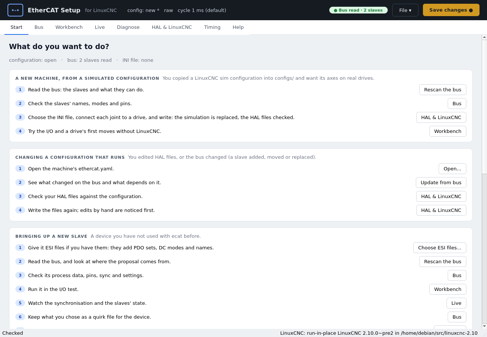

A list of tasks, each with its steps in order and a button that takes you
to where the step is done (a tab, or an action such as *Rescan the bus*).
The line at the top tells what is open: configuration, bus, INI file. The
tasks:

- a new machine, from a simulated configuration;
- changing a configuration that runs;
- bringing up a new slave;
- using a slave by hand;
- tuning a servo drive ([step by step](#tuning-a-servo-drive-step-by-step));
- troubleshooting while LinuxCNC runs.

### Bus

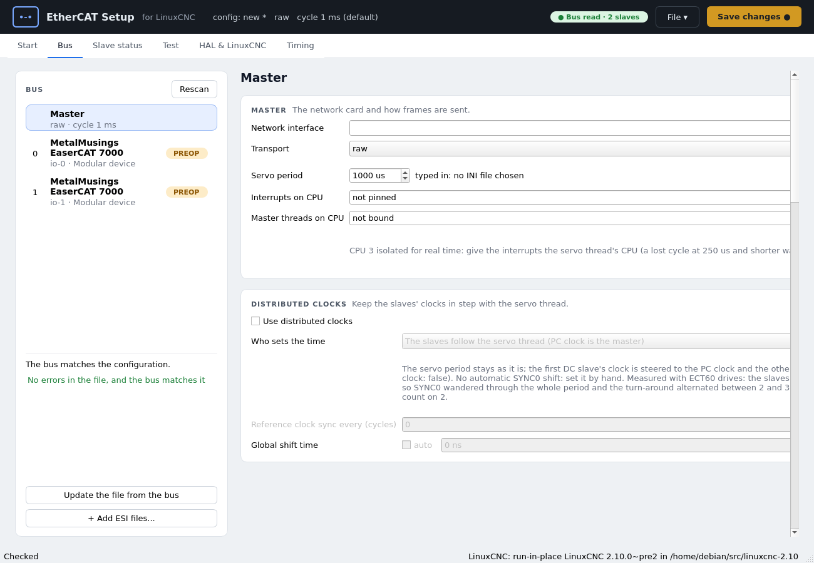

On the left, the bus: *Master* and each slave with its position, name,
pin prefix, profile and AL state. A line under the list says whether the
bus matches the configuration. *Rescan* reads the bus again;
*Update the file from the bus* brings the file in line with it (what
changed is listed first); *Add ESI files...* gives the program ESI files
to propose from.

The **Master** page (on the right) holds the network interface, the
transport, the servo period (taken from the INI file once you have chosen
one; without an INI file, or one without `SERVO_PERIOD`, typed in, 1 ms
until then: enough to try slaves on their own with the I/O test), **Interrupts on CPU** and **Master threads on CPU**
(`irq-cpu` and `cpu`: pin the network card's interrupts, and the master's own threads, to a CPU; the line
under them names the CPUs isolated for real time on this computer; "not pinned" leaves them where the
system put them) and **Distributed clocks**: whether to use them, *Who sets the time*
(the slaves follow the servo thread, or the servo thread follows the
reference clock, which is recommended; the fields of the other choice are
greyed out), how often the reference clock is synchronised (choosing "the
slaves follow the servo thread" sets it to 100 cycles when it was more or
unset; more than 100 is warned about, since the slaves' clock then wanders),
and the global
shift time (`auto` lets the component find it; see
[file format](component.md#the-configuration-file)).

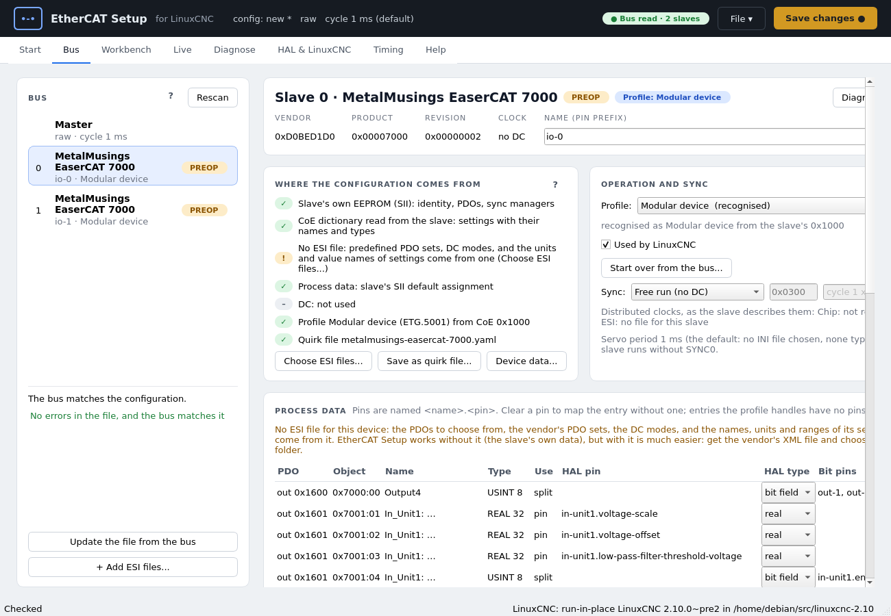

Choosing a slave shows:

- its identity, its **name** (the pin prefix) and its profile;
- **Problems**, when the proposal or the check found any;
- **Where the configuration comes from**: SII, CoE, ESI file, DC, profile.
  A green tick means the source was found, an amber mark that something
  would improve the proposal (usually an ESI file). *Choose ESI files...*
  and *Save as quirk file...* (what you chose, kept for the device, see
  [quirk files](#quirk-files)) are here;
- **Operation and sync**: first the *Profile*: how ecat runs the slave.
  *CiA 402 drive* (enable, fault handling and the modes below), *Modular
  device* (I/O terminals, with their encoder and serial channels) or
  *Generic* (every entry a pin, nothing handled for you). The profile the
  slave reports (its 0x1000) or its ESI file names is marked *recognised*
  and proposed; generic is always offered. Choosing another one proposes
  the slave's PDOs again for it, after asking; its name, settings and DC
  stay. Then *Used by LinuxCNC* (untick it for a slave that
  is only on the bus: `unused: true`, the slave is left alone, in PREOP,
  with no pins; ecat still checks at start that it is the slave the file
  says), the PDO assignment (the box shows the ESI's
  predefined assignment the file uses; choosing another proposes the slave
  again with it, after asking), `configure-pdos`, the Sync
  choice (free run, one of the slave's DC modes, or DC mode with user settings; see
  [Distributed clocks](#distributed-clocks)) with SYNC0's cycle and shift (and,
  for a mode that uses SYNC1, a row with SYNC1 every n SYNC0 cycles and its
  shift, filled from the mode); under
  it what the slave says about DC (chip, SII, ESI, CoE), a line with the SYNC0
  cycle it gets (the servo period times the cycle factor) and, when there are
  any, what was *measured on the bus* on this kind of device at servo periods that
  were tried ([Measured SYNC0 cycles](#measured-sync0-cycles)), with a warning when
  the servo period is at or below one that was refused,
  and for a drive the CiA 402 modes (below), *Propose again* and the homing
  card ([cia402](component.md#the-cia402-profile));
- **CiA 402 modes**, for a drive: *Mode of operation* is the mode the
  drive starts in and runs in. Under *Can also switch to* you tick the
  modes it may switch to while it runs, with the pin `opmode-cmd`: for
  instance CSP and PP, or CSV and PV, for a drive that is sometimes a
  joint and sometimes positions on its own. A line under the boxes shows
  the pin's numbers (0 is the mode above). The mode above cannot be
  ticked twice. *Homing by the drive's own method* is separate, since
  homing is not an `opmode-cmd` value; it shows the card **Homing by the
  drive**: the method (from the drive's `0x60E3`, or all of the standard's),
  speeds, acceleration, offset, and the INI lines LinuxCNC needs, with
  *Copy the INI lines*. The choice goes to Settings. Switching modes is
  built and unit-tested but not yet tried on a drive
  ([Changing modes](component.md#changing-modes));
- **Serial ports**, for a serial terminal (EL6001, EL6002, EL6021,
  EL6022; [serial channels](component.md#serial-channels)): a row per
  channel with its port (`/dev/ttyECAT4`), the baud rate at start, the
  frame (data bits, parity, stop bits: the device's), *Send continuous*
  (for Modbus RTU above 38400 baud) and *RS485 (half duplex)*, which adds
  or removes the setting `0x80n0:06` (greyed out when the terminal has
  none, an EL6001). Under it the lines for mb2hal's INI file for each
  port, with *Copy the mb2hal lines*;
- **Network (EoE)**, for a slave that speaks Ethernet over EtherCAT (its
  SII lists the protocol) or has an `eoe:` block
  ([eoe](component.md#eoe)): *Give the slave an IP address* adds the block,
  starting from a subnet `192.168.N.x` that no other slave and none of the
  computer's own networks is in (the slave `.2`, the computer `.1`);
  switching it off removes the block. The fields are the slave's address
  with its prefix length, the computer's address (`host-ip`; empty leaves
  the network device down), gateway, DNS server, host name and MAC
  address; an emptied field is taken out of the file. Under them: the name
  of the slave's network device on the computer (`eoe0s4`) and what to try
  (`ping`, the web page), and the errors and warnings of the check for
  this slave;
- **Process data**: every PDO entry with its pin name and HAL type. The
  first column gives the direction and the PDO (`out 0x1600`). The
  columns Scale, Offset, Bit pins and Invert are shown only where an entry
  uses them (the *All columns* box shows them all), so that the rows fit a
  small window. Clear
  a pin name to map an entry without a pin; entries the profile handles
  are marked as such and get no pin. An entry of several bits, such as a
  drive's digital inputs (`0x60FD`), can get one `bit` pin per bit:
  choose *bit field* in the HAL type list. The pins are named
  `<pin>-0`, `<pin>-1`...; rename them, or leave a name empty to give a
  bit no pin, in the *Bit pins* column (double-click the empty *HAL pin*
  cell of the row to go there). Choosing a type again gives back one
  pin. The *Invert* column makes a bit pin the opposite of the bit (`yes`
  for a bit pin, the names of the bit pins for a bit field), for normally
  closed switches such as an E-stop: no `not` is needed in HAL.
  The order is: the profile, then its choices (for a drive the mode and the
  modes it may switch to; for a modular device what its channels are used
  for), then the PDOs these need. *PDOs per mode*, beside the drive's
  modes, says for each mode whether the device's PDOs can give it (from
  its ESI file): *ready* (one of its PDO assignments has it), *build* (an
  own mapping in its open PDOs), *impossible* (the tooltip says why, such as
  a mode the drive does not report in 0x6502) or *unknown*. When the
  mapping in the file lacks something, *Ways to get this* under the table
  lists what the device offers, the recommended one first: a predefined
  assignment, fixed PDOs, or an own mapping in the open PDOs, and for a
  modular device the assignment that gives a channel its index, external
  latch or more data bytes. Nothing changes until you press *Use this*: the
  slave is read and only its PDOs are replaced (pins of objects that stay
  keep their names; the rest of the slave's entry stays). The proposal
  itself never changes the assignment on its own: it names the better one
  in its notes ("recommended PDO mapping ... not applied until you choose
  it").
  Under the table, lines say what the mapping lacks for the drive's
  modes (red: *cannot run as CiA 402 in CSP: 0x607A Target position
  missing*; grey: the mode objects 0x6060/0x6061 are not mapped, which is
  all right with one mode), and what the device's ESI file says about the
  PDOs in the file (a fixed PDO that was changed, PDOs that exclude each
  other, too many entries, an object that cannot be mapped that way).
  *Add what is missing* maps the objects the red line names, *Add
  object...* any object the ESI file lets be mapped (it goes into the
  first open PDO of its direction), *Remove entry* takes the selected
  entry out, and *Add PDO...* assigns another of the device's PDOs with
  its entries. A PDO that the ESI file marks fixed cannot be edited: the
  window says so and what to do (*Propose again* chooses ready PDOs that
  have the objects, or builds a mapping in the open PDO);
- **Settings**: SDOs written at every start, in PREOP. A new proposal
  already has what the device needs written at start: the settings its
  ESI file writes then (its InitCmds, such as Beckhoff's channel
  settings; not the ones the configuring tool fills in itself, such as
  the cycle time, and not those written with complete access, which a
  note names), and for a drive whose `0x6060` is not in the process data,
  its mode (`0x6060:00`, which follows the mode chosen above); also the
  state change timeouts its ESI file gives that are longer than the
  master's (`state-timeouts-ms`). For a file
  made earlier, *Add what the device needs* adds them (shown when some
  are missing; *Update from bus* names them too, and adds nothing on its
  own). *Add setting...*
  opens the slave's object dictionary: filter by object or name, objects
  writable in PREOP only (untick to see all), manufacturer objects
  (0x2000-0x5FFF) in bold, with type, size, access and, from the ESI file,
  range and default. Select one or more and *Add*: each gets its name and
  type and the value the slave has now (else the ESI default, else 0).
  PDO mapping objects and commands are not offered. You can also type an
  object; it completes from the dictionary. A row with a problem is
  coloured and explained under the table: not in the dictionary, not
  writable in PREOP, a value that does not fit the type or the ESI's
  range, another type than the dictionary's, or a command (a quirk file's
  command is an error and `--check` refuses it; one that only looks like a
  command, by its name, write-only access or 0x1010/0x1011, is a
  warning). *Read present values* fills the *Now* column from the slave.
  For a CiA 402 drive *Suggest following-error window* adds the drive's
  own following-error window (the quirk file's object, such as the ECT60's
  `0x2022`, else `0x6065`) as an ordinary setting: twice the joint's `FERROR`
  from the INI file, in the joint's counts (the Joints card gives the
  scale), so that LinuxCNC's own following error trips first and the drive
  is the second line of defence. The status line says how it was worked
  out, or why nothing was suggested (no joint, no INI file or `FERROR`, a
  drive with several axes). A setting already there is updated.
  *Values in hex* shows the values and *Now* as `0x` hex, as wide as the
  type (the SDO card's *Hex* box is the same setting); you can type a value
  in either form, `255` or `0xFF`, and the file keeps the number;
  The dictionary is the slave's own with the ESI file's ranges added; with
  no slave read, the ESI file's alone. `ecatsetup --check FILE --esi DIR`
  prints the same problems from the ESI files;

  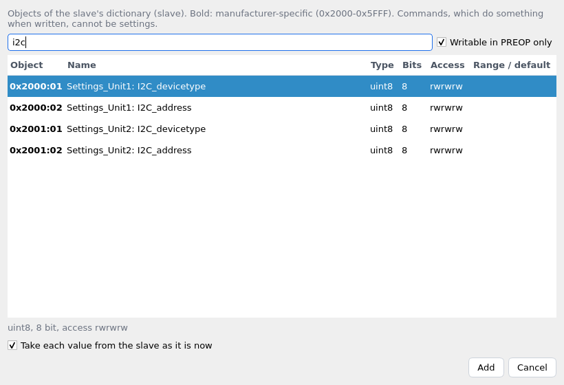

  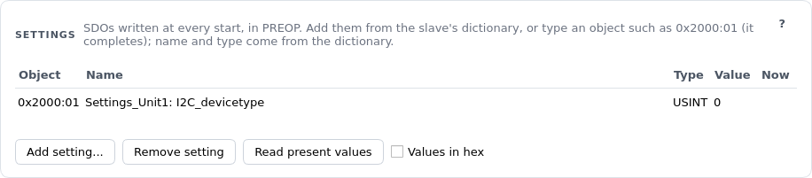

- **Settings** (continued): *Remove setting* removes the selected rows;
- **Notes from the proposal**.

The buttons *Status* and *Test this slave* in the slave's header jump to
the other tabs with the slave chosen.

### Slave status

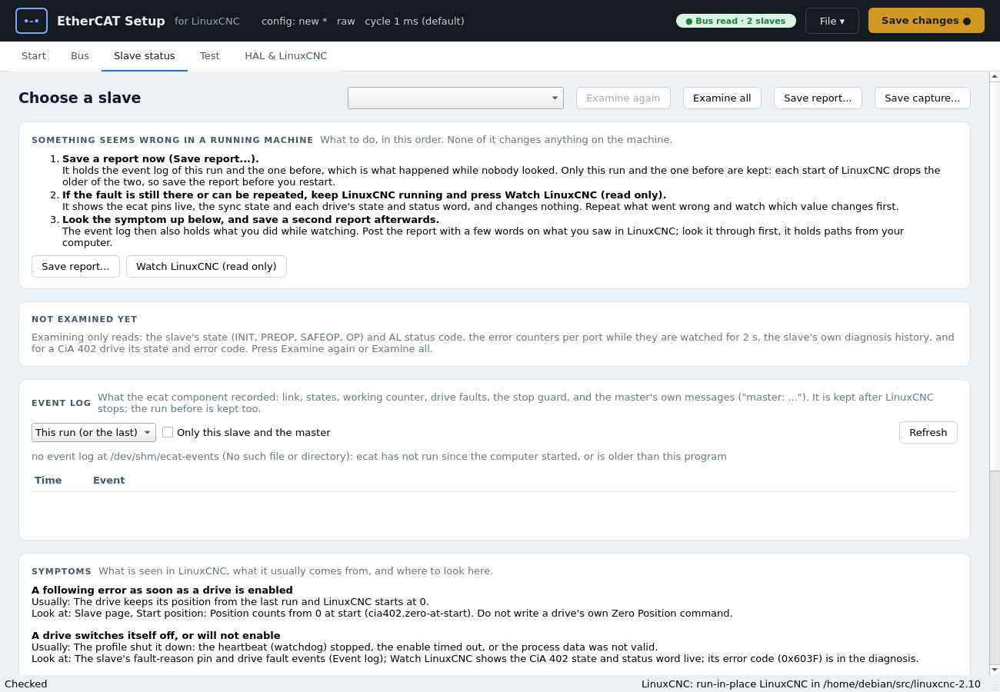

Diagnosis of the slaves on the bus: *Examine again* / *Examine all*. For
the chosen slave the page shows a series of steps (each ok, warning or
failed), what the slave says (AL state and status code), the cable and
link (port error counters), the slave's own message history (0x10F3), and
A port counter that has reached 255 is marked: it cannot show whether the fault is
still there, so the diagnosis says to write the counter (0x0300 for rx and phy
errors, 0x0310 for lost links) or power the slave off, and run it again.
**Messages from the master**: what the master said about this slave while
`ecat` ran (the I/O test or LinuxCNC), such as "Slave seems not to support
distributed clocks!", and the **Event log**: what the `ecat` component recorded
while LinuxCNC ran ([event log](#event-log-and-report)), optionally only for this
slave and the master.

A slave that stopped short of OP with the master's error flag but no AL
status code is shown as "The master stopped bringing the slave up": the
master gave up configuring it (a DC setting the slave cannot take, an SDO it
refuses), or the slave refused and the master's acknowledgement cleared its
code. The master's messages say which.

For a running machine the page opens with a short flow: *Save report...*
(a file to attach when you ask for help), then *Watch LinuxCNC (read only)*.
*Save capture...*, beside *Save report...* at the top, records the whole
bus for a developer who does not have the device ([A capture of the
bus](#a-capture-of-the-bus)).
At the bottom, **Symptoms** lists what is seen in LinuxCNC, what it usually
comes from and what to do.

### Test

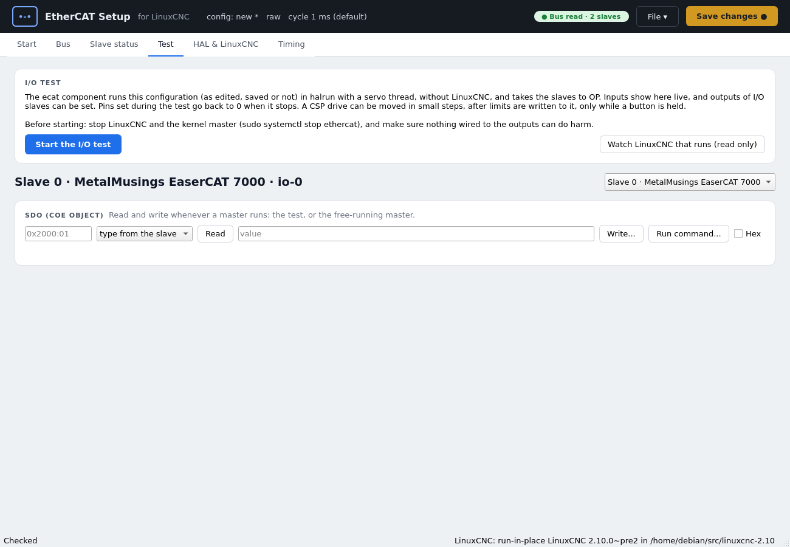

Works with no LinuxCNC. *Start the I/O test* runs `ecat` in `halrun` on
the bus; stop the kernel master first, or the two share the NIC
([Getting started](getting-started.md#getting-started)). For the chosen slave:

- **Synchronisation**: DC state, where SYNC0 falls and the turn-around, the
  `pll-err` spread, the room for two cycles, where the network card's
  interrupts are, and what was measured on the drives; *Remember this period for
  the drives...* keeps what a good (or refused) run shows
  ([details](#synchronisation-in-the-test-mode));
- **Outputs** and **Inputs**, live, and **All pins**. Outputs are set
  here and go back to 0 when the test stops;
- **SDO**: read and write a CoE object while a master runs;
- for a drive: the **CiA 402 state chain**, live values, the status word,
  and **Move**, which can move the axis. It writes limits to the drive,
  needs *Hold to enable* held down (a heartbeat shuts the drive down if
  the window hangs), has jogs, runs, homing and *Reset fault*, and puts
  the drive's limits back with *Done*. Read [test mode](#test-mode)
  before using it, and have the user at the machine.

*Watch LinuxCNC that runs (read only)* shows the pins of a LinuxCNC that is
already running and changes nothing.

### HAL & LinuxCNC

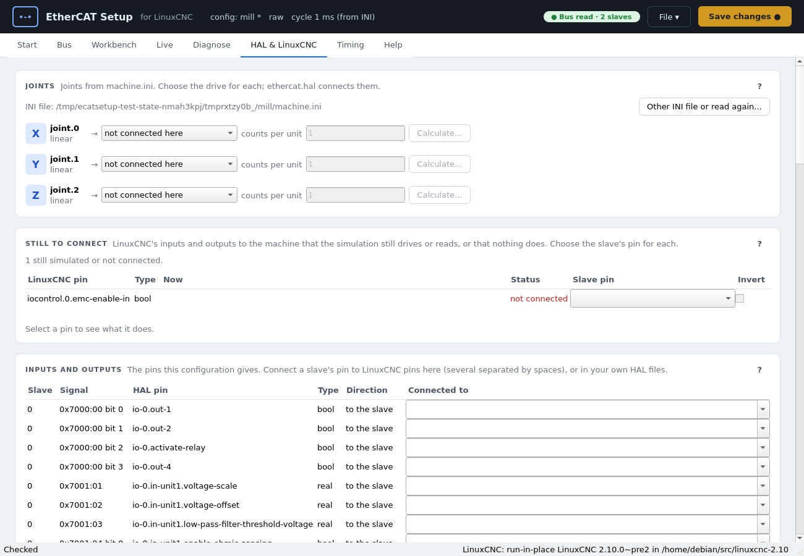

Writing the configuration into a LinuxCNC machine ([writing into LinuxCNC](#writing-the-configuration-into-linuxcnc)).
One column, top to bottom in the order of the work:

- **Joints**: choose the INI file, then the drive for each joint. The
  card always shows the INI file in use; its button chooses another one
  or reads the same one again (also *File > Machine INI file...*).
  *Take over from the HAL files* reads what your HAL files already use;
- **From lcec** (only for a configuration that uses lcec): every pin of
  lcec your HAL files use, with the ecat pin that takes its place, and the
  settings lcec wrote at start (see [from an lcec configuration](#from-an-lcec-configuration));
- **Still to connect**: LinuxCNC's inputs and outputs to the machine
  (E-stop, home switches, probe, spindle, plasmac's torch and sensors ...)
  that the simulation still drives or reads, or that nothing does, with
  a choice of the slaves' pins of the right type for each (see
  [what is still simulated](#what-is-still-simulated)). Select a row to
  read what the LinuxCNC pin does (for example `plasmac.breakaway`), with
  links to the pin's section and to the whole page (QtPlasmaC, motion,
  halui ...) in LinuxCNC's documentation on linuxcnc.org. The text comes
  from LinuxCNC's documentation and is kept in `ecatsetup/pindocs.py`;
  nothing is fetched, the links open in your browser. Pins of your own
  components have no text. The *Invert* box of a row makes the connected
  slave pin the opposite of its bit (a bit pin or one bit of a bit field),
  for a normally closed switch such as an E-stop; it is the same setting as
  the *Invert* column of Process data, so every net the pin is in gets it;
- **Inputs and outputs**: the pins the configuration gives, and a column
  where you connect each to LinuxCNC pins. An encoder channel's pins
  (`pos`, `velocity`, `counts`, `index-enable` ...) are rows too. A pin both
  sides read and write (a handshake such as `index-enable`) is connected
  to such a pin (`spindle.0.index-enable`, `joint.N.index-enable`) and
  written with `<=>`; of a simulated spindle encoder on the same signal
  only the simulation's pins give way, never your own logic;
- **HAL check** and **File contents**, side by side: your HAL files
  against the configuration, and `ethercat.yaml` as it will be written;
- **Apply to LinuxCNC**, last: what will be written (`ethercat-load.hal`,
  `ethercat.hal`, the INI changes, the HAL lines that will be commented
  out with `#ecatsetup: `), *Show all changes...* and *Write* on the left,
  the selected file's new text on the right. Work on a copy of the
  configuration first. A checkbox runs the HAL check each time LinuxCNC
  starts. A configuration inside LinuxCNC's own files (the source tree of a
  run-in-place build, or the installed sample configurations) is flagged
  with a warning, and *Write* asks again before it writes there: copy the
  folder to `~/linuxcnc/configs` first. A run-in-place LinuxCNC runs a
  sample configuration where it is and does not offer to copy it; start it
  with `debug_pickconfig=1 linuxcnc` to be asked.

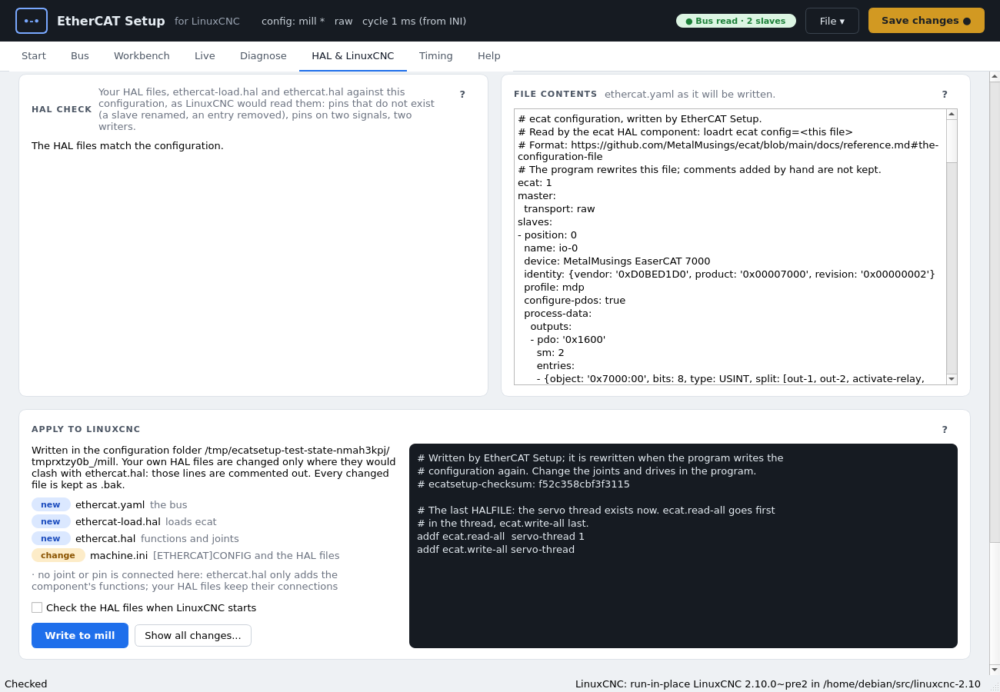

## Bringing up a new slave

Getting a slave to work with the master: its process data, its clock
and synchronisation, and its settings. EtherCAT Setup proposes all of
it from what it can read; this section is about seeing what the proposal
rests on, checking it on the bus, and keeping what you chose.

### Where the proposal comes from

The slave's page on the *Bus* page has a card *Where the configuration
comes from*, one line per source, marked ✓ (used), ✕ (missing or not
matching) or – (not used):

| Source | What it gives |
|---|---|
| The slave's EEPROM (SII) | Identity, PDOs, sync managers; always read. |
| The CoE dictionary | The names and types of settings, the drive's supported modes. Without it names come from the SII. |
| An ESI file | Predefined PDO sets (the *PDO assignment* box offers them), DC modes, units and value names of settings. The line says which file matched and whether it is for the slave's revision; a file for another revision is used, with a warning to check what it gave. |
| Process data, DC, profile | Which of the above each came from. |
| A quirk file | When one matches the device ([quirk files](#quirk-files)). |

### ESI files

For now you provide the ESI file: the vendor's XML, from its web site
or the device's CD. Without one EtherCAT Setup works from the SII and
the CoE dictionary, and says what is missing. *Choose ESI files...*
(or `--esi FOLDER` on the command line) reads every XML file in a
folder. A folder chosen in the window is remembered, in
`~/.config/ecatsetup/settings.yaml` (or `$ECATSETUP_SETTINGS`), and read
again at the next start; a folder that no longer exists is skipped.

What is read from the files is kept in `~/.cache/ecatsetup/esi-cache.pickle`
(or `$ECATSETUP_ESI_CACHE`; empty for none) and used again while a file has
the same size and time. Beckhoff's whole set (1.2 GB of XML) takes about a
minute to read the first time, and a second after that; the window says
so while it reads. Removing the file only makes the next start slower.

### A spindle encoder (EL5101)

How to get a terminal with an incremental encoder input (an EL5101, or
another that follows ETG.5001 MDP 511) to be LinuxCNC's spindle encoder,
for threading and other spindle-synchronised moves. The encoder function
of the component does the work; the steps are to give EtherCAT Setup what
it needs to propose it, and to connect two pins. Status: the encoder
function has run an EL5101 (see [encoder channels](component.md#encoder-channels));
connecting the spindle pins from the window is built and unit-tested, and
has not been tried at a machine yet.

1. **Give it the ESI files.** *Add ESI files...* (Bus page, or the
   slave's *Choose ESI files...*) and choose the folder with Beckhoff's
   XML files (`Beckhoff EL5xxx.xml` for an EL5101); the folder is
   remembered. Without them the slave has only the process data it starts
   with, which for an EL5101 is the *legacy* layout (`0x7000:01`, `:02`,
   `0x6000:01` to `:03`: Ctrl, Value, Status, Value, Latch). The encoder
   function does not handle it, and the proposal says so in its notes.
2. **Read the bus again** (*Read the bus*, or *Propose again* on the
   slave). *Where the configuration comes from* shows ✓ for the ESI file.
   The proposal now uses the ESI file's default assignment, *Standard 16
   Bit (MDP 511)*, and finds the channel: the notes say *encoder enc:
   channel 0x6010 ...*, and the counter and latch entries are marked
   *profile* under Process data. For a 32-bit counter choose *Standard 32
   Bit (MDP 511)* under *PDO assignment* (the slave is proposed again with it); the count
   is extended to 64 bits either way. The DC settings and the way the
   terminal reaches OP come from the ESI file too: if the slave does not
   reach OP, the test mode names what it did not accept.
3. **Set the scale.** The encoder's `pos` is in units of the scale, so
   that one turn of the spindle is 1.0. On *HAL & LinuxCNC*, the
   [*Parameters*](#parameters) card has `<slave>.enc.pos-scale`: type the
   counts per revolution (a quadrature encoder gives four counts per
   line: 4096 for a 1024-line encoder). It is written into `ethercat.hal`.
4. **Connect the two pins.** On *HAL & LinuxCNC*, *Still to connect* lists
   `spindle.0.revs` and `spindle.0.index-enable`, simulated while the
   configuration still has LinuxCNC's spindle simulation
   (`spindle_sim.hal`). Choose `<slave>.enc.pos` for `spindle.0.revs`
   (the spindle position in revolutions) and `<slave>.enc.index-enable`
   for `spindle.0.index-enable` (a handshake pin both sides drive, so
   it is connected with `<=>`). Writing replaces the simulated encoder on
   those signals; the rest of the simulation (the speed command) stays
   until you take it out.
5. **Check it by hand.** In the *Test* page (the free-running master and
   `halrun`, no LinuxCNC) turn the spindle by hand: `enc.pos` counts one
   per turn in the direction you expect (if it is backwards, make
   `pos-scale` negative), and `index-enable` clears at the index pulse,
   where `pos` returns to 0. Only then run the machine.

See [Inputs and outputs](#inputs-and-outputs) for the connection pins in
general, and [encoder channels](component.md#encoder-channels) for every
pin of the channel (`velocity`, `counts`, `reset`, the external latch).

### A Modbus VFD on a serial terminal (EL6021)

How to talk Modbus RTU to a VFD (or another Modbus device) over RS485
through a Beckhoff EL6021 on the EtherCAT bus, with LinuxCNC's `mb2hal`,
instead of a USB-RS485 adapter. The terminal's channel becomes a serial
port on the computer, `/dev/ttyECAT4` for instance, and `mb2hal` uses it as
it would use `/dev/ttyUSB0`. The same goes for the EL6001 (RS232) and the
two-channel EL6002 and EL6022. Status: built from Beckhoff's manual and ESI
files; tried with `mb2hal` over a real wire against a slave of our own made
to behave as an EL6021 (2400 to 115200 baud, in `halrun`), not on a real
terminal yet (see [serial channels](component.md#serial-channels)).

What you need from the VFD's manual: its Modbus address (slave id), baud
rate, parity and stop bits, and the registers for run/stop, the speed
command and what you want to read back.

1. **Wire it.** For two-wire RS485, the EL6021's transmit and receive
   lines are connected to one another, as in Beckhoff's manual (EL600x,
   EL602x, "Connection for RS485 transfer"), and to the VFD's A/B (or
   D+/D-). The EL602x has no termination resistors of its own: put 120 Ω
   at the two ends of the line.
2. **Give it the ESI files** (*Add ESI files...*, the folder with
   `Beckhoff EL6xxx.xml`) and **read the bus**. The proposal finds the
   channel: the notes say *serial port: PDOs 0x1604/0x1A04, 22 data bytes;
   a serial port on the computer ...*, and under Process data the
   entries are *handled by the serial channel port*. The slave gets the
   port `/dev/ttyECAT<position>` (an EL6022: `-1` and `-2`).
3. **Set the port on the *Serial ports* card** of the slave's page:
   - *Baud rate* and *Frame*: the VFD's (Modbus RTU is often 19200 8E1,
     many VFDs ship with 9600 8N1). Parity and data bits are used as set
     here, whatever `mb2hal` asks for: the port cannot pass them on.
   - *RS485 (half duplex)*: tick it for two-wire RS485. Without it the
     terminal also receives what it sends itself, and `mb2hal` reads its
     own request back instead of the VFD's answer. (The check list, and
     `--check`, add a note for an EL6021 or EL6022 channel without it:
     ignore it for RS422.)
   - *Send continuous*: tick it above 38400 baud, so that a request longer
     than 22 bytes goes out without a pause (which would break it);
     harmless below.
   - *Port*: change the path if you like; it must not be the path of a
     real port.

   Save, and write into LinuxCNC (*Apply*), as for any slave.
4. **Write mb2hal's file.** Copy the lines under the card (*Copy the
   mb2hal lines*) into the first transaction of an mb2hal INI file in your
   configuration folder, and add the transactions for your VFD (registers
   and function codes from its manual; LinuxCNC's
   `mb2hal_HOWTO.ini`, in its documentation, explains each key):

   ```ini
   [MB2HAL_INIT]
   TOTAL_TRANSACTIONS=2
   [TRANSACTION_00]
   LINK_TYPE=serial
   SERIAL_PORT=/dev/ttyECAT4
   SERIAL_BAUD=19200
   SERIAL_BITS=8
   SERIAL_PARITY=even
   SERIAL_STOP=1
   MB_SLAVE_ID=1
   MB_TX_CODE=fnct_06_write_single_register
   FIRST_ELEMENT=8193
   NELEMENTS=1
   HAL_TX_NAME=vfd-cmd
   [TRANSACTION_01]
   MB_TX_CODE=fnct_03_read_holding_registers
   FIRST_ELEMENT=12288
   NELEMENTS=2
   HAL_TX_NAME=vfd-status
   ```

   (The register numbers are an example; take yours from the VFD's
   manual.) Start it from a HAL file of your own (`ecat`, which makes the
   port, is loaded first, by `ethercat-load.hal`):
   `loadusr -W mb2hal config=mb2hal.ini`, and connect
   its pins (`mb2hal.vfd-cmd...`) to the spindle as for a USB adapter. The
   [HAL check](#checking-the-hal-files) warns if `SERIAL_BITS` or
   `SERIAL_PARITY` differ from the frame on the card.
5. **Check it.** With LinuxCNC running (or the *Test* page's I/O test,
   which loads `ecat` and so makes the port), these pins tell where it
   stops:

   | Pin | If |
   |---|---|
   | `<slave>.port.state` | 3 when the channel is ready; 0: no process data (the bus) |
   | `<slave>.port.port-open` | true while `mb2hal` has the port open |
   | `<slave>.port.tx-bytes` | counts up: requests go to the terminal |
   | `<slave>.port.rx-bytes` | counts up: answers come back. Stays at 0: wiring, A/B swapped, the VFD's address, baud rate or parity, termination |
   | `<slave>.port.parity-errors`, `framing-errors` | count up: the frame or baud rate differs from the VFD's |
   | `<slave>.port.baud` | the rate the terminal has: `mb2hal`'s `SERIAL_BAUD` |
   | `<slave>.port.settings-error` | true: the terminal did not take a rate `mb2hal` asked for |
   | `<slave>.port.burst-timeouts` | counts up with *Send continuous*: the terminal did not confirm; untick it and tell us |

   `mb2hal`'s own `mb2hal.<transaction>.num_errors` counts requests that
   got no valid answer. When `rx-bytes` grows about as fast as `tx-bytes`
   with half duplex off, the terminal hears itself: tick *RS485 (half
   duplex)*.

If you have a serial terminal, [a capture of the bus](#a-capture-of-the-bus)
while `mb2hal` talks to the VFD helps to make the channel right for
everyone (it has not met a real terminal yet).

### A device's web page over EoE

How to reach the built-in web page (or another network service) of a
drive, an I/O module or a gateway through the EtherCAT cable, with no
second cable to it: Ethernet over EtherCAT (EoE). The slave gets an IP
address, the computer a network device of its own for that slave, and a
browser on the computer opens `http://<the slave's address>/` while
LinuxCNC runs. Status: tried on one slave of our own (an EaserCAT 3000
with a small web server), in halrun and in LinuxCNC with the machine
moving ([development.md](development.md#eoe)); not on a bought device.
The reference is [eoe](component.md#eoe).

What you need: a slave that speaks EoE (its manual says so, and the
slave's page in the window then has the *Network (EoE)* card), and the
master package 1.4 or later.

1. **Read the bus** and open the slave's page. No *Network (EoE)* card:
   the slave's SII does not list EoE, and it has none (or needs another
   firmware or setting to have it: its manual).
2. **Tick *Give the slave an IP address*.** The card fills in a subnet
   that nothing else uses: the slave `192.168.10.2/24`, the computer
   `192.168.10.1`. Keep them unless the device insists on an address of
   its own (some have a fixed one, or take it only from their own
   settings: then give the card that address and prefix, and the
   computer another address in the same subnet).
   - The subnet must not be one the computer already is in (your
     ordinary network, often `192.168.1.x` or `192.168.0.x`): the card
     warns.
   - *Gateway*, *DNS server*, *Host name* and *MAC address* can stay
     empty for a web page.
3. **Save**, and write into LinuxCNC (*Apply*) as for any slave.
4. **Start LinuxCNC** (or the *Test* page's I/O test, which loads `ecat`
   too). When the bus is in OP, try it from a terminal on the same
   computer (the card names both):

   ```
   ping 192.168.10.2
   ```

   and then the browser: `http://192.168.10.2/`. Use `http://`, not
   `https://`, and no proxy for that address.

**Several slaves.** Each EoE slave has its own card, its own network
device on the computer (`eoe0s<position>`) and must have its own subnet:
`192.168.10.x` for the first, `192.168.11.x` for the next. The card
proposes the next free one; two slaves in one subnet are an error in the
check, since the computer would reach only one of them. (Two EoE slaves on
one bus have not been tried.)

**Speed.** About 0.5 Mbit/s each way for a slave at a 1 ms servo period
(one mailbox of data per cycle): fine for a settings page, slow for a
firmware file. It does not disturb the servo cycle: the traffic rides in
the cyclic frames, and the servo thread's jitter was unchanged in the
tests.

**When LinuxCNC is not running** the address is gone: the network device
is made anew whenever the bus is taken over or scanned, and only `ecat`
knows the file. With the master started but nothing loaded, set it by
hand (`sudo ip addr add 192.168.10.1/24 dev eoe0s4; sudo ip link set
eoe0s4 up`), or use the I/O test.

**From another computer.** Nothing is routed: only the computer on the
bus reaches the slave. The simple way from elsewhere is an SSH tunnel,
`ssh -L 8080:192.168.10.2:80 <the LinuxCNC computer>`, then
`http://localhost:8080/`. A bridge to your network would put the
machine's bus on it: do not.

If it does not work:

| What you see | Look at |
|---|---|
| no *Network (EoE)* card | the slave has no EoE (step 1) |
| `ping`: "Network is unreachable", or `ip addr show eoe0s4` has no address | LinuxCNC or the test is not running, the *computer's address* field is empty, or the master package is older than 1.4 (`ecat` then prints "this master cannot set eoe.host-ip" at start) |
| `ping`: no answer, the device has the address | the slave did not take the address (*Slave status*, "Messages from the master": a set-IP error), has a fixed address of its own, or the subnet is also the computer's ordinary network (`ip route`) |
| `ping` answers, the browser does not | `http://` and port (the device's manual), a proxy setting in the browser |
| the master's log says "No EoE processing because of missing callbacks!" | the master package is 1.3 or older |

### Distributed clocks

What a slave can do with distributed clocks (DC) comes from four sources,
shown under the Sync choice on the slave's page:

| Source | What it says |
|---|---|
| The slave's EtherCAT chip (as `ethercat slaves -v` reports it) | "DC clock, 64 bit" (or 32): it has a system time and can take SYNC0, which does not say the device uses it. "Delay measurement only" or "no DC": it cannot take SYNC0 at all. |
| The ESI file of the slave's revision | Its operation modes (`Dc/OpMode`): free run, and DC modes with the AssignActivate they need (an EL5101: DC 0x0320, DCIN 0x0320). No `Dc` element: no DC mode. |
| The slave's SII (EEPROM), category DC | The same modes, from the slave itself; a missing category is a weaker "no". Without an ESI file of the slave's revision these are the ones offered. |
| CoE `0x1C32`/`0x1C33` (slaves with CoE) | `:04` the synchronisation types supported (free run, SM synchronous, DC), `:05` the minimum cycle time. A value above 100 ms is not believed (an ECT60 says 3.9 s). |

The Sync choice offers *Free run (no DC)*, each DC mode of the slave (with
its AssignActivate and SYNC0 factor), and *DC mode with user settings*: any
AssignActivate, typed in the field beside it. Nothing is forbidden. With
the bus read, the page, the check list and `ecatsetup --check FILE` (with a
master running) warn:

- the slave is the DC reference clock (the first used slave with DC on,
  after ETG.1020; `--check` names it, with or without the bus), but its chip
  has no DC system time: the bus has no reference clock
  ([dc](component.md#dc));
- DC is on, but the chip has no DC clock: the slave will not reach OP
  with DC (an EL2008: the master says "Slave seems not to support
  distributed clocks!" and "Failed to set DC cycle times", and the slave
  stays in PREOP with no AL status code);
- DC is on, but the slave describes no DC mode (an EL1008: its chip has
  DC, it reaches OP and does not use SYNC0);
- the AssignActivate is not one of the slave's DC modes;
- DC is on, but CoE `0x1C3x:04` lists no DC mode;
- DC is off, but the slave lists only DC modes (it may refuse OP, AL
  0x0027);
- the servo period is shorter than the slave's minimum cycle time;
- (a note) the SII and the ESI file differ in their DC modes.

Without the bus nothing is said: the file alone does not tell what the
slave can do.

Tried on turner's bus (2026-11-14): EK1100, EL1008 and EL2008 have no DC
mode in SII or ESI, the EL2008's chip only measures delays; the EL5101's
SII, ESI and CoE agree (DC 0x0320, minimum cycle 66 us); the ECT60's SII
has DC 0x0300 and free run. With DC 0x0300 on the EL1008 and EL2008,
`--check` warned for both, the EL2008 stayed in PREOP and the EL1008 went
to OP, as described above.

### Synchronisation, in the test mode

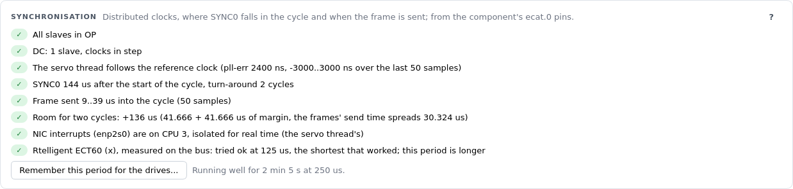

While a test runs (*Test* page), the *Synchronisation* card shows, from
the master's pins (`ecat.0.*`):
- whether all slaves are in OP;
- distributed clocks: how many slaves use them, and whether the
  master's DC sync check failed for one (`dc-sync-failed`);
- which clock is the master (the Master page's "Who sets the time" says it
  in words: the slaves follow the servo thread, or the servo thread follows
  the reference clock); with `servo-thread-follows-ref-clock`, whether the servo thread is
  locked to the reference clock (`dc-phased`, `pll-err`);
- where SYNC0 is (`shift-time`) and the turn-around (`turnaround-cycles`):
  2 is what drive profiles count on; with `sync0-shift-ns: auto` it says
  so while it still measures (2 s after all OP), and warns at 3 or more;
- how much the moment the frame is sent varies (`send-offset`, the last
  50 samples): more than a quarter of the period points at the servo
  thread's latency;
- the servo thread's `pll-err` as a spread over the last 50 samples, not only
  the last value;
- the **room for two cycles**: the period less the two margins (`auto-shift-margin`
  and `auto-shift-input-margin`) less the spread of the frames' send time. When
  it is under a tenth of the period, a late frame can put SYNC0 in the
  three-cycle position (what happened at 125 us on the plasma cutter, with
  the old fixed margins of 50 us);
- **where the network card's interrupts are**, against the CPU that is isolated
  for real time (`isolcpus=`): on the other CPUs the arrival of a frame waits
  behind the GUI and other work (`master: irq-cpu` pins them);
- what was **measured on the kinds of drive** that run with SYNC0 here at this
  servo period (below).

*Remember this period for the drives...* keeps what the run shows. With all
slaves that use SYNC0 in OP for a minute or more and the turn-around at two
cycles (the text beside the button says for how long it has run well), it
records that the period works for each kind of drive; when a drive is not in
OP with an AL status that is about the SYNC0 cycle (0x0030, 0x0035, 0x0036,
0x0037) it records that it refused the period (the master acknowledges the
slave's error and so clears the slave's own code; the code the master kept,
`ethercat slaves -v` "Last AL status code", is used then); any other reason is
not kept.
It asks first. The results go to your own file,
`~/.config/ecatsetup/measured/sync0.yaml`, are added to the ones that come
with the program (`ecatsetup/measured/sync0.yaml`: the ECT60, 100 to 250 us,
2026-11-16), and are shown on the slave's page. Only periods that were tried
count: "refused at 100 us" and "ok at 125 us" say nothing about 110 us.

A slave without DC has no SYNC0 to place; the card then says only
whether the slaves are in OP.

What the rows mean for how short a servo period can be, and what was
measured on one machine, is in [Servo period and
performance](component.md#servo-period-and-performance).

### Keeping what you chose

*Save as quirk file...* on the slave's page saves its pin names, scales
and settings as a quirk file of your own, for the device's vendor and
product. The next slave of the same device is proposed with them, on
this machine or, with the file shared, on another ([quirk files](#quirk-files)).

## Troubleshooting a slave

A slave that does not work, in five questions, each answered by something
in EtherCAT Setup. None of it changes the slave, except the test in
point 4, which is a deliberate act:

1. **Is it there, and is it the one the file expects?** The bus list, and
   the line under it that compares the bus with the configuration.
2. **Why is it not in OP?** *Examine* on the *Slave status* page (or
   `ecatsetup --diagnose`): the slave's AL state and status code in plain
   words, and the master's own messages about it.
3. **Is the cable or the connector at fault?** The port error counters,
   watched while you look, and the lost links, which point at the cable
   between two slaves.
4. **Does it do what it should in OP?** The I/O test: inputs live,
   outputs set by hand, SDOs read, a drive's CiA 402 state chain, and
   the synchronisation card.
5. **What happened while LinuxCNC ran, and who can help?** The event log,
   *Watch LinuxCNC*, the symptoms list, and a report, or a capture of the
   bus for a developer who does not have the device.

The steps below go through them in order. Stop at the first one that
explains the fault.

### Step 1: the slave on the bus

1. A master must run. With LinuxCNC stopped, EtherCAT Setup offers to start
   one ([starting the master](#starting-the-master)); with LinuxCNC running,
   it reads through LinuxCNC's master. The kernel master must not have the
   network card at the same time (`sudo systemctl stop ethercat`).
2. Look at the bus list on the *Bus* page. A slave that is missing, and
   every slave after it, has no power, or the cable before it is broken:
   check the power and the cable at the last slave that is listed.
3. The line under the list says whether the bus matches the configuration:
   the same devices at the same positions. A slave added, moved or
   replaced is named there; *Update the file from the bus* brings the
   file in line and says what changed. LinuxCNC's start check says the
   same in its log when `ecat` loads (`master.start-check`).

### Step 2: why it is not in OP

1. On the *Slave status* page, choose the slave and press *Examine again*
   (or *Examine all*; on the command line `ecatsetup --diagnose`, which
   asks for no SDOs of slaves without CoE). It reads, and changes nothing.
2. Read the AL state and status code. The page gives the code's meaning
   and what usually lies behind it. The common ones:

   | Code | Usually | What to do |
   |---|---|---|
   | 0x0017, 0x001D, 0x001E, 0x0024, 0x0025 | The process data mapping is not accepted. | Choose another PDO set (*PDO assignment*, with the ESI file), use the slave's own assignment, or clear *Write the PDO mapping to the slave* (`configure-pdos: false`). If LinuxCNC does not use the slave at all, untick *Used by LinuxCNC* on its page: the slave is then left alone. A slave of the file that does not reach OP stops every drive (the working counter is incomplete), a slave that is not used does not. |
   | 0x0026, 0x0043 | A setting (start-up SDO) was refused, or does not fit the others. | Read the master's messages for the object; check it in the Settings card (*Read present values*), take it out and try again. |
   | 0x0027, 0x0028, 0x002C, 0x002D, 0x0030, 0x0035, 0x0036 | Distributed clocks: needed, wrong, or not possible at this period (0x0036, "DC Sync0 Cycle Time": the slave does not take the servo period as its SYNC0 cycle; the Rtelligent ECT60 refuses 100 us and takes 125 us and up: use a longer period). | [Distributed clocks](#distributed-clocks): the Sync choice and its warnings; [Servo period and performance](component.md#servo-period-and-performance). |
   | 0x001B | Sync manager watchdog: the process data stopped. | LinuxCNC or the test stopped, or the servo thread missed cycles: see the event log. |
   | 0x0020, 0x0060, 0x0011 | The slave needs a power cycle, reset itself, or follows an earlier error. | Power the slave off and on; restart the master. |

3. "The master stopped bringing the slave up" (the master's error flag, no
   status code) means the master gave up while configuring it. The
   **Messages from the master** under it say why, for example "Slave seems
   not to support distributed clocks!" or an SDO abort for a setting.
4. Check the file: the check list on the *Bus* page, or
   `ecatsetup --check ethercat.yaml` with a master running, also warns
   about DC settings the slave cannot take.

### Step 3: cable and connectors

1. *Examine* watches the error counters of each port for 2 s
   (`--seconds` for longer). Counters that grow while you watch point at
   the cable or connector on that port: move the cable, look at the plug,
   try another cable.
2. Lost links are counted per port since power-on; the diagnosis names
   the cable between two slaves that was disconnected or lost power. A
   cable pulled on purpose counts too.
3. A counter at 255 cannot grow any more. The page says so; power the slave
   off and on, and examine it again.
4. Faults that come and go show in the event log as a slave going offline,
   the working counter incomplete, or a link down, with the time.

### Step 4: in OP, with the I/O test

1. Stop LinuxCNC. On the *Test* page, *Start the I/O test* runs the
   configuration in `halrun` and takes the slaves to OP ([test mode](#test-mode)).
2. **Inputs**: change the signal (a switch, a sensor) and watch the pin.
   **Outputs**: set one, and see the device react. Make sure nothing
   wired to the outputs can do harm.
3. **SDO**: read objects the slave's manual names (status, error codes,
   measured values). *Write* refuses commands, process data and a drive's
   CiA 402 objects.
4. A drive: the **CiA 402 state chain** shows its state and status word,
   and what is missing to reach "Operation enabled". Moving it needs the
   user at the machine ([moving a drive](#moving-a-drive)).
5. **Synchronisation**: all slaves in OP, DC in use, whether the master's
   DC sync check failed, the turn-around (2 cycles is the aim), and how
   much the frame's send time varies.
6. A slave that works in the test but not in LinuxCNC: compare the HAL
   files with the configuration (the *HAL check* card on the *HAL &
   LinuxCNC* page, or `ecatsetup --check-hal machine.ini`).

### Step 5: while LinuxCNC runs, and asking for help

1. Faults that only come in LinuxCNC: the **event log** on the *Slave
   status* page (*Only this slave and the master*) shows what the
   component recorded, kept after LinuxCNC stops, with the run before.
   `scripts/ecat-events-follow` follows it live in a terminal.
2. *Watch LinuxCNC (read only)* shows the pins of a running LinuxCNC;
   repeat what went wrong and see which value changes first.
3. **Symptoms**, at the bottom of the *Slave status* page, lists what is
   seen in LinuxCNC, what it usually comes from and where to look.
4. To ask for help: *Save report...* ([the report](#the-report)) and a few
   words on what you saw. For a device the developer does not have, add
   *Save capture...* ([a capture of the bus](#a-capture-of-the-bus)),
   preferably taken while the I/O test runs, so that it holds the frames
   of the bus in OP.
5. What you found and chose for a device (pin names, settings, a PDO set):
   keep it as a quirk file ([keeping what you chose](#keeping-what-you-chose)),
   so that the next slave of the same kind starts from it.

## Test mode

EtherCAT Setup's Test page runs the configuration being edited, saved or
not, in `halrun` with the `ecat` component and a servo thread, without
LinuxCNC. It is the same code that runs the machine.

Before starting it, stop LinuxCNC and the kernel master
(`sudo systemctl stop ethercat`). The free-running master
(`ethercat-uspace start`) hands the bus over to the test by itself and
does not come back when the test stops.

The test does not start when the master's network interface is missing,
does not exist on this computer, or is set to `xdp-native` on a driver
that cannot do it (such as `r8169`): the Master page says why. If the
component does not load, the test stops at once with the end of the
`halrun` log. A test's files (`ethercat.yaml`, `test.hal`, `halrun.log`) are
in a folder `/tmp/ecatsetup-test-*`, kept until the next test starts, which
removes the earlier ones.

One test runs at a time, also with several EtherCAT Setup windows open:
editing in several windows is fine, but a second window that starts a
test is told which process runs one already. The lock
(`~/.local/state/ecatsetup/test.lock`) goes with the process, so a
crashed window does not keep it.

### I/O

Each slave's inputs show live; the outputs of I/O slaves can be set.
Pins set during the test go back to 0 before it stops. SDOs can be read
and written from the same page whenever a master runs; objects that are
commands rather than settings (such as `0x2010` on the ECT60), objects in
the process data, and a drive's CiA 402 objects are refused by *Write*.
*Run command...* runs a command object once: it asks first, showing what
the quirk file says it does, and is refused while a CiA 402 drive is in
"Operation enabled" (read from its statusword). Only objects known as
commands (a quirk file's `commands:`, or suspected from the dictionary)
can be run this way; the value is the quirk's, else the one typed.

When the test stops, every drive is disabled, the outputs go to zero, and
the slaves are taken to PREOP while process data still flows
(`ecat.take-down`; the component's stop guard would do it too), so that
they stop without an error.

### Moving a drive

A CiA 402 drive can be moved in small steps: in CSP and PP by jogging, in
PV by running it while a button is held, and a drive with `hm` in its
`modes` can home by its own method (see [PP, PV and homing](#pp-pv-and-homing)).
Safety comes in layers, so that no single one has to be perfect:

1. **Nothing moves without a deliberate act.** The drive is enabled only
   while a button is held, with the mouse or the space bar, one at a
   time: *Hold to enable* enables it without moving it; *Jog −* and
   *Jog +* enable it by themselves and move one step. Releasing the
   button disables the drive; so does the window losing focus.
2. **Heartbeat.** Every drive's `watchdog-ms` is set to 500 ms in the
   test's HAL file, and the window counts the `watchdog` pin up every
   100 ms. If the window hangs or dies, the servo thread shuts the drive
   down by itself (`fault-reason` 5).
3. **Limits in the drive.** *Write limits to the drive* reads the drive's
   own values and writes, where the drive has the objects:
   - software position limits `0x607D` at ± the travel around the
     position at that moment;
   - a tight following-error window: `0x6065`, or the vendor's object
     (on the Rtelligent ECT60, `0x2022` "Position trace error Limit");
   - the maximum torque `0x6072`.

   The drive's own values are kept in
   `~/.local/state/ecatsetup/drive-limits.json` before each limit is
   written, and written back by *Done* or when the test stops; if the
   program dies in between, it offers to write them back at its next
   start. While another window runs a test, the values in that file are
   its own: no other window offers to write them back.
4. **Limits in HAL.** The drive's `pos-cmd` comes from a `limit3` with the
   test's velocity, acceleration and travel, in the servo thread. Until
   the drive is in "Operation enabled", the `limit3` follows `pos-fb`, so
   enabling never makes a jump; a jog moves its target by one step, never
   past the travel.

Defaults: 5 mm/s, 50 mm/s², ± 20 mm, following error 2 mm, torque 30 %.
The scale (counts per mm) is taken from the configuration's HAL files
(`setp <drive>.pos-scale ...`) when they have it.

What the ECT60 has: `0x607D` and `0x2022`, no `0x6080`, `0x6072` or
`0x6065`. It ignores `0x607D` in CSP (tried: it moved 4.6 mm past a
limit of 1 mm, without an error or a status bit), so the test writes only
`0x2022` to it, and its travel, velocity and torque are limited in HAL.

#### PP, PV and homing

In PP and PV the drive plans the motion itself; there is no `limit3` in
front of it. The layers 1 to 3 are the same, and instead of layer 4:

- **PP** (*Jog −*, *Jog +*): each step is a move to the drive's present
  position ± the step, never past the travel around the start;
  `pp-velocity` is the test's maximum velocity, and the maximum profile
  velocity `0x607F` is written to the drive where it has it. The drive
  ramps with its own acceleration (`0x6083`, `0x6084`). The move starts
  once the drive is in "Operation enabled" (the profile ignores
  `pp-start` before that); releasing the button stops it. The profile
  velocity is `pp-velocity` if `0x6081` is in the process data, else
  `0x6081` is written to the drive with the other limits.
- **PV** (*Run −*, *Run +*): the drive runs at the test's maximum
  velocity while the button is held, and ramps down with its own
  deceleration when it is released. There is no travel limit in PV:
  keep the button short, or use PV for what turns (a spindle, a
  conveyor). `0x607F` is written where the drive has it.
- **Homing** (*Home (hold)*, for a drive with `modes: [..., hm]`): the
  drive homes by the method and speeds in its settings (`0x6098`,
  `0x6099`, `0x609A`); the card shows *in progress*, *homed* or *error*.
  Releasing the button stops the homing. Try the method first with the
  drive away from its end stops. When the drive reports the homing
  attained (`stat-homed`), the window disables the drive by itself, so
  the axis does not go on pressing against its stop, and the Home button
  turns green ("✓ Homed: position is 0") until the next homing; on an
  error it turns red.

The scale (counts per mm) is also used as `velo-scale`: the drive's
velocity units are taken as counts per second, the CiA 402 default. For
a drive with other velocity units, the mm/s shown are off by that
factor; check with a short run first.

Tried on the plasma cutter (2026-11-10, ECT60 drives): see
[PP, PV and homing at the machine](#pp-pv-and-homing-at-the-machine).

**Set the scale first.** The *Scale* field starts at 1 count per mm
unless the configuration's HAL files have the drive's `pos-scale`; with
1, a 1 mm step is 1 count and nothing seems to move. The window asks
before it writes limits with a scale of 1.

**Homing may move the axis.** The window reads the drive's homing method
(`0x6098`) when the limits are written, and says what it does. Only
method 35 (the current position) leaves the axis where it is; any other
drives it to a limit switch, an index pulse or a stop, and *Home (hold)*
is refused until *The homing may move the axis* is ticked. The ECT60s
were found on method 17 (negative limit switch): without a switch the
axis drives into its end stop.

#### The plot

While a drive can move, the *Move* card plots the last 10 seconds, one
strip each with its own scale: the position (from where the test
started), the following error (CSP: the command less the feedback) and
the velocity (PP and PV: the position and the velocity). It is drawn from
the pins, every 200 ms.

#### Tuning a servo drive, step by step

In CSP LinuxCNC sends a position every cycle and the drive does the rest:
its command filter, its position and velocity loops, its feedforward.
There is no PID in LinuxCNC to tune. What LinuxCNC sees is the following
error, `pos-cmd` - `pos-fb`, and `FERROR` must allow for it. Tuning here
means finding what that error is made of and making the parts that are
not the bus small, one change at a time, with a measurement before and
after. The *Response* card on the Test page does the measuring and
comparing; the details of each line are in [Measuring a drive's
response](#measuring-a-drives-response) below.

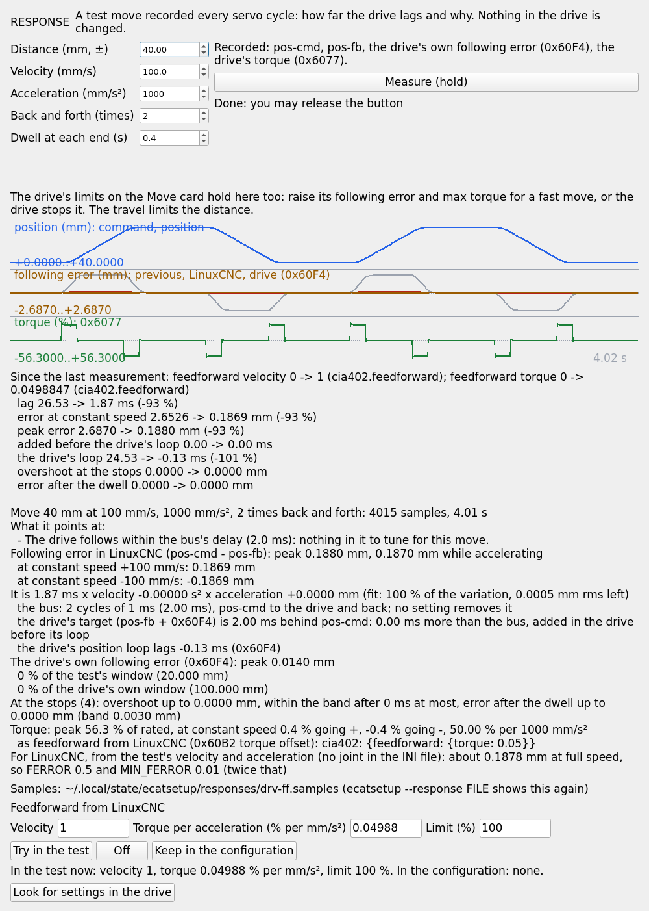

*The Response card after two measurements of a simulated drive (an
EaserCAT 3000 acting as a CiA 402 drive, 1000 counts/mm, 40 mm at 100
mm/s): first without feedforward (25 ms behind: the grey line), then with
the feedforward line the first measurement gave. The comparison comes
first.*

**Before you start**

- The machine is free to move the test's distance both ways, someone is
  at it with the emergency stop within reach, and the drive is a `cia402`
  slave in CSP. The drive moves only while *Measure (hold)* is held.
- Start the test (Test page), choose the drive on the *Move* card, give
  its scale (counts per mm), travel, following error and max torque, and
  press *Write limits to the drive*. The Response card appears.
- Record what the drive can tell: its own following error `0x60F4` and its
  torque `0x6077`. When the drive has them but they are not in the process
  data, *Add them to the process data*, save, and start the test again.
  Without `0x60F4` the card cannot tell a command filter from a slow loop;
  without `0x6077` it says nothing about torque.

**1. Measure the drive as it is**

- Distance, velocity and acceleration: near the joint's `MAX_VELOCITY` and
  `MAX_ACCELERATION`, and a distance long enough for some constant speed
  (the card says when it was too short). Two strokes back and forth.
- Hold *Measure (hold)* until it says *Done*. Measure with the real load
  on the axis: inertia and friction are part of the result.

**2. Read what it points at**

The first lines say where most of the error comes from. What to do:

| The card says | It comes from | What to try |
|---|---|---|
| the drive follows within the bus's delay | the bus only (two cycles) | nothing; set `FERROR` (step 5) |
| the drive's target is behind `pos-cmd` by more than the bus | a command filter or smoothing in the drive | make it small: LinuxCNC's path is smooth already (ECT60: `0x2009`) |
| the drive's position loop lags *n* ms (an effective gain of *k* /s) | the position loop without (enough) velocity feedforward | velocity feedforward in the drive, a higher position gain, or [feedforward from LinuxCNC](#feedforward-from-linuxcnc) |
| part of the error follows the acceleration | inertia not made up for | torque feedforward or the inertia ratio in the drive, or torque feedforward from LinuxCNC |
| overshoot at the stops, a long settling | a gain too high, or a resonance | a lower gain, a notch filter |
| an offset that stays at standstill | no integral, or friction | the position loop's integral |
| the torque reached the test's limit | the test's max torque | raise *Max torque* on the Move card, or a lower acceleration |

**3. Try one setting at a time**

- *Look for settings in the drive* lists the settings that may be the
  cause, what the measurement points at first, with their present values
  (from the drive's quirk file, then by name from its own dictionary).
  Nothing is written.
- Choose one, give a new value and press *Try it*: the drive's own value is
  kept first, and the new one goes to its RAM while it is disabled.
- Measure again with the same move. The result starts with what changed
  and how much the lag, the error and the stops moved.
- *Keep as setting* when it helped: the value goes into the slave's
  Settings in the configuration, which ecat writes at every start (save
  the file). *Undo* puts the drive's own value back. Nothing is stored in
  the drive's EEPROM; what is still being tried is put back when the test
  stops.

##### Feedforward from LinuxCNC

A drive with `0x60B1` (velocity offset) and `0x60B2` (torque offset) can
take its feedforward from LinuxCNC: the profile works them out from
`pos-cmd` every cycle ([component.md, feedforward in
CSP](component.md#feedforward-in-csp)). It removes the position loop's lag
without touching the drive's gains.

- The objects must be in the drive's outputs, as `use: profile` (the
  proposal does that when the drive's PDOs have them), and the drive must
  be told to use them: a vendor setting, such as StepperOnline A6's
  C01.13 = 5 and C01.16 = 5. Add that setting to the slave's Settings, and
  turn the drive's own feedforward off.
- The card then has a **Feedforward from LinuxCNC** row: *Velocity* (the
  share of the command's velocity, 1.0 for all of it), *Torque per
  acceleration* and *Limit* (the torque offset's, % of rated; 30 unless the
  file says otherwise). A field is greyed out when the drive lacks its
  object. The line under it says what the test runs with now, and what
  the configuration has.
- Measure without it first. With `0x6077` recorded, the measurement puts
  the torque per acceleration it found in the field (and the result shows
  it as *as feedforward from LinuxCNC: cia402: {feedforward: {torque:
  0.05}}*).
- Set *Velocity* to 1, press **Try in the test**, and measure again: the
  comparison names the change (*feedforward velocity 0 -> 1*). **Off**
  sets both to 0 in the test. A measurement with a large acceleration may
  need a higher *Limit*.
- **Keep in the configuration** writes the values as the slave's
  `cia402.feedforward` (only those the drive has objects for; both 0
  removes it). Save the file; *Apply* (HAL & LinuxCNC page) then writes
  `setp <drive>.velo-scale` with the joint's scale, which `0x60B1` needs
  (counts per second). In the file it looks like

  ```yaml
  cia402:
    mode: csp
    feedforward: {velocity: 1.0, torque: 0.05}
  ```

- Without the window, the same while a test or LinuxCNC runs:
  `halcmd setp <drive>.ff-velocity-gain 1.0`, `halcmd setp
  <drive>.ff-torque-per-accel 0.05`.

**4. Measure again until nothing is left to tune**

Until the card says the drive follows within the bus's delay, or the
changes no longer make a difference worth having. Compare at the same
move every time.

**5. Into LinuxCNC**

- Save the configuration and *Apply* it (HAL & LinuxCNC page), so that
  the kept settings and the feedforward are written at start.
- Set `FERROR` and `MIN_FERROR` from the card's last line: twice the error
  it predicts at the joint's `MAX_VELOCITY` and `MAX_ACCELERATION`, with
  the bus's delay counted. A `FERROR` far above it hides a fault; one
  below it stops the machine with "joint N following error" at speed.
- Run LinuxCNC at full speed and watch `joint.N.f-error` (halscope), or
  measure again in the test with the same move.

**Two examples**

- *A plasma cutter's ECT60 drives* (2026-11-16): the card said the drive's
  target was 15 ms more behind than the bus: a command filter. *Look for
  settings* found `0x2009` "Filter Time" at 25600 us, its maximum. Tried
  6400, then 2000: the lag went from 17.3 to 4.6 ms and the error at 100
  mm/s from 1.65 to 0.49 mm. Kept as a setting. Measured again at 300
  mm/s, the card suggested `FERROR` 20 and `MIN_FERROR` 0.2.
- *A drive with `0x60B1` / `0x60B2`* (the simulated drive in the picture):
  26.53 ms of lag, most of it the position loop (24.5 ms: an effective
  gain of 41 /s).
  With feedforward velocity 1.0 and the card's torque 0.05: 1.87 ms, the
  bus's two cycles; the peak error from 2.69 to 0.19 mm. In LinuxCNC (40 mm
  moves at 100 mm/s) `joint.0.f-error` stayed below 0.09 mm; without it
  LinuxCNC stopped with "joint 0 following error".

#### Measuring a drive's response

The *Response* card (CSP drives, once *Write limits to the drive* is done)
moves the drive out and back with a chosen distance, velocity and
acceleration, and records every servo cycle. It says what LinuxCNC's
following error is made of. Nothing in the drive is changed: this is the
first part of tuning, the measuring.

- **Hold *Measure (hold)*** for the whole move (the card says about how
  long). The drive is enabled where it stands, waits 0.3 s, then moves out
  by the distance and back, *Back and forth* times, with the dwell at
  each end. Releasing the button stops it at once; what was recorded is
  still shown, marked as ended early. The Move card's safety holds: the
  heartbeat, the travel (the distance is cut to it), and the following
  error and torque written to the drive. For a fast move, raise *Following
  error* and *Max torque* on the Move card first, or the drive stops
  itself: that is the window doing its work, not a fault of the
  measurement.
- **What is recorded**: LinuxCNC's `pos-cmd` and `pos-fb`, whether the
  drive is in "Operation enabled", and where the drive has them in its
  process data, its own following error (`0x60F4`) and torque (`0x6077`).
  If the drive has them in its dictionary but not in the process data,
  *Add them to the process data* adds them to the first input PDO (not to
  a PDO the ESI file marks as fixed); save, then stop and start the test.
  The test's HAL has a `sampler` channel per CSP drive, after the jog and
  before `ecat.write-all`; `halsampler` reads it while the measurement
  runs.
- **What it shows**: a plot of the whole move (command and position, the
  following error, LinuxCNC's and the drive's own, and the torque), with
  the previous measurement's following error in grey behind it, and these
  lines:
  - the peak following error, and its mean at constant speed each way;
  - **What it points at**, first: the largest part of the following error
    and the kind of setting in the drive that it comes from (a command
    filter, the position loop, velocity feedforward, torque feedforward or
    inertia, a gain too high), or that the drive follows within the bus's
    delay and there is nothing in it to tune;
  - the error as *T* × velocity + *K* × acceleration + *c*. *T* is a time,
    made of:
    - **the bus**: the cycles from `pos-cmd` to the drive and back to
      `pos-fb`, the turn-around (two with the automatic SYNC0 shift). It is
      not an error at the motor, and no setting removes it; `FERROR` has to
      allow for it;
    - **what the drive adds before its loop**: with `0x60F4` recorded, the
      drive's own target (`pos-fb` + `0x60F4`) is compared with `pos-cmd`.
      When it is further behind than the bus, the drive delays or smooths
      the command: a command filter. In CSP LinuxCNC's path is already
      smooth, so such a filter can mostly be small. (The ECT60's `0x2009`
      "Filter Time" stood at its maximum, 25.6 ms, on a plasma cutter: 15 of
      its 17 ms of lag.)
    - **the drive's position loop**: `0x60F4` per velocity, 1 / its
      effective position gain. A drive without velocity feedforward lags by
      velocity / position gain: 40 /s at 100 mm/s is 2.5 mm. In CSP there is
      no PID in LinuxCNC: the gains and feedforward are the drive's.
    - Without `0x60F4` the drive's two parts are given together;
  - at each stop, the overshoot and the time until the position stays
    within a band (3 counts, at least 0.002 mm);
  - the torque at constant speed (friction) and per acceleration, when
    `0x6077` is recorded, with the `cia402.feedforward` line for it; whether
    it reached the test's torque limit (then the result is the limit's, not
    the drive's). The torque is set against the motor's acceleration, from
    `pos-fb` (smoothed so that a count's step is at most 1 % of the
    acceleration measured), not the command's, which a drive that lags
    follows late;
  - how much of the drive's following-error window (the test's and the
    drive's own) the error used: where a stepper drive with an encoder
    (such as the ECT60) loses steps or stops;
  - after a second measurement, how the numbers moved and what changed in
    between: settings being tried in the drive, and LinuxCNC's feedforward
    (`setp <drive>.ff-velocity-gain` / `ff-torque-per-accel` in the test's
    halrun);
  - `FERROR` and `MIN_FERROR` for LinuxCNC: twice the error the result
    predicts at the joint's `MAX_VELOCITY` and `MAX_ACCELERATION` (from the
    INI file, when the drive is a joint: the configuration's Joints, or
    else the joint whose `motor-pos-cmd` the HAL files connect to the
    drive's `pos-cmd`), else at the test's own.
- **Look for settings in the drive** lists the drive's settings that may
  explain the result, what it points at first: those its quirk file names
  (`tuning:`, with their range, factory value and what was found on a
  machine), then those whose names in the drive's own dictionary suggest a
  filter, a gain, feedforward, inertia or a notch (input filters, the
  current loop, alarms and commands are left out), with their present
  values. A value at the end of its range is marked, and so is one that
  belongs to a mode the drive is not in. Listing them writes nothing. This
  is how a drive nobody has tuned here yet can be looked at without its
  manual; the measurement before and after decides, not the name.
- **Trying one**: choose a row, give a new value and press *Try it*. The
  value is written to the drive's RAM, only while the drive is disabled
  and within the range where one is known; the drive's own value is read
  first and kept in `~/.local/state/ecatsetup/tuning-trials.json` before
  anything is written, and a value the drive does not take is put back.
  *Being tried* lists what is in the drive now. Then measure again with
  the same move: the result starts with what changed since the last
  measurement (*0x2009:00 25600 -> 2000*) and how the lag, the error at
  constant speed, the peak, the drive's parts and the stops moved, in per
  cent. Try one setting at a time.
- **Keep as setting** adds the value to the slave's Settings in the
  configuration (save the file), which ecat writes at every start; the
  drive keeps it in RAM meanwhile. Nothing is stored in the drive's EEPROM.
  **Undo** writes the drive's own value back. Values still being tried are
  written back when the test stops or the window closes, and offered back
  at the next start if the program ended without that.
- **Feedforward from LinuxCNC** (drives with `0x60B1` / `0x60B2` as
  `use: profile`): *Try in the test* sets the drive's `ff-velocity-gain`,
  `ff-torque-per-accel` and `ff-torque-max` in the test's HAL, *Off* sets
  the first two to 0, *Keep in the configuration* writes
  `cia402.feedforward`. A measurement with the torque recorded fills in
  the torque per acceleration while the test runs without it. See
  [Feedforward from LinuxCNC](#feedforward-from-linuxcnc).
- **Make the move long enough**: the drive's lag settles only after a few
  of its time constants at constant speed. The card says when constant
  speed lasted less than five times the lag; use a longer distance or a
  lower velocity then. A test near the joint's `MAX_VELOCITY` gives the
  best `FERROR`.
- **The samples** are kept in `~/.local/state/ecatsetup/responses/`
  (`<drive>-<date>-<time>.samples`, text with a header line); `ecatsetup
  --response FILE [--ini <machine>.ini]` shows the result again.

### Watching LinuxCNC

*Watch LinuxCNC that runs (read only)* on the *Test* page (or in the
File menu) shows the pins of the `ecat` component in a LinuxCNC that
runs, live, the same view as the test without anything that changes
something: no output can be set, no drive limits are written, no drive is
enabled, nothing is started or stopped, and *STOP* only ends the
watching. It reads through `halcmd`, as the same user as LinuxCNC. The
*Synchronisation* card works too, so a slave's sync and a drive's state
can be seen while the machine does its work. It stops by itself when
LinuxCNC ends.

The configuration open in the window is used to name the slaves; open
the one LinuxCNC runs (`[ETHERCAT]CONFIG` in its INI file). The
*Troubleshoot* page has a *Symptoms* guide: what is seen in LinuxCNC,
what it usually comes from, and where to look.

Tried against a running LinuxCNC (the plasma cutter's QtPlasmaC with
ecat, machine off, 2026-11-10): starting the watching takes 10 ms, a read
of the ecat pins about 3 ms; the *Synchronisation* card and a drive's
state, status word, live values and pins show and change live (the PLL
error moves between reads); every attempt to set a pin is refused and the
HAL had the same 1661 pins before and after. When LinuxCNC is closed the
watching ends by itself. Two findings, both fixed: the SDO card could
still be used while watching (it is now off), and a watching started
from the Start page showed no slave (the first one is shown now). LinuxCNC
must be started from a login session or with `setsid`; started from a
tool shell without a controlling terminal, its `rtapi_app` exited at once.

#### PP, PV and homing at the machine

Tried on the plasma cutter's three ECT60 drives on 2026-11-10, with the
user at the machine (100 counts/mm on X and Y; the test configuration
had the drives' `0x607D` as settings). The ECT60 has no `0x607F`; since
2026-11-14 PP needs only `0x607D:01` and `:02`, and `0x607F` where the drive
has it. PP was tried again from the window on X that day, steps of 1 and
5 mm, with the component of that day:

- **PP** works on X, Y and Z, steps of 1 and 5 mm in both directions,
  after two findings, both in the profile ([cia402](component.md#the-cia402-profile)): the
  ECT60 acknowledges a set-point sometimes without starting (target
  reached stays set), so the profile gives it again; and with control
  word bit 5 ("change set immediately") set it acknowledged and did not
  move at all (`pp-immediate`, off by default). The step starts about
  50 ms after the drive is enabled, the time the drive needs to report
  target reached.
- **PV** works on X, Y and Z in both directions.
- **Homing, method 35** worked earlier (2026-11-09). **Torque homing**
  (method 36, `0x2030`) was tried again with the drive test: X moves
  towards X− at about half the commanded speed (the drive needs 40 % of
  its rated torque for the friction), stops softly at the end stop with
  the torque at 70 to 80 %, and the drive never sets "homing attained",
  with detect limits of 50 % and 60 %, because the drive's speed loop
  had no integral gain (`0x2030:06` = 0). With `0x2030:06` = 100 and a
  larger `0x2022` it ends: the drive sets "homing attained" and zeroes
  the position at the stop, twice in a row
  ([cia402](component.md#homing-by-the-drive)).
- Z hangs in a spring suspension and moves when its drive is disabled:
  with the drive off, the axis can drift.
- Everything the test wrote to the drives was read back and restored.

### First test at the machine

Done on the plasma cutter's three axes (ECT60 drives in CSP) on
2026-11-09, with the user at the machine, following the steps below; X
(100 counts/mm) first:

- limits written (0x607D at ±20 mm, 0x2022 at 2 mm = 200 counts) and put
  back afterwards (−1/−1, 4000);
- *Hold to enable*: "Operation enabled", no motion;
- jog 0.1 mm and 1 mm, both directions, as expected;
- heartbeat: with the window stopped (`kill -STOP`) while enabled, the
  servo thread shut the drive down 0.38-0.44 s later (`fault-reason` 5,
  the last heartbeat up to 0.1 s before), and kept it down while
  `enable` stayed set;
- the test stopped cleanly: the slaves in PREOP, `0x603F` 0 on all three
  drives;
- `0x607D` set to ±1 mm by hand, with the HAL travel at ±20 mm: the
  ECT60 followed the target to +4.6 mm without an error. It ignores
  `0x607D` in CSP; the test no longer writes it to an ECT60.
- Y (66.67 counts/mm) and Z (212.2 counts/mm, travel ±5 mm; Z holds
  when disabled) the same way: *Jog +* moves Y+ and Z+ (up), steps of
  0.1, 1 and 5 mm, no errors; all three drives' own values back
  afterwards, the slaves in PREOP, `0x603F` 0.
- When a drive is disabled, the stepper lets go of its holding torque
  and moves back 4-6 counts (0.06 mm on X); the next jog starts from
  there.

The steps:

1. E-stop within reach; the axis away from its ends.
2. Start the test, choose the drive (X first), check the scale, and
   *Write limits to the drive*. The banner lists what was written.
3. If the drive shows Fault, hold *Reset fault*.
4. Hold *Hold to enable* without jogging: the drive should reach
   "Operation enabled" and not move. Release: it goes back to "Switched
   on" or "Ready to switch on".
5. Step 0.1 mm, hold *Jog +* alone (it enables the drive by itself)
   until the step is done: the position should change by 0.1 mm. Then
   1 mm, both directions.
6. Check the heartbeat: while holding *Hold to enable*, stop the window
   (for example `kill -STOP` of its process from a terminal). The drive
   should be disabled within half a second (`fault-reason` 5). `kill -CONT`
   it again.
7. *Done* writes the drive's own limits back; check them with an SDO
   read of what the banner listed (`0x2022` on the ECT60).
8. The other axes the same way. Stopping the test takes the slaves to
   PREOP; `0x603F` should be 0 on every drive afterwards.


## Which LinuxCNC

The test mode runs `halrun`, and the HAL files' library (`LIB:` names) and
`.tcl` HALFILEs need LinuxCNC's `hallib` and Tcl. With a LinuxCNC installed as a
package these are found on the PATH. With a run-in-place build, EtherCAT Setup
needs to know the tree: `linuxcnc: /home/you/src/linuxcnc-2.10` in
`~/.config/ecatsetup/settings.yaml` (the installer of the run-in-place archive
writes it), or `ECATSETUP_LINUXCNC=<tree>` in the environment, or just start it
from a shell that has read the tree's `scripts/rip-environment`. EtherCAT Setup
then reads that file itself for the programs it starts, so you need not. The
status bar of the window says which LinuxCNC it uses, with its version.

The version matters: LinuxCNC 2.9's integer pins have 32 bits, 2.10's 64. On
2.9 EtherCAT Setup proposes a `LINT`/`ULINT` entry as a `real` pin and
`extend` only for 16-bit counters (a 32-bit counter wraps as the pin does),
and the check refuses what the 2.9 component cannot do. The same
`ethercat.yaml` otherwise works on both.

## Starting the master

Reading the bus needs a running master. When none answers (and LinuxCNC is
not running), EtherCAT Setup offers to start one:

- the window asks at start, after a test has ended (the free-running master
  does not come back by itself), and when you press *Start the master...* on
  the Bus card. With `xdp-skb` or `xdp-native` and master package
  1.3+git20261115 or later the master is back in under half a second: the
  XDP program stays on the network card, so the link does not restart
  (before, about 3 s; `sudo ip link set dev <if> xdp off` removes the
  program);
- the command line (`--propose`, `--diagnose`, `--update`) asks with
  `[y/N]`, but only on a terminal; in a script it prints the old hint.

The dialog shows the whole command, for example
`sudo /usr/bin/ethercat-uspace start -- -i enp2s0 -t xdp-native`, and nothing
runs until you answer Yes. The interface and transport come from the file's
`master:` section when it names an interface that exists here; otherwise the
master's own `ethercat-uspace.conf` decides. When neither names one (no file
yet, as for a first look at a bus, and no active `INTERFACE=` line in
`ethercat-uspace.conf`), you are first asked which network card the slaves are
on: the wired cards, those with a link first (the window lists them, the
command line takes the first one on Enter). If the kernel master is loaded
(`/dev/EtherCAT0`), `sudo systemctl stop ethercat` is shown and run first;
it is never done without being shown. The box "Don't ask again this session"
stops the offers, the button still works.

The fork's own tool does the same. When you run `ethercat-uspace slaves`
(or any command that needs a master) in a terminal and no master answers,
it prints `sudo /opt/linuxcnc-ethercat-uspace/bin/ethercat start`, asks
`[y/N]`, starts the master on Yes and runs your command again (needs
linuxcnc-ethercat-uspace 1.2). It asks only with a terminal on both stdin
and stderr, never as root, never while LinuxCNC has the interface, and not
when `ETHERCAT_USPACE_NO_PROMPT=1` is set (ecatsetup sets it when it calls
the tool). With the kernel master loaded it shows
`sudo systemctl stop ethercat` first, as above.

A master that runs but does not fit is offered a restart: it has no link,
sees no slaves, or sits on another network card than the file's
`master.interface` (found by comparing the card's MAC address with the one the
master reports). The dialog shows `ethercat-uspace stop` followed by the start
command, and nothing runs until you answer Yes. A master that a program has
activated (LinuxCNC) is never called stale: it is in use. The offer comes once
per session.

The window never runs as root and never asks for a password: it runs
`sudo -n`. If sudo needs a password, the window tells you to run the command
in a terminal. The command line runs plain `sudo`, which asks by itself.
The code is in `ecatsetup/masterstart.py`.

## Writing the configuration into LinuxCNC

EtherCAT Setup writes an `ethercat.yaml` into a LinuxCNC configuration,
together with the HAL lines that load the `ecat` component and connect
the joints to their drives. In the window this is the *HAL & LinuxCNC*
page, *Write to <folder>*, which asks first and lists each file with what
is done to it (such as a `.tcl` HALFILE turned into `.hal`); on the
command line:

```
ecatsetup --apply ethercat.yaml --ini <machine>.ini
```

`--apply` shows every change as a diff and asks before writing (`--yes`
writes without asking). Nothing is written while the configuration has
errors.

### What is written

In the folder of the INI file:

| File | |
|---|---|
| `ethercat.yaml` | The configuration (the name of the file being edited). |
| `ethercat-load.hal` | New. Loads the component: `loadrt ecat config=[ETHERCAT]CONFIG`. |
| `ethercat.hal` | New. Adds `ecat.read-all` first and `ecat.write-all` last to the servo thread, and connects the joints to the drives. |
| `<machine>.ini` (or the file it `#INCLUDE`s that holds `[HAL]`) | `[ETHERCAT]CONFIG = ethercat.yaml`; `HALFILE = ethercat-load.hal` before the other HAL files, `HALFILE = ethercat.hal` after them. |
| your HAL files | Only lines that would clash are commented out (below). |

Every file that existed is kept as `.bak` first. `ethercat-load.hal` and
`ethercat.hal` are rewritten each time; change the joints in the program,
not in these files.

An INI file that `#INCLUDE`s the rest, as QtPlasmaC's do, is read the way
LinuxCNC reads it: the included file in place of the line (only in the
main file, relative to its folder, `~` and `$VARIABLES` expanded), and
only the first section of each name. The HALFILE lines go into the file
that holds the first `[HAL]` section, so often the included `.inc` file,
and a new `[ETHERCAT]` goes just before it. Do not choose the
`<name>.ini.expanded` file: LinuxCNC writes it from the INI file at every
start, so it is out of date until then and loses what is written into it.
The program offers the INI file it comes from, and refuses to write into
it.

There are two files because the component must be loaded before your
HAL files, so that the slaves' pins exist for them, but its functions can
only be added once the servo thread exists, which `motmod` creates in
your first HAL file.

### Joints

A joint is connected to a CiA 402 drive in CSP. `ethercat.hal` then
holds, for joint 0 and a drive `x`:

```
setp x.pos-scale 100.0
net x-pos-cmd joint.0.motor-pos-cmd => x.pos-cmd
net x-pos-fb x.pos-fb => joint.0.motor-pos-fb
net x-enable joint.0.amp-enable-out => x.enable
net x-amp-fault x.drv-fault => joint.0.amp-fault-in
```

and `index-enable` both ways if the drive homes by itself (`modes:
[hm]`; then `HOME_USE_INDEX = YES` must be set in the joint's INI section, which
the INI check says if it is not). The scale is counts per machine unit. The choice is kept in
`ethercat.yaml` (see [file format](component.md#linuxcnc)).

When your HAL files already connect a joint to a drive, the program
proposes the same connection with the same `pos-scale` (*Take over from
the HAL files*; `--apply` takes them over by itself).

Joints the program does not connect stay as your HAL files have them.
CSV drives and gantries with their own components are connected in your
HAL files for now.

### From a simulated configuration

A new machine often starts in LinuxCNC's simulator: pick one of its
configurations (`configs/sim/` in LinuxCNC), copy it into
`~/linuxcnc/configs/<machine>/`, try it, then open its INI file in
EtherCAT Setup and replace the simulation with the bus:

- **Joints.** The simulation loops each joint's `motor-pos-cmd` back to
  its `motor-pos-fb` (`core_sim.hal`). Connecting a joint to a drive
  takes the loop out: the command goes to the drive, and the feedback
  comes from the drive on a signal of its own. Other pins on the
  command's signal (the `ddt` blocks behind the velocity display) keep
  it.
- **Home and limit switches, E-stop.** Connect an input to
  `joint.N.home-sw-in`, `iocontrol.0.emc-enable-in` and so on
  (*Inputs and outputs*). The simulation's writer on that signal (a
  `sim_home_switch`, a `comp`, the E-stop loop-back
  `iocontrol.0.user-enable-out`) is taken off it. A simulated switch the
  simulation shared between joints (X and Z on one `or2`) is not given to
  the other joint: connect its own input.
- **Library files.** Most of the simulation is in LinuxCNC's `hallib`
  (`core_sim.hal`, `simulated_home.hal` ...). A file that must change is
  copied into the configuration folder and changed there; LinuxCNC finds
  the folder's first, and a `LIB:` line in the INI file is changed to the
  copy. LinuxCNC's own files are never changed.
- **`LIB:basic_sim.tcl`.** Most simulated configurations build their HAL
  in Tcl when LinuxCNC starts, and save it as `<ini name>_cmds.hal` in the
  folder. Start the copy once in the simulator, so that the file exists;
  writing then puts it in place of `LIB:basic_sim.tcl` (as that file's
  own header suggests), and changes it like any HAL file.
- **A configuration's own `.tcl` HAL files** (QtPlasmaC's
  `sim_no_stepgen.tcl`, `machine.tcl`) are read as the HAL they give: the
  file runs in `tclsh` as `haltcl` runs it, with the INI file's values
  (`$::KINS(JOINTS)`), but the HAL commands only note the line they would
  give, so nothing is loaded. Joints, pins, the take-over and the HAL
  check see their connections, with the Tcl file's line numbers. A query
  (`getp`, `show` ...) cannot be answered this way and is noted. A `.tcl`
  file is never changed. When it connects a pin `ethercat.hal` connects
  (the simulated joints and E-stop of `sim_no_stepgen.tcl`, once a joint
  or the E-stop is connected to a drive or an input), *Apply* turns it
  into a plain HAL file next to it, `sim_no_stepgen.hal`: the Tcl run once
  with the INI file's values (a loop over the joints becomes one set of
  lines per joint), with the clashing lines commented out with
  `#ecatsetup: `. The INI file then reads the `.hal` file; the `.tcl` file
  stays in the folder. Select the new file in the Apply card to see the
  complete HAL, and edit it as any HAL file: writing again keeps your
  changes. It is not done when the Tcl cannot be turned into HAL (a query
  such as `getp`, named in the message) or when the `.hal` file exists:
  then writing is refused and the message names the lines.
- <a id="what-is-still-simulated"></a>**Still to connect.** Each of
  LinuxCNC's pins to the machine is followed back through the HAL files
  (POSTGUI and `.tcl` ones too). A debounce (`dbounce`, `debounce`) is
  followed through, so the slave's pin takes the simulation's place in
  front of it (`db_arc-ok.in`, not `plasmac.arc-ok-in`); logic that
  changes the value (`not`, `or2` ...) is not, and the slave's pin is then
  connected to LinuxCNC's pin itself: an E-stop is never inverted by a
  guess. A source counts as simulated when its component is named so
  (`sim-torch`, `qtplasmac_sim`, `sim-joint.0...`) or comes from
  LinuxCNC's simulation files. Home switches are listed for joints that
  home to a switch (`HOME_SEARCH_VEL` not 0).
- **POSTGUI files.** A line there that connects a pin `ethercat.hal` now
  connects is commented out when that pin exists before the GUI (a
  slave's, or a component a HALFILE loads). The simulation's writer on it
  gives way like any other simulated writer. The simulation panel itself,
  QtPlasmaC's `qtplasmac_sim`, is taken out when you write: its `loadusr` line
  and every line with one of its pins are commented out with `#ecatsetup: `,
  and what else was on those signals (the simulated torch's
  `net plasmac:torch-on => sim-torch.start`) stays on a line of its own marked
  `#ecatsetup: added`. The simulated E-stop chain has no special treatment:
  connect `iocontrol.0.emc-enable-in` to an input like any pin, and the
  simulated writer on its signal gives way; the chain's other lines stay.
  A pin only the GUI has cannot be connected in `ethercat.hal`, which
  runs before the GUI: that is refused.
- **What is still simulated** is noted when writing: `simulated_home.hal`
  for switches not connected yet, `sim_spindle_encoder.hal` for the
  spindle. Take them out of the INI file once the real ones are
  connected.
- **The scale.** *Calculate...* beside a joint's counts per unit: the
  drive's counts per motor revolution, the screw's lead (units per
  revolution) and the gear between motor and screw.
- **The INI file is checked** against the drives: `SERVO_PERIOD` (the
  EtherCAT cycle), each connected joint's `FERROR` and `MIN_FERROR`, and
  its `MAX_VELOCITY` against the drive's maximum profile velocity
  (`0x607F`, read with the bus).

Tried on a copy of `configs/sim/axis/axis_mm.ini` with the plasma
cutter's configuration (three drives, one input for X's home switch):
the loops and the E-stop loop-back replaced, Z's shared simulated switch
left for its own input, `core_sim.hal` and `simulated_home.hal` copied
in, and the HAL check found nothing.

### From an lcec configuration

A machine that runs lcec (with `lcec_conf` and an XML file) moves to ecat
the same way: read the bus, so that the slaves get ecat's proposal (the
drives the cia402 profile), and open the machine's INI file. The XML file
is not imported; the HAL files say what is needed, and the XML file that
`loadusr -W lcec_conf <file>` loads gives suggestions. An XML file with more
than one master is refused: ecat drives one.

- **The cia402 component.** lcec configurations often put the `cia402`
  component ([hal-cia402](https://github.com/dbraun1981/hal-cia402))
  between a joint and a generic slave: the joint drives `cia402.X.pos-cmd`,
  the component writes the drive's control word and target position
  through lcec's pins. Where the drive at that slave's position has ecat's
  cia402 profile, the profile replaces the component: the Joints card
  offers the joint (its `pos-scale` from `setp cia402.X.pos-scale`), and
  when you write, the component's `loadrt` and `addf` lines and the nets
  between it and lcec's pins are commented out. Its other pins become the
  drive's pins of the same name (`cia402.X.drv-fault` becomes
  `X.drv-fault`; `csp-mode` goes, the mode is `cia402.mode`). A net that
  also takes the drive's position elsewhere (`lcec.0.X.actual-position =>
  cia402.X.drv-actual-position ddt.0.in`) keeps that reader, on the
  profile's pin (`X.drv-actual-position => ddt.0.in`). A drive without the
  cia402 profile keeps the component; choose the profile on the Bus page
  to replace it. lcec's C drivers with their own CiA 402 code are not
  recognised.
- **The other pins.** Every other pin of lcec in the HAL files is a row of
  the card *From lcec*: where it is used, and a box for the ecat pin that
  takes its place, or *(take it out)*. A suggestion comes from the XML file
  (the same object, or the same bit of it, of the slave at the same
  position: `lcec.0.E7000.in-1` is bit 0 of `0x6000:00`, which is
  `E7000.in-1` if that bit has a pin), the master's state pins
  (`lcec.0.all-op` becomes `ecat.0.all-op`), the slaves' state pins
  (`slave-online` ...), or the same name. A row's *Use* button takes its
  suggestion; *Use the suggestions* takes every suggestion for the rows
  without a choice. Writing is refused while a row has none. The choices are kept in `ethercat.yaml` as
  `linuxcnc.old-pins` ([the file format](component.md#linuxcnc)).
- **Names.** The slaves keep the proposal's names; *Name the slaves as lcec
  did* gives them the XML file's (`X`, `E7000`), as on the Bus page. The
  choices follow a rename.
- **What is written.** Each line with an old pin is commented out with
  `#ecatsetup: `, and the line with the new pins follows it, marked
  `#ecatsetup: added`: your HAL files keep their order, comments and signal
  names. A pin taken out leaves the line's other pins on the signal; a line
  with nothing left goes. lcec's own lines (`loadusr lcec_conf`, `loadrt
  lcec`, `addf lcec.*`) are commented out as always. A `.tcl` HAL file with
  old pins is turned into a `.hal` file, as for a simulation.
- **lcec's settings.** lcec wrote its `sdoConfig` values (and modParams,
  through the quirk files) at every start. Those the configuration does not
  have, or has with another value, are listed under the pins with *Add* (and
  *Add all these settings*); nothing is added unasked. A drive that does
  not keep a value has its own again after a power cycle, so check the list.
  A command lcec wrote as a setting (the ECT60's `0x2010` Zero Position) is
  offered as what replaces it (`cia402.zero-at-start`).

Tried on a copy of the plasma cutter's lcec configuration (three ECT60
through the cia402 component, an EaserCAT 7000 with bit pins), against
the configuration of the bus, without a machine: the three components
replaced, all 27 other pins suggested from the XML file, and the result
the same as the configuration converted by hand (`QtPlasma-ecat402`);
writing again changed nothing, and the HAL check found nothing. Then done
by the user in the window on a fresh copy against the bus, and LinuxCNC
started with the result and ran without remarks (2026-11-13).

### Parameters

The *Parameters* card on the *HAL & LinuxCNC* page lists the parameters of
the slaves, their axes and encoder channels with their type, the
component's default and a *Value* you can type: `pos-scale` and
`velocity-window-ms` of an encoder channel, `enable-timeout-ms`,
`auto-fault-reset` and the PV and PP timeouts of a drive, and so on (the
[component's](component.md) tables say what each does). Empty keeps the
default. The value is kept in `linuxcnc.params` of `ethercat.yaml` and
written as a `setp` line in `ethercat.hal` under `# parameters`:

```
# parameters
setp Encoder.enc.pos-scale 4096.0
```

Not listed: the master's parameters (`ecat.0.*`), and a drive's
`pos-scale` that a joint sets (the *Joints* card). A parameter that your
own HAL files set too gets a note when the files are written:
`ethercat.hal` is read last and wins, so take it out of your file.

An encoder's `pos-scale` is its counts per revolution: four counts per
line for a quadrature encoder, so 1024 lines give 4096. A minus sign in
front of the value counts the other way.

### Inputs and outputs

A slave's pin can be connected to LinuxCNC pins in the program: the
*Inputs and outputs* card on the *HAL & LinuxCNC* page has a column
*Connected to*. Type one or more pins, separated by spaces, or choose one
of the offered LinuxCNC pins (only those of the pin's HAL type and the
other direction are offered: an input of the slave is offered
`motion.digital-in-00`, `joint.0.home-sw-in`, `iocontrol.0.emc-enable-in`
and so on). You can also type the name of a signal that the HAL files already have
(`spindle-revs`): the slave's pin then takes the place of what the simulation
wrote or read there. The signal keeps its name and its other pins; pins
that only a simulation wrote or read give way (the status bar says which),
and a signal that a real pin already writes is not joined by a second writer:
the window tells you instead. For a handshake pin (`index-enable`) all the
signal's pins are joined.
A pin that your HAL files already connect (by hand, or by the *From lcec*
card) shows that signal and its other pins in grey, with the file and line
in the tooltip; it is changed there, not here, since a connection here would
put the pin on a second signal. A pin chosen on the *From lcec* card is shown
the same way before *Apply* writes it into the HAL files.
Pins of other components, such as `not.0.in` or
`plasmac.arc-voltage-in`, can be typed too; the component must be loaded
by a HALFILE, since `ethercat.hal` comes after them. `ethercat.hal` then
holds, for example:

```
# inputs and outputs
net home-x io.din-0 => joint.0.home-sw-in
net io-dout-1 motion.digital-out-00 => io.dout-1
```

The choice is kept in `ethercat.yaml` as `linuxcnc.nets`
([file format](component.md#linuxcnc)). The arrow is written when
one pin of the net is known to write it. The check refuses a net with two
pins known to write it, with pins of different HAL types, with a pin a
joint already takes, or without any slave pin.

On the command line:

```
ecatsetup --apply ethercat.yaml --ini <machine>.ini --net io.din-0=joint.0.home-sw-in
ecatsetup --apply ethercat.yaml --ini <machine>.ini --net io.din-0=      # removes it
```

**Taking over from the HAL files.** *Take over from the HAL files* (or
`--take-over-io`) moves the signals that carry a slave's pin into
`ethercat.hal`, with their names and with the pins your HAL files in the
configuration folder put on them. Lines in LinuxCNC's `hallib` and in
POSTGUI files that use the same signal keep working, since the signal
keeps its name. A signal with only the slave's pin in the folder (the
rest in `hallib`) is left where it is.

Unlike the joints, the I/O is not taken over by `--apply` by itself:
moving every connection is a larger change than most need.

**POSTGUI files.** They are read after `ethercat.hal`, when a GUI's pins
(PyVCP, QtVCP) exist. A pin connected here must not be connected in a
POSTGUI file; the program refuses to write then. Connect the signal there
instead (`net home-x => pyvcp.home-x-led`).

**Names.** Signals keep the name your HAL files gave them. A new
connection gets the slave's pin name with `-` for `.` (`io-din-0`); a name
already used in your HAL files for something else is refused.

### Names

A slave's pins are `<name>.<pin>`, with the name from `ethercat.yaml`
(letters, digits, `-`, `_`, `.`, unique). A configuration imported from
lcec keeps lcec's names, such as `lcec.0.X`, so that its HAL files work
unchanged; any other name works too, such as `x-drive` (`x-drive.pos-cmd`).

Rename a slave on the Bus page (*Name (pin prefix)*). A joint connected
to it, and its pins connected in the program, follow, and `ethercat.hal`
gets the new name at the next write.
Your own HAL files are not changed: lines there that use the old name,
such as an I/O slave's pins, must be changed by hand.

### Your HAL files

So that the two do not clash, these lines in the INI file's HAL files are
commented out with `#ecatsetup: ` in front:

- loading `lcec_conf`, `lcec`, `lcec_uspace` or `ecat`, and adding their
  functions;
- `net` lines with a pin that `ethercat.hal` connects (joints and
  inputs and outputs);
- `setp` of a connected drive's `pos-scale`.

The signal names of those lines are kept in `ethercat.hal`. Other lines
using the signals, such as `net x-enable => pyvcp.x-led` in a
POSTGUI file, keep working. Other pins of a commented `net` line are put
on the same signal in `ethercat.hal`.

Each write starts from your files as you wrote them: lines with
`#ecatsetup: ` are taken as uncommented. A joint taken back out of the
program therefore gets its lines back, and writing twice changes nothing.

Not written:

- when a joint reaches its drive through other components (a filter
  between `joint.N.motor-pos-cmd` and the drive's `pos-cmd`): connect it
  by hand;
- when a HAL file outside the configuration folder (from LinuxCNC's
  `hallib`) would have to change: copy it into the folder.

### Checking the HAL files

HAL files are edited by hand, and drift from `ethercat.yaml`: a slave
renamed in the program but not in a HAL file, a PDO entry removed, a pin
connected twice. The HAL check reads every HAL file of the INI file,
with `ethercat-load.hal` and `ethercat.hal`, as LinuxCNC would, and
reports:

| | |
|---|---|
| error | a pin of a slave, an axis or `ecat` that the configuration does not have, with the nearest one (`did you mean io.out-1?`), also under the slaves' old names (`lcec.0.E7000.out-1` after a rename) |
| error | a pin on two signals, a `setp` of a connected pin, a `setp` of an output of a slave: HAL refuses these |
| error | a signal with two writers |
| warning | a signal on a slave's input with other pins but nothing that writes it (a signal with only the slave's pin may be written by a GUI's Python code, as in QtPlasmaC, and is not reported) |
| warning | `ethercat-load.hal` or `ethercat.hal` changed by hand (below) |
| warning | an mb2hal transaction (in the file a HAL file gives mb2hal with `loadusr ... mb2hal config=FILE`) on a serial channel's port whose `SERIAL_BITS` or `SERIAL_PARITY` differ from the channel's `frame` (the terminal uses the file's: a pty does not pass them on), or whose `SERIAL_BAUD` the serial terminals do not have; a transaction without these takes the one before it, as in mb2hal |

It is on the *HAL & LinuxCNC* page (*HAL check*), and on the command
line: `ecatsetup --check-hal <machine>.ini`. With *Check the HAL files
when LinuxCNC starts* (`linuxcnc: {check-hal-at-start: true}`),
`ethercat-load.hal` runs `ecatsetup --check-hal` before it loads `ecat`:
LinuxCNC then stops with the check's lines instead of halcmd's "pin not
found". It takes about a second.

The tooltip of a pin on the *Inputs and outputs* card shows every line
where your HAL files use it.

**Hand edits of `ethercat.hal`.** The program writes a checksum into
`ethercat-load.hal` and `ethercat.hal`. When one was changed since, the
check says so, and writing asks first (`--apply` needs
`--overwrite-edited`): the change would be lost. Move it into a HAL file
of your own.

**The bus changed.** *Update from bus* (and `--update`) matches the bus
to the file by type and order: slaves moved by a slave put in or taken
out before them keep their names and pins, so the HAL files keep working.
The window shows the changes first, with what depends on slaves that are
missing: joints and connected pins (removed from the file), and lines in
your HAL files that use their pins (`--update --ini` prints those too);
then the HAL check lists what to fix. A modular device whose modules
changed is reported ([modular devices](component.md#modular-devices)).

**Renames.** Renaming a slave in the program offers to rename its pins in
your HAL files in the configuration folder too (each kept as `.bak`;
comments are left alone). Its joints, connected pins and axes follow
anyway.

### Tried

On a copy of the plasma cutter's configuration (three ECT60 in CSP, one
I/O board, QtPlasmaC), 2026-11-09:

- the joints were taken over from its HAL file with their scales;
- 27 lines in `QtPlasma.hal` were commented out (the `ecat` lines, the
  joints' connections and scales);
- the signals `x-enable`, `y-pos-fb` and `z-pos-cmd` stayed connected to
  `custom_postgui.hal`, `ddt` and `sampler`;
- the HAL files loaded in `halrun` (without `iocontrol` and `halui`,
  which need LinuxCNC) with `ecat.read-all` first and `ecat.write-all`
  last in the servo thread;
- the bus reached OP and stopped cleanly.

Then in LinuxCNC (QtPlasmaC, `xdp-native`), with the user at the
machine: the bus in OP, the thread in the same order, the POSTGUI file's
`delay-x-ferror` still on `x-enable`; machine on, homing, jogging all
three axes and moving as with the original configuration. After LinuxCNC
exited, the drives' `0x603F` was 0.

### Trying the configuration in LinuxCNC

The steps for the first run of a written configuration in LinuxCNC, with
the machine in front of you. They suit most configurations; leave out what
yours does not have (a spindle encoder, an I/O terminal).

**Before starting**

1. *Check the HAL files* (or `ecatsetup --check-hal <machine>.ini`), and
   read the *HAL & LinuxCNC* page's *Still to connect*: what is left open
   or simulated is deliberate or not yet done.
2. Make sure the master is running and sees the slaves (`ethercat-uspace
   slaves`, all in PREOP), and that nothing else uses the NIC (the kernel
   master stopped).
3. Lower the joints' `MAX_VELOCITY` (for example to 5 mm/s) and keep the
   drives' power switch, or the machine's E-stop, within reach. Drive
   limits (`settings`, such as the ECT60's following-error window `0x2022`)
   are not needed for the first run, but they are the drive's own
   protection: see the *Settings* card.
4. In a second terminal follow the event log while you test:
   `scripts/ecat-events-follow` (it reads `/dev/shm/ecat-events`).
   `ecatsetup --events` prints it afterwards. The master's own `[ERR]`
   lines come in the terminal that started LinuxCNC; keep them.

**Start LinuxCNC.** In the log: `ecat loaded`, `master activated`, all
slaves PREOP, then OP about a second later, `SYNC0 shift ... us,
turn-around 2 cycles`. After that no warnings or errors. Anything else is
a reason to stop and look before switching the machine on.

**Joints** (machine on, homed as the configuration says; with
`HOME_SEARCH_VEL = 0` the machine homes where it stands)

1. Jog each joint 10 mm and measure it: the direction and the length
   follow the scale (`pos-scale`, counts per mm).
2. When the joints stand still, `halcmd getp <drive>.fault-reason` is 0 on
   every drive.

**A spindle encoder** (the spindle need not be connected; turn it by
hand)

1. Watch `<slave>.enc.pos` and `raw-count`: one turn of the spindle is
   1.0 in `pos` (negate `pos-scale` if it is backwards), and
   `status-of-input-a` and `-b` change as you turn.
2. Set the index handshake through its signal (the pin is connected, so
   use `sets`, not `setp`): `halcmd sets <signal> 1`, where the signal is
   the one `spindle.0.index-enable` is on, then turn the spindle at least
   one turn past the index. `pos` becomes 0 there and the pin goes back
   to 0.
3. `halcmd setp <slave>.enc.reset 1` sets `pos` to 0 without the index;
   set it back to 0.

**Faults** (the axes still, the machine on; the event log in view)

1. *The bus cable pulled* between the master and the first slave, for a
   few seconds, and put back. Expect, within a millisecond, `working
   counter zero` and `the profile shut the drive down: fault-reason 2`
   for every drive; then all slaves OFFLINE, and a second later `link
   DOWN`. LinuxCNC shows an amplifier fault on the joints. After the
   cable is back: `link up`, and all slaves in OP again about ten seconds
   later. The drives stay shut down until the machine is switched off and
   on (the drive's `enable` has to drop first); then `fault-reason` is 0
   again.
2. *E-stop in software.* Where LinuxCNC's E-stop goes through a signal
   into `iocontrol.0.emc-enable-in` (a real input, or a constant such as
   `sets estop-ok 1` in your own HAL file), set the signal to 0 with
   `halcmd sets` and back to 1. The GUI's own E-stop button does the same
   from LinuxCNC. LinuxCNC enters E-stop, the drives' `enable` drops, and
   the bus stays in OP: there is no event in the log, because nothing
   went wrong with the bus. The machine's physical E-stop is tried
   separately, where it cuts only the drives' power and not the
   computer's.

**Ending.** Close LinuxCNC. The log has `ecat unloading` and `stop guard:
done, outputs zero, slaves in PREOP` (50 to 60 ms); one `servo thread
late` at that moment is the thread stopping. With a master running,
`0x603F` is 0 on every drive.

**What is harmless.** The master prints `SDO upload 0x10F3:01 aborted` or
`0x1001:00 aborted`, abort message `0x06020000` ("This object does not
exist in the object directory"), for a slave that has no such object:
these are optional diagnostic objects (the diagnosis history and the
error register). EtherCAT Setup's slave diagnosis reads them (`ethercat diag`
and an upload of `0x1001`) only from a slave whose object list has them,
so it no longer causes these messages; if the master has not read the list
yet (it is empty), it asks as before, so they can still appear, also
while LinuxCNC runs. A `working counter incomplete` or
`zero` of tens of milliseconds at each climb back to OP is known. After
the cable the master scans the whole bus again before it configures the
slaves, which takes about ten seconds (measured, see the fault tests in
[development.md](development.md)); the drives are shut down meanwhile.

Tried 2026-11-13 on a copy of LinuxCNC's `sim.axis` lathe (two ECT60 in
CSP, an EL5101 spindle encoder, an EL1008 and an EL2008), with the user at
the machine: everything above except the physical E-stop. All six slaves
in OP in a second, SYNC0 shift 555 us with a turn-around of two cycles,
both joints 10 mm as measured, the encoder and its index by hand, the
cable pulled (the drives shut down in a millisecond, all in OP 11 s after
the cable was back), the software E-stop, and a clean stop.

## The computer's timing

The *Timing* tab checks whether the computer keeps time well enough for the
machine, for any LinuxCNC computer (EtherCAT, Mesa Ethernet, a parallel
port): how late the real-time threads start, what comes with the late
cycles, and what to change. It leads you through the work in steps, shown at
the top (*Where you are*: every step in order, the ones done ticked, the
present one marked; the check moves on by itself, the steps are not buttons),
and says when it is done. When a run is done, a few lines under *Measure* sum
it up: per thread how much of the period is left and how late it started,
better or worse than the run before, and how many findings there are, which
can be tried at once and which has the most to gain; *Go to the findings*
and *The whole result* lead to the rest.

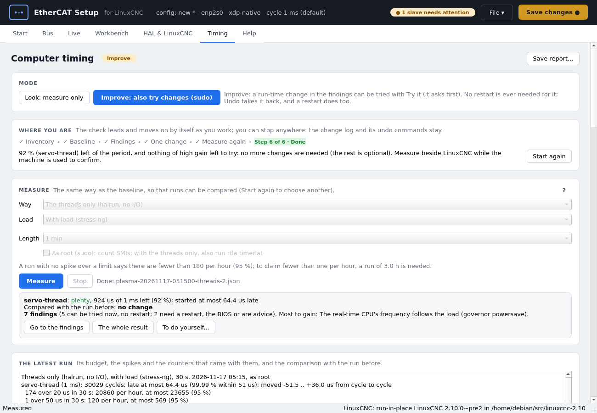

**What it needs.** A PREEMPT_RT kernel and LinuxCNC (2.9 or 2.10); ecat's
EtherCAT component is not needed. The package recommends two programs that
apt installs with it; when one is missing the check says so:

- `stress-ng` for *Load: With load* (`sudo apt install stress-ng`);
- `ethtool` to read the network cards' interrupt coalescing (`rx-usecs`) and
  Energy Efficient Ethernet (`sudo apt install ethtool`).

Optional: `rtla` (package `rtla`) for *As root*, and sudo without a password
for *Try it* (otherwise the window shows the commands for a terminal).

**Choose the machine's INI file**, even when LinuxCNC is not running (File >
Machine INI file..., or `--ini`). The check learns the threads, the servo
period, the I/O (Mesa Ethernet, EtherCAT, a parallel port) and the I/O's
network card from it and its HAL files. Without it the rules about that card
(its interrupt, coalescing, EEE, the LAN on the same card) cannot look at it,
and a quiet list then says nothing about the card. The card is found from
ethercat.yaml's `master: interface`, or for `hm2_eth` from the card whose
address range holds `board_ip`: the computer's line *The I/O's network card*
shows which.

1. **The computer.** Read when the tab is first shown, and summed up in one
   line at the bottom of the page (*The computer*); *Show all* lists every
   fact: the kernel, isolated CPUs, frequency, idle states, where every
   interrupt goes, the network cards, the graphics, the BIOS, the INI's
   threads and the I/O. Hover over a value to see where it was read. *Read
   again* after a change made elsewhere.
2. **Baseline: measure twice the same way.** *Way*: beside LinuxCNC while it
   runs (offered first then: run the machine as usual meanwhile; nothing that
   talks to your I/O card is loaded), or the INI's threads alone in halrun.
   *Load*: as the computer is used, at rest, or with `stress-ng` (the package
   recommends it; when it is missing the page says so under *Load* and
   *Measure* does not start: `sudo apt install stress-ng`). *Length*:
   the line under it says what a run of that length can show ("no spike in
   15 min means fewer than 12 per hour"). *As root* counts SMIs and runs
   `rtla timerlat` (only when sudo needs no password; otherwise use the
   command line). The two runs show how much the numbers move by chance: a
   later change counts as better or worse only by more than that. From then
   on the way, load and length stay the baseline's (*Start again* to change
   them).
3. **Findings**, most to gain first, each with what was seen, why it
   matters, what to do, the risk and cost, how to check it, how to undo it,
   where the knowledge comes from and whether we have seen it on our own
   computers. A late cycle that came with a counter no rule knows is listed
   as such. What the rules look at is listed below ([What the check looks
   at](#what-the-check-looks-at)).
4. **One change.** The page has two modes, chosen at the top: *Look*
   measures and changes nothing; *Improve* also lets you try changes (it
   asks first). In Improve, press *Try it* on a run-time change (in Look
   mode the button is there but greyed out). It shows the command and asks
   again; a run-time change never needs a restart, *Undo it* takes it back at
   once, and a restart takes it back too. The change then stays at the top
   of the findings as *Being tried*, with *Undo it* and *Keep it* beside it: its commands run as root with sudo and the change is
   logged. If sudo needs a password, the window shows the commands for a
   terminal and you press *I ran it* when done. Kernel parameters, the BIOS
   and advice are for you to do (a restart).
5. **Measure again**, the same way. *The latest run* says better, worse or
   no change against the run before, with the noise taken into account.
   Then *Keep the change* or *Undo the change*.
6. Back to the findings, until the check says no more changes are needed (at
   least half the period left and nothing of high gain), or nothing is left
   that it can change at run time.
7. **To do yourself.** A kept change lasts until the next restart:
   EtherCAT Setup changes nothing that lasts. *To do yourself: the lasting
   changes...* (top of *Findings*) shows a list to save or copy, made from
   the changes you kept and the findings not yet done, in the forms that
   last, one group per edit: the kernel parameters as one new
   `GRUB_CMDLINE_LINUX_DEFAULT` line (your present line from
   `/etc/default/grub` with them put in; one of the same name, such as
   `isolcpus=3`, is replaced), with the backup, `update-grub` and what to
   do if the computer does not start; sysctl settings
   (`/etc/sysctl.d/90-ecatsetup-rt.conf`); kernel module options
   (`/etc/modprobe.d/ecatsetup-rt.conf`); the run-time commands that have no
   other lasting form as a start-up service (`ecatsetup-rt.service`, the
   whole unit file written out); commands to run once (`systemctl disable
   irqbalance`); files (NetworkManager leaving the I/O card alone); other
   commands; the BIOS and advice. Each group says how to take it back. A
   finding not tried yet is marked so: try it first. Make one group at a
   time and measure again. `ecatsetup --rt-todo [FILE]` writes the same.

*History: changes made to this computer* lists every change already made
(from the window or the command line) with its state: tried, kept or
undone (taken back); the changes still to try are the findings; *Undo the
selected change* takes one back. Everything is in
`~/.local/state/ecatsetup/rt-changes.yaml`, and `rt-undo.sh` beside it has
the undo commands of what is still in force, newest first, to read and run
(`sudo sh ~/.local/state/ecatsetup/rt-undo.sh`). Run-time changes are gone
after a restart anyway. *Save report...* writes one file with the computer,
every run, the changes and their measurements, the findings and what was
done in order: what to send when asking for help with timing.

### What the check looks at

Each finding comes from a rule in a catalogue shipped with the package
(`ecatsetup/rtrules/*.yaml`, one file per area; a rule with the same `id`
in `~/.config/ecatsetup/rtrules/` replaces the shipped one). A rule speaks only
on its evidence: what the computer is, or what came with the late cycles.

| Area | What it looks at |
|---|---|
| Kernel | PREEMPT_RT, a virtual machine; isolated CPUs (`isolcpus`): none, one isolated but used by no real-time thread and not sharing its core (`isolcpus=1,2,3` with the threads on 3 and 1 its sibling: `isolcpus=1,3` frees CPU 2 for the rest), the `managed_irq` flag; `irqaffinity`, irqbalance; `nohz_full`, `rcu_nocbs`; memory statistics, timer migration, transparent huge pages; signals between CPUs (RES, CAL, TLB, IWI) that came with late cycles |
| Processor | hyperthread sibling not isolated, deep idle states, frequency governor, turbo, heat throttling, battery, SMIs (as root) |
| Devices | interrupts on the real-time CPU (USB, wireless, any other), ACPI GPE storms, Intel graphics power states, sound card and NVMe power saving, PCIe ASPM |
| Network | the I/O card's interrupt on the real-time CPU (EtherCAT: `master: irq-cpu`; Mesa: moved at run time), coalescing (`rx-usecs`) on a Mesa card, EEE on the I/O card, the I/O card also carrying the LAN, NetworkManager on the Mesa card, Realtek r8169 with Mesa, ethtool missing |
| LinuxCNC | too little of the period left, a HAL function taking much of it, a tight base thread, measured without load |

The same from a terminal: `ecatsetup --rt-check <machine>.ini --improve`
measures twice, then offers the run-time changes one at a time, measures
again and asks whether to keep each ([Command line](#command-line)).

Tried 2026-11-17: on our N100 (threads only at 1 ms under `stress-ng`:
turbo off by `--improve`, measured again, no change beyond the noise,
undone); on turner, one kernel parameter at a time taken away and found
again; and by a user alone on a Mesa Ethernet computer with LinuxCNC 2.9.4,
from the window only. That test gave the stress-ng and ethtool messages and
the rules for unused isolated CPUs and the Mesa card's interrupt.

## Event log and report

When something unexpected happens in LinuxCNC, the cause has often passed
by the time anyone looks. The `ecat` component therefore keeps a flight
recorder: an event log of the bus, written while LinuxCNC runs and kept
after it stops. EtherCAT Setup shows it and puts it, with everything else
needed, into one report file to attach when asking for help.

### The event log

The component records, with the time to the millisecond:

| Event | |
|---|---|
| ecat loaded, master activated, ecat unloading | The run's start, the start of cyclic operation (with the servo period), and the end. |
| link up, link DOWN | The network card's link. |
| slaves' states | All slaves' AL states together (INIT, PREOP, SAFEOP, OP), when they change. |
| slaves respond | How many slaves answer, when it changes. |
| working counter | complete, incomplete or zero: whether every slave exchanged its process data. Recorded at the cycle it changes. |
| slave N: state | A slave's AL state, `+ ERROR` when it reports an error (its AL status code is in the diagnosis). |
| slave N online / offline / operational | |
| DC sync check | The master's check that a slave's clock is within 10 us before SYNC0 starts. |
| drive fault | A CiA 402 drive's fault, with its error code (`0x603F`) as text. |
| the profile shut the drive down | The cia402 profile's `fault-reason` (watchdog, enable timeout, no valid process data, ...), see [cia402](component.md#the-cia402-profile). |
| stop guard | The servo thread stopped: the guard takes the slaves to PREOP, and says whether they got there (or it gave up, with the states they were left in); or the servo thread runs again. |
| servo thread late | The guard sent a cycle for a servo thread more than a quarter period late (at most one line a second, with the number left out). |
| SYNC0 shift | `sync0-shift-ns: auto` chose a shift, with the turn-around in cycles. |
| master: ... | The master's own messages (its log, up to level info), such as "EtherCAT WARNING 0-2: Slave seems not to support distributed clocks!" or an SDO abort while it configures a slave. Shown between the events at their time; one repeated right after itself is shown once, with the count. |

Slave states are read once a second, as for the component's state pins;
the working counter, drive faults and the guard every cycle.

The log holds the last 4096 events and the master's last 512 messages in
`/dev/shm/ecat-events`; the run before is kept as
`/dev/shm/ecat-events.prev`. Both are gone after the computer restarts.
Writing an event costs a few memory stores in the servo thread. The
master's messages from before the log opens (the bus scan at the start)
are not in it. A log written by an older `ecat` (before 0.16) has no
messages of the master; it is still read.

The master's messages also go to `ecat`'s output, as before: the terminal
of `halrun`, the I/O test's `halrun.log`, or LinuxCNC's print file (stdout;
the master's own default before was stderr).

After a cable break the master reads the whole bus again and every slave is
offline for a while, and the working counter shows zero or incomplete while the
slaves climb back to OP. The log shows these as information (with the reason),
not as errors, when the events before them explain them: a slave beyond the
number that respond is still reported offline.

To see it:

- in the window: the *Troubleshoot* page, *Event log*, newest first,
  refreshed every 2 s; *This run* or *The run before*, and *Only this
  slave*;
- on the command line: `ecatsetup --events` (this or the last run),
  `ecatsetup --events prev`; `ecatsetup --diagnose` shows each slave's
  messages from the master (from the latest run that has any) and ends with
  the last 20 events;
- in a terminal: `scripts/ecat-events-follow`, events and the master's
  messages as they come.

### What the event log means

When the log shows a known problem, the *Event log* card starts with a box
*What this means*: what the events mean in plain words and the problem's
usual causes, each judged against this computer:

| Mark | |
|---|---|
| likely | This computer has it (the IgH kernel master loaded, EEE on the EtherCAT card). What to do is under it. |
| possible | A known risk is there (a Realtek card), not proof. |
| not checked | Nothing here tells; under it, how to find out (the Timing tab, *Examine all*). |
| ruled out | Checked, and it is not that. |

The likely causes come first. The judgement uses the event log of the run
shown, the EtherCAT masters on the computer, the computer as the
[real-time check](#the-computers-timing) reads it, the network card of
`master.interface` and, after *Examine all*, the slaves' port error
counters. It changes nothing. The same text is at the top of the
[report](#the-report) and after `ecatsetup --events`.

The first problem it knows (2026-11-18), from a user whose drives would not
stay enabled after moving from the IgH kernel master to the userspace one:

**Frames were lost or came back too late**: working counter zero while
running (not while the slaves come up), or the master's *skipped*,
*unmatched* or *timed-out* datagrams. In such a cycle no process data is
exchanged and ecat shuts every drive down (`fault-reason` 2): a drive
reaches "Operation enabled" and falls back at once. Late frames are mostly
timing or a second user of the card, seldom the cable. The causes looked
at: the IgH kernel master loaded (or enabled for the next boot), the servo
thread late (ecat's *servo thread late* events, a turn-around of 3 cycles),
no PREEMPT_RT kernel, no isolated CPU, EEE on the card, the card also
carrying the LAN, the card's interrupt not on the real-time CPU (while
LinuxCNC runs), a Realtek card (`r8169`), and a cable or a slave's power
(link down, slaves offline, port error counters).

The problems are data, `ecatsetup/explain/*.yaml` (the format is at the top
of `ecatsetup/explain.py`), with the real-time check's safe expressions.
A file of your own in `~/.config/ecatsetup/explain/` replaces a shipped
problem of the same `id`. Each problem and each cause carries its own tests.

### The report

*Save report...* on the *Troubleshoot* page, or

```
ecatsetup --report [FILE] --ini <machine>.ini
```

writes one Markdown file (`ethercat-report-<date>-<time>.md`) with:

- first, when this run's event log shows a known problem, [what it
  means](#what-the-event-log-means) and its causes judged on this computer;
- versions: the packages (`linuxcnc-ecat`, `linuxcnc-ethercat-uspace`,
  LinuxCNC), the kernel (and whether it is PREEMPT_RT), the system, and
  where EtherCAT Setup runs from (a run-in-place archive's version from its
  `BUILD-INFO`, a checkout's `git describe`);
- `ethercat.yaml` (from `[ETHERCAT]CONFIG`, or `--check FILE`), its check,
  the network card's driver, whether it can do `xdp-native`, and the
  transport the file asks for;
- the INI lines that matter: `SERVO_PERIOD`, `[ETHERCAT]`, `[HAL]` files,
  `[KINS]`, `[TRAJ]` units and velocity, each joint's limits, following
  error, scale and homing;
- `ethercat-load.hal` and `ethercat.hal`;
- the EtherCAT masters on the computer: the IgH kernel master (its device
  `/dev/EtherCAT0`, `ec_*` modules, `ethercat.service` enabled/active, with
  a warning when it is loaded: it must not share the card with the
  userspace master), free userspace masters with their command lines, and
  whether LinuxCNC and `rtapi_app` run; and the running master's own
  status (`ethercat-uspace master`: link, frames, lost frames);
- the computer as the [real-time check](#the-computers-timing) reads it (kernel command
  line, CPUs and isolation, governor, network cards with driver, EEE and
  coalescing, the I/O card, the threads' CPUs), each line with its source;
- a diagnosis of every slave, if a master can be reached (LinuxCNC with
  `ecat` running, or `sudo ethercat-uspace start`): states, error
  counters, the slaves' messages, CiA 402 state;
- both event logs.

It only reads, and sends nothing anywhere. Disk UUIDs on the kernel
command line (`root=`, `resume=`, ...) are left out, MAC addresses are
replaced by the card's name, and the home folder is written `~`. It still
holds file paths and the machine's configuration: look it through before
posting it.

### A capture of the bus

When a device does not work and the developer does not have one, a
capture gives them the device as the program sees it. *Save capture...* on
the *Slave status* page, beside *Save report...*, or

```
ecatsetup --capture [FILE] --esi <ESI folder> [--ini <machine>.ini]
```

writes `ecat-capture-<date>-<time>.tar.gz`. The window uses its ESI
folders, configuration and INI file, shows the progress in the status bar
and what the file holds when it is done. To have the frames of a bus in
OP, save the capture while the I/O test runs (or LinuxCNC). A master must be running
(`sudo ethercat-uspace start`, or LinuxCNC with `ecat`; it is offered when
none answers). It reads, and keeps with their answers:

- the slave list, the master, the topology, the configuration and domains
  the master holds;
- for each slave: its identity and state, the SII, the CoE dictionary
  with the value of every entry it answers for in its present state
  (`--no-values` leaves them out), the PDO assignment, the ESC registers
  0x0000-0x0FFF, and what a proposal reads;
- the report (as `--report`, with the configuration and INI lines if
  given);
- the ESI description of each slave from the ESI folders given, only that
  device, not the vendor's whole file;
- a few seconds of the EtherCAT frames on the wire (`--frames-seconds`,
  default 3; 0 for none), if `tcpdump` is installed and can run as root
  (`sudo` without a password, or run the capture with `sudo`). A master
  using `xdp-native` hides its frames from tcpdump.

Reading takes time: about 20 s for a drive with 270 objects. Nothing is
written to the slaves. `ecatsetup --capture-info FILE` shows what a capture
holds.

With `--from-capture FILE` the program reads the bus from a capture instead
of the master: the proposal, `--diagnose`, `--check` and `--gui` work
without the devices, with the capture's ESI files added. Anything that
writes (SDO downloads, test mode) cannot be answered from a capture and
fails.

For the component's C tests, `ecatsetup --capture-c FILE --c-name NAME`
prints a header with the captured slaves as fakes: their process data
layout and, from frames of a bus in OP, each cycle's values ([Developing
ecat](development.md#build-and-test)).

### Tried (event log and report)

Capture on the plasma cutter's bus (2026-11-14, free-running master,
PREOP, ESI folder given, no tcpdump): 4 slaves, 1029 tool calls in 73 s,
42 kB; 21 of each ECT60's 271 readable objects refused an upload. Read back
with `--from-capture`, the proposal, `--diagnose` and `--check` gave what
they give against the bus; the window (offscreen) read the four slaves
from it. Frames, with tcpdump installed and the master on `raw`: 497 frames
sent and 497 back in 3 s from the idle master, 76 kB. In OP (ecat in
halrun with the plasma cutter's configuration on `raw`, drives not
enabled): 1029 calls, 1.2 MB of frames in 3 s, decoded into each slave's
process data per cycle. *Save capture...* in the window (offscreen, the
same bus in OP under halrun): 88 s, the progress slave by slave, the same
contents and frames. Not tried: a master on `xdp-native`.

On the plasma cutter (2026-11-10, halrun with the servo thread, no
motion): the log showed the load, the activation 4 s later, the four
slaves from PREOP to OP within a second, the working counter coming up,
and at the stop the late servo thread, the guard taking over and its
done 55 ms later.

*Save report* in the window (2026-11-10, the plasma cutter's configuration and
INI, the dialog answered by a script): with LinuxCNC running it wrote the report in
6.6 s, with versions, the configuration, the INI lines, the bus diagnosis of all
four slaves (states, ports, CiA 402 state) and the event logs of this run and the
one before; with LinuxCNC closed, in 0.5 s, saying that no master could be
reached and what to start, and with the closing run's stop guard in the log. The
file name is proposed next to the INI file, and nothing is written there unless
the dialog is accepted. Its paths show the user's home folder name; look
the report through before posting it.

### Measured SYNC0 cycles

A slave's page says, under the Sync row, what SYNC0 cycle it gets (the servo
period times the cycle factor) and what was measured on this kind of device:
for example "250 us ok, 200 us ok, ..., 100 us refused (AL 0x0036); measured
2026-11-16". A servo period at or below one that was refused is a warning
(also in the check list); one between the periods that were tried is a note;
at or above the shortest that worked, nothing. This is separate from what the
slave says about itself (ESI, SII, CoE 0x1C32/0x1C33), which the same page
also shows: the ECT60's ESI gives no minimum cycle and its CoE object reads
nonsense, so for it the measurements are the only thing there is. See
[Synchronisation, in the test mode](#synchronisation-in-the-test-mode) for how
they are recorded.

A result is kept with the slave's revision (the number in its identity), and the
slave page says when it was measured on another one ("some on revision
0x00000202, this one is 0x00000300: check it again"): a new revision may
behave differently, and a result without a revision says nothing either way.

`ecatsetup --device-data` lists what device data there is, yours and what came
with the program (quirk files and measured results), and what to look at: a
file that cannot be read, a result more than a year old or without a date, a
result of yours that contradicts a shipped one for the same period (yours is
used), a quirk file of yours that replaces a shipped one for the same device
(what only the shipped file says is then not used), results that do not say
which revision they are for.

## Quirk files

A quirk file tells EtherCAT Setup what it cannot read from a device's ESI
file, SII or object dictionary: better pin names, a scale, an object that
is a command and not a setting, where a drive keeps a limit, HAL lines a
device needs, and how lcec's settings for it translate. ecat has no
product drivers; a device that needs something special gets a quirk file
instead, which anyone can write without a new release.

Quirks act only through what EtherCAT Setup writes (`ethercat.yaml`,
`ethercat.hal`) or does in its test mode. The `ecat` component never reads
them, so the written files say everything that happens.

### Where they are

| Folder | |
|---|---|
| `~/.config/ecatsetup/devices/*.yaml` (or `$ECATSETUP_DEVICES`) | Your own. A file here for a vendor and product replaces the one that comes with the program. |
| `ecatsetup/devices/*.yaml` in the program | Those that come with EtherCAT Setup: `rtelligent-ect60.yaml`, `beckhoff-el7041.yaml`, `beckhoff-el70x1-position.yaml`, `metalmusings-easercat-7000.yaml`. |

*Save as quirk file...* on a slave's page writes one from a slave as you
have configured it: its identity, the pin names, HAL types, scales and
offsets of its process data, and its settings. It is saved as
`<vendor>-<product>.yaml` in your folder, and the next slave of that
device (vendor and product) is proposed with them. Add the rest
(`commands`, `limits`, `hal`) by hand if the device needs them.

A file that cannot be read is skipped, with a warning in the window and
from `ecatsetup --check`. To share one, post it or propose it for the
program, with where each fact comes from (a manual, a test on a machine).

### Format

```yaml
name: Beckhoff EL7041
match: {vendor: '0x00000002', product: '0x1B813052'}

pins:                      # when the slave is proposed
  '0x7010:21': {pin: velocity, hal-type: real, scale: 32767}
  '0x6000:00': {split: [in-1, in-2, in-3, null, in-5]}   # one pin per bit

settings:                  # added to the slave when it is proposed
- {object: '0x8010:01', name: Maximal current, type: UINT, value: 1500}

commands:                  # objects that are commands, not settings
  '0x2010': Zero Position, a command
  '0x1010:01':             # the longer form tells "Run command" what to write
    note: Store parameters
    value: 1702257011      # "save" as ASCII
    type: uint32
    confirm: Keeps every setting through a power cycle

limits:                    # where the drive test finds a limit
  following-error: {object: '0x2022:00', type: uint32}
  travel: why the drive's own object is not used

tuning:                    # settings the Response card's search shows first
  '0x2009:00': {kind: command-filter, type: UINT, unit: us, min: 0, max: 25600, factory: 6400,
                note: what it does, tried: what it gave on a machine}
  '0x2023:04': {kind: feedforward, type: UINT, when: {object: '0x2011:00', values: [1]}}

measure:
  ignore: {'0x6077': why the response measurement does not record it}

hal:                       # HAL lines for each matching slave
  load: {edge: ['{name}-enable-edge']}
  addf: ['{name}-enable-edge']
  lines:
  - net {signal:0x7010:01} => {name}-enable-edge.in

lcec:                      # importing lcec XML files
  types: [EL7041, EP7041]
  modparams:
    maxCurrent: {object: '0x8010:01', type: UINT, convert: milli}
    maxSpeed: {object: '0x8012:05', type: UINT, values: {1000: 0, 2000: 1}}
  settings:                # always added for these lcec types
  - {object: '0x8012:01', type: USINT, value: 3, note: why}
  sdo:                     # sdoConfig entries replaced
    '0x2010:00': {replace: cia402.zero-at-start, note: why}
```

Every key but `name` is optional. A file with only `lcec` (no `match`)
serves the import alone.

| Key | |
|---|---|
| `match` | `vendor` and `product` of the device. |
| `pins` | Per object: `pin` (its name), and optionally `hal-type`, `scale`, `offset`, as in [file format](component.md#the-configuration-file); or `split`, a list of bit pin names from bit 0 (`null` for a bit without a pin) for an object that holds several bits. Used when EtherCAT Setup proposes the slave; the file then holds them like any other pin. *Save as quirk file* keeps bit pins too. |
| `settings` | Settings (SDOs written at every start) the slave gets when it is proposed: `object`, `type`, `value`, and optionally `name`, as in [file format](component.md#the-configuration-file). |
| `commands` | Per object index: why it is a command. The test mode does not write it. |
| `tuning` | Per object: `kind` (`command-filter`, `position-loop`, `feedforward`, `torque`, `gain-high`, `other`) and `type`, and optionally `unit`, `min`, `max`, `factory`, `note`, `tried` (what it gave on a machine), and `when` (`object` and `values`: it is used only in that mode of the drive). Shown by *Look for settings in the drive* ([Measuring a drive's response](#measuring-a-drives-response)). |
| `measure` | `ignore`: per object index, why the response measurement does not record it (a drive's object that does not mean what the standard says). |
| `limits` | For the drive test: `following-error`, `max-torque`, `max-velocity` as `object` and `type` (the ethercat tool's: `uint32` ...), or `travel` and the others as a text saying why the drive's own object is not used. |
| `hal` | `load`: per HAL component, its instances (one `loadrt ... names=` for all slaves); `addf`: functions, added to the servo thread between `ecat.read-all` and `ecat.write-all`; `lines`: HAL lines. |
| `lcec.types` | lcec type names (`type=` in the XML) that `modparams` and `settings` apply to. |
| `lcec.modparams` | Per lcec `modParam`: the `object` and `type` of the setting, and `convert` (`milli`: ×1000, `flag`: 0/1, else a number as it is) or `values` (a table). |
| `lcec.settings` | Settings always added for those types (what the lcec driver always wrote). |
| `lcec.sdo` | An lcec `sdoConfig` that ecat does differently: `replace` with `cia402.zero-at-start` (when the slave gets the cia402 profile). |

#### HAL lines

In `hal`, these are filled in for each slave:

| | |
|---|---|
| `{name}` | The slave's name (its pin prefix). |
| `{pin:0x7010:02}` | The pin of that object. It must be free: if your HAL files connect it, the lines are left out. |
| `{signal:0x7010:01}` | The signal that object's pin is on, in your HAL files or `ethercat.hal`. For an output of the slave (an input pin in HAL, such as `enable`), something must drive it, or the lines are left out. For an input of the slave, a signal is made if there is none. |

The lines are written into `ethercat.hal` under a comment naming the
quirk file. They are left out, with a note in the plan, when an object
has no pin in the configuration, when a placeholder cannot be filled, or
when your HAL files load the same component (HAL loads a component only
once: add the instance names there and connect them by hand).

#### Homing

```yaml
homing:
  methods: [17, 18, 35, 36]          # the CiA 402 homing methods (0x6098) the drive supports
  describe:                          # the drive's own text for a method (default: the standard's)
    36: {text: "Torque homing ...", needs: [mechanical stop], moves: true}
  extras:                            # settings the drive needs besides 0x6098, 0x6099, 0x609A, 0x607C
    36:
      - {object: '0x2030:01', type: UINT, value: 70, name: Max torque output}
```

Without `methods`, EtherCAT Setup reads the drive's 0x60E3 (supported homing
methods); if the drive has neither, every method of the standard is offered.
The ECT60 has no 0x60E3 (read from a drive, 2026-11-10), so its file lists
the methods from the manual. The extras are for the axis of the slave's
first axis; for later axes their indexes move by 0x800 as the other objects do.

### The files that come with the program

- `rtelligent-ect60.yaml`: `0x2010` is a command (Zero Position); the
  drive test's following error is `0x2022`; the ECT60 ignores `0x607D` in
  CSP; lcec's `0x2010` sdoConfig becomes `cia402.zero-at-start`; its
  tuning settings (`0x2009` the command filter, `0x2023` servo mode 1,
  `0x2026` FOC); its `0x6077` is not recorded (it does not report torque).
- `beckhoff-el7041.yaml`: pin names and the velocity scale; HAL lines
  that reset an error when `enable` comes on again (as lcec's driver did);
  lcec's modParams. See [stepper terminals](component.md#stepper-and-dc-motor-terminals).
- `beckhoff-el70x1-position.yaml`: lcec's el70x1 modParams and the
  position interface it always set.
- `metalmusings-easercat-7000.yaml`: the bit pins of the THC and I/O device
  (`in-1`..`in-12`, `out-1`, `out-2`, `activate-relay`, `out-4`, the ohmic
  sensing flags). Which terminal is wired to what is the machine's: see
  the comments in the file for the plasma cutter it ran on.

## Command line

Everything the window does with a file is done by the same functions from
the command line, which suits scripts. Installed from the package the
command is `ecatsetup`; from a checkout, `python3 -m ecatsetup`. Reading
the bus needs a running master.

```
ecatsetup --esi <ESI folder> --ini <machine>.ini --compare ethercat-conf.xml
ecatsetup --ini <machine>.ini --write ethercat.yaml [--interface enp2s0]
ecatsetup --esi <ESI folder> --pdo-set "3=Standard 32 Bit (MDP 511)" --write ethercat.yaml
ecatsetup --import ethercat-conf.xml --ini <machine>.ini --write ethercat.yaml
ecatsetup --ini <machine>.ini --update ethercat.yaml
ecatsetup --check ethercat.yaml
ecatsetup --diagnose
ecatsetup --check-hal <machine>.ini
ecatsetup --events [prev]
ecatsetup --report --ini <machine>.ini
ecatsetup --capture --esi <ESI folder>
ecatsetup --response ~/.local/state/ecatsetup/responses/<file>.samples [--ini <machine>.ini]
ecatsetup --from-capture ecat-capture-<time>.tar.gz --diagnose
ecatsetup --rt-check <machine>.ini [--rt-seconds 900] [--rt-load stress] [--rt-twice] [--rt-root]
ecatsetup --rt-check <machine>.ini --improve [--rt-report report.md]
ecatsetup --rt-todo [todo.md]
ecatsetup --from-run ~/.local/state/ecatsetup/rt-runs/<file>.json
ecatsetup --apply ethercat.yaml --ini <machine>.ini
ecatsetup --gui ethercat.yaml --ini <machine>.ini --esi <ESI folder>
```

- Without options, the bus is read and the proposals are reported;
  `--compare` compares them with an lcec XML file. With ESI files, a
  slave gets the ESI's predefined PDO assignment that the ESI marks as
  default (TwinCAT's "Predefined PDO Assignment"), or the one named with
  `--pdo-set`. Unsigned 32-bit counters, latches and positions get `sint`
  pins, since they count down past 0. Input counters of 16 and 32 bits get
  `extend: true`, so that the pin goes on counting past the wrap of the entry
  (64 bits); a note says so. The digital outputs (`0x60FE`) get `raw: true`.
- `--write` writes the proposals as an ecat configuration file;
  `--import` converts an lcec XML file; `--check` checks a file and
  compares the bus with it.
- `--update` brings a file up to date with the bus and keeps what is in
  it: slaves still on the bus keep their entries (names, pins, settings,
  mapping), slaves moved by others put in or taken out before them keep
  theirs at the new position, new slaves get proposals, missing ones are
  left out, and each change is reported. The old file is kept as `.bak`.
- `--diagnose` reports, per slave, why it is not in OP (the AL status
  code in plain words, with what usually lies behind it), its links and
  the error counters that grow while it watches (`--seconds`, pointing at
  a cable or connector), the slave's own diagnosis history and error
  register, and for a CiA 402 drive its state, error code and what is
  missing to reach "Operation enabled".
- `--events` shows the event log, and `--report` writes one file to
  attach when asking for help ([Event log and report](#event-log-and-report)).
  `--capture` records the bus for a developer who does not have the
  devices, and `--from-capture` reads the bus from such a file
  ([A capture of the bus](#a-capture-of-the-bus)).
- `--response` analyses a recording of the Response card again
  ([Measuring a drive's response](#measuring-a-drives-response)).
- `--rt-check` is the first part of the real-time check: it changes
  nothing and needs no sudo. It lists what the computer is (kernel and
  PREEMPT_RT, isolated CPUs, frequency governor and turbo, idle states,
  where every interrupt goes, network cards with their coalescing, EEE and
  ASPM, graphics driver, BIOS, virtual machine or not, the INI's threads and
  I/O, the CPU LinuxCNC's threads run on), each fact with where it was
  read. Then it measures how evenly the real-time threads start, every
  cycle: with LinuxCNC running, beside it (a function of ecat's own small
  HAL module `ecat_rtprobe` put first into each thread and taken out again at
  the end; it only notes the time of each run, talks to nothing, and works
  beside a configuration's own `sampler` or `timedelta`); otherwise in `halrun` with the INI's threads alone
  (`--rt-way threads|attach|inventory` chooses). It prints how late the
  threads started (the largest, and what 99.99 % of the cycles stay within),
  the cycles over 20, 50 and 100 us with what the length of the run can say
  ("none in 15 min: fewer than 12 per hour"), and the period's budget: what
  is left of the period after the lateness and the thread's longest run, and
  how much of that run is the I/O driver's. Beside it, counters of the
  real-time CPU are read every 10 ms (interrupts, softirqs, idle states,
  frequency, heat, ACPI events), and each late cycle is compared with them:
  "11 of 12 spikes came with the SMI count growing (by chance 3 %)". With
  `--rt-root` (sudo asks once) it also counts SMIs and, with the threads
  only, runs `rtla timerlat` (package `rtla`), whose own analysis of the
  first wake-up over 50 us is shown. `rtla` is never run beside LinuxCNC:
  switching the kernel's tracing on and off at its start and end delays the
  real-time threads, once enough for LinuxCNC's "Unexpected realtime delay". Then the **findings**: what the rule catalogue makes of the
  inventory and the run, most to gain first, each with what was seen, why it
  matters, what to do (the commands, or the kernel parameter), its risk and
  cost, how to check it worked, how to undo it, where the knowledge comes
  from, and whether we have seen it on our own computers. Nothing is changed:
  the commands are for you to run (as root), one at a time, measuring again
  after each. A late cycle that no rule explains is reported as such, with
  the counter that came with it. `--rt-load stress` runs `stress-ng`
  meanwhile; `--rt-twice` measures twice and says how much the numbers
  move by chance, so that a later change is judged against that. Every run
  is saved in `~/.local/state/ecatsetup/rt-runs/`; `--from-run` shows one
  again. `--improve` goes on as the *Timing* tab does
  ([The computer's timing](#the-computers-timing)): two runs, then the
  run-time changes of the findings one at a time with sudo, each measured
  again and kept or undone; `--rt-report` writes the report at the end.
  `--rt-todo [FILE]` writes the lasting changes for you to make (kernel
  parameters, sysctl, a start-up service, the BIOS), from what was kept and
  found so far ([The computer's timing](#the-computers-timing), step 7).
  The rules are data, in `ecatsetup/rtrules/*.yaml`;
  your own go in `~/.config/ecatsetup/rtrules/` (a rule with the same `id`
  replaces the shipped one; the format is at the top of `rtrules.py`).
- Other options: `--mode` chooses the mode proposed for CiA 402 drives,
  `-p` limits the proposal to some slaves, `--json` prints it as JSON,
  `--transport` and `--interface` set the master's for `--write`.
- `--apply` writes into a LinuxCNC configuration, and `--check-hal` checks
  its HAL files against the file ([Writing the configuration into
  LinuxCNC](#writing-the-configuration-into-linuxcnc)); `--net PIN=PIN`
  connects I/O pins, `--take-over-io` reads the connections your HAL
  files already make, `--yes` does not ask, and `--overwrite-edited`
  replaces files edited by hand. `ecatsetup --help` lists them all.
